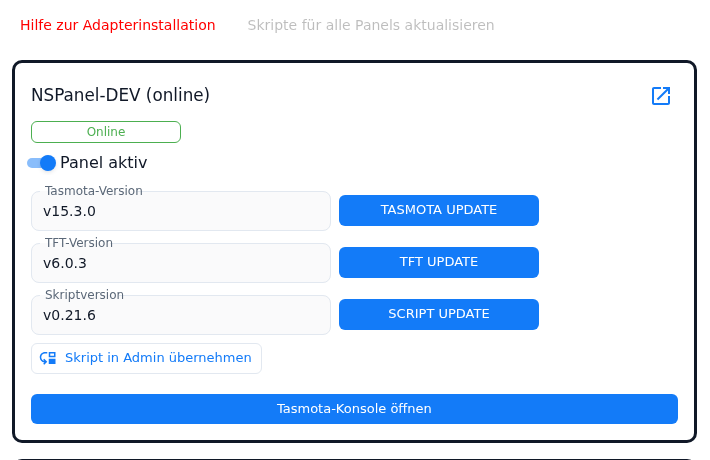
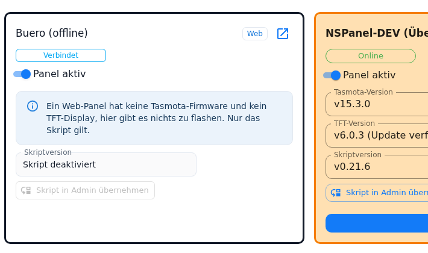

# Maintain

The first tab of the instance settings: for every panel of the table it shows a **card** with the connection state, the **Tasmota version**, the **TFT firmware** and the **script version**, detects differences and triggers the updates. This is also where the **Panel active** switch sits and the **Take script over into admin** button, with which an existing script configuration moves into the admin.

Contents:
- [The tab at a glance](#1-the-tab-at-a-glance)
- [The card of a panel](#2-the-card-of-a-panel)
- [Updating Tasmota and TFT](#3-updating-tasmota-and-tft)
- [Script version and SCRIPT UPDATE](#4-script-version-and-script-update)
- [Panels without a script](#5-panels-without-a-script)
- [Web panels in the tab](#6-web-panels-in-the-tab)
- [Taking the script over into the admin](#7-taking-the-script-over-into-the-admin)
- [When a button stays grey](#8-when-a-button-stays-grey)
- [What the version fields say](#9-what-the-version-fields-say)
- [Pitfalls](#pitfalls)

## 1. The tab at a glance

The tab only appears once the MQTT settings are complete — own server or broker IP, port and credentials (user and password, or alternatively the central credential ID with a foreign broker) — and **at least one panel** is in the table under [NSPanelsetting](NSPanelsetting). If any of that is missing, the tab is not visible.

Above the cards sit:

| Element | Effect |
|---|---|
| **Help for adapter installation** (red text button) | Opens the wiki page [adapter installation](Adapter-Installation) in a new tab. |
| **Update scripts for all panels** | The same as *SCRIPT UPDATE*, but for every panel whose script version differs from the shipped template. Panels with the **Panel uses no script** checkbox are left out. The button is orange while there is something to do, and grey when nothing is pending, the instance is not running or another operation is in progress. |
| Note **Beta version in use** | Appears while *beta firmware* is switched on in the [Global Settings](globelSettings). |
| Red error line | A message of the adapter about the last operation; it can be closed. |

The tab fetches the data from the adapter when it opens, on every return to the browser tab, after every action and about five seconds after a change of the online state of a panel. **If the instance is not running**, there is no data: when opened, the tab stays empty and reports that the adapter is not running; if the instance dies while the tab is open, the cards turn grey and all controls are locked.

## 2. The card of a panel

The name is at the top, in brackets the short state: `online`, `offline`, `flashing`, while flashing the progress (`Update: 42%`) and **Check!** when something differs. Below it the status badge of the panel (the same states as in the panel overview, see [PanelStatusBadge](PanelStatusBadge) — here without an icon and without a tooltip).

The colour of the card tells whether something needs doing: **orange** means "there is a difference" (Tasmota update available, TFT update or downgrade, developer version `0.0.0`, newer script version), **yellow** means "currently flashing", **grey** means the instance is not running. With a difference the button that fixes it is additionally coloured a strong blue.

| Control | Effect |
|---|---|
| **Web** (label) | Only on a standalone web panel, see [section 6](#6-web-panels-in-the-tab). |
| Icon **Open web panel in a new tab** | Opens the panel in the browser; only visible when the web panels are switched on and the panel has a topic (see [WebPanel](WebPanel)). |
| **Panel active** | Switches the panel on or off in the adapter. Takes effect **immediately** — the switch writes the state `panels.<panel>.cmd.activated` and needs no saving. Off: the adapter tears the panel down, the status becomes **Deactivated**, `info.isOnline` becomes `false`, and a clone of the same panel open in a browser goes with it. On: the panel is built again without restarting the instance. The state survives an adapter restart. |
| **Open Tasmota console** | Opens the console of the Tasmota web interface in a new tab — with the IP **entered in the panel table**, not with the one reported by the panel. On a web panel the button is missing. |

A panel switched off is no longer known to the adapter: the card stays, but the version fields only show `---` or the placeholder (see [section 9](#9-what-the-version-fields-say)).

## 3. Updating Tasmota and TFT

Before both updates the admin asks for confirmation and mentions the roughly **40 seconds** in which the panel is unreachable.

| Button | What happens |
|---|---|
| **TASMOTA UPDATE** | The adapter reads the recommended Tasmota version from the version list and sends the panel the OTA command for `tasmota32-<LANGUAGE>.bin` from `ota.tasmota.com` over MQTT. The language is the one of the admin (Chinese falls back to English). The panel downloads it itself and restarts. With *beta firmware* switched on in the [Global Settings](globelSettings) the adapter takes the `tasmota-beta` entry of the version list — if it is missing, the stable version; the version field of the card then compares against the beta as well. |
| **TFT UPDATE** | The adapter determines the TFT file matching the hardware model (`nspanel[-model]-v<version>.tft`), taking *beta firmware* and a version pinned in the [Global Settings](globelSettings) into account, and sends the panel the flash command. The panel downloads the file **itself** from the TFT server (internet access needed) and restarts; that takes a few minutes. |

Both commands only go to panels the adapter is currently operating. The same tools — plus the Berry installation and the restart — are available in the [Tasmota tools](tasmotatools) tab, there via the IP instead of via the panel card. The version fields refresh by themselves as soon as the panel reports back.

## 4. Script version and SCRIPT UPDATE

The **Script version** field compares the version in the configuration script of the panel (`script.js.nspanel-lovelace-ui_<instance>.<panel name>`) with the version of the template the adapter ships. **SCRIPT UPDATE** creates the script or brings it up to that state — and refreshes the **global script** `globalPageConfig` in the same go.

> **What survives a script update**
>
> The panel script has a marker line reading `END STOP END STOP END - No more configuration - END STOP END STOP END`. **Everything below it is replaced, everything above it stays** — so your own additions only survive an update if they live **above** the marker. In the global script the line `stopScript(scriptName, undefined)` takes that role.
>
> ⚠️ Removing the marker from the script makes it un-updatable: the update stops with an error message and the script stays unchanged. If the marker is only missing from the global script, the error appears in the log alone — the panel script is written all the same.

Furthermore:

- The script name follows the **panel name**; characters other than `A–Z`, `a–z`, `0–9`, `_` and `-` become `_`. If a panel is renamed, the tab looks for the script under the **new** name — the old one stays where it is and is no longer checked.
- An existing script keeps its on/off state; after being written, the JavaScript adapter restarts it and it then sends its configuration.
- A new script gets the topic of the panel and the instance of the adapter inserted.
- For panels with the **Panel uses no script** checkbox the button does not exist (see [section 5](#5-panels-without-a-script)).

Anyone moving from the script to the admin does not need this button but the one from [section 7](#7-taking-the-script-over-into-the-admin).

## 5. Panels without a script

The **Panel uses no script** checkbox sits on the panel card under [NSPanelsetting](NSPanelsetting); a web panel also does without a script (see [WebPanel](WebPanel)). All consequences and the right order when moving over are under [Migration](Migration). **In the Maintain tab** the checkbox means:

- The **Script version** field reads *Script disabled*; no version is checked any more.
- The **SCRIPT UPDATE** button is not present — the row only has the field and the take-over button left.
- **Update scripts for all panels** leaves the panel out.
- **Take script over into admin** is grey; the tooltip names the reason. A call bypassing the adapter is rejected as well: first remove the checkbox, then take over, then set the checkbox again.

## 6. Web panels in the tab

A standalone web panel stands in the tab with a card of its own, labelled **Web**. It has no Tasmota firmware and no TFT display: the rows *Tasmota version* and *TFT version* and the button for the Tasmota console are missing, a blue note takes their place. What remains is the status badge, **Panel active**, the script row and the icon for opening it in the browser.

A **browser window of a real panel**, by contrast, gets no card of its own — it belongs to the card of its hardware panel.

## 7. Taking the script over into the admin

Every panel card has the **Take script over into admin** button in its script row. With it the configuration that the script of the panel sent to the adapter moves into the admin configuration: pages into the [PageConfig](PageConfig) tab, the screensaver into the [Screensaver](screensaver) tab, the hardware buttons onto the panel card under [NSPanelsetting](NSPanelsetting).

Which page types are taken over, what happens to the script source and how things continue afterwards is described in full under [Migration](Migration). This section is about the procedure in the admin.

### Prerequisites

- The adapter does **not take over the source code** but the configuration the script sent last and that it stored. So the script has to **have run at least once** — otherwise the dialog reports exactly that, and the only remedy is to start the script once.
- The panel has to be in the panel table with a topic.
- A script serving **several panels** (`panelTopic: ['…', '…']`) is rejected; the message names every panel concerned. First split it up (one script per panel), start each one once, then take over per panel.
- The **Panel uses no script** checkbox must not be set ([section 5](#5-panels-without-a-script)).
- The instance has to be running, and **no other operation** may be in progress for this panel (Tasmota, TFT or script update of the same card).
- All changes in the admin should be **saved** — the dialog warns if they are not.

The script object itself does not have to exist any more: then the adapter creates no backup, changes no source code and only converts the stored configuration. The error messages of the adapter appear in the dialog in English; only the note about the checkbox is translated.

### The preview

The click opens the dialog **Take the script over into the admin – `<panel name>`** and asks the adapter what can be taken over. Nothing is changed in the process. The dialog shows, from top to bottom:

| Block | Content |
|---|---|
| Script id | Which script object is meant. |
| Notes | If the script object is missing (no backup, source code stays), if there is nothing to take over, if the admin has unsaved changes — and always the note about the backup or "no backup" together with the warning that the admin has to be reloaded afterwards. |
| **Summary** | One line: `Pages: n are taken over (… new, … navigation only, … reference removed only), n skipped · Screensaver: … · Hardware buttons: …`. |
| **Pages of the global script that differ from the admin** | Only if there are any: per page the differing fields and the choice **Keep admin version (assign panel)**, **Take script version** or **Skip**. If the page is assigned to further panels, the dialog warns that *Take script version* takes effect there as well. Every changed decision fetches a new preview; the decisions go along on taking over. |
| **Problems and notes** | A skipped screensaver, skipped buttons, skipped pages — each with the reason and, where possible, the field or element concerned (e.g. `items[3].confirm`). Plus the pages that are stored under a different name (`stored in the admin as "main_<panel name>" (flagged as start page)`) and those of which only the reference in the script disappears. If there is nothing to report, it says *No problems – nothing is skipped.* |
| **Taken over as raw data** | **Not a problem, just information.** Items the editor has no fields for are taken over unchanged as raw data — the panel behaves as before. Per page (and for the screensaver) the number of items, and per item the position, the format (`native (runtime item)` or `script (as in the script)`) and the reason. They can be edited later in the item dialog with the `{ }` button (see [PageConfig-Dialoge](PageConfig-Dialoge)). |
| **Long press dropped** | Information as well: items whose long press falls away. A long press only exists on the grid pages (`cardGrid`, `cardGrid2`, `cardGrid3`) — the items are taken over without `longPress`/`targetPageLongPress`, everything else stays. |
| **Details: `n` pages** | Collapsed, so that a script with many pages does not bury the problems. Expanded: per page the name, the page type (and the type of the admin entry if it differs), the number of items, the navigation and the action — *new admin entry*, *navigation only (entry exists)* or *removed from the script only*. Below that the **screensaver** (name, version, items, notifications) and the **hardware buttons** with their action. |

At the bottom there are **Cancel** and **Take over**. If there is nothing to take over, only **Close** remains.

### Taking over, report, reloading

1. **Take over.** The adapter first parks the admin entries in its meta object, then backs the script up and cleans it, stores the cleaned script configuration, **answers** the dialog and only then writes the instance configuration. That order is necessary because every write of the instance configuration restarts the adapter. If the adapter does not answer within 60 seconds, the dialog gives the request up and points out that the take-over may have run through all the same — **check the log first** in that case. While the adapter works, the dialog cannot be closed.
2. **Report.** On success it reads **Taken over** with the tally (`n pages created, n navigations assigned, n references removed`, plus screensaver and buttons). Below it the **Script** section: backup id, backups moved up and deleted, whether the source code was changed, and the warning list **Not changed in the script source (please check by hand)** with everything the adapter could not find unambiguously in the source.
3. **Reload the admin.** The button in the dialog reloads the admin page. That is not optional: the instance configuration loaded in the browser is out of date after the take-over, and saving would overwrite the new entries again. While the adapter restarts, the admin may briefly show "not connected".

Other results: **Nothing was changed** (the run stopped before anything was written), **Partially executed** (one write failed after the first one had already gone through — the dialog names the backup id and says whether the parked plan will be applied on the next adapter start) and **Taken over** with the addition that no restart was announced (the entries then apply with the next start). The individual cases are described under [Migration](Migration).

> [!IMPORTANT]
> Save all changes in the admin before the take-over. The adapter writes the instance configuration itself, and the reload afterwards discards unsaved changes. The dialog warns, but cannot enforce it.

A further click after the take-over shows *Nothing to take over* — unless pages are left that the admin cannot map; those keep standing under **Problems and notes** and stay in the script.

## 8. When a button stays grey

| Button | Conditions |
|---|---|
| **TASMOTA UPDATE** | A valid IP and a valid topic, complete MQTT settings (port and user/password, or with a foreign broker the central credential ID), with the own server additionally a usable *internal server IP* (not `127.0.0.1`), and a panel that is online and not currently flashing. |
| **TFT UPDATE** | A reachable panel with an IP that is not currently flashing. |
| **SCRIPT UPDATE** | Panel name and topic; if the *Panel uses no script* checkbox is set, the button is not there at all. |
| **Take script over into admin** | A topic present and the *Panel uses no script* checkbox not set. |
| all | The instance is running, and no other operation is in progress for **this** panel. |

"Online" is stricter here than in the head line: the buttons require a panel that has reported **and** finished its setup. So straight after an adapter start the head line can read `online` while the buttons are still grey.

## 9. What the version fields say

| Display | Meaning |
|---|---|
| `v1.2.3` | The version reported by the panel or found in the script. |
| `(Update available)` / `(Downgrade recommended)` | The version differs from the recommended one. |
| `(Developer version!)` with TFT `0.0.0` | A developer version; the adapter treats that as "update needed". |
| `???` for Tasmota or TFT | The panel has not answered yet. After an adapter start that takes a moment; if it stays that way, something is wrong with the MQTT connection, the topic or the power supply. |
| `???` for the script version | There is **no script object** with the name of the panel — never created, or the panel was renamed. This has nothing to do with the panel. |
| `---` | The adapter is not currently operating this panel (switched off, or never connected). |
| `Script disabled` | The *Panel uses no script* checkbox is set ([section 5](#5-panels-without-a-script)). |

The same values are available as states under `panels.<panel>.info.*`, see [Panelinfo](Panelinfo).

## Pitfalls

- **Your own additions to the script belong above the marker.** *SCRIPT UPDATE* replaces everything **below** `END STOP END STOP END - No more configuration - END STOP END STOP END`; only what stands above it stays. Deleting the marker makes the script un-updatable.
- **The collective button stays silent about errors.** *Update scripts for all panels* shows no error message for individual panels. If a script was not refreshed, the button on the card of that panel helps — or the log.
- **Avoid two operations at once.** While the collective run works, the buttons of the individual cards stay operable; only what belongs to the panel currently being processed is locked.
- **A renamed panel means an orphaned script.** The tab only checks the script matching the current panel name. The old script keeps running and keeps sending — it belongs deactivated or deleted.
- **The script version of a switched-off panel looks up to date.** For panels the adapter is not operating, the field shows the version of the shipped template when no script object exists at all. The display is only reliable for connected panels.
- **A recommended Tasmota downgrade does not colour the card.** It only appears in the version field; the card stays inconspicuous. With the TFT firmware it does turn orange.
- **The note on web panels ends wrongly.** It closes with "Only the script applies." — which has not been true since 2.0.0: a web panel gets its pages in the [PageConfig](PageConfig) tab and needs no script (see [WebPanel](WebPanel)).
- **The Tasmota console uses the IP that is entered.** If the panel table holds an outdated address, the button opens the wrong device — even when the right address has long been read along in the *Tasmota version* field.
- **"Panel active" works without saving.** The switch writes a state, not the configuration. A panel switched off stays off even after an adapter restart — which is easily mistaken for "the panel is broken".
- **Save before the take-over, reload afterwards.** Otherwise a later save overwrites the newly created entries again.
