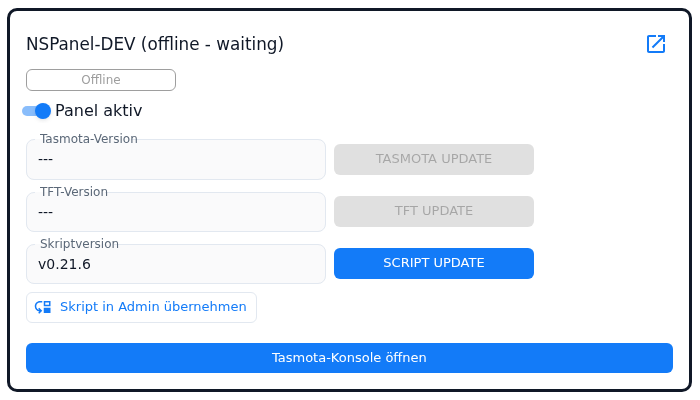
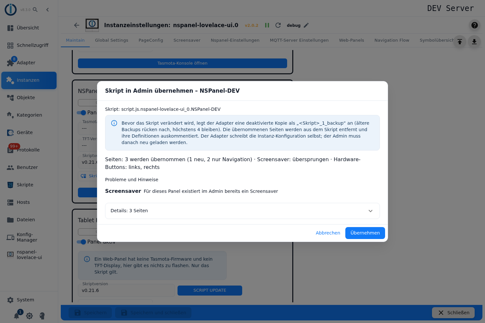
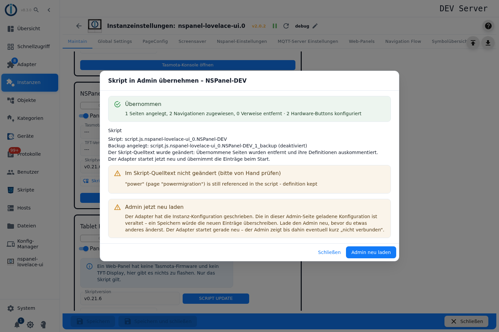
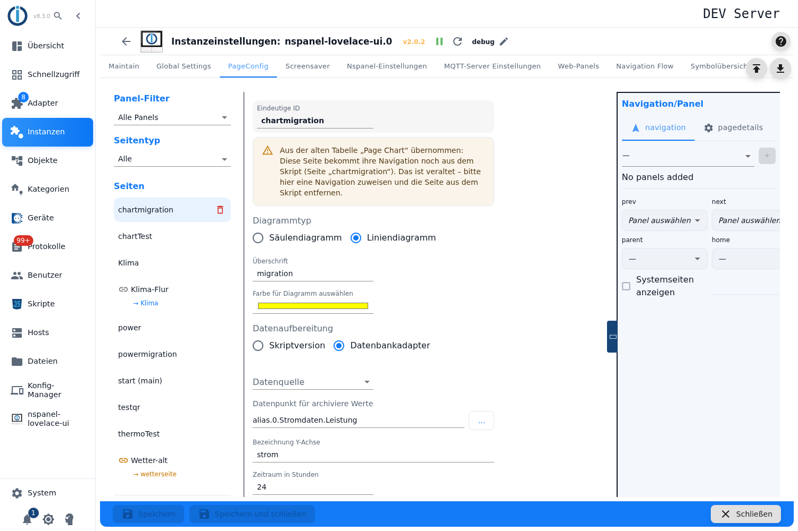
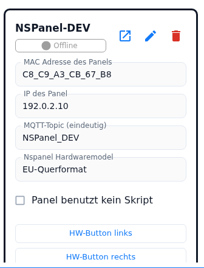

# Migration – from the configuration script into the admin

This page describes the way from an existing configuration script into the admin. It is the only page of the documentation that still mentions the script: everything else describes the admin as the way panels are set up. Three things belong to it — the button **Take script over into admin** in the tab `Maintain`, the automatic conversion of the old tabs *Page Power* and *Page Chart* at the adapter start, and the tick box **Panel uses no script**, with which a converted panel gets rid of the script for good.

Contents:
- [Prerequisites](#1-prerequisites)
- [The button "Take script over into admin"](#2-the-button-take-script-over-into-admin)
- [The preview](#3-the-preview)
- [What is taken over](#4-what-is-taken-over)
- [What happens to the script](#5-what-happens-to-the-script)
- [Course of the conversion](#6-course-of-the-conversion)
- [Error cases](#7-error-cases)
- [The old tabs "Page Power" and "Page Chart"](#8-the-old-tabs-page-power-and-page-chart)
- ["Panel uses no script"](#9-panel-uses-no-script)
- [Pitfalls](#pitfalls)

## 1. Prerequisites

The adapter does **not** take over the **source code** of the script, but the configuration the script last sent to it and which it stored in its meta object. The prerequisites follow from that:

| Prerequisite | What happens otherwise |
|---|---|
| The script has run **at least once** | The dialog says that the script has not sent its configuration yet — start the script once and press the button again. |
| The panel stands in the panel table under `NSPanelsetting` (with a topic) | The adapter says that the panel is not configured in the admin. |
| The script serves **exactly one panel** | A script with `panelTopic: [...]` is refused; the message names all panels concerned. Split it up first (one script per panel), start each one once, then convert panel by panel. |
| The tick box **Panel uses no script** is **not** set | The adapter refuses with a message of its own: the tick box has to be removed, the script converted and the tick box set again afterwards. |
| The instance is running | The button stays grey. |
| All changes in the admin are **saved** | The preview warns. The adapter writes the instance configuration itself, and the reload needed afterwards discards unsaved changes. |

The script object itself does not have to exist any more. If it is missing, the adapter creates no backup and changes no source code — it only converts the stored configuration and points that out in the preview.

## 2. The button "Take script over into admin"

Tab `Maintain`, in every panel card in the row **Script version** next to **SCRIPT UPDATE**.

| State | Meaning |
|---|---|
| active | The panel has a topic, the instance is running, the tick box **Panel uses no script** is not set and no other operation is running for this panel right now. |
| grey, tooltip pointing at the tick box | The panel is set to **Panel uses no script**. |
| grey without a tooltip | No topic, instance not running, or a Tasmota, TFT or script update is running for this panel right now. |

The click opens the dialog **Take the script over into the admin – `<panel name>`** and asks the adapter for a preview. Nothing is changed in the process.

## 3. The preview

The dialog first shows the id of the script, then the notes, then a one-line summary and below it the blocks. The list of all planned pages is collapsed (**Details: `n` pages**) so that a script with many pages does not cover up the problems.

| Block | Content |
|---|---|
| Notes (at the top) | Whether the script object is missing, whether there is nothing to take over, whether the admin has unsaved changes — and always the note about the backup or "no backup" as well as the one that the admin has to be reloaded afterwards. |
| Summary | One line: `Pages: n are taken over (… new, … navigation only, … reference removed only), n skipped · Screensaver: … · Hardware buttons: …`. |
| **Pages of the global script that differ from the admin** | Only if there are any. Per page the choice **Keep admin version (assign panel)**, **Take script version** or **Skip**, along with the list of the differing fields and, if the page is assigned to further panels, the note that the change acts there too. Every changed decision fetches a new preview; the decisions go along when taking over. |
| **Problems and notes** | Skipped screensaver, skipped buttons, skipped pages — each with the reason and, where possible, the field or item concerned. In addition the pages that are stored under another name and those from which only the reference in the script disappears. If there is nothing to report: *No problems – nothing is skipped.* |
| **Taken over as raw data** | Not a problem, information only: items for which the editor has no fields. They are taken over unchanged, the panel behaves as before; they can be edited in the item dialog through the button `{ }` (see `PageConfig-Dialoge`). Per entry the position (`items[3]`), the format (`native` or `script`) and the reason. |
| **Long press dropped** | Items on pages without a long press. A long press only exists on grid pages (`cardGrid`, `cardGrid2`, `cardGrid3`) — as on the HMI. The items are taken over without `longPress`/`targetPageLongPress`. |
| **Details: `n` pages** (collapsed) | Per page the name, the page type, the number of items, the navigation and the action: *new admin entry*, *navigation only (entry exists)* or *removed from the script only*. Below it the **screensaver** (name, version, items, notifications) and the **hardware buttons**. |

At the bottom sit **Take over** and the button to close. If there is nothing to take over, only closing is left.

## 4. What is taken over

### Pages

| Page type in the script | What the adapter does |
|---|---|
| `cardGrid`, `cardGrid2`, `cardGrid3`, `cardEntities`, `cardSchedule`, `cardThermo`, `cardThermo2`, `cardMedia` | **A new admin entry** in the tab `PageConfig`, with all items and the navigation of the panel. |
| `cardPower`, `cardChart`, `cardLChart` | **No new entry.** These pages exist in the admin only (`cardPower`, `cardChart`). The adapter looks for the existing entry, attaches the navigation of the panel to it and removes the page from the script. If it finds no entry, the page stays in the script (*No matching admin entry found for this script page*). If the entry already has a navigation of its own in the admin, the reference in the script is dead and is only removed. |
| `cardQR`, `cardAlarm`, `cardUnlock` | Are configured in the admin exclusively (`PageQR`, `PageAlarm`): the reference is only removed from the script. |
| everything else, `globalLink`, pages without a `type` (native pages) | Stay in the script, with the reason in **Problems and notes**. |

The former basic rule "whole pages only" does **not hold any more**: a single item the converter cannot express does not prevent the page from being taken over — it moves into the entry as raw data and stands in **Taken over as raw data**. A page is only skipped completely when a **field of the page** itself cannot be expressed, when the item list is no list at all, when the name is taken already or when the script overwrites the navigation links of the page.

**Start page.** If the admin already holds an entry with the name `main` that creates no page for this panel, the adapter stores the script start page under `main_<panel name>` and flags it as the start page — the panel still sees it as `main`. The preview then says *stored in the admin as "main_…" (flagged as start page)*. Characters other than `A–Z`, `a–z`, `0–9`, `_` and `-` become `_` in the panel name. If this name is taken as well, the page is skipped. If the existing `main` entry (or another page flagged as the start page) already publishes a start page for this panel, the script start page is skipped with *A page with this name already exists in the admin*.

### Screensaver

The screensaver of the script becomes **one** entry in the tab `Screensaver`, named after the panel and assigned to this panel (see `screensaver`). The adapter takes the version (Standard, Alternate, Advanced) from the running panel; if it does not answer, it derives it from the areas in use (left or indicator items ⇒ Advanced, an alternate item ⇒ Alternate, otherwise Standard). Notifications of the script become entries of their own in the notification list and are linked at the screensaver entry. The weather instance moves along, as long as none is set in the global settings — then the global one holds anyway.

The screensaver is not taken over when

- **a screensaver already exists** in the admin for this panel,
- the script uses **native page items**,
- an item cannot be expressed (a status icon without a state and without a value, for example),
- or it is empty and has default settings only (*nothing to take over*, not a problem).

### Hardware buttons

`buttonLeft` and `buttonRight` move into the panel card under `NSPanelsetting` (**HW button left** / **HW button right**). A button is skipped when it is **already configured** in the admin ("no action" counts as configured too) or when the action cannot be expressed in the admin. A script button without an action is no issue — there is nothing to take over there.

### Reasons in "Problems and notes"

| Message | Meaning |
|---|---|
| *This page type cannot be configured in the admin* | Page type without an admin editor, `globalLink`, native page. |
| *A page with this name already exists in the admin* | Name collision. |
| *An item of the page cannot be expressed in the admin* | Item list structurally unusable (single items are taken over as raw data today). |
| *A field of the page cannot be expressed in the admin* | For example `uniqueName` missing, the script overwrites the navigation links, navigation copy of a renamed page of the global script. |
| *This page type is configured in the admin only – the script reference is dead and is removed* | `cardQR`, `cardAlarm`, `cardUnlock`. |
| *The admin entry already has its own navigation – the script reference is dead and is removed* | `cardPower`/`cardChart` with an admin navigation. |
| *No matching admin entry found for this script page* | `cardPower`/`cardChart` without a counterpart in the admin. |
| *A screensaver for this panel already exists in the admin* / *The script screensaver has no items and only default settings* / *An item of the screensaver cannot be expressed in the admin* | Screensaver. |
| *This button is already configured in the admin* / *The button action cannot be expressed in the admin* | Hardware buttons. |

## 5. What happens to the script

**Backup.** Before the adapter touches the script, it creates a **disabled** copy as `<script>_1_backup`. Existing backups move up one number (`_1_backup` → `_2_backup` …), at most four are kept, older ones are deleted. The copy keeps everything except the name, the id and the state; its name is `<script name> backup <n>`.

**Source code.** After that the adapter changes the source code:

- The pages taken over are removed from `pages` or `subPages` of the configuration object.
- If the page stands there as a variable, its **definition is commented out** — but only if the variable is used nowhere else in the script. The comment carries a mark with the date (`NSPanel: converted to the admin page configuration on <date>`).
- For the screensaver taken over, the item arrays are emptied, the status icon objects are reset and `screensaverSwipe`/`screensaverIndicatorButtons` are removed.
- Buttons taken over are set to `null`.

The scanner reads the source code without running it. What it does not find unambiguously it leaves standing and reports in the report under **Not changed in the script source (please check by hand)** — for example "page not found in pages/subPages", "definition not found", "is still referenced in the script – definition kept". These spots have to be reworked by hand, otherwise the script sends the page concerned again on its next run.

After the change the JavaScript adapter restarts the script; it then sends the reduced configuration. In parallel the adapter replaces the script configuration it stored with the cleaned up version.

## 6. Course of the conversion

1. **Preview** (see above) — nothing is written.
2. **Take over.** The adapter first parks the admin part in its meta object, then backs up and changes the script, stores the cleaned up script configuration, **answers** the dialog and only writes the instance configuration a good half a second later. This order is necessary because every write of the instance configuration restarts the adapter — the answer has to be out before that.
3. **Report.** The dialog shows **Taken over** with the result (`n pages created, n navigations assigned, n references removed`, plus the screensaver and the buttons), the section **Script** with the backup id, the backups that moved up and were deleted, whether the source code was changed, and if applicable the list of the spots to be checked by hand.
4. **Reload the admin.** The button in the dialog reloads the admin page. That is not optional: the instance configuration loaded in the browser is outdated after the conversion, saving it would overwrite the new entries again. While the adapter restarts, the admin may briefly show "not connected".

After the reload the pages stand in the tab `PageConfig` (menu pages see `pageMenu`, thermostat pages see `cardThermo2`), the screensaver in the tab `Screensaver` and the buttons in the panel card under `NSPanelsetting`.

Another click says *Nothing to take over* — unless pages are left over that the admin cannot express; those still stand under **Problems and notes** and stay in the script.

## 7. Error cases

| Display | Situation | What to do |
|---|---|---|
| **The conversion is not possible** | The adapter refuses: configuration never sent, panel unknown in the admin, script for several panels, tick box **Panel uses no script** set. | Establish the prerequisite named (section 1) and convert again. Nothing was changed. |
| **The adapter did not answer in time.** | After 60 seconds the dialog gives the request up. | Harmless with the preview. With the execution the dialog points out that the adapter may have finished it nevertheless: **check the log of the instance first**, and if the adapter has restarted, reload the admin before anything else is changed. |
| **Nothing was changed** | The run broke off before anything was written. | Look for the reason in the log, try again. |
| **Partially executed** | A write failed after the first one had already gone through. The script is backed up already and possibly changed already. | The dialog names the backup id and says whether the parked plan is applied at the next adapter start (then restart the adapter) or whether nothing is parked (then fetch the script back from the backup). The log names both once more. |
| **Taken over** with the addition that no restart was announced | The entries are written, but the adapter does not restart on its own. | The entries hold with its next start. |
| **The adapter reported an error during the conversion** together with **Taken over** | Most frequent case: the config manager refused the cleaned up script configuration. | The admin entries are written nevertheless — that is the valuable part. The stored script configuration refreshes itself as soon as the script sends the next time. |
| **The adapter sent an unexpected answer.** | The answer does not match the contract. | Check whether the instance is running and up to date. |

If writing the instance configuration fails, the adapter fetches the parked admin part back into the meta object and applies it at the next start. While doing so it only adds what is missing: pages whose name does not appear yet, the screensaver if no entry covers the panel, notifications by id, and buttons only if the panel has none. Each of these additions stands as a message in the log.

## 8. The old tabs "Page Power" and "Page Chart"

The tables behind the old tabs *Page Power* and *Page Chart* do not exist any more. The adapter tidies them up **itself** — without a button, without asking.

**When.** At the start, in the same run that also tidies up other old fields of the instance configuration, and only as long as the field still exists at all: first *Page Chart*, then *Page Power*. After that the adapter deletes the table, writes the instance configuration, reports *Updated configuration … to the latest version. Restart adapter!* and is restarted by the js-controller. At the next start there is nothing left to do.

**What comes out of it.** One entry in the tab `PageConfig` per row — page type **Power** (`cardPower`) or **Chart** (`cardChart`, column or line chart). All fields of the row move along; fields of the wrong type fall back to the defaults of the adapter, exactly as the old table read them. Rows without a name are skipped, and rows already taken over are recognised by the adapter and left alone.

| Case | Behaviour |
|---|---|
| **Name collision** | If the name is taken by another page already, the new entry gets the suffix `_chart` or `_power`, with further collisions `_chart2`, `_power2` and so on. The original name stays stored at the entry as the script name, so the script still addresses the page under the old name. A warning with both names stands in the log. |
| **Unit of a state** (*Page Power* only) | The adapter reads `common.unit` of the state and uses it — the way the old table showed it. So it takes precedence over the unit chosen in the table. Only if the state has no unit or the id is invalid does the unit from the table hold, and as the very last resort `W`. The internal sum below the house icon has no state — there the unit from the table always holds. |
| **Navigation** | The new entry has **no** navigation in the admin. It still gets it from the script page of the same name: the script delivers the place and the links, the content comes from the admin entry. The adapter writes a warning into the log at every start for that ("the navigation from the script is deprecated – assign it in the admin"), and the editor of the page shows a yellow box at the top: *Migrated from the old table "Page Chart": this page still gets its navigation from the script (page "…"). This is deprecated - assign a navigation here and remove the page from the script.* |
| **Navigation assigned in the admin** | As soon as the entry has a panel assignment in the admin, the script navigation ends. The script page is then a dead reference: the adapter skips it and writes *gets its navigation in the admin (tab PageConfig) – remove it from the script. Skipped!* into the log. |
| **Duplicate names** | If two entries with the same name come out of the tidying up, the adapter keeps the first one and warns (*Duplicate uniqueName … found in pageConfig!*). |

**The rest of the work.** The row has moved, the script page has not. The last step is done either by hand (assign a navigation in the admin, delete the page from the script) or by the button from part 1: it attaches the navigation to the existing entry and removes the page from the script — for `cardPower` and `cardChart` it deliberately creates **no** new entry.

## 9. "Panel uses no script"

The tick box sits in the panel card under `NSPanelsetting`, below the model:

**Label:** *Panel uses no script* — *The panel is configured in the admin (and by the global script) only. A panel script sent for it is rejected, no script update is offered.*

| Effect | In detail |
|---|---|
| Panel scripts that are sent are rejected | If a script sends a configuration for this panel nevertheless, the adapter does not store it and does not reload the panel. It writes an error into the log and sends it back to the sender: disable or delete the script in the JavaScript adapter, otherwise it sends again at every start. The **global script** is never concerned. |
| No script version check, no update offer | In the tab `Maintain` **Script version** says *Script disabled*; the button **SCRIPT UPDATE** disappears, and the panel no longer counts towards **Update scripts for all panels**. A request to create the script is refused with a message. |
| Built from the admin + the global script only | The script configuration of the panel that was stored last is no longer used at the adapter start, not even as a side supplier for other panels. If a start page is missing, the adapter quietly creates one, without the log message that is otherwise usual. |
| The conversion is blocked | With the tick box set, the adapter refuses **Take script over into admin**. |

**When to set it:** **after** the conversion. So the order is: take the script over → reload the admin → check that the pages, the screensaver and the buttons are right → disable the script in the JavaScript adapter → set the tick box → **save**. The tick box is a normal setting of the instance configuration; it only takes effect with the save, and the save restarts the adapter.

Old scripts send the complete command topic (`<topic>.cmnd.CustomSend`). The adapter cuts the addition off before it looks for the panel — so the tick box works for such scripts too.

## Pitfalls

- **Save before the conversion.** The adapter writes the instance configuration itself, and the reload needed afterwards discards everything unsaved. The dialog warns, but it cannot force the save.
- **Change nothing else after the conversion without reloading.** The configuration loaded in the browser is outdated; saving over it deletes the newly created entries again.
- **The script has to have run.** The adapter does not read the source code but the configuration that was sent. A script that has never sent anything is empty as far as it is concerned.
- **Split a script for several panels up first.** The rebuild for one panel would take the pages away from the others, which is why the adapter refuses it.
- **Take the list "Not changed in the script source" seriously.** What the adapter did not find unambiguously in the source code still stands in the script and comes back on its next run.
- **A commented out page definition stays standing when the variable is still in use.** Then handwork is needed.
- **Backups are rotated, not collected.** At most four are kept; the fifth run deletes the oldest. Whoever needs a particular state saves it outside.
- **The tick box "Panel uses no script" blocks the conversion.** Convert first, then set the tick box — not the other way round.
- **After the move of *Page Power* / *Page Chart* the work is not finished.** As long as the navigation comes from the script, the adapter warns at every start. Only the assignment in the admin plus the removal of the page from the script ends that.
- **Mind the suffix.** With a name collision the entry is called `…_chart` or `…_power`, the script name stays the old one. Whoever enters the page in a navigation by hand needs the **entry name**, not the script name.
- **A start page that was taken over may lie under `main_<panel name>`.** On the panel it is still called `main` — in the admin list it is to be found under the longer name.
- **A long press only exists on grid pages.** On all other pages it is lost in the conversion; the preview names the positions concerned.
