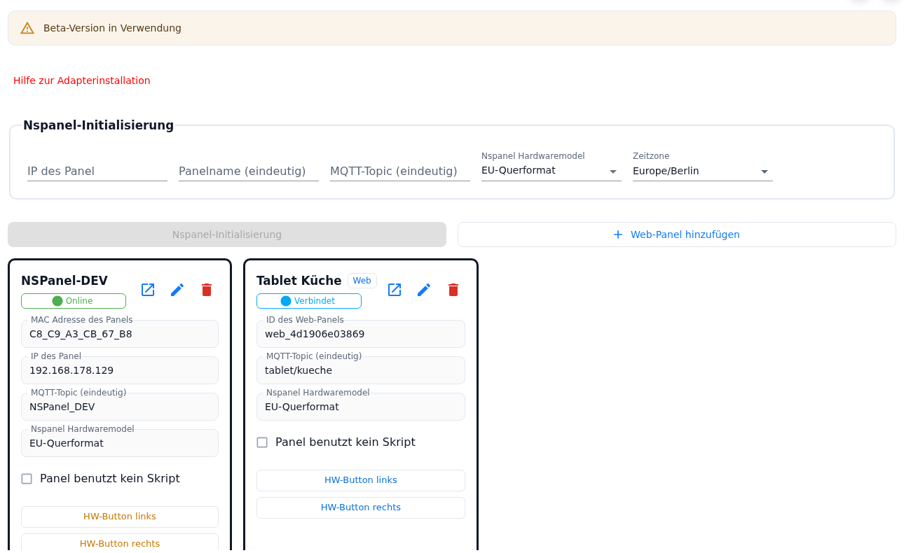
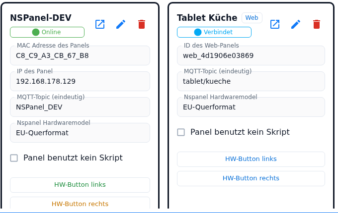
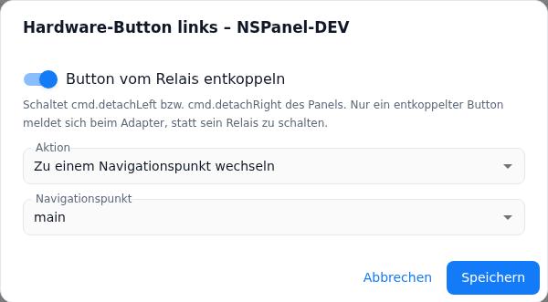

# NSPanel settings

The **NSPanel settings** tab is the panel management of the adapter: at the top sits the setup form with which an NSPanel is created or transferred again, next to it the button for a web panel, and below it one card for every known panel. The card also holds the two settings that only exist since 2.0.0: the **Panel uses no script** checkbox and one button each for the **action of the two hardware buttons** below the display.

**What takes effect when** — this holds for the whole tab:

- Panel name, topic, model, the *Panel uses no script* checkbox and the actions of the hardware buttons are part of the instance configuration (`native.panels[]`). They only become valid with **saving the instance settings**, and saving restarts the adapter.
- **Decoupling** a hardware button, by contrast, is a state (`panels.<ID>.cmd.detachLeft` / `.detachRight`). The switch in the dialog acts immediately and independently of saving.

Contents:
- [When the tab appears](#1-when-the-tab-appears)
- [Creating or updating a panel](#2-creating-or-updating-a-panel)
- [Adding a web panel](#3-adding-a-web-panel)
- [The panel card](#4-the-panel-card)
- [Panel uses no script](#5-panel-uses-no-script)
- [The hardware buttons: two buttons, two dialogs](#6-the-hardware-buttons-two-buttons-two-dialogs)
- [Decoupling the relay](#7-decoupling-the-relay)
- [The action types](#8-the-action-types)
- [Colour of the buttons on the card](#9-colour-of-the-buttons-on-the-card)
- [Pitfalls](#pitfalls)

## 1. When the tab appears

The tab is visible as soon as the MQTT settings are complete: a broker (the built-in server **or** a broker address), a port and a login — with an external broker a central credentials ID is enough instead of user and password. A panel does not have to exist yet, because this is where the first one is created. The fields for it are in the [MQTT server settings](General) tab.

Above the form sits the red link **Help for adapter installation** (opens the wiki in a new tab). If the beta TFT is switched on in the [Global Settings](globelSettings) tab, the warning *Beta version in use* appears here as well.

## 2. Creating or updating a panel

| Field | Meaning |
|---|---|
| **IP of the ioBroker** | Only with the built-in MQTT server: the address under which the panel reaches ioBroker. Has to be a complete IPv4 address. |
| **IP of the panel** | The panel's fixed IP; checked for a complete IPv4 format. |
| **Panel name (unique)** | Name of the panel; it appears as the name of the states and of the configuration script. |
| **Mqtt topic (unique)** | Topic of the panel. At least four characters, starts with a letter, then letters, digits, `_` and `/`. |
| **NSPanel Hardwaremodel** | EU landscape, US landscape or US portrait. |
| **Timezone** | A search field with all Tasmota time zones. The setting applies **instance-wide** and is transferred in the second setup step to the panel that is currently being set up. |

The button below reads **NSPanel initialisation** when the topic is new, and **NSPanel configuration update** when a panel with that topic already exists. It is only active while the instance is running and every field is valid — including the MQTT settings from the other tab.

After the confirmation three steps run one after the other; the admin reports a milestone after each step. If the adapter does not answer for more than 30 seconds, the admin says so and the setup keeps running in the background — the instance log shows the progress. What the steps do in detail (MQTT access, basic settings and time zone, Berry driver, TFT firmware, scripts) is described under [adapter installation](Adapter-Installation).

⚠️ **At the end a dialog with "Save" and "Cancel" appears: only "Save" adds the panel to the configuration.** This saving sets the **whole panel table** to the state the adapter knows — see [Pitfalls](#pitfalls).

## 3. Adding a web panel

Next to the initialisation button sits **Add web panel**. The button only appears when the web panels are switched on, and it does not need a running instance: a web panel is a pure configuration entry without hardware. The dialog asks for the name, the topic (which becomes the path of the address) and the hardware model, and shows the finished address for checking.

Everything else — address, operation in the browser, PIN and HTTPS, the limits of a web panel — is on the [web panel](WebPanel) page.

## 4. The panel card

The head of the card holds the panel name, for a web panel the **Web** label, and below it the connection state (see [panel status](PanelStatusBadge)). To the right of it sit the icon buttons:

| Control | Effect |
|---|---|
| **⧉ (Open web panel in a new tab)** | Appears when the web panels are switched on and the panel has a topic — for a real NSPanel as well. Opens `http(s)://<host>:<port>/<topic>` in a new tab; a stored PIN is built into the address by the admin. More under [web panel](WebPanel). |
| **Pencil** | For an NSPanel: copies IP, name, topic and model up into the form, the frame blinks briefly. **The change itself only happens** when *NSPanel configuration update* is run afterwards. For a web panel the pencil opens its dialog — that works with the instance stopped as well. |
| **Bin** | Asks for confirmation and then removes the entry **from the panel table**. Only with the instance running. The device keeps its Tasmota settings; to really wipe it, use the factory reset in the [Tasmota tools](tasmotatools). |

Below, for information only, the **MAC address** (for a web panel the automatically generated **ID** `web_…`), the **IP** (NSPanel only), the **Mqtt topic** and the **hardware model**. Then follow the *Panel uses no script* checkbox, the two buttons **HW button left** and **HW button right** and — only for an NSPanel — **Open Tasmota console**, which opens the console of the Tasmota web interface in a new tab.

With the instance stopped the card is pale and almost everything is locked. What stays operable is the checkbox and the two hardware button buttons: both are configuration and need no running panel.

## 5. Panel uses no script

The checkbox (`native.panels[].noScript`) puts the panel into **admin operation**: it is built from the admin configuration and the global script only. The tooltip puts it briefly: *The panel is configured in the admin (and by the global script) only. A panel script sent for it is rejected, no script update is offered.*

| Effect | In detail |
|---|---|
| **Panel scripts are rejected** | If a script sends a configuration for this topic, the adapter does not store it and does not reload the panel. It writes an error into the log and sends it back to the sender: deactivate or delete the script in the JavaScript adapter, otherwise it sends again on every start. The **global script** is never affected; it keeps applying and on changes is even loaded into the running panels. Old scripts that send the complete command topic (`<topic>.cmnd.CustomSend`) are recognised along with the others. |
| **A stored script configuration stays where it is** | The last stored configuration of the panel is no longer used when the adapter starts — not even as a secondary supplier for the pages of the other panels. It is not deleted: removing the checkbox brings it back. |
| **Built from an empty template** | Instead of the placeholder start page ("the void") the adapter starts with an empty page list and takes the pages from the admin; if a start page is missing, it adds its own and writes an info into the log. |
| **No version check, no update offer** | In the [Maintain](Maintain) tab *Script version* reads **Script disabled**, the *SCRIPT UPDATE* button is not shown, and *Update scripts for all panels* leaves the panel out. A request to create the panel script is rejected with a message; on initialisation the adapter only creates the global script. In the [panel info](Panelinfo) tab the script name also reads *Script disabled*. |
| **Take-over blocked** | With the checkbox set the adapter rejects *Take script over into admin*: remove the checkbox, convert, then set it again. |
| **Hardware buttons need the admin** | Without a script there is nobody who could decide for a button. If its action is set to *not configured here*, the button has no function; the dialog points that out. |

The right order when moving over from a script — take over, check, switch the script off, then set the checkbox — is on the [Migration](Migration) page.

## 6. The hardware buttons: two buttons, two dialogs

The two buttons below the display can be configured in the admin since 2.0.0. **HW button left** and **HW button right** on the card each open a dialog *Hardware button left/right – <panel name>*; the result is stored as `buttonLeft` respectively `buttonRight` of the panel.

**The admin overrides the script.** When building the panel configuration the adapter lays the actions of the admin over those of the configuration script, separately for each side:

- A side configured in the admin **wins** against the script.
- A side that was never touched in the admin (*not configured here*) keeps the value from the script. A panel configured by script therefore behaves unchanged as long as nobody uses the dialog.
- An unusable admin entry (a state ending in a dot, for instance) is discarded; the adapter writes a warning into the log and keeps the script value.

The dialog only closes through its own buttons — a click next to it does not close it. **Save** is disabled as long as the entries are incomplete; **Cancel** discards the entries, but not a decoupling switch flipped in the meantime.

## 7. Decoupling the relay

A hardware button of the NSPanel switches **its relay** out of the box and does not report to the adapter. That is why the dialog offers the decoupling first and the action only afterwards.

| Element | Meaning |
|---|---|
| **Decouple the button from its relay** | Switches `panels.<ID>.cmd.detachLeft` respectively `.detachRight`. The adapter thereupon sends the matching Tasmota rule straight away, which publishes the key press as an event. The dialog reads the state live and always shows the real condition. The switch needs a **running instance**. |
| Note **"Decouple the button first, then the action can be configured."** | Appears as long as the button is coupled and no action is stored. The action selection is not shown at all. |
| Note **"The action stored for this button is kept"** | Appears when an action for the coupled button is already in the configuration. It is not deleted and works again as soon as the button is decoupled. |
| **Save with the relay coupled** | Only closes the dialog. There is nothing to save: the decoupling was already written when the switch was flipped, and the stored action is left untouched. |
| **Instance not running** | A warning in the dialog, the switch is disabled. The action can be configured all the same — it lives in the configuration, not in the panel. |
| **Web panel** | Has no relay. The dialog says so and always offers the action; the two button bars in the browser trigger it directly. |

The decoupling survives adapter restarts (the adapter reads the state back when the panel starts), the default is **coupled**. Two side effects are useful to know:

- For every decoupled side the state `panels.<ID>.cmd.buttons.left` respectively `.right` is created. Writing it triggers the configured action as if the button had been pressed. Once both sides are coupled again, the whole branch disappears.
- Every press of a decoupled button additionally writes `panels.<ID>.buttons.left` respectively `.right` to `true` — regardless of whether an action is configured. That makes the button usable in your own scripts or scenes as well.

## 8. The action types

The **Action** field has seven entries besides *not configured here*:

| Action | What the button does |
|---|---|
| **not configured here** | The admin configures nothing; what the configuration script says about this button applies. On saving, the field is removed from the configuration. With *Panel uses no script* this means: no function. |
| **Go to a navigation point** | The panel jumps to the chosen page. |
| **Flip a datapoint** | Toggles a boolean state. |
| **Set a datapoint to true** | Sets the state to `true` (push-button behaviour). |
| **Set true, back to false after the delay** | Sets `true` immediately, `false` after the delay. |
| **Set false, back to true after the delay** | Sets `false` immediately, `true` after the delay. |
| **Set true after the delay** | Sets `true` only once the delay has elapsed. |
| **Set false after the delay** | Sets `false` only once the delay has elapsed. |

Depending on the choice, the matching fields appear:

- **Navigation point** — a select list with the navigation points of this panel; these are exactly the values the state `cmd.goToNavigationPoint` knows, including the system pages (names with `///`). If the list is empty, the dialog offers a text field with the note to enter the name as it appears in `cmd.goToNavigationPoint`. A stored name the panel does not (any longer) report stays visible in the list and is not lost.
- **Datapoint** — chosen from the object tree; only **writable** states are offered.
- **Delay (s)** — only for the four delay types. Empty means **0.25 s**; allowed are 0.001 to 2,147,483 seconds. A value outside those limits disables *Save*; should an unusable value reach the panel all the same, it computes with 250 ms. Pressing the button again during the delay restarts the running time.

## 9. Colour of the buttons on the card

The two buttons sit **one below the other** across the full width of the card and show by their colour
where you stand. Every colour has a tooltip of its own that spells the state out:

| Colour | Meaning |
|---|---|
| **Green** | An action is configured in the admin and can take effect: the button is decoupled from its relay — or it is a web panel, which has none at all. |
| **Orange** | An action is configured, but the button is still attached to its relay: *An action is configured, but the button is coupled to its relay - it works only after decoupling.* |
| **Blue** | **Nothing** is configured in the admin for this side, but the relay is **decoupled** — so the key press reaches the adapter, and what the configuration script says about this button applies. |
| **Grey** | Nothing configured and the button switches its relay — the factory state. |

If the decoupling cannot be read — with the instance stopped, for instance — it counts as decoupled; the button is green then. The dialog uses the same rule when it decides whether to offer the action.

## Pitfalls

- **Save before the initialisation.** The "Save" in the success dialog sets the panel table to the list the **adapter** knows — that is, to the stored state plus the new panel. Changes in the cards that have not been saved yet (a *Panel uses no script* checkbox just set, a new button action, a web panel just created) are gone afterwards.
- **Decoupling acts immediately, the action only after saving.** The switch writes a state; *Cancel* does not take it back. The action, by contrast, lives in the instance configuration and only takes hold once it is saved and the adapter has rebuilt the panel.
- **The time zone only goes along during setup.** The adapter reads the **stored** time zone and sends it in the second step to exactly the panel that is being set up. So save a newly chosen time zone first; other panels set up long ago only get it through *NSPanel configuration update*.
- **Topic already in use:** two panels must not share a topic. Otherwise the button switches to *NSPanel configuration update* and transfers to the existing panel. If IP and topic belong to different entries, the adapter stops with a message.
- **The button does nothing although an action is configured:** if the given state does not exist when the panel starts (renamed, deleted, alias gone), the adapter discards the action silently — the button stays without effect. Second cause: the button is still on its relay, in which case the button on the card is orange.
- **Wrong navigation point:** a name the navigation of the panel does not know only leads to a warning in the log; nothing happens on the panel. Better to pick it from the list than to type it.
- **The checkbox blocks the take-over.** *Take script over into admin* rejects a panel with *Panel uses no script* — take over first, then set the checkbox ([Migration](Migration)).
- **The panel was attached to another host before:** run `reset 4` on the Tasmota console once before initialising.
- **No internet on the panel:** the third step checks whether the panel reaches the download address and otherwise stops with a note — the panel downloads the Berry driver and the TFT firmware itself.
- **Connection after restoring from a backup:** check the topic and the IP in the form and run *NSPanel configuration update*; that sends the MQTT access and the basic settings to the panel again. The certificate of the built-in broker lives in the instance object and is not regenerated in the process — the panel does not check it anyway.
