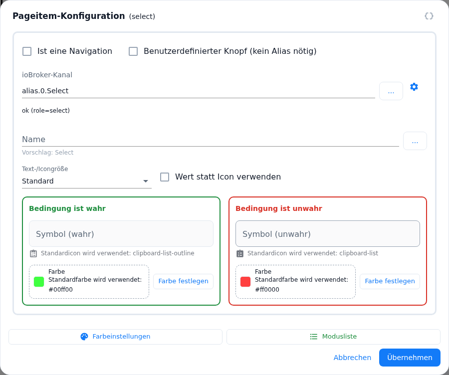
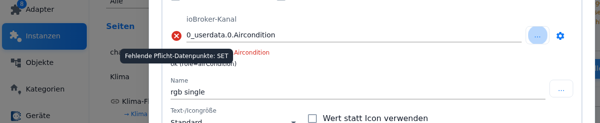
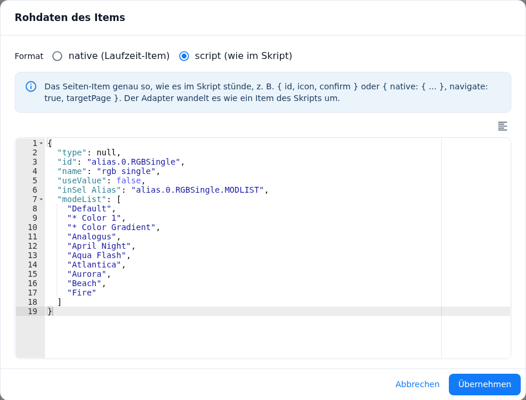
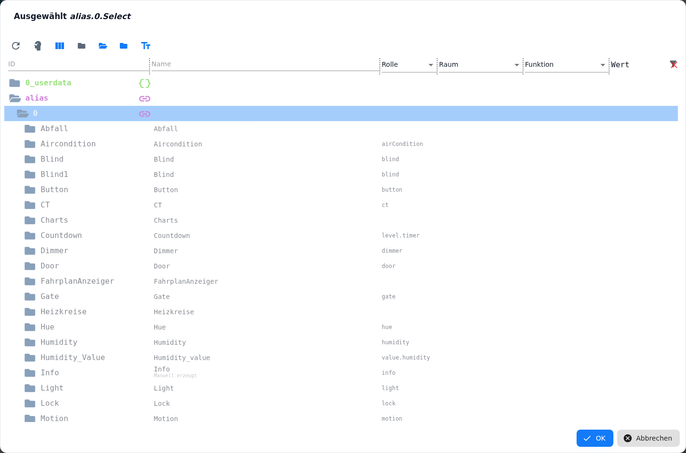
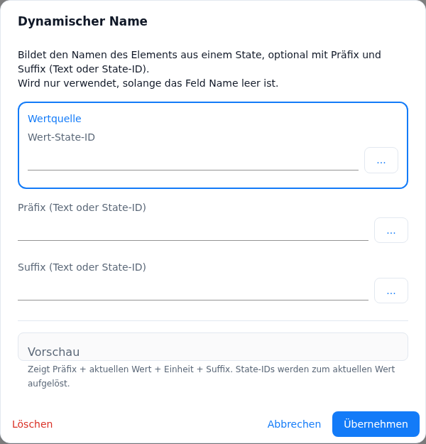
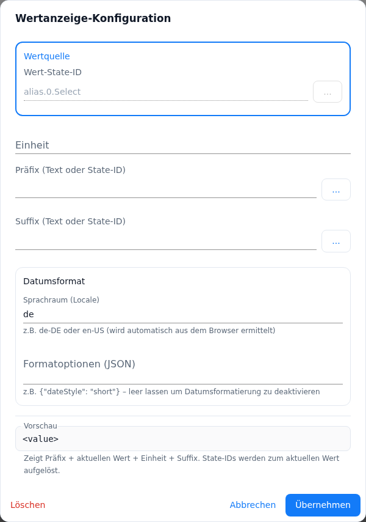
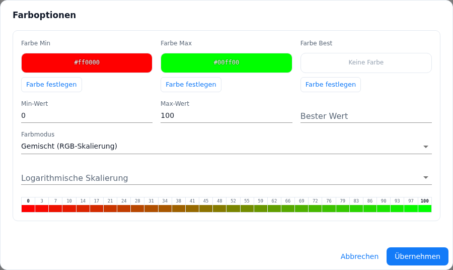
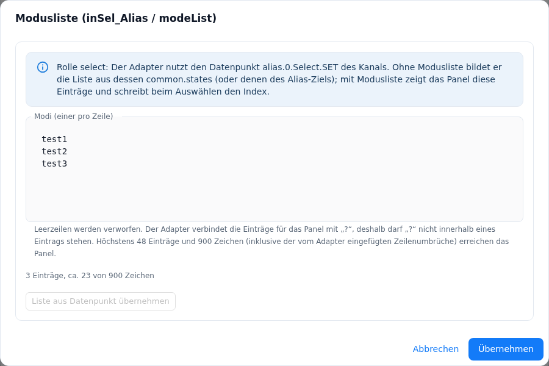

# Recurring dialogs in PageConfig

The editors of the individual card types look different, but they all fall back on the same dialogs. Once you have understood how the **Pageitem Configuration** works, you will recognise it on every page. This page describes those dialogs once and in full; the card type pages link here.

**Where the Pageitem Configuration appears:** on the [menu page](pageMenu) in all five variants, on the [thermostat page](cardThermo2) and on the [media player page](cardMedia). The editors for alarm, power, chart, QR, trash and page link do **not** include the dialog — there are no free slots there that could hold a page item.

All dialogs share two properties:

- **Clicking next to them does not close them.** Pageitem Configuration, raw data, dynamic name and value display additionally close with **Esc**; **Color Options** and the **mode list** do not react to Esc at all — they only close through their own buttons. That keeps a half-finished entry from being lost.
- **Their *Apply* does not save anything yet.** It only writes the setting back into the admin's form. Nothing takes effect until **Save** in the PageConfig tab, and the adapter restarts for that (see [PageConfig – overview](PageConfig#saving)).

Contents:
- [Pageitem Configuration](#1-pageitem-configuration)
- [Raw data of the item](#2-raw-data-of-the-item)
- [Picking an object](#3-picking-an-object-text-field-and-)
- [Dynamic name](#4-dynamic-name)
- [Value Display Configuration at the channel](#5-value-display-configuration-at-the-channel)
- [Color Options](#6-color-options)
- [Mode list](#7-mode-list)
- [The check when applying](#8-the-check-when-applying)
- [Pitfalls](#pitfalls)

## 1. Pageitem Configuration

This is the dialog behind every single slot of a card. It opens with a **click on the slot** in the editor — on a menu page one of the fields, on the thermostat page one of the slots around the set temperature, on the media player page one of the places in the lower bar. Clicking a free slot creates a new page item, clicking an occupied one opens the existing one.

At the top, next to the title *Pageitem Configuration*, brackets tell you what you are dealing with: the **role** of the selected channel (`dimmer`, `socket` …), plus *(unknown role)* for a role the adapter does not know, otherwise *no channel selected* or *Object not found in ioBroker*.

On the right of the title row sits the small **`{ }`** button — the way to the [raw data of the item](#2-raw-data-of-the-item).

### What a page item should show: the three basic cases

Two checkboxes at the head of the dialog decide which kind of element you get:

| Checkbox | Result |
|---|---|
| neither | **Device.** The page item operates an ioBroker channel (an alias or a device with a `role`). The adapter reads from the role which states belong to it and how the slot has to look. |
| **Is a navigation** | **A jump to another page.** Instead of a device you pick a **Target page**. The channel ID may then stay empty — the dialog says so explicitly ("Empty ID is allowed (Navigation)"). |
| **Custom button (no alias needed)** | **A single state.** No channel, no alias: the ID has to point directly at a state with `type=boolean`. The dialog checks that and writes underneath what it found — *writeable*, *read-only*, *not a boolean state* or *not a state*. |

With *Is a navigation* ticked, the field **Target page** appears. It lists the pages this panel knows about — the page itself is taken out of the list, `main` comes first, the rest alphabetically. The field also accepts a freely typed name; handy for a page that does not exist yet, and also the place where a typo goes unnoticed.

At the end of the list stands the entry **Screensaver**: the slot then shows the screensaver at once, as if the timeout of the panel had run out (see [showing the screensaver at once](screensaver#15-showing-the-screensaver-at-once)). The same entry stands in the target page of the long press and in the *Target page after pressing*.

### The ioBroker channel and its check marks

The field is called **ioBroker Channel**, for a custom button **ioBroker State** instead. The picker behind "…" is filtered by the **role**, not by the card type: it offers the 30 channel roles the adapter knows states for, and everything below such a channel. Picking a state is **shortened to its channel**. The complete role table is under [Alias Table](ALIAS).

While and after you type, the admin checks the channel and shows the result **to the left of the field**:

| Mark | Meaning |
|---|---|
| Spinner | The check is still running. It starts after a short pause while typing, and immediately when the field is left. |
| Red ✖ | **Missing required states.** The tooltip names them. The role requires states the channel does not have. |
| Red ⚠ | **Duplicate states** — several states of the channel match the same role and the adapter cannot decide. The tooltip names them. The same mark also appears when the button at the foot reads **Details…**. |

Below the field there is one more line in plain words: *ok (role=…)* when everything fits, *Object not found in ioBroker*, *Missing ID*, the hint text of the custom button, or — when the role matches no known channel role — *The object's role is not a recognized device type*. In that last case the page item cannot be saved usefully; the button at the foot turns into **Details…**.

The **gear icon** to the right of the field opens the [Value Display Configuration](#5-value-display-configuration-at-the-channel) **for the channel ID itself** — that is where the unit, prefix, suffix and date format of the shown value live. With a custom button the gear is missing.

### Name and dynamic name

**Name** is the label of the slot on the panel. If the field stays empty, the helper text below shows what happens instead: either *Suggestion: …* (the name from `common.name` of the channel) or *Default name will be used*.

> **On the thermostat and the media player page the name does not label the slot.** There it is only the **title of the popup** the slot opens; it does not appear below the icon. The dialog says so as helper text under the field: *"On this page only the title of the item's popup – not shown below the icon on the panel."* See [cardThermo2](cardThermo2) and [cardMedia](cardMedia).

The **…** button next to it opens the [dynamic name](#4-dynamic-name) — a label built from a state. Once one is set up, its preview appears as faint placeholder text in the name field.

### Further fields, depending on the card type

These fields only appear where the adapter evaluates them:

| Field | Visible when | Meaning |
|---|---|---|
| **Heat circuit** | thermostat page only | Assigns the page item to one heat circuit, or *all heat circuits* — then it appears on every one. |
| **Text Size** | on the three grid variants, on the thermostat and on the media player page — **not** on *Entities* and *Schedule* | The Nextion font the panel uses to draw the icon or the value of this item (see below). |
| **Use Value Instead of Icon** | the same five card types, not for a custom button | The slot shows the value as text instead of the icon. The adapter only does that when the `ACTUAL` state is a number, a string or `mixed`; otherwise the icon stays. |
| **Long press** | **only** on the three grid variants, and only for a navigation, a custom button or `role=button` | A second function on the same slot. |

**Long press** is deliberately kept that narrow: of the pages only the grid pages report a long press to the adapter at all (since the TFT 6.0.9 the indicators of the [screensaver](screensaver#action-on-long-press) do as well), and only items without a popup of their own can make use of it — on all others it would collide with the popup. It can **either** switch a state **or** jump to a page, never both; that is why the other field disappears as soon as one of them is filled. The state has to be `type=boolean` and `write=true`; the object picker only offers such states in the first place. If the group of fields is not visible, the dialog no longer stores an old value along with the item either.

### The text/icon size

The selection names the pixel size of each font, e.g. *0 – 24 px (text only)*, *4 – 80 px bold*, *5 – 128 px bold (ASCII only)*. Behind it sits this table:

| ID | Size | Icons | Character set |
|---|---|---|---|
| **0** | 24 px | no | many special characters |
| **1** | 32 px | yes | limited |
| **2** | 32 px | no | many special characters |
| **3** | 48 px | yes | limited |
| **4** | 80 px, bold | yes | limited |
| **5** | 128 px, bold | no | ASCII only — no °, no umlauts |

- As long as the slot shows an **icon**, only the fonts **1, 3 and 4** can be chosen — they are the only ones containing the icons. A stored value outside of them is not discarded silently: it stays **orange** in the list, and below the field it says *"This font has no icons - the icon stays empty on the panel"*.
- With **Use Value Instead of Icon** all six fonts can be chosen; with font 5 the ASCII note appears.
- Without a choice of your own it says *default* — the panel then uses the font that belongs to the slot.

### Fields only certain roles evaluate

These fields only appear for a page item with a valid channel ID and a matching role (not for a custom button and not in raw data mode):

| Field | Roles | Meaning |
|---|---|---|
| **Condition for the value** | `info`, `slider`, `motion`, `door`, `window`, `temperature`, `value.temperature`, `thermostat`, `airCondition`, `humidity`, `value.humidity` — for navigation items only `thermostat` and `humidity` | A JavaScript expression over `val` (the current value), e.g. `val && val < 100`. The value is only shown instead of the icon while the expression is true, otherwise the icon is shown. |
| **Minimum value** / **Maximum value** | `volume` | The range of the volume slider; empty or 0 = panel default. |
| **Second row** | `blind` | Text of the second row in the shutter popup; empty = none. |
| **Minimum / Maximum brightness** | `dimmer`, `ct`, `rgb`, `rgbSingle`, `hue` | The value range of the device that the adapter maps onto the **0–100 slider of the panel**; empty or 0 = panel default, then it uses `common.min`/`common.max` of the state. |
| **Minimum / Maximum color temperature** | `ct`, `rgb`, `rgbSingle`, `hue` | The same for the colour temperature slider. |
| **Color mode (colormode)** | `dimmer`, `ct`, `rgb`, `rgbSingle`, `hue` | Set: the panel always colours the icon from **hue/RGB**. Not set: the adapter decides by itself — it takes the source whose state was written last (colour temperature or colour). |
| **Target page after pressing** | `button` (no navigation item, no custom button) | A press switches the button **and** changes to this page — typically to return to the previous page after choosing an option. Like the navigation target page, the field also accepts a freely typed page name. |
| **Use the timer of the screensaver** | `level.timer` | Checkbox: the item and its popup show the timer of the screensaver of this panel instead of their own states. Help text: *The item and its popup show the timer of the screensaver of this panel (time dialog). The states of this channel are not used for it.* Locked when the screensaver uses exactly this item as the source of its timer (*Not possible: … that would be a circle.*). Details under [timer popup](popupTimer#5-use-the-timer-of-the-screensaver). |

### Icon and colour for "true" and "false"

Below that there are two identically built columns: **Condition is true** (green border) and **Condition is false** (red border) — switched on and off, open and closed. Per column:

- **Icon (true)** respectively **Icon (false)**: the icon picker (overview under [Symbols](symbolOverview)). Left empty, the dialog shows the icon the adapter will use by itself as a small image together with its name (*Default icon will be used: …*).
- **Color**: without a choice of your own it says *Default color will be used* plus the colour value — the colour taken from the role and the configured [colour theme](colorTheme) of the instance. **Set color** takes exactly that value as a starting point, **Reset** hands the colour back to role and colour theme.

That way a page you never styled still looks coherent: every gap is filled by the adapter from role and colour theme.

> **With the role `blind` the icon follows the position.** If **Icon (true)** and **Icon (false)** are both empty, the adapter does not set a fixed name but a placeholder the panel resolves per position: 0–5 % → the icon for "closed", 95–100 % → the one for "open", in between the nearest quarter step (`window-shutter-25` / `-50` / `-75`; a tie is rounded up). These three icons are home-made and need **HMI/TFT 6.0.2** or newer. As soon as **one** icon of your own is set, the automatic behaviour is off. The admin keeps showing the end-position icons in the preview — panel and preview deliberately differ here.

### The buttons at the foot

| Button | Effect |
|---|---|
| **Color Settings** | Opens the [Color Options](#6-color-options) — a colour gradient across a value range. |
| **Mode list** | Only for the roles `rgbSingle`, `rgb`, `ct`, `hue` and `select`: opens the [mode list](#7-mode-list). |

Both turn **green** as soon as something is configured behind them. So the colour of the button tells you whether it is worth looking inside.

**Which button is there is decided by the role.** **Color Settings** only exists for roles whose page item carries a numeric value: `blind`, `thermostat`, `airCondition`, `temperature`, `value.temperature`, `humidity`, `value.humidity`, `info`, `volume`, `select`, `slider`, `warning`, `level.timer` and `level.mode.fan`. For the purely switching roles (`socket`, `light`, `dimmer`, `ct`, `rgb`, `rgbSingle`, `hue`, `button`, `gate`, `motion`, `door`, `window`, `lock`, `media`) it is missing — a colour gradient across a value range makes no sense there. For the light roles the **mode list** remains, for `socket`, `button` and the sensor roles the row stays empty altogether. Only for `select` are **both** buttons there. With a custom button and in raw data mode both disappear.

At the bottom right there are **Cancel** and **Apply**. During the check the right button reads *Checking…*, with problems detected **Details…** (orange) — see [section 8](#8-the-check-when-applying).

## 2. Raw data of the item

The **`{ }`** button on the right of the title row of the Pageitem Configuration (tooltip *"Enter the item as raw data (JSON)"*) opens the dialog **Raw data of the item**. It is **always** there — no expert mode needed. Here the page item is entered as raw JSON, for settings that have no interface yet. The item dialog of the [screensaver](screensaver#4-items-the-item-dialog) has the same button.

**Format** — two possibilities, each explained by the note box in the dialog:

| Format | Meaning |
|---|---|
| **native (runtime item)** | The item as the adapter uses it at runtime (e.g. `{ "template": …, "dpInit": … }`). It is taken over **unchanged** and has no navigation fields. Corresponds to `{ native: { … } }` in the script. |
| **script (as in the script)** | The page item exactly as it would stand in a configuration script, e.g. `{ "id": …, "icon": …, "confirm": … }` or `{ "native": { … }, "navigate": true, "targetPage": … }`. The adapter converts it like an item from the script. |

- The dialog **checks continuously**: if the text is not a JSON object, the frame turns red, the reason is written below (*"Invalid JSON: …"* or *"The configuration has to be a JSON object { ... }"*) and **Apply** is disabled.
- The icon above the editor (**Format JSON**) re-indents valid JSON.
- On first opening it does not read `{}` but shows a **suggestion**: the script item the adapter would build from the fields already filled in, in the *script* format. Only when neither a channel ID nor a navigation target is set does the dialog start empty in the *native* format.
- **Remove raw data (back to standard)** (bottom left, only with raw mode already active) brings the item back to the fields of the dialog. The standard fields are in fact kept in the background while raw mode runs.
- In the format *script* the fields of the configuration script apply. Three of them belong to the timer functions: `"targetPage": "///screensaver"` (also for `prev`, `next`, `parent` and `home` of a page) shows the screensaver at once; `"useScreensaverTimer": true` lets a `level.timer` item use the timer of the screensaver; `"itemId"` is only needed by a script item a screensaver is to use as the source of its timer — the value has to be unique within the instance. In the admin the adapter assigns this id itself.

**While raw data is active**, the `{ }` button is **orange** and the whole content of the Pageitem Configuration is replaced by a warning box: *"Raw configuration active (format …)"*, below it the recognisable ID or the template and the sentence *"The item is built from the raw data alone, the fields of this dialog are not used."* A button **Edit raw data** leads back into the JSON editor. A raw data item needs **no channel ID** — **Apply** is therefore possible without a channel, and the role and state checks are skipped.

In the editor such items can be recognised by the label **"Raw data"** (followed by `id`, `template` or `dpInit` if the configuration contains one of them); they do not show an icon.

This is also where the items end up that the [take-over of a configuration script](Migration#4-what-is-taken-over) could not map onto fields — there they are listed under *Taken over as raw data*.

> If the dialog is missing something the page item would need, the right way is a report to the development team — not a permanent rebuild as raw data: <https://github.com/ticaki/ioBroker.nspanel-lovelace-ui/issues>

## 3. Picking an object: text field and "…"

Wherever an ioBroker ID is needed, you find the same pair: a **text field** and next to it the **…** button.

- The text field accepts a typed ID — and for prefix, suffix, value source and mode list also free text.
- **…** opens ioBroker's object picker. It is **pre-filtered**: at each place only those objects can be selected that make sense there — for a long press only writable boolean states, for the selection datapoint of a mode list only strings, for prefix and suffix strings and numbers, for a channel the states below a channel with a matching role (the choice is shortened to the channel).

The value is taken over when you **leave the field** or press **Enter** — only then does the admin check the ID. If you type and click *Apply* right away, the click itself triggers the check; the dialog waits for it instead of swallowing the click.

## 4. Dynamic name

The **…** button at the name field opens the dialog **Dynamic name** (tooltip *"Dynamic name (from a state)"*). At the top it says what it does: *"Builds the name of the item from a state, optionally with prefix and suffix (text or state ID). Only used while the Name field is empty."*

| Field | Meaning |
|---|---|
| **Value Source / value state ID** | The state (`string` or `number`) whose value becomes the label. If this is not a state but plain text, the text is shown. Below it the **detected type** appears. |
| **Prefix** | Text **before** the value — or a state whose value is put in front. |
| **Suffix** | The same **after** the value. |
| **Preview** | Continuously shows the result with the **real current value**; states in prefix and suffix are resolved. The same preview then appears as faint placeholder text in the name field. |
| **Delete** | Removes the dynamic name again. |

**The typed name wins.** If there is something in the *Name* field, the adapter does not evaluate the dynamic name at all — it is then not stored either.

**There is no unit and no date format here.** The adapter does not read them at this place, so the dialog does not show the fields — and it **clears stored old values when opening and when applying**. If you need a unit in the label, put it into the suffix. The unit and date format of the **value** live behind the gear at the channel field ([section 5](#5-value-display-configuration-at-the-channel)).

On the thermostat and the media player page the note additionally says that the name is only the popup title there.

## 5. Value Display Configuration at the channel

The **gear** at the channel field opens the dialog *Value Display Configuration* (tooltip *"Configure channel ID (advanced)"*). It describes how the **value** of the channel appears on the panel. The value source here is the channel itself and **read-only** — it is changed in the channel field.

| Field | Meaning |
|---|---|
| **Value Source / value state ID** | The channel ID, for information only. No type is shown here, because a channel has no type. |
| **Unit** | Is put behind the value. Visible as soon as the value source is a number — at the gear also whenever **Use Value Instead of Icon** is set or the item sits on a grid, thermostat or media player page. Left empty, the adapter uses `common.unit` of the state. |
| **Prefix** | Text **before** the value — or a state whose value is put in front. |
| **Suffix** | The same **after** the value. |
| **Date Format** | Its own box, always present here: turns a timestamp into a readable date. |
| **Preview** | Shows the structure: prefix and suffix are resolved to the current value, the main value stands there as the placeholder **`<value>`**. |
| **Delete** | **Clears the whole channel ID**, not only the value display — see [Pitfalls](#pitfalls). |

> ### Check prefix and suffix from a 1.x configuration
>
> Up to and including 1.7.x the adapter handed **prefix and suffix of the item values over the wrong way round** to the panel: what was in the prefix appeared behind the value, and vice versa. **Version 2.0.0 fixed that.** Anyone who deliberately filled them in the wrong way round back then so that it looked right on the panel now sees it **wrong** after the update — and has to **swap the two fields back once**.
>
> This concerns the fields **Prefix** and **Suffix** behind the **gear of the channel ID**, for every page item configured in the admin. If you filled them the wrong way round at the [dynamic name](#4-dynamic-name) as well, check them there too. If you always filled them as their names say, there is nothing to do. Apart from the changelog this change has not been documented anywhere so far.

**Date Format** in detail:

- **Locale** — e.g. `de-DE`. Pre-filled from the browser.
- **Format options (JSON)** — the options of `Intl.DateTimeFormat`, e.g. `{"dateStyle": "short"}`. The field is **checked immediately**: invalid JSON turns it red (*"Invalid format options"*). Leaving it empty switches date formatting off.
- A **number** is read as a timestamp in milliseconds, a **string** as a date text.

> **The unit is appended to a string as well.** The adapter appends it to every value, no matter whether number or text; only the **preview** in the admin leaves it out for everything that is not a number — and because a channel has no type, the preview at the gear never shows it. What really appears on the panel is therefore only shown by the panel.

## 6. Color Options

Title *Color Options*. This turns a numeric value into a colour — an icon that runs from blue to red the warmer the reading gets.

**The three colour fields:** **Color Min**, **Color Max** and **Color Best**. *Color Min* and *Color Max* are **the same values** as *Color* in the columns *Condition is false* respectively *true* — a change here changes them there as well. As long as no colour of your own is set, it says *No color* or shows the default colour as a preview, and **Set color** takes exactly that default as a starting point. **Reset** hands the colour back to role and [colour theme](colorTheme).

| Field | Meaning |
|---|---|
| **Min Value** / **Max Value** | The value range the colour runs across. Preset to 0 and 100. |
| **Best Value** | Optional. A point inside the range that gets **Color Best** — the target temperature in the middle, for instance. Without it, the field says *no best value*. |
| **Color Mode** | How the colours are computed in between: *Mixed (RGB scaling)*, *Hue (HSV scaling)*, *CIE (Color table)*, *Tri-Gradient (Red-Green)* and *Quad-Gradient (RYGB)*, the two gradients also **anchored**. The default is *Mixed*. |
| **Logarithmic Scaling** | *Linear (none)*, *Log10 to Max* or *Log10 to Min* — for readings that span several orders of magnitude. |

Below sits a **colour preview**: a table of values over coloured cells, computed with exactly the same function that later determines the colour on the panel. Minimum, maximum and the best value are printed bold. The preview only appears once **more than 1** lies between min and max, and shows at most 30 columns.

> **The gradient modes ignore the three colour fields.** *Tri-Gradient* and *Quad-Gradient* (anchored as well) compute with a **fixed** gradient — Tri-Gradient fixed **red → yellow → green**, with red at **both** ends and green at the best value. The colour preview shows that correctly; the colour fields have no effect in these modes.

## 7. Mode list

Title *Mode list (inSel_Alias / modeList)*. This gives a page item a **selection list** on the panel — the light scenes of an RGB lamp, for example. The dialog applies to the roles `rgbSingle`, `rgb`, `ct`, `hue` and `select`.

| Field | Meaning |
|---|---|
| **Selection datapoint (inSel_Alias)** | The state of type `string` the selected entry is written to. It is only evaluated for `rgbSingle`, `rgb`, `ct` and `hue`. For the role `select` the field is absent: there the adapter uses the channel's `SET` state, and a note at the top names it. |
| **Modes (one per line)** | The entries, one per line. Blank lines are discarded. |
| **Take list from datapoint** | Fills the list from `common.states` of the state. The button is disabled when no state is selected or it has no `common.states` — the tooltip tells you which of the two. |

**The selection datapoint is checked**, and the result appears as a coloured message in the dialog: *Datapoint exists, type string, writable* (green), or a warning — *does not exist* (the adapter then ignores it), *not a state*, wrong type, *not writable*. Applying with a failed check brings up the question **Check failed — apply anyway?**; the way stays open, but not by accident.

**Limits the dialog keeps counting** (below the text field it continuously says "*n* entries, approx. *x* of 900 characters"):

- At most **48 entries** — the adapter does not pass anything beyond that on to the panel.
- At most **900 characters** for the whole list — beyond that it is truncated.
- **No `?` inside an entry.** That is how the adapter separates the entries; a `?` in the text cannot be displayed by the panel. The dialog warns and names the entries concerned. `?` and `_` become spaces when displayed.
- Every entry is wrapped on the panel into **two lines of 12 characters**, the second one truncated if need be. The character count in the dialog already accounts for the line breaks the adapter inserts.

> If the state has **its own `common.states`**, the adapter builds the list on the panel directly from them — the mode list then only serves as a fallback should the `states` be missing. The dialog points that out as soon as it finds any. For the role `select` the weighting is the other way round: without a mode list the adapter builds the list from the `common.states`, with a mode list the panel shows its entries and writes the **index** on selection.

## 8. The check when applying

**Apply** in the Pageitem Configuration does not close the dialog right away. The admin first sends the page item **to the running adapter**, which builds a real panel item from it and reports back what it noticed. That gives three cases:

| Result | What happens |
|---|---|
| No message | The page item is taken over, the dialog closes. |
| Notes, no error | A window **Configuration Check** lists them. **Save** takes it over anyway, **Cancel** leads back into the dialog. |
| Error | Window **Configuration Error**, only **Close**. The dialog stays open so you can put it right. |

The messages are the **English log texts** of the adapter, regardless of the language of the admin.

If states were already detected as missing or duplicated, or the role does not fit, the button is not called *Apply* but **Details…** and is orange — it leads straight into that window.

> **A missing object is not the same as a missing state.** If the channel field says *Object not found in ioBroker*, the dialog locks every field except the ID, and while the button is labelled **Details…** it stays **grey and does nothing** (it is the same button as *Apply* and needs an existing channel). The only way out of that state is to correct the ID — or **Cancel**.

> **If the adapter is not running**, no check is possible; the dialog then applies without one. So an item passing without complaint means nothing while the adapter is stopped. In the PageConfig tab the editor is greyed out with a stopped adapter anyway (see [PageConfig – overview](PageConfig)).

## Pitfalls

- **"Delete" in the dialog at the gear clears the channel ID.** The button does not only remove unit, prefix, suffix and date format, it resets the whole channel ID — the page item then has no device any more and all fields are locked. To get rid of prefix and suffix only, empty the two fields and press *Apply*.
- **Prefix and suffix at the gear only reach *Entities* and *Schedule*.** The adapter evaluates them on those two card types only. On the three grid variants, on the thermostat and on the media player page the dialog accepts them, stores them and shows them in the preview — on the panel they do not appear. The **unit** is not affected by this, it works everywhere.
- **The dynamic name only works with an empty name field.** Filling both shows the typed name on the panel; the dynamic name is not even stored. The faint preview in the name field disappears then.
- **Unit and date format at the dynamic name are lost.** An entry from an older version is cleared silently when the dialog opens, because the adapter does not read it there.
- **The preview does not show what appears on the panel.** At the gear the main value only stands there as `<value>`, and the unit is generally missing from the preview as soon as the value source is not a number — on the panel it is appended all the same.
- **The Color Options always write a scale when applying.** Even pressing only *Apply* without changing anything creates a colour scale with 0–100 and *Mixed*; the **Color Settings** button stays green afterwards. There is no way to remove the scale again in the dialog — only via the raw data or a new page item.
- **The Color Options remember values from the previous page item.** If the item just opened has no scale, Min Value, Max Value, Best Value, Color Mode and Color Best still stand as they were on the last item in the same editor. So look before you *Apply*.
- **Tri- and Quad-Gradient ignore the chosen colours.** The gradient is fixed; only the preview shows the actual gradient. If the reading hits the **best** value exactly and that equals the **Max Value**, the adapter computes 0/0 — the colour becomes useless. So never set Best Value and Max Value to the same number.
- **Both checkboxes at the head can be ticked at the same time.** *Is a navigation* and *Custom button* do not exclude each other in the dialog; the adapter then takes the **navigation** and treats the rest as trimming. Only ever tick one of them.
- **The target page accepts any text.** The navigation target page, *Target page after pressing* and the target page of the long press are free fields. A typo only shows up on the panel, where the jump then leads nowhere.
- **In raw data mode nothing is checked any more.** Channel, role and required states are not checked, and *Apply* is possible without a channel. Whether the JSON fits the card type is only shown by the [check when applying](#8-the-check-when-applying) — and only while the adapter is running.
- **"Remove raw data" brings the old fields back, not an empty dialog.** The standard fields are kept in the background while raw data is active; after removing it they are there again — possibly with values long forgotten.
- **A font without icons leaves the slot empty.** Choosing font 0, 2 or 5 for a slot with an icon (only possible if the value comes from an old configuration or *Use Value Instead of Icon* was set) makes the panel draw no icon. The orange entry in the list and the note under the field are the only warning.
- **"Use Value Instead of Icon" needs a readable value.** The adapter only shows the text when the `ACTUAL` state of the channel is a number, a string or `mixed`. With a boolean state the icon stays, without a message.
- **"Minimum/Maximum brightness" does not limit the slider.** The slider on the panel stays 0–100; the two values only tell the adapter which section of the **device scale** to map onto it. The same holds for the colour temperature and for *Minimum value/Maximum value* with `volume`. A 0 counts as "not set" everywhere.
- **"Color mode (colormode)" can only force one direction.** Set always means hue/RGB. The colour temperature cannot be forced in the admin — without the checkbox the adapter decides by the more recent timestamp.
- **A broken "Condition for the value" goes unnoticed.** The expression runs in the adapter; if it throws an error, a warning lands in the log and the value is **always** shown — as if no condition had ever been set. The dialog does not check the expression.
- **The shutter looks different in the admin than on the panel.** With `blind` and no icons of your own the preview shows the end-position icons, the panel the icon for the current position. For that the panel needs HMI/TFT 6.0.2 or newer; on older firmware the slot stays empty.
- **A long press is lost when the page is switched over.** An item taken from a grid variant to *Entities* or *Schedule* no longer shows the group of fields — and then no longer stores the old long press either.
