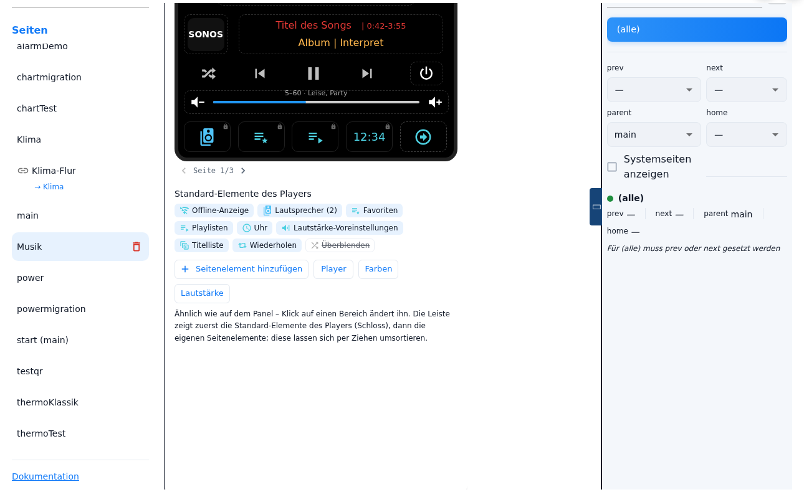
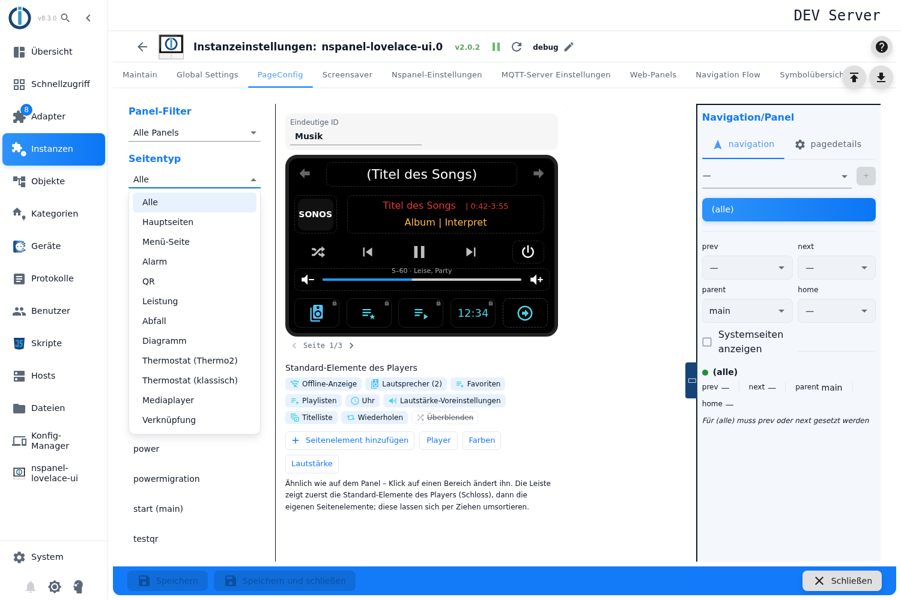
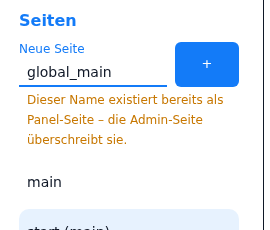
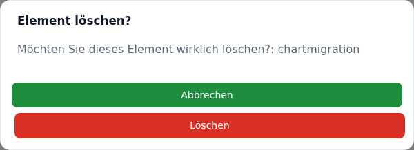
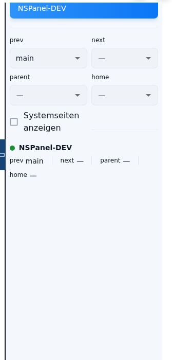
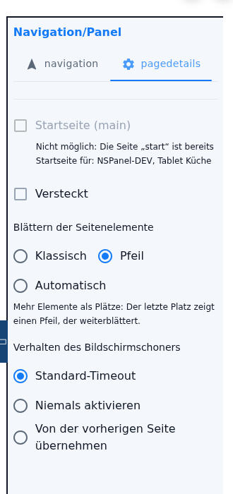

# PageConfig – overview

The **PageConfig** tab is where the pages of the panels are built: create them, set them up, assign them to a panel and link them to each other. Everything configured here lives in the configuration of the instance — **no configuration script is needed for it**. Coming from a script, the way into the admin is described under [Migration](Migration).

This tab is the common shell for **ten page types**. What is shown in the middle depends on the type of the selected page; everything around it — list, filter, panel assignment, navigation, page details, saving — is the same for every type and is described on this page. The settings of the individual cards have pages of their own, see [sub-pages per card type](#sub-pages-per-card-type).

Contents:
- [When the tab appears](#when-the-tab-appears)
- [Layout](#layout)
- [Panel filter](#panel-filter)
- [Page type](#page-type)
- [Creating and deleting pages](#creating-and-deleting-pages)
- [Panel assignment and navigation](#panel-assignment-and-navigation)
- [Page details](#page-details)
- [The *Documentation* button](#the-documentation-button)
- [Saving](#saving)
- [Sub-pages per card type](#sub-pages-per-card-type)
- [Pitfalls](#pitfalls)

## When the tab appears

The tab is **hidden** as long as one of the two prerequisites is missing:

- The **MQTT settings** are complete: the adapter's own server or the IP of an external server, plus the port and the credentials (user and password for the own server; for an external server either a credentials entry or user and password). See [MQTT server settings](General).
- **At least one panel** is set up, see [NSPanel settings](NSPanelsetting).

Only the **entries in the form** are checked, not a connection that actually stands.

In addition, the **instance has to be running**. With the instance stopped, *Page Type*, the *New Page* field, the **+** button, the bin icons of the list, the two tabs of the right-hand column and the fields of the editors stay locked; the panel filter and the page list can still be read. The reason: the admin asks the **running adapter for the existing page names** live (command `getAllPages`) — if the answer stays empty, it tries again every three seconds.

## Layout

| Area | Content |
|---|---|
| **Left** | Panel filter, page type, the *New Page* field, the page list and the *Documentation* button. |
| **Middle** | The editor of the selected page — one per page type. With no page selected it says *Select an item*. |
| **Right** | **Navigation/Panel** with two tabs: panel assignment and navigation targets, and the page details. |

The right-hand column can be collapsed with the **handle** on its left edge (⏷ open, ⏶ closed). As long as no page is selected it is collapsed and the handle does nothing. On a narrow screen (phone, tablet) there is no handle: the column then moves below the editor and carries a bar labelled *Navigation/Panel* at the top.

## Panel filter

Decides which pages the list shows — it changes nothing in the configuration.

| Choice | Shows |
|---|---|
| **All panels** | Every page, regardless of assignment. |
| **Not assigned** | Pages without a panel assignment. Those are **not present** on the panel — this is where to find them again. |
| **&lt;panel name&gt;** | Pages assigned to that panel, plus every page set to *(all)*. |

Every panel of the panel table can be chosen, including the [web panels](WebPanel). The web panel **mirror** of a hardware panel is not an entry of its own: it gets the pages of the panel it is made from and therefore does not appear in the list.

## Page type

The page type filters the list **and** determines what a click on **+** creates. The selection has twelve entries: two pure filters and the ten page types.

| Entry | Meaning | Described under |
|---|---|---|
| **All** | Filter: shows every page. | — |
| **Main pages** | Filter: shows the pages flagged as start page. | [Page details](#page-details) |
| **Menu page** | Five variants in one type: Grid (6 slots), Grid2 (8 slots, 9 on *us-p*), Grid3 (4 slots), Entities (4 rows), Schedule (6 rows). | [Menu page](pageMenu) |
| **Alarm** | Alarm system; with the *unlock* mode it becomes the unlock page. | [Alarm and unlock page](cardAlarm) |
| **QR** | Wi-Fi access, phone number or address as a QR code. | [QR code](cardQR) |
| **Power** | Energy flow with producers and consumers. | [Power](cardPower) |
| **Trash** | Collection dates. | [Trash](cardTrash) |
| **Chart** | History as a line or as columns. | [Chart](cardChart) |
| **Thermostat (Thermo2)** | Heating and climate, up to eight heat circuits. | [Thermostat](cardThermo2) |
| **Thermostat (classic)** | The older thermostat card with eight slots. | [Thermostat (classic)](cardThermo) |
| **Media player** | Music, speakers, playlists and favourites. | [Media player](cardMedia) |
| **Page link** | Shows another admin page under its own name and with its own navigation. | [Page link](pageLink) |

In addition:

- Under **All** and **Main pages** nothing can be created — the *New Page* field is hidden then.
- **Main pages** is not a card type but a marker. In the list a flagged page carries `(main)` behind it; it stays stored under its own name.
- **Menu page** first creates a **Grid (6 slots)**; which of the five variants it becomes is decided by the *Card type* radio group in the editor. It can still be changed there later.
- A page that is jumped to from outside — via the button on the node in the [navigation flow](naviFlow) or as the target of a page link — resets the filter to **All** if it would otherwise be invisible.

## Creating and deleting pages

**Create:** pick a page type, enter a name in the *New Page* field, press **+**. The name is the **unique ID** of the page: it is how other pages address it in their navigation targets, and how a page item with a navigation target or a script jumps to it.

- `main` is reserved; the **+** button stays disabled and a note names the reason — the start page is made with the marker, not with the name.
- A name **already in use** cannot be created, the button stays disabled. Because the name is **fixed** afterwards, this is the only place where it is checked.
- If the running adapter already knows the name from a page that does **not** come from the admin, the note *"This name already exists as a panel page - the admin page overrides it."* appears. The note applies to pages from every configuration script and to the pages of **all** panels, not only of the one currently filtered.

> ⚠️ **The note promises too much.** A page of the same name from the **script of this panel** wins: the adapter then skips the admin page and writes *"Page with name … already exists, skipping!"* into the log. Overriding only happens in three cases — the **start page** (which always replaces a `main` from the script), a page of the **global** script configuration (only if the panel is assigned to the admin page **by name**; an assignment of *(all)* is not enough) and a page that was only handed in from the **script of another panel**. To replace a script page, remove it from the script — or take the script over completely, see [Migration](Migration).

**The name is fixed.** There is no renaming: the **Unique ID** field in the editor only shows the name. It is read-only and carries the note *"The name is fixed once the page exists - other pages refer to it."*; on the start page its own note stands there (*"Start page - published under the id \"main\" …"*). The value can still be selected and copied.

> **Why fixed?** The ID is what hangs together: the navigation targets *prev*, *next*, *parent* and *home* **of other pages**, navigation targets on page items, [page links](pageLink), the remembered page list of the assigned panels and every reference from a configuration script. Renaming carried only part of that along; the rest led nowhere silently and showed up in the adapter log at best (*"Navigation unresolved for …"*). If a page is to have a different name, the way is: create a new page with the new name, move the contents over, delete the old page — and take the references the confirmation names with you while deleting. There is no page duplicate.

**Order:** the list is always sorted alphabetically; there is no manual order, and none is needed — what the panel shows follows from the navigation, not from the position in the list. In the select lists of the navigation targets `main` comes first, the rest alphabetically.

**Copy:** a whole page can**not** be duplicated. If the same content is to appear at two places of the navigation, the [page link](pageLink) is the way. What can be copied are **single page items of a menu page**: right-click the slot, *Copy item*, right-click the target slot, *Paste item* — also from one menu page into another. There is no way by tap or keyboard shortcut, so on tablet and phone the function is out of reach. The details are under [Menu page](pageMenu#5-copying-and-pasting-tiles).

**Delete:** via the bin icon in the row — on the desktop it appears when hovering the row, on a touch screen it is always there. The confirmation *Delete item?* with the name of the page follows. It **names the pages that point at this one**: the navigation targets *prev*, *next*, *parent* and *home* from all assignment rows, [page links](pageLink) with this page as their target and page items navigating here. More than five are counted (*"… and n more"*).

If a *prev* or *next* points at the page, the checkbox **Connect the previous and the next page** appears below. With it set, the neighbours take over the *prev* or *next* of the deleted page — `A → B → C` becomes `A → C`; if the deleted page has no neighbour of its own on that panel, the link is removed instead of moved. The checkbox is **not** preselected, and every assignment row is handled on its own, so every panel keeps its own chain. Afterwards the list selects the first page of the current filter.

> ⚠️ **Named is not cleaned up.** The confirmation lists the references but does not remove them: *parent*, *home*, [page links](pageLink) and navigation targets on page items stay on the name of the deleted page and lead nowhere (a page link is reported by the adapter and skipped). The list itself is not complete either — references from a **configuration script** are not part of the page configuration and are therefore not named; the dialog says so as well. The checkbox closes the *prev*/*next* chain and nothing else. To see everything that points at the page, look into the [navigation flow](naviFlow) beforehand.

## Panel assignment and navigation

The first tab of the right-hand column decides **on which panel** a page appears and **how it is reached**.

**Assign a panel:** choose a panel in the select field and add it with **+**. There is also the entry **(all)** — the page then applies to every panel, including ones added later. Panels already assigned disappear from the selection. The bin icon next to an assignment removes it; the **first click only marks** it (the icon gets a dark red background), the second deletes it, and after three seconds without a second click the marking expires.

> A page **without** a panel assignment is never built and does not exist on the panel. That is the most common reason for "the page is gone" — the *Not assigned* panel filter shows everyone affected.

**Excluding a single panel:** if the page is set to *(all)*, a panel can be excluded by assigning it **in addition** and **never touching** its navigation. The adapter then skips the page for exactly that panel; the summary carries the note *Page will not be added*.

> **Once touched, the row stays.** The exclusion depends on the panel row carrying **no** navigation at all. Setting a target there and removing it again leaves an empty but existing navigation — the page is built again, while the note *Page will not be added* keeps showing (it only looks at the empty *prev* and *next* fields). The only safe way out is to remove the panel and assign it again.

**Navigation targets:** there are four fields for the panel **clicked** in the list. They match the swipe gestures on the panel:

| Field | Gesture on the panel |
|---|---|
| **next** | swipe right once |
| **prev** | swipe left once |
| **home** | swipe right twice |
| **parent** | swipe left twice |

The choices are the pages this panel knows about and the admin pages assigned to it — the page itself is excluded. The **Show system pages** checkbox adds the internal pages (`///…`) to the list; the unlock page `///unlock` is never hidden. A target already entered always stays visible, even when it is a system page.

Below the fields there is a **summary** per assigned panel: a dot (green as soon as any target is set, otherwise red), the panel name and the four values.

**Resolved neighbours as a placeholder:** a field **without** a value of its own shows, in grey italics, the neighbour the **running** adapter resolved for this panel — the page whose *next* points here, for instance. That is not a stored value, and the tooltip says so: *"Determined from the navigation of the running adapter, not stored. Choose a value to store it."* Only a choice of your own is stored; an empty field stays empty, nothing is written back. Without a running instance the placeholders stay empty, and so they do with the assignment **(all)** — there the neighbours can differ per panel. After a restart of the adapter they fill with a delay: the admin asks for the navigation from the third second on, for up to a minute.

**Collision notes:** below *prev* and *next* a note appears in the warning colour when other pages on the selected panel have stored the **same** value (*"The pages X, Y also point to this prev."*, likewise for *next*) or when other pages point at this page with their *prev* while its own *next* leads to none of them (*"… they only hang on by their own prev."*). The notes are computed from the stored configuration — start pages do not count, because their own values are ignored anyway.

Worth knowing:

- **The opposite direction is not created automatically.** Setting `next = B` on page A means `prev = A` has to be entered on B as well, otherwise there is no way back. The final chaining of *prev* and *next* is only computed by the adapter when it builds: pages sharing the same *prev* are hung one after another in the order of the page list. An **explicit *next*** is not overwritten by that — if the *next* page is part of the group it comes first behind the page, otherwise the own link stays and the group only hangs on by its *prev*.
- A page that has **no target at all** and is not the start page automatically gets `home` pointing at the start page when it is built — an emergency exit, not navigation.
- A target pointing at the **page itself** is removed by the adapter for *home* and *parent* and written into the log.
- A **⚠** on a value means: the target does not exist on the panel in question. If a panel has not reported any pages at all yet (because it has never been online), no warning is shown.
- With the assignment **(all)**, *prev* or *next* has to be set, otherwise the page can only be reached through a navigation target on a page item. The admin points this out.
- If the page is flagged as the **start page**, the panel selection, the bin and the four fields are locked; a note at the top names the reason. To change them, uncheck the box under *Page details*. The fields then show, in grey italics, the neighbours the adapter resolved for the start page, with the sentence *"The start page has no navigation of its own: its neighbours follow from the other pages whose prev/next point to the start page …"* below them — **the neighbouring page is what gets changed**, not the start page. The summary shows the resolved values here as well.
- On a **menu page in the Grid2 variant** the selection depends on the assignment: Grid2 requires all assigned panels to use the same model — otherwise the variant is disabled and the editor falls back to Grid.
- Pages of the type **Power** or **Chart** that come from the old tabs *Page Power* / *Page Chart* at first keep taking their navigation from the script. The **first panel assignment in the admin ends that**; the script page is a dead reference afterwards. See [Migration](Migration#8-the-old-tabs-page-power-and-page-chart).

## Page details

The second tab of the right-hand column. It applies to every page type; the three paging settings only appear on the cards that page through a list of page items.

| Setting | Meaning |
|---|---|
| **Start page (main)** | The page is published on the assigned panels under the ID `main` and replaces the start page from the script or the one the adapter generates. Assign first, then flag: without a panel assignment the checkbox stays disabled (*"Assign a panel first"*), likewise with the instance stopped and when another page is already the start page for one of the panels concerned — the note names it. While the marker is set, the panel assignment and the four navigation targets are locked (the name is fixed anyway): the start page has **no navigation of its own** — its neighbours follow from the other pages whose *prev* or *next* points at it, and the fields show what the adapter resolved from that. Targets stored earlier are kept but ignored while the marker is set, and apply again as soon as it is removed. A page that is simply **named** `main` is treated the same way by the adapter — even without the marker, then with a warning in the log. |
| **Hidden** | The page is built but does not appear when swiping through normally. It stays reachable through a dedicated navigation target. |
| **Paging of the page items** | *Classic* (the double arrows of the panel page), *Arrow* (the last slot of the page becomes the paging arrow) or *Automatic* (like classic, and pages on by itself as well). Default: classic. |
| **Scroll by** | *Full page* or *Half page*. Only appears with *Classic* and *Automatic*. |
| **Seconds until the next page** | Only with *Automatic*; empty = 15 seconds. |
| **Screensaver behavior** | *Default timeout* (the time of the panel applies), *Never activate* (the screensaver does not start while this page is on screen — an alarm page, for instance) or *Inherit from previous page* (the page sends the panel no new time, the one of the previously shown page keeps applying). |

The three paging rows appear on **menu pages** (Grid, Grid2, Grid3, Entities, Schedule), on the **thermostat page (Thermo2)** and on the **media player**. *Half page* only exists on the three grid variants and on Thermo2 — and on Thermo2 the choice is reset to *Full page* by the adapter. What the three modes mean on the respective card is described under [Menu page](pageMenu#7-paging-of-the-page-items), [Thermostat](cardThermo2) and [Media player](cardMedia#9-paging-of-the-option-bar).

> The tab labels currently show the keys `navigation` and `pagedetails` instead of their translations (on a narrow screen `nav`, `details`) — a known point in the admin interface, without consequences for the configuration. This page therefore names the tabs by their function and not by their label.

## The *Documentation* button

Below the page list, **Documentation** opens the wiki page of the currently selected page type in a new tab. With the selection on *All* or *Main pages*, the selected page decides: the button leads to the page of its card — for a menu page that is *cardGrid*, *cardGrid2*, *cardGrid3*, *cardEntities* or *cardSchedule*, which all redirect to [Menu page](pageMenu). If **no** page is selected, the button lands on this overview.

## Saving

The admin collects all page changes in the form; they only take effect on **Save**. The adapter restarts afterwards and builds the pages. Closing the instance settings or reloading the browser loses everything unsaved.

One exception: **assigning a panel** writes the page name into the remembered page list of the panel object **straight away**, so that the select lists of the other pages are complete. That is only a cache of the interface — the page itself is still only created on save.

## Sub-pages per card type

The settings of the individual page types, in the order of the *Page Type* selection:

- [Menu page](pageMenu) — Grid, Grid2, Grid3, Entities, Schedule
- [Alarm and unlock page](cardAlarm)
- [QR code](cardQR)
- [Power](cardPower)
- [Trash](cardTrash)
- [Chart](cardChart)
- [Pie chart](cardPChart)
- [Thermostat](cardThermo2)
- [Thermostat (classic)](cardThermo)
- [Media player](cardMedia)
- [Page link](pageLink)

Plus the dialogs that look the same in several editors: [Recurring dialogs](PageConfig-Dialoge) — page item, object picker, colours, mode list, raw data.

The **unlock page** is not a page type of its own: it is made from an alarm page whose editor is switched from *alarm* to the *unlock* mode, together with the target to jump to after the correct PIN.

Which states the cards expect is listed in the [alias table](ALIAS); the way from an existing configuration script into the admin is described by [Migration](Migration).

## Pitfalls

- **Almost nothing works without a running instance.** Creating, deleting and the whole right-hand column are locked, because the admin asks the adapter for the existing page names. The interface gives no hint about it — the fields are simply grey.
- **A page without a panel assignment does not exist.** It is in the list but is not built. The *Not assigned* filter finds it.
- **The name is fixed once the page exists.** To give a page another name, create it anew and delete the old one; there is no duplicate.
- **Deleting only cleans up the chain.** The confirmation names who points at the page and closes the *prev*/*next* chain on request. *parent*, *home*, page links, page item targets and script references stay as they are and point nowhere afterwards.
- **The note "the admin page overrides it" only holds in three cases.** Against the page from the script of the **same** panel the admin page loses and is skipped when building; that is only visible in the log.
- **The start page locks its own assignment.** The panel and the navigation targets can only be changed after unchecking the marker. What was entered before flagging stays stored — but **has no effect** while the page is the start page, and applies again once the marker is removed.
- **A page named `main` is the start page without saying so.** Such names come from old configurations; `main` cannot be given out anew. The adapter treats such a page like the start page and discards its own navigation targets — the log carries a warning asking for the marker to be set. The admin does **not** lock the fields there: targets can be chosen but stay without effect.
- **An assigned panel remembers the page even without saving.** The name goes into the remembered page list of the panel straight away and then appears in the select lists of other pages although the page does not exist yet — even if the assignment is removed again at once or never saved. On the next start of the adapter the list is rewritten and the entry disappears; until then the ⚠ warning is also omitted for that target.
- **Copying only works with a mouse.** *Copy item* and *Paste item* hang on the right-click; on tablet and phone there is no substitute. Pasting over an occupied slot happens without a confirmation.
- **"Half page" does not take effect everywhere.** On Thermo2 the choice is always reset to *Full page*, and switching a grid page to Entities or Schedule afterwards keeps the stored value, which the adapter then discards as well.
- **An `alwaysOn: action` taken over from a script cannot be selected.** There is no button for this fourth mode (the page holds the screensaver back after every action). The value stays stored but shows **no** selected radio button in the *Page details* tab — and the first click into the group deletes it for good.
- **Both tab labels are untranslated.** They show `navigation` and `pagedetails` (on a narrow screen `nav`, `details`) — harmless.
