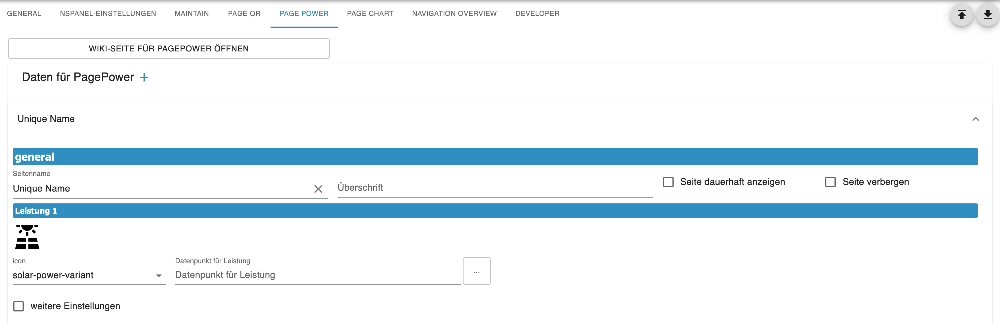
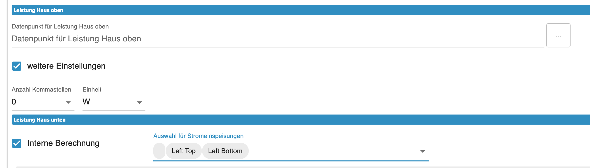

# Page Power

The power page draws the flow of energy through the house: up to six sources and consumers running into
the middle — the virtual distribution box — or out of it. The dots move faster the higher the power is,
and the icon can change its colour with the value.

> **It is configured in the admin**, in the *PageConfig* tab: [Power page – configuration in the
> admin](PagePower-Admin). Every field is described there — the six tiles, the slot dialog with unit and
> decimals, the colour scale, speed and flow direction, the two house values and the internal sum.



## What arrives on the panel

- **Six tiles** around the house: three on the left, three on the right. Each shows an icon, a value and a
  unit; an optional label sits above it.
- **The middle** is the house with two values — one above, one below the icon. Instead of a state of its
  own, the lower one can show the **sum of the feeding flows**.
- **The direction of movement** tells where the energy goes: producers flow towards the middle, consumers
  away from it. At 0 W the dot stands still.
- The unit grows automatically: 999 W becomes 1 kW at the next step.



## Second way: the old *Page Power* tab plus a script

Next to the editor in the *PageConfig* tab the older tab **Page Power** still exists. A page created there
does **not** appear on a panel by itself: it needs an entry in the configuration script carrying the same
`uniqueName`.

```typescript
// as a main page under pages
const powerGrid: ScriptConfig.PagePower = {
    uniqueName: 'pagename', // as in the admin
    type: 'cardPower',
};

// as a subpage under subPages
const energyDisplay: ScriptConfig.PagePower = {
    prev: 'uniqueName of a page',
    home: 'main',
    uniqueName: 'pagename',
    type: 'cardPower',
};
```

```typescript
pages: [powerGrid],
subPages: [energyDisplay],
```

The adapter looks the `uniqueName` up in the table of the old tab (`pagePowerdata`). If it is not there,
it reports *No pagePowerdata found for …* and drops the page.

> **This does not apply to pages from the *PageConfig* tab.** Those the admin builds itself and assigns to
> the panel directly — **no script entry is needed**, and a reference from a script would not even find
> such a page: it only searches the table of the old tab. Which fields exist is described on the
> [admin page](PagePower-Admin).
