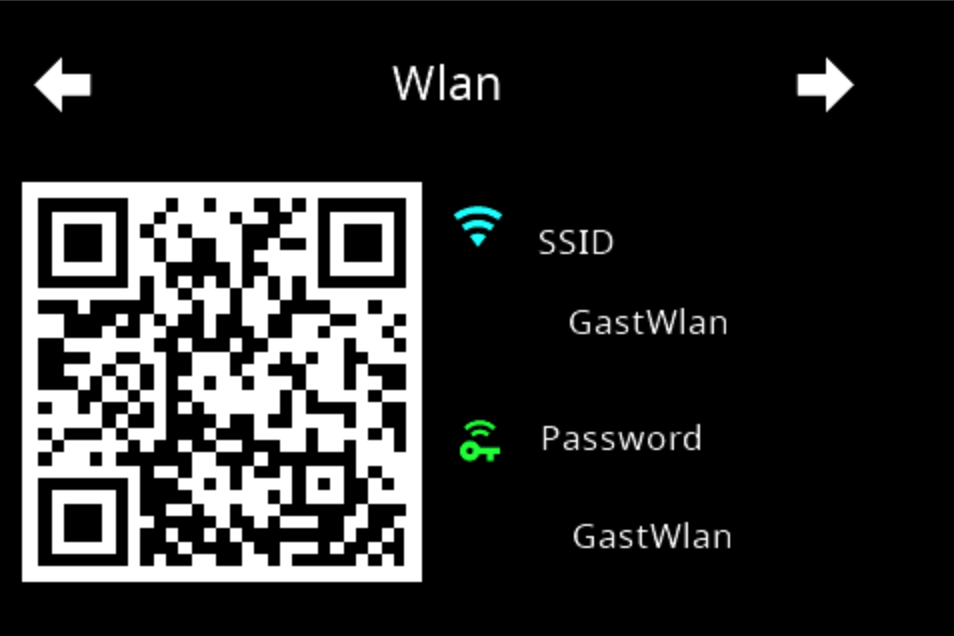
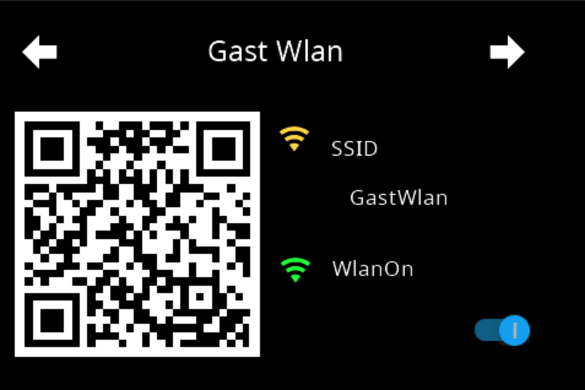
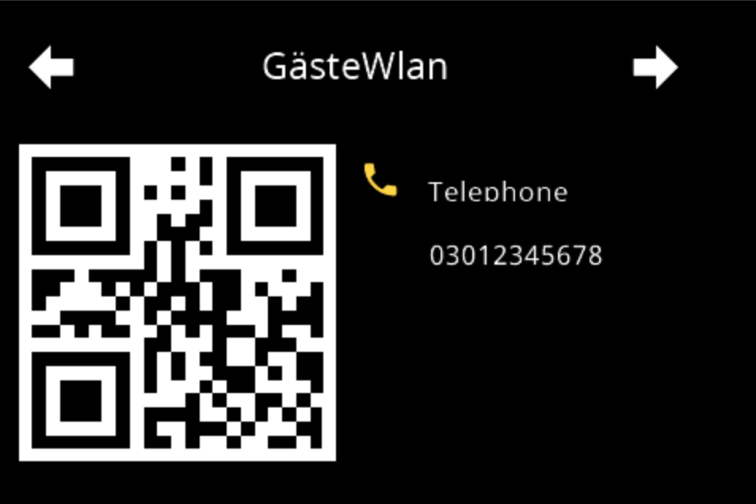
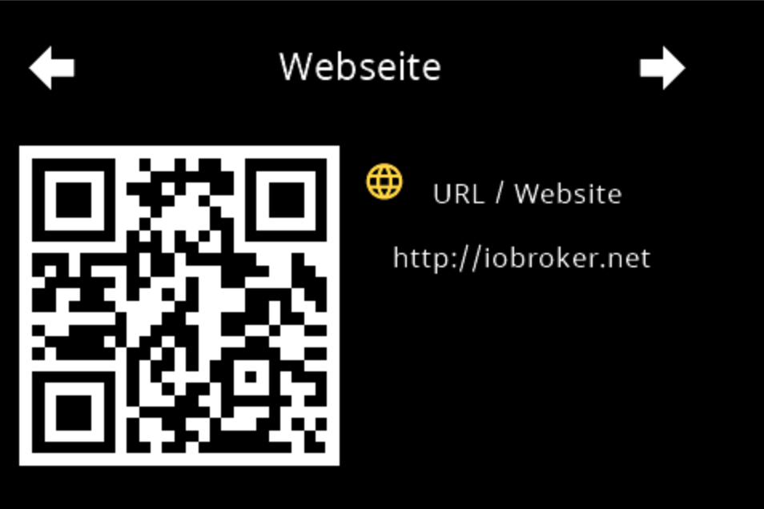

# Page QR

The **QR page** shows a QR code on the panel, ready to be scanned with a phone: the credentials of the
guest Wi-Fi, a telephone number or a web address. It is configured **in the admin only** — a configuration
script cannot create this card type, it rejects it explicitly („is only supported in the admin
configuration! Skipped!", `config-manager.ts`). So there is no second way here, and accordingly no script
description either.

➡️ **[QR page – configuration in the admin](PageQR-Admin)**

That page covers every field: the QR code type, headline and content, and for Wi-Fi additionally the
encryption, the password (also from the central credentials), the hidden network and the switch that
releases the guest Wi-Fi.

## What arrives on the panel

**Wi-Fi** — the code fills the upper half, with two lines below it. The first shows the network name, the
second either the password **or** a switch; never both. The labels *SSID*, *Password* and *Telephone* come
from the panel firmware and stay English even when the adapter runs in German.

 

**Telephone** — the number sits in the code; after scanning, the phone offers to dial it right away. Best
written with the country code, so `+49…`.

**URL** — the classic case: the code holds an address which the phone opens after scanning.

 

## Navigation

How the page is reached — main page or subpage, and with which neighbours — is decided by the **panel
assignment** in the same tab; it is described on the [admin page](PageQR-Admin#7-panel-assignment-and-navigation).
A panel only shows a QR page if the page is assigned to it there.

> **The code is drawn by the panel, not by the adapter.** The adapter only sends the text (SSID,
> encryption, password, number, address); the panel firmware turns it into the code. Very long contents
> therefore become hard to scan quickly — short addresses work far better.
