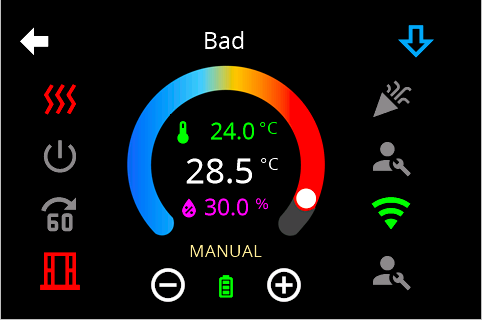
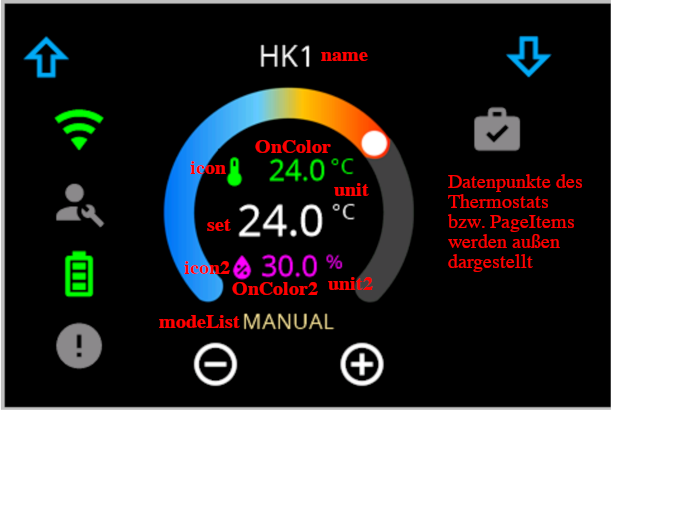
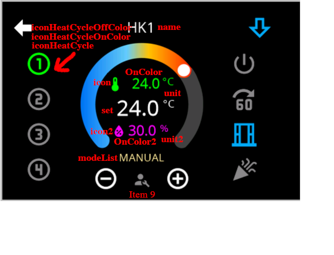

# Page Thermo2

The thermostat page handles up to eight heat circuits on one card and takes your own page items on top.

> **It is configured in the admin.** Every field, the heat circuit dialog, the object picker and the
> arrangement of the tiles are described on
> [Thermostat – configuration in the admin](PageThermo2-Admin). This page describes **what arrives on the
> panel** and the **second way** through the configuration script.



## What arrives on the panel

The target temperature sits in the middle with **−** and **+**, and the tiles surround it. Seven fields
are fixed and filled by the adapter itself:

| Place | Content |
|---|---|
| Line 1 | Icon, current temperature and unit |
| Line 3 | Icon, humidity and unit |
| between − and + | the **mode text** (`OFF`, `AUTO`, `HEAT` …, translated) |

On top of that come the **eight page items** around it — four on the left, four on the right. More items
than slots can be configured; the panel then pages through them.

> **The editor in the admin offers nine slots, eight arrive on the panel.** When building the page the
> adapter cuts the list down to eight entries (`pageThermo2.ts`, `maxItems = 8`), while the editor counts
> on nine. The ninth slot — the one between − and + — is in fact the fixed mode display. An item placed
> there in the editor never shows up on the panel.

The order of the eight tiles is set by `sortOrder`: `V` (default, vertical: 1–4 left, 5–8 right), `H`
(horizontal), plus `HM`, `VM`, `HB` and `VB` as alternative patterns.

Every heat circuit has its **own headline**; the panel pages between the circuits. More than eight heat
circuits are discarded with a warning („only 8 are supported").

## The second way: the configuration script

A complete page looks like this in the script:

```typescript
const ThermoNew: PageType = {
    type: 'cardThermo2',
    uniqueName: 'main',
    heading: 'not shown',   // the headline comes per heat circuit from `name`
    thermoItems: [
        { name: 'Living room', id: '0_userdata.0.Devices.Thermostat' },
    ],
    items: [
        { id: 'alias.0.Light.lights.Device_1', filter: 0 },
        { id: 'alias.0.NSPanel.general.shutter', filter: 1 },
    ],
};
```

`heading` is **not shown** on this card — the headline comes from the heat circuit's `name`, or from the
channel's `common.name`. `scrollType` and `scrollPresentation` have no effect here either; the card always
pages.

### Either an alias …

```typescript
thermoItems: [
    {
        name: 'This is the headline',
        id: '0_userdata.0.Devices.Thermostat', // channel, device or folder
    },
],
```

The channel has to carry the role **`thermostat`** or **`airCondition`** (see the [alias table](ALIAS));
any other role is rejected with an error and the entry is removed.

An **`airCondition` channel yields two heat circuits** — heating and cooling. The second one uses `SET2`,
`name2`, `iconHeatCycle2`, `iconHeatCycleOnColor2` and `iconHeatCycleOffColor2`. **Without `SET2` the
cooling circuit disappears**, because a circuit without a writeable setpoint is skipped.

### … or states directly

The two cannot be mixed, but the states may well belong to an existing channel:

```typescript
thermoItems: [
    {
        name: 'This is the headline',
        set: '0_userdata.0.…Thermostat.SET',        // setpoint, mandatory
        thermoId1: '0_userdata.0.…Thermostat.ACTUAL',   // upper value line, mandatory
        thermoId2: '0_userdata.0.…Thermostat.HUMIDITY', // lower value line
        modeId: '0_userdata.0.…Thermostat.MODE',        // mode text
    },
],
```

> **`set` must exist and be writeable.** Otherwise the adapter skips the whole heat circuit and writes to
> the log: *invalid SET datapoint. Not exists or not writeable!* The same goes for `thermoId1`; states
> given for `thermoId2` and `modeId` that do not exist are reported as well.

### Shared fields




| Field | Meaning |
|---|---|
| `icon`, `onColor` | Icon and colour of the first value line (temperature) |
| `icon2`, `onColor2` | the same for the third line (humidity) |
| `unit` | Unit — **in the script it covers both value lines**; `unit2` only works in the admin configuration |
| `iconHeatCycle`, `iconHeatCycleOnColor`, `iconHeatCycleOffColor` | Icon and colours of the heat circuit tile |
| `minValue`, `maxValue`, `stepValue` | Limits and step of the setpoint (defaults 15, 28 and 0.5) |
| `power` | State for on/off. If it exists it wins; otherwise the adapter derives the state from `MODESET` or `modeId`. |
| `modeList` | your own labels for the modes, see below |

`power` and `unit` are **not optional** in the type — anyone compiling the examples has to supply both.

Whether a 10 in the state means 1 °C or 10 °C is set once in the admin under *Nspanel settings* (script
compatibility).

### modeList

`modeId`, `MODE` and `MODESET` all work the same way: a number picks the text from a list. The default
list is

```typescript
['OFF', 'AUTO', 'COOL', 'HEAT', 'ECO', 'FAN', 'DRY']
```

and it is translated. A 0 in the state therefore shows *OFF*, a 3 shows *HEAT*.

**Which list wins depends on the route:**

| Route | Order |
|---|---|
| Alias | the state's `common.states` **first**, then `modeList`, finally the default list |
| States directly | `modeList` **first**, then `common.states`, finally the default list |

```typescript
modeList: ["Off", "Auto", "Cool", "Heat", "Eco", "Fan", "Dry"],
```

If `MODE` is not given, `MODESET` takes its place.

### Page items and heat circuits

```typescript
items: [
    { id: 'alias.0.Light.lights.Device_1', filter: 0 },
],
```

`filter` ties a page item to a heat circuit, counted from 0. **Inserting an `airCondition` channel shifts
the index of every following circuit by one**, because it turns into two.

Free slots can be created with **placeholders**: `{ id: 'delete' }` or `{ id: 'empty' }`.

> Placeholders ignore `filter` — they appear in **every** heat circuit. A gap built for one circuit is
> therefore built into all of them.
