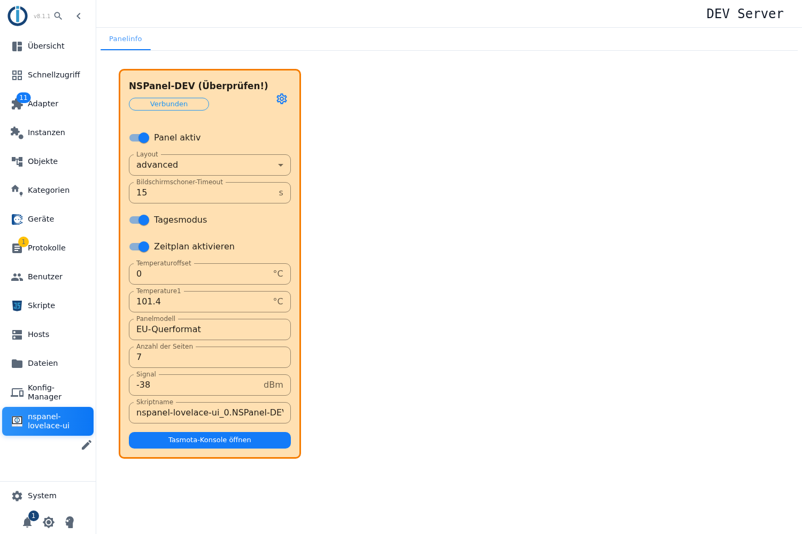

# Panel info

The adapter adds its **own entry to the admin sidebar** — under the adapter icon.  
It opens the **Panel info** tab: one card per panel with the values that matter, and not just to look at but to operate.

Unlike the instance settings, this tab is meant for the **daily glance**: is the panel running, how good is the Wi-Fi, how many pages does it have, which script belongs to it. The **cog** in the top right of the card leads to the instance settings if something really has to be configured.

## What the card shows

Header: the name of the panel, the connection state and — if the adapter has found a discrepancy — the addition **(check!)** together with an orange border. Then come the values:

| Display | State under `panels.<panel>.` | Meaning |
|---|---|---|
| **Panel active** | `cmd.activated` | Switches the panel on and off in the adapter. |
| **Layout** | `cmd.screenSaver.layout` | Version of the screensaver (e.g. `advanced`). |
| **Screensaver timeout** | `cmd.screenSaver.timeout` | Seconds until the screensaver appears. |
| **Day mode** | `cmd.dim.dayMode` | Switches between day and night brightness. |
| **Enable schedule** | `cmd.dim.schedule` | Turns the time-controlled brightness on. |
| **Temperature offset** | `cmd.tempOffset` | Correction for the built-in temperature sensor, see [Temperature offset](#temperature-offset). |
| **Temperature1** | `info.tasmota.sensors.ANALOG.Temperature1` | Reading of the sensor inside the panel. |
| **Panel model** | `info.nspanel.model` | Hardware model, e.g. EU landscape. |
| **Number of pages** | `info.internal.pageCount` | How many pages the panel currently knows. |
| **Signal** | `info.tasmota.sts.Wifi.Signal` | Wi-Fi level in dBm — the closer to 0, the better. |
| **Script name** | `info.internal.scriptName` | The configuration script belonging to this panel. |

At the bottom, **open Tasmota console** leads straight into the panel's web interface.

## Operating, not just watching

Fields backed by a **writable** state are real controls: switches flip immediately, a selection applies the value when picked, a text field when you press **Enter** or leave it. **Nothing is saved and nothing restarts** — the value goes straight into the state and the panel reacts at once. Pure readings (temperature, signal, page count, script name) cannot be changed.

In practice that means: try out the screensaver timeout or the day mode here, without opening the instance settings and without restarting the adapter.

## Temperature offset

The **temperature offset** is a correction for the built-in temperature sensor: Tasmota adds it to the reading, so a negative value lowers the display.

| What | Behaviour |
|---|---|
| **Range** | −12.6 to +12.6. The adapter sets values outside to the nearest bound. |
| **Unit** | Follows the Tasmota setting `TempUnit` — °C or °F. |
| **Transfer** | The adapter sends the value via MQTT as the Tasmota command `<topic>/cmnd/tempOffset` to the panel. This only works while the panel is online. |
| **After a change** | Right afterwards the adapter requests `STATUS 10`, so that **Temperature1** shows the corrected value promptly and not only with the next regular report. |
| **Panel comes online** | Each time the panel comes online, the adapter sends the stored value again. |
| **Value from the panel** | If an MQTT message from the panel (`tele/RESULT` or `stat/RESULT`) contains the field `tempOffset`, the adapter writes this value to the state. |

In the quick access the field is a text field: type the value and confirm with **Enter** or leave the field — as described under [Operating, not just watching](#operating-not-just-watching). Web panels have no temperature sensor and therefore no offset (see [WebPanel](WebPanel)); both fields are missing for them.

## Notes

- If the instance is not running, a notice appears instead of the cards — then the log is the place to look.
- The colour of the card follows the same logic as in the [maintain](Maintain) tab: orange means "the adapter found something", for example outdated firmware or a newer script version.
- Which values a card shows is defined in the adapter; the complete list of a panel's states lives in the object tree under `nspanel-lovelace-ui.<instance>.panels.<panel>`.
