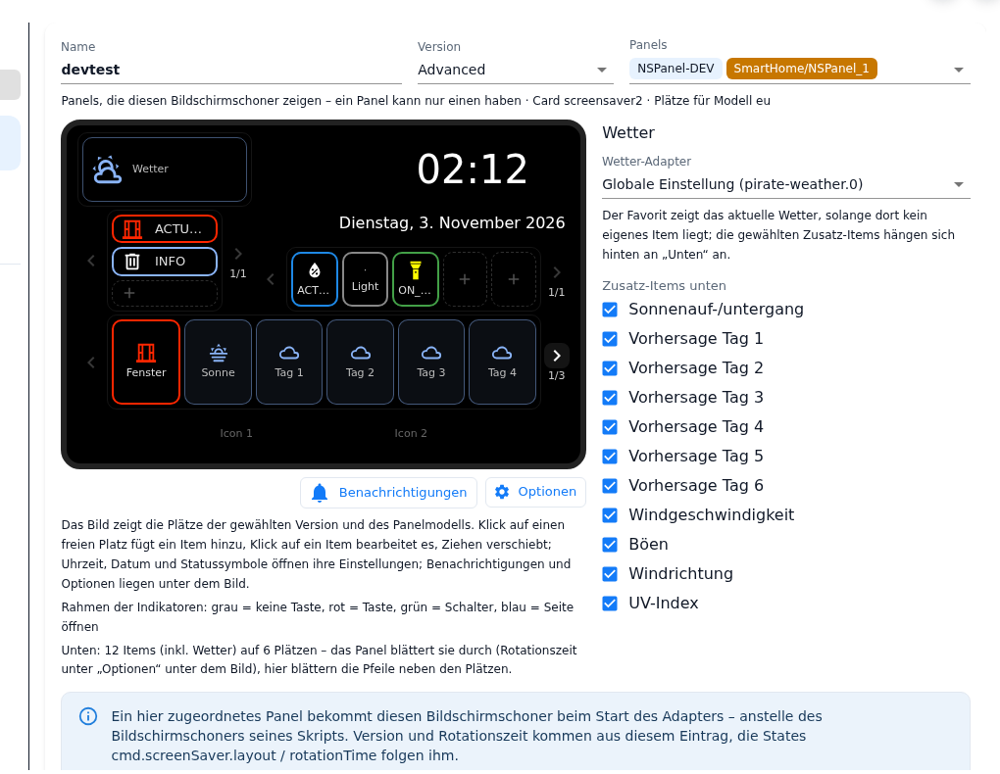
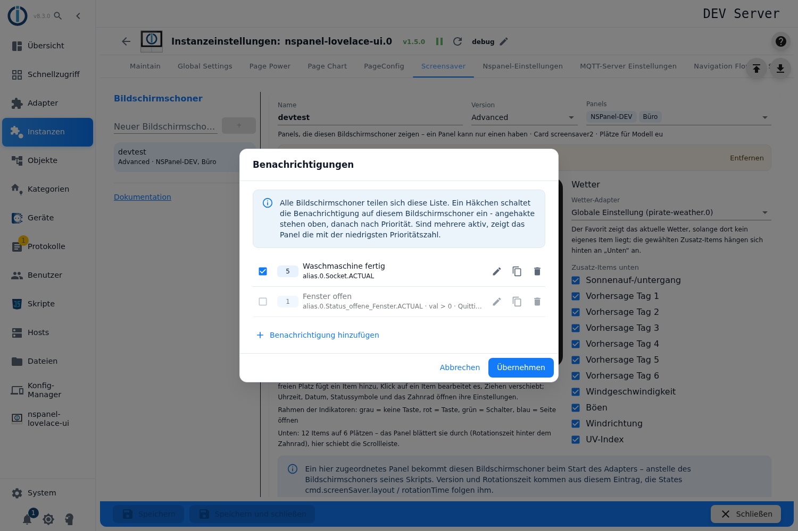
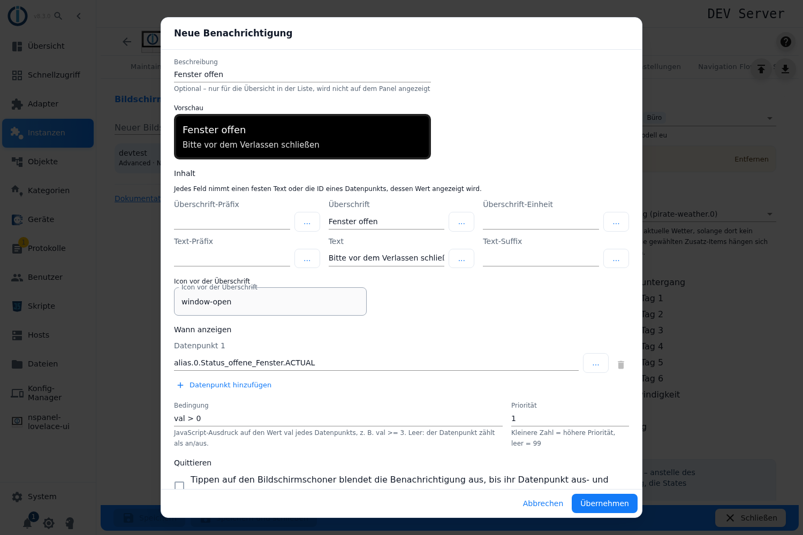
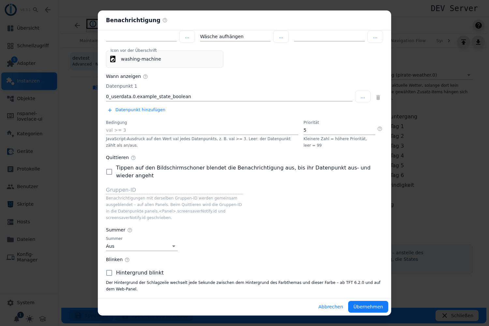

# Screensaver notifications – configuration in the admin

A notification covers the screensaver while a state is "on": two lines – a headline with an icon and a text below it. It is meant for things that should be noticed without operating the panel: an open window, an alarm, a fault, a value that runs out of range.

They are created through the button **Notifications** below the panel picture of the screensaver editor, next to **Options** (up to 2.0.2 it was the bell in the picture). All screensavers share **one common list**; the tick box in each row decides on which screensaver a notification appears. A configuration script is not needed for this – since 2.0.0 the panel needs none at all (tick box **Panel uses no script**, see [NSPanel settings](NSPanelsetting)).

How the screensaver itself is created is described under [Screensaver in the admin](screensaver). This page covers the notifications only.

Contents:
- [The list](#1-the-list)
- [Content: headline and text](#2-content-headline-and-text)
  - [When the message changes on the panel](#when-the-message-changes-on-the-panel)
- [When to show: states and condition](#3-when-to-show-states-and-condition)
- [Priority: which message the panel shows](#4-priority-which-message-the-panel-shows)
- [Dismissing and the group ID](#5-dismissing-and-the-group-id)
- [Buzzer](#6-buzzer)
- [Preview and what the dialog checks](#7-preview-and-what-the-dialog-checks)
- [Saving – what the adapter does with it](#8-saving--what-the-adapter-does-with-it)
- [If something does not look as expected](#9-if-something-does-not-look-as-expected)
- [Colours: headline, text and background](#10-colours-headline-text-and-background)
  - [Background blinks](#background-blinks)
- [From a script: sendTo `screensaverNotify`](#11-from-a-script-sendto-screensavernotify)

## 1. The list





The button sits below the panel picture, to the left of **Options**. The small number on it tells how many notifications are switched on for **this** screensaver. It only works while the instance is running.

A click opens **Notifications** – the common list. Each row shows:

| Element | Meaning |
|---|---|
| **Show on this screensaver** | The tick box switches the notification on for the screensaver currently open. Without the tick it stays in the list but goes to no panel. |
| Priority chip | The priority number, see [Priority](#4-priority-which-message-the-panel-shows). |
| Label | The **description**, otherwise prefix + headline + unit, otherwise the text, otherwise the first state. |
| Second line | The states, the condition if there is one, and "Dismiss (group ID)". |
| **Also used by: …** | Appears when further screensavers use the same notification. |
| **Edit**, **Duplicate**, **Delete** | Pencil, copy, bin. Duplicate puts the copy right behind the original in the stored list and keeps the tick – it is displayed wherever the sorting puts it. |

At the bottom, **Add notification** creates a new one.

> The order in the list is display only: ticked ones on top, then by priority, then by the order they were stored in. Which message the panel shows is decided by the priority alone.

> ⚠️ **Editing and deleting affect every screensaver** that uses the same notification. The dialog says so when editing, and asks before deleting – but only when the notification really is used more than once. To change a message for one panel only, **duplicate** it first.

> **Deleting tidies up everywhere – keeping does too.** On deleting, the notification disappears from **all** screensaver entries, not only from the one that is open. The other way round, deleting a **screensaver** does **not** delete its notifications: they stay in the common list and appear on every other screensaver as a row without a tick. Tidying up means deleting them row by row in the notifications dialog.

## 2. Content: headline and text



At the very top of the dialog stands the **Description**, below it the preview, then the section **Content**. It fills the two lines the panel displays – the icon field sits below the two text lines:

| Field | Effect |
|---|---|
| **Icon in front of the headline** | Icon at the left of the first line. |
| **Headline prefix**, **Headline**, **Headline unit** | The first line, composed in this order. |
| **Text prefix**, **Text**, **Text suffix** | The second line. |
| **Description** | For the overview in the list only – it is **not** shown on the panel. |

**Every one of these fields takes either a fixed text or the id of a state** – in the latter case the panel shows its current value. Numbers are formatted the way the panel does it; if the headline has no unit of its own, the adapter appends the unit (`common.unit`) of the state – with string states too. This holds for the headline only: the text line has no unit field and never gets a unit appended.

> **Prefix and suffix of the text** stay disabled while **Text** is empty – on their own they do not make a line. Anything left in a disabled field is dropped when applying.

> ⚠️ Whether a field counts as a text or as a state depends solely on **whether the id actually exists**. A typo in an id silently ends up as text on the panel; there is no warning. The same holds for an id that ends on a dot (`pirate-weather.0.` instead of `pirate-weather.0.temperature`) – it is never recognised as a state. The [preview](#7-preview-and-what-the-dialog-checks) is the proof: if the value appears there, the id was recognised.

### When the message changes on the panel

When the value of a state in **any** of the content fields changes – icon in front of the headline, headline prefix, headline, headline unit, text prefix, text or text suffix – the adapter sends the message with the new content to the panel.

| What changes | When it reaches the panel |
|---|---|
| **Content** of the displayed message | **At most every 30 seconds.** If the last send is longer ago, at once; otherwise once at the end of the 30 seconds with the values of then. Intermediate values are dropped. So a value that changes every second (a voltage, say) does not flood the panel. The 30 seconds run **per panel** – two panels with the same message do not slow each other down. |
| **On/off** through the states and the condition of [section 3](#3-when-to-show-states-and-condition) | **At once:** the message appears or disappears, and another message takes its turn by its [priority](#4-priority-which-message-the-panel-shows) at once. |

> **Tapped away stays away.** Every touch of the screensaver hides the message on the panel – the display does that by itself. If the screensaver stays (a swipe, say, or a single tap with double click switched on), the message stays hidden, also with a new content. It comes back the next time the screensaver appears, that is after the next dimming. If its states bring another message up, that one appears at once. With a standby brightness of 0 in the current mode (day or night) the first tap on the dark display hid nothing – then new content still arrives.

A **new colour** counts as new content as well: if a displayed message changes its font, background or blink colour, that change is throttled just like a new text. And if the screensaver is not visible at all because the panel sits on another page, a follow-up due at the end of the 30 seconds falls away – nothing is lost by that, because as soon as the screensaver appears again the adapter sends everything anew.

A **dismissed** message stays hidden, also when its content changes – it only comes back when its state goes off and on again (see [Dismissing](#5-dismissing-and-the-group-id)).

A message set by `sendTo` (`screensaverNotify`) **without `id`** or through `cmd.screenSaver.headingNotification`/`textNotification`/`activateNotification` is not configured in the admin and is not throttled. A message by `sendTo` **with `id`** is throttled like one of the list, see [From a script](#11-from-a-script-sendto-screensavernotify).

## 3. When to show: states and condition



| Field | Effect |
|---|---|
| **State 1, 2, …** | At least one is required. **Add state** appends more; from two rows on, a row can be removed again. |
| **When shown** | Optional expression over `val`, the value of the respective state – for example `val >= 3`. |

The notification appears **while all states listed are "on"** (logical AND). Without a condition the value counts as yes/no directly. With a condition the expression is evaluated for every state; it is a free JavaScript expression, not just a comparison – `val > 9` works as well as `val.length > 0 && val !== 'OFF'`.

> **One condition applies to all** states of the notification. Different conditions per state do not exist – that needs two notifications.

> ⚠️ The condition is **not checked for syntax**. A faulty expression only shows up at runtime: the adapter logs an error and then evaluates the raw value as yes/no.

## 4. Priority: which message the panel shows

The panel shows **one** notification at a time. If several are active at once, the one with the **lowest priority number** wins; on a tie the order of the common list decides.

- **Priority**: smaller number = higher. Empty means **99**, that is, last.
- The other messages appear once the leading one is no longer active or has been dismissed. There is no sequence of several messages.

## 5. Dismissing and the group ID

| Field | Effect |
|---|---|
| **Dismiss** | A tap on the screensaver hides the notification – until its state switches off and on again. |
| **Group ID** | Only with the tick box set. Notifications with the same group ID are dismissed together, and that **on all panels**. |

**Feedback for scripts:** When a notification with a group ID is dismissed, the adapter writes the **group ID** (not the single entry) to `nspanel-lovelace-ui.0.panels.<panel>.screensaverNotify.id` (the panel that was tapped) and to `nspanel-lovelace-ui.0.screensaverNotify.id`. Every dismiss writes the state again, also with the same group ID – so trigger the script on update, not on value change. Without a group ID there is no feedback.

> ⚠️ **Without** "Dismiss" the message stays as long as its states are on – it cannot be tapped away at the panel. For lasting states (an open window) that is intended, for events (a doorbell) usually not.

> ⚠️ **Only a dismissible message takes the tap.** While a message with **Dismiss** lies on the screensaver, the first tap – or swipe – is used up for it: it disappears, the panel stays in the screensaver, only the next tap leads to the main page. A message **without** Dismiss lets the tap through: the panel changes to the main page as usual, the message stays and lies on the screensaver again as soon as it returns. With double click switched on (`cmd.screenSaver.doubleClick`) the double tap counts each time. Up to and including 2.2.0 a message that could not be dismissed took every tap as well – the only ways out of the screensaver were an item with an action of its own, the hardware buttons or `cmd.goToNavigationPoint`.

## 6. Buzzer

Three choices: **Off**, **Default** (`1,2,3,0xF54`) or **Own tone sequence**. With "own" the field **Tone sequence** is mandatory; it takes the arguments of the Tasmota command `Buzzer` in the form *count,on,off,tune*. Spaces at the edges are cut off by the admin when applying.

The buzzer only sounds **when the displayed notification changes** – not repeatedly while the same message stands, not even when its content changes. It also stays silent in **night mode** (`panels.<panel>.cmd.dim.dayMode` off) and when `panels.<panel>.cmd.isBuzzerAllowed` is off; this state is writable and stands on `true` by default.

> On a [web panel](WebPanel) the same message appears. The buzzer is the only Tasmota command the adapter passes on to the browser – there the browser plays it, but only after the browser has been tapped once.

## 7. Preview and what the dialog checks

The preview in the dialog draws the message the way the panel renders it: black box, icon, headline line, text line. Fields holding a valid state id show the **current value**.

> The values are fetched once shortly after typing and read again when the dialog opens – they do **not** follow live.

**Apply** stays disabled until all of these hold:

- at least one **state** is entered,
- there is something to show at all – either **Text** or **Headline** (its prefix, unit or icon are enough),
- the **Priority** is a number,
- with **Own tone sequence**, the tone sequence is filled in.

The dialog names the reason in a warning line, for example "Nothing to show: fill in the headline (or its prefix, unit, icon) or the text."

## 8. Saving – what the adapter does with it

The dialog works on a copy: only **Apply** in the list writes the changes back, and only **Save** in the instance settings makes them permanent – the instance restarts in the process.

- The notifications are kept centrally in **`native.screensaverNotify`**, each with an id of its own. A screensaver only stores the **ids** of the notifications that are to appear on it.
- Older configurations, where the notifications were still part of the screensaver entry, are moved into the common list automatically when loading.
- Notifications without a tick are kept but are sent to no panel.

On the panel this becomes a headline line (icon + prefix + value/text + unit) and the text line below it (prefix + text + suffix) – on the panel as on the [web panel](WebPanel).

**Taking them over from a script (from 2.0.0).** [Maintain](Maintain) → **Take script over into admin** brings the notifications of the panel script along:

- Each becomes one row of the common list, as the **Description** it carries the panel name with a running number (*Wohnzimmer 1*, *Wohnzimmer 2* …), and it is ticked for the newly created screensaver right away.
- The preview of the conversion counts them ("*n* notifications"), together with the number of screensaver items.
- If the conversion breaks off between the script backup and writing the instance, the adapter adds the notifications that are still missing by id at its next start and reports it in the log. Nothing is created twice.

> ⚠️ If **one** notification cannot be expressed, the **whole screensaver** is skipped – reported as "An item of the screensaver cannot be expressed in the admin". That happens with a notification from a template or from raw data, with a field the admin does not know, with a missing state and with a tone sequence that has spaces at its edges. For screensaver **items** there is the raw data way as a fallback, for notifications there is not: here the only cure is to remove the message in the script, convert, and create it anew in the admin afterwards.

## 9. If something does not look as expected

- **The button is grey:** The instance is not running. Notifications can only be edited with a running instance.
- **The id appears on the panel instead of the value:** The id does not exist – then the entry counts as a fixed text. The preview shows it immediately.
- **The message never appears:** All states must be "on" at the same time. A state that does not exist counts as "off" – with several states the message silently disappears. If **only one** state is entered and it is missing, the adapter drops the whole notification and logs an error.
- **A different message than expected appears:** Only one is ever visible – the one with the smallest priority number. An empty priority means 99.
- **The message does not go away:** Without **Dismiss** it stays until its states go off.
- **A tap on the screensaver does nothing:** A dismissible notification lay over it – the first tap dismissed it, the next one leads on. If the panel stays in the screensaver with a message that **cannot** be dismissed as well, it is still running 2.2.0 or older; see [Dismissing](#5-dismissing-and-the-group-id).
- **A deleted notification turns up again:** Not deleted, only no longer ticked. A deleted screensaver does not take its notifications with it – they stay in the common list.
- **Dismissing affects more than expected:** Notifications with the same **Group ID** are hidden together, on other panels as well.
- **A value on the panel lags behind:** New content of the same message reaches the panel at most every 30 seconds, see [When the message changes on the panel](#when-the-message-changes-on-the-panel). A message that was tapped away only appears again after the next dimming.
- **The buzzer stays silent:** Night mode, `cmd.isBuzzerAllowed` off – or the displayed message did not change at all.
- **The headline breaks in the wrong place:** The sequence `<sp!it>` must not appear in the text, the adapter splits the lines at it internally. A `~` in the text is replaced by `-`.
- **A change shows up on another screensaver:** The list is shared – see "Also used by" in the row. **Duplicate** first if a different version is needed.
- **The background does not blink:** Only TFT 6.2.0 (and the web panel) can do that, and only for a notification with the tick **Background blinks** – see [Background blinks](#background-blinks).

## 10. Colours: headline, text and background

The colours of the notification are not set in the dialog but by the [colour theme](colorTheme#colours-of-the-notification) of the instance. They apply to all notifications and also to a notification a script sets via `sendTo` or through `cmd` – only a message by `sendTo` with `id` can bring font colours of its own with `colorHeadline`/`colorText`.

| Colour | Meaning |
|---|---|
| **Headline** | Font colour of the upper line. In the admin: **Notification headline**. |
| **Text** | Font colour of the line below. In the admin: **Notification text**. |
| **Background** | Area behind both lines, so that the notification stands out from the screensaver. It spans the full width from the headline down to the lower edge of the display, as far as nothing below stays visible. If something stays there – the bar with the icons of the advanced screensaver, the colour bars of EasyView and the tiles, on US portrait the bottom row of the standard screensaver –, it ends above it; that depends on the model. In the admin: **Notification background**. |

With the ready-made themes headline and text are white as before; the background is the background of the screensaver, slightly lightened – grey (RGB 56/56/56) with the default theme. Own values come with the colour theme **User colors** in the section **Screensaver**.

> **Only TFT 6.2.0 shows the background.** Older TFTs keep showing the notification on the background of the screensaver; they do take over the headline and text colour. The [web panel](WebPanel) draws the area like the TFT.

### Background blinks

A single notification can draw attention to itself on top: its background then alternates every second between the background of the colour theme and a second colour. This is set in the dialog of the notification, in the section **Blinking** below the buzzer:

| Field | Meaning |
|---|---|
| **Background blinks** | Switches the blinking on for this notification. Without the tick nothing blinks. |
| **Second colour** | Appears with the tick, preset to dark red (`#9c201a`). The first colour is always the background of the colour theme. |

The panel blinks by itself – the adapter sends the message only once. The blinking ends as soon as the notification disappears (state off, tapped away) or another one without blinking takes its place.

> **Only from TFT 6.2.0 on and on the web panel.** Older TFTs show no background at all and therefore no blinking either. A notification that a script sets via `sendTo` without `id` or through `cmd` never blinks; via `sendTo` with `id` it blinks with `backgroundBlink`.

## 11. From a script: sendTo `screensaverNotify`

A script or another adapter can also set a notification via `sendTo`. The message understands largely the same fields as the popup (`setPopupNotification`, see [popup](pagePopup)), so the same JSON can go to both. Answer: `{ result: 'ok' }` or `{ error: 'sendToAnyError' }` (no panel found).

```js
sendTo('nspanel-lovelace-ui.0', 'screensaverNotify', {
    id: 'washer',
    priority: 40,
    headline: 'Washing machine',
    text: 'done',
    icon: 'washing-machine',
    type: 'acknowledge',
    buzzer: true,
});
// remove
sendTo('nspanel-lovelace-ui.0', 'screensaverNotify', { id: 'washer', priority: 0 });
```

| Field | Meaning |
|---|---|
| `panel` | Target: name, friendly name or MQTT topic of the panel, a string or an array. **Without it the message goes to all panels.** |
| `id` | Id of the message. **With `id`** the message goes into a queue of the panel (see below), **without `id`** the old way applies. |
| `priority` | Only with `id`. Lower = more important, default **50**. `<= 0` removes the message with this `id`, `<= -100` all messages whose `id` starts with it. |
| `headline` | Headline; `heading` is accepted as well (`heading` wins on the old way, `headline` on the new one). |
| `text` | Second line. |
| `enabled` | Old way: `true` shows the message, missing or `false` switches it off. With `id`: `false` removes the message. |
| `icon` | Only with `id`. MDI name, in front of the headline like the icon of the list. |
| `colorHeadline`, `colorText` | Only with `id`. Font colour as `{r,g,b}` or `"#rrggbb"` instead of the colour of the colour theme. |
| `backgroundBlink` | Only with `id`. `"#rrggbb"`: second background colour, see [Background blinks](#background-blinks). |
| `buzzer` | Only with `id`. `true` = default tone, a string = own tone sequence – like the [buzzer](#6-buzzer) of the list (not at night, only with `cmd.isBuzzerAllowed`). |
| `type` | Only with `id`. `acknowledge`: a tap removes the message from the queue and takes the tap like a dismissible message of the list. `information` (default): a tap acts as with a message that cannot be dismissed. |
| `global` | Only with `id` and `acknowledge`: dismissing on one panel removes the message on all panels. Default: yes when the message went to several panels. |

Fields of the popup only (buttons, `largeIcon`, `iconColor`, `textSize`, `alwaysOn`) are skipped without an error.

**With `id` – the queue:**

- At most 10 messages per panel; the same `id` replaces the previous one. After a restart of the adapter it is empty.
- It is mixed with the active notifications of the list: the lowest priority wins. **On a tie the message by `sendTo` wins**; among `sendTo` messages of the same priority the older one.
- A new content of a shown message is throttled like with the list (at most every 30 seconds), see [When the message changes on the panel](#when-the-message-changes-on-the-panel).

**Without `id` – the old way:** `{ panel, heading, text, enabled }` takes a single slot – the same as `cmd.screenSaver.headingNotification`/`textNotification`/`activateNotification`. While it is active it covers all other notifications.
