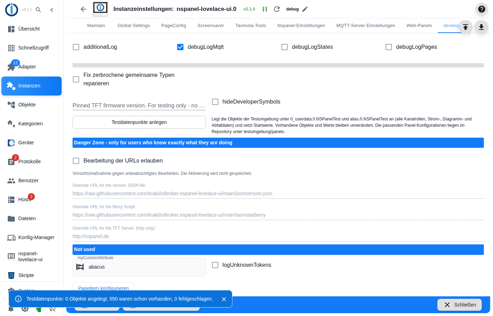
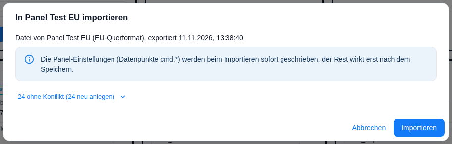
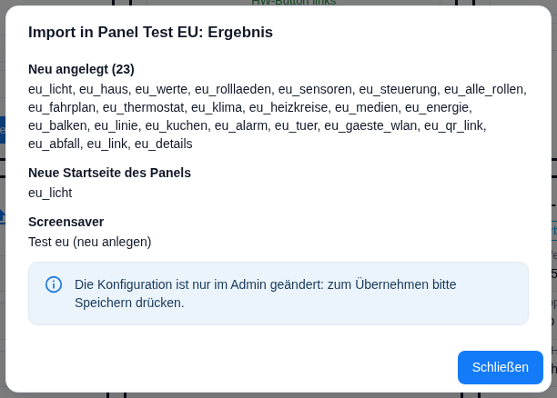

# Test environment

Ready-made test data for every panel model: states for **every channel role** of the adapter, and for each model a panel configuration with **all card types**, fully filled pages and a fully filled screensaver. A change can be checked on five formats within minutes, without creating a single state by hand — and for a hardware test a configuration is right there.

This is meant for everyone working on the adapter or trying to reproduce a bug. Nothing here is needed for day-to-day use.

Contents:
- [What it is for](#1-what-it-is-for)
- [Create the test states](#2-create-the-test-states)
- [Import the panel configuration](#3-import-the-panel-configuration)
- [What the panel shows](#4-what-the-panel-shows)
- [Screensaver](#5-screensaver)
- [System page "navigation error"](#6-system-page-navigation-error)
- [Limits](#7-limits)
- [Structure and your own additions](#8-structure-and-your-own-additions)

## 1. What it is for

The test environment exists to **make layout problems visible** before someone runs into them in daily use. Every page is filled to its last slot, the values are deliberately awkward (long names, wide numbers, units), and the same configuration runs on all five formats. What still fits on the EU panel overflows on the US portrait panel.

A number of bugs were found exactly this way — cut-off values, colliding names, a screensaver drawn in the wrong orientation. The comparison is on the picture page under [Before and after](Testumgebung-Bilder#before-and-after).

## 2. Create the test states

Instance settings → tab **Developer** → button **Create test states**.

> **The tab is only visible in expert mode.** It is toggled in the admin itself (icon at the bottom left of the sidebar), not in the instance settings, and the setting applies to the current browser session. See the page [Developer](Developer) for details.

The adapter creates the objects below `0_userdata.0.NSPanelTest` and `alias.0.NSPanelTest` and sets initial values. With the currently shipped data that is **550 objects** (folders, values and aliases together); the number grows whenever the test data is extended.

The message below the button gives **three** numbers: created, already existing, failed.

| Requirement | Why |
|---|---|
| The instance must be **running** | The button sends a message to the instance; if it is stopped, the admin refuses with "Instance … is not alive". |
| `0_userdata.0` and `alias.0` must **exist** | Objects are only created from `NSPanelTest` downwards. Without the branch above, every object counts as *failed*. |

**Existing objects and values are left untouched.** The adapter checks each object individually and skips it if it is already there — initial values are only written for newly created objects. So the button may be pressed as often as you like; the second time it reports "0 created". There is a flip side: **time values are not refreshed** this way (see [Limits](#7-limits)).

If something fails, the run does not stop — every single object is written to the log with a warning, and the third number of the message shows how many there were.

## 3. Import the panel configuration

The ready-made configurations are in the repository under `testumgebung/panels/`. There is one file per model:

| Model | Resolution | File |
|---|---|---|
| EU | 480 × 320 landscape | `nspanel-eu.json` |
| US landscape | 480 × 320 landscape | `nspanel-us-l.json` |
| US portrait | 320 × 480 portrait | `nspanel-us-p.json` |
| Smartphone landscape | 640 × 320 landscape | `nspanel-web-l.json` |
| Smartphone portrait | 320 × 640 portrait | `nspanel-web-p.json` |

The way there: tab **NSPanel settings** → on the panel tile **Import panel configuration** → pick the file → **Import** in the overview → then **save** the instance settings.

In an empty panel everything fits without conflict: **24 rows** — 23 pages and the screensaver.

> **Two things take effect at different moments.** The panel settings (states `cmd.*`) are written immediately on import, everything else only when the instance settings are **saved**. No manual restart is needed — saving restarts the adapter along the way.

Everything else about the dialog — part selection, import mode, name conflicts, safety prompts — is on the page [Transfer a panel configuration](panelConfigTransfer).

**The files contain no secrets.** They were exported without credentials (`secretsIncluded: false`); the alarm and unlock pages carry no PIN of their own, so the instance's global password applies, and the guest Wi-Fi is configured as an open network.

**Several models in the same instance** are no problem: page names carry a per-model prefix (`eu_`, `usl_`, `usp_`, `webl_`, `webp_`), so there are no name clashes.

### Without hardware: a web panel

The quickest route needs no device at all: tab **NSPanel settings** → **Add web panel** → choose the model → save the instance settings → then import as described above. The button only appears when web panels are enabled in the instance settings.

It opens in the browser at `http://<ioBroker>:8090/<topic>` — port 8090 is the default; with HTTPS enabled it is `https`, and with a PIN set a login page comes first. The details are on the page [Web panel](WebPanel).

By the way, **all five shipped files were exported from web panels** — including the EU and US ones. For a real device you import the very same file; the origin recorded in the export says nothing about where it may go.

## 4. What the panel shows

23 pages, reachable in this order. The right arrow walks through all of them and returns from the last one to the home page. The numbers are the **filled slots per model** — every page is filled up to the capacity of the model.

| # | Page | Card | eu | us-l | us-p | web-l | web-p |
|---|---|---|---|---|---|---|---|
| 1 | Light *(home page)* | `cardGrid` | 6 | 6 | 6 | 8 | 10 |
| 2 | House | `cardGrid2` | 8 | 8 | 9 | 10 | 15 |
| 3 | Readings | `cardGrid3` | 4 | 4 | 4 | 6 | 8 |
| 4 | Blinds & gates | `cardEntities` | 4 | 4 | 5 | 4 | 8 |
| 5 | Sensors | `cardEntities` | 4 | 4 | 5 | 4 | 8 |
| 6 | Controls | `cardEntities` | 4 | 4 | 5 | 4 | 8 |
| 7 | All roles | `cardEntities` | 28 | 28 | 28 | 28 | 28 |
| 8 | Departures | `cardSchedule` | 6 | 6 | 6 | 6 | 11 |
| 9 | Living room | `cardThermo` | – | – | – | – | – |
| 10 | Air conditioning | `cardThermo` | – | – | – | – | – |
| 11 | Heating circuits | `cardThermo2` | 9 | 9 | 9 | 9 | 9 |
| 12 | *(Media, no title)* | `cardMedia` | 5 | 5 | 5 | 6 | 8 |
| 13 | Power flow | `cardPower` | – | – | – | – | – |
| 14 | Power 24 h | `cardChart` | – | – | – | – | – |
| 15 | Outside temperature | `cardLChart` | – | – | – | – | – |
| 16 | Energy today | `cardPChart` | – | – | – | – | – |
| 17 | Alarm system | `cardAlarm` | – | – | – | – | – |
| 18 | Open door | `cardAlarm` *(unlock)* | – | – | – | – | – |
| 19 | Guest Wi-Fi | `cardQR` | – | – | – | – | – |
| 20 | Instructions | `cardQR` | – | – | – | – | – |
| 21 | Waste collection | `cardTrash` | – | – | – | – | – |
| 22 | Light *(page link)* | `pageLink` | – | – | – | – | – |
| 23 | Details | `cardEntities` | 4 | 4 | 5 | 4 | 8 |

"–" means the card has no freely assignable slots; its content lives in the card itself.

A few peculiarities that stand out while clicking through, all of them **intentional**:

- **All roles** deliberately carries 28 entries, more than fit on one page, so the paging arrow has something to do. These are 28 of the 30 channel roles; the two missing ones are listed under [Limits](#7-limits).
- **Details** is a sub-page, reachable only through the last slot on *House*; the way back leads there again. From the US portrait model on, entries repeat, because there are only four info channels and the page is filled cyclically.
- **The media page has no title** — `cardMedia` shows the player's name instead.
- **Heating circuits** offers **six selectable circuits** from five entries on nine slots: four heating circuits and an air conditioner that counts as a heating *and* a cooling circuit. One circuit is deliberately wired through individual states instead of an alias.
- **What a page shows depends on the model.** On *House*, EU only has sockets, scenes, a blind and a gate; the lock is added from US portrait on, the fan from smartphone landscape on, and heating, climate, selection, timer and volume only on the portrait smartphone. On *Readings*, electricity price and remaining time appear only from six slots on.

All pages on all five models as pictures: [Test environment – pictures → Pages per model](Testumgebung-Bilder#pages-per-model).

## 5. Screensaver

One entry per model, start mode **advanced**. Every area is filled up to the capacity of the model — for the largest mode in each case, so that no slot stays empty after switching modes either.

| Area | eu | us-l | us-p | web-l | web-p |
|---|---|---|---|---|---|
| left | 3 | 3 | 3 | 3 | 4 |
| bottom | 6 | 6 | 6 | 8 | 8 |
| indicators | 7 | 7 | 8 | 11 | 12 |
| favourite | 1 | 1 | 1 | 1 | 1 |
| alternate row | 1 | 1 | 1 | 1 | 1 |
| MR icons | 2 | 2 | 2 | 2 | 2 |
| notifications | 2 | 2 | 2 | 2 | 2 |

The indicators are mixed on purpose: display only, tap switches or opens a page, long press with its own action, or both together.

**Switching the mode** — set the state `<instance>.panels.<panel ID>.cmd.screenSaver.layout`:

| Value | Mode |
|---|---|
| 0 | standard |
| 1 | alternate |
| 2 | advanced |
| 3 | easyview |
| 4 | tiles |

The change takes effect immediately. The plain names are also available as selectable values on the state itself.

> **After an adapter restart the mode from the admin applies again** — here *advanced*. That holds for screensavers created in the admin, and therefore for the test environment. If the screensaver comes from a configuration script, the mode you set survives the restart. To change it permanently, edit the entry "Test …" in the **Screensaver** tab.

**The two notifications** appear when `0_userdata.0.NSPanelTest.Hinweis.Waschmaschine_fertig` is `true` or `0_userdata.0.NSPanelTest.Hinweis.Fenster_offen` is greater than 0. The first can be dismissed, the second cannot — it only disappears once the value is back to 0.

All five modes on all five models as pictures: [Test environment – pictures → Screensaver modes](Testumgebung-Bilder#screensaver-modes).

## 6. System page "navigation error"

When a navigation points to a page that does not exist, the panel shows a system page: title **Nav error**, plus the missing target, the page the jump came from, and the hint to check the configuration. The back arrow returns to the original page.

> **This cannot be reproduced with the five panel files from `testumgebung/panels/`.** Their navigation is complete. The screenshots come from the older, script-configured test setup (`testumgebung/Global_Script.ts`), where one page deliberately points at an empty target. To see the page, add a navigation target that does not exist to any page by hand.

The page in both system languages and on all five models: [Test environment – pictures → System page "navigation error"](Testumgebung-Bilder#system-page-navigation-error).

## 7. Limits

| Topic | What to keep in mind |
|---|---|
| **Media page** | It needs a real player. The files point to `squeezeboxrpc.0.Players.Familienzimmer` — the **only** reference to a foreign adapter in the whole configuration. After the import, enter your own player in the admin (alexa2, sonos, spotify-premium, mpd, squeezeboxrpc) or hide the page. |
| **Two roles without a page** | `media` is on no page — an element of that role needs an alias to a real player. `sensor.alarm.flood` is not implemented as a page element in the adapter; as a screensaver indicator the water sensor only shows up on the two smartphone formats, because only those have enough indicator slots. |
| **Time values go stale** | Departures and waste collection dates are set relative to the current time when they are created. Because the button never overwrites anything, they stay as they are. To refresh them, delete the affected states and press the button again. |
| **Initial values only** | The states do not move on their own. To see a curve in a chart, you have to write values yourself. |

## 8. Structure and your own additions

Where the states come from, how to add your own, how the five panel files are produced and what the unit test guarantees is described on the page [Test environment – structure](Testumgebung-Aufbau).
