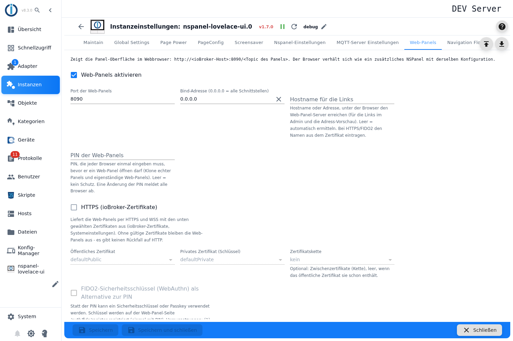
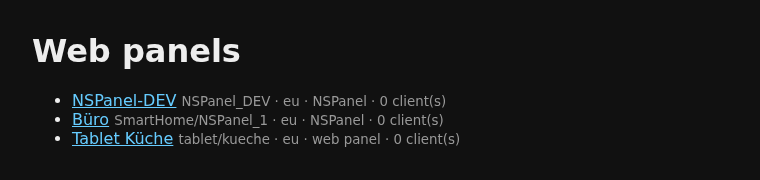
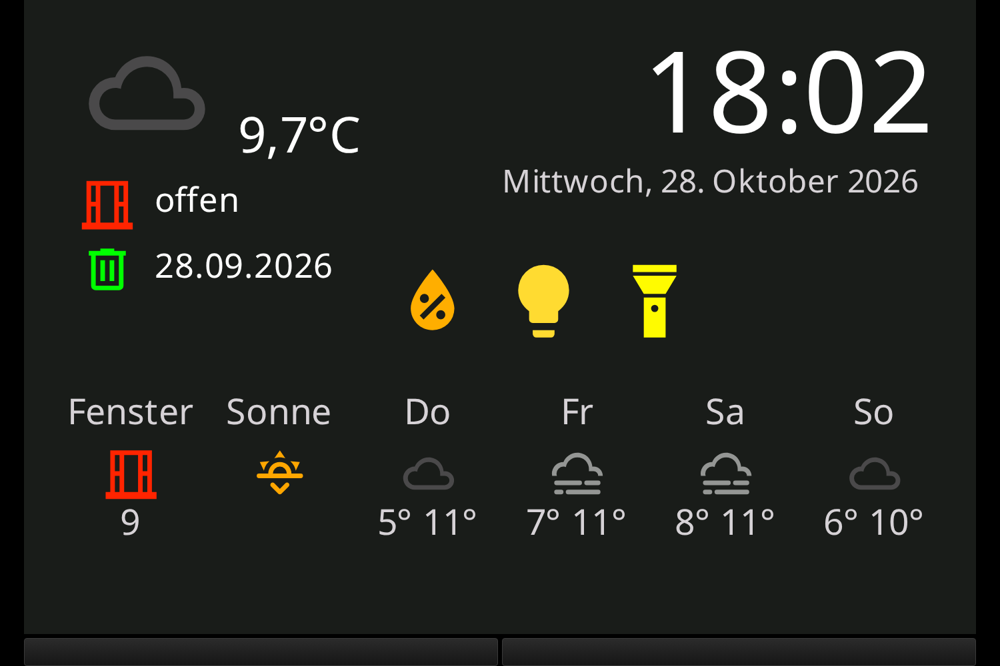
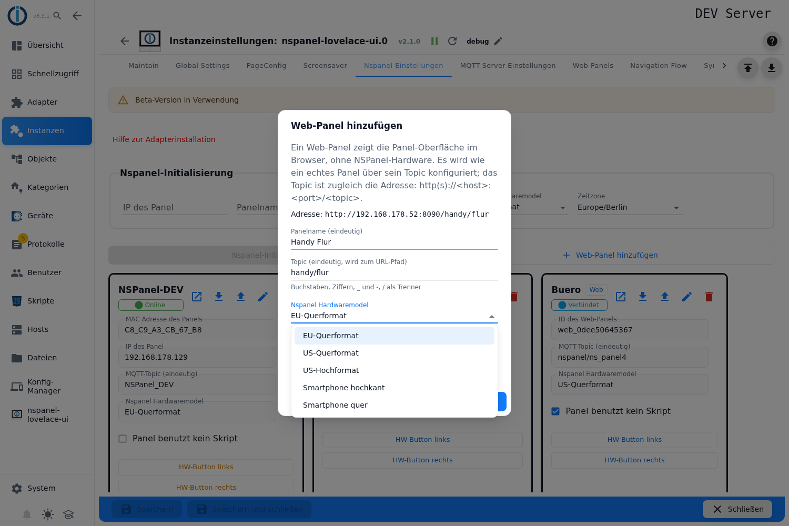
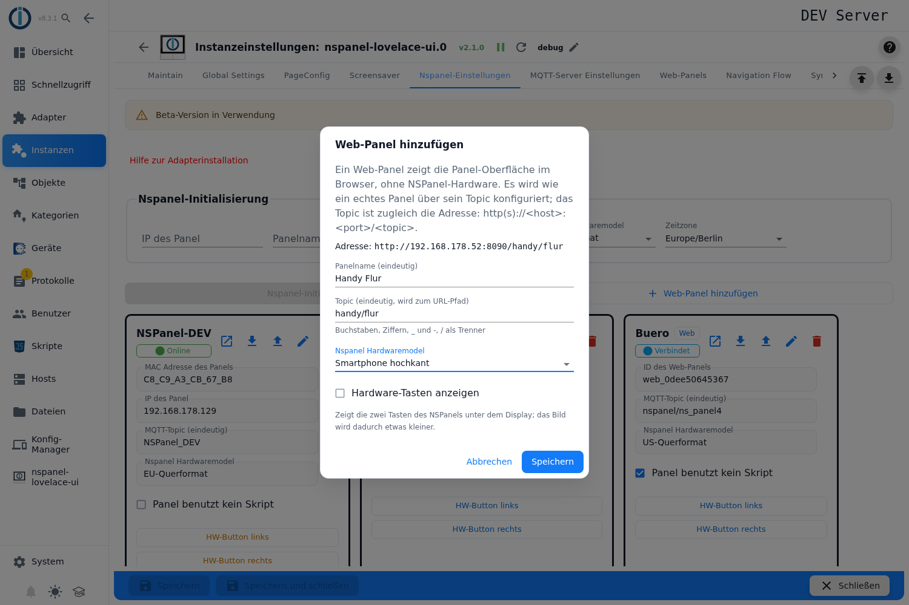
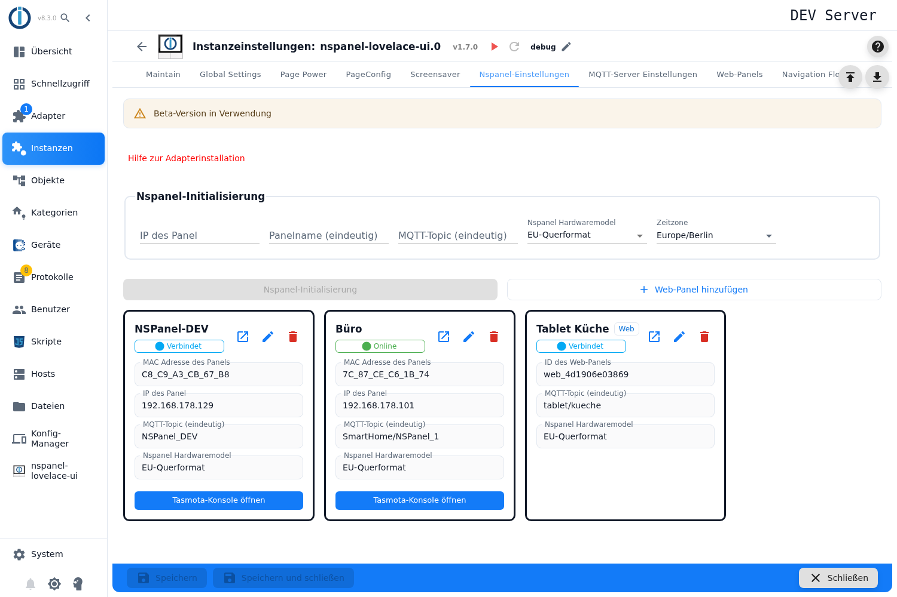
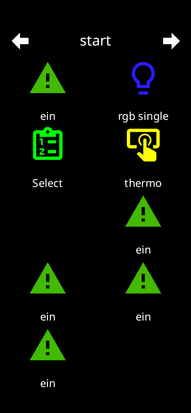
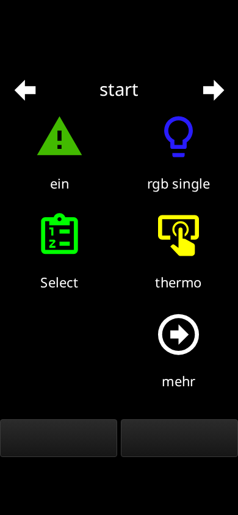
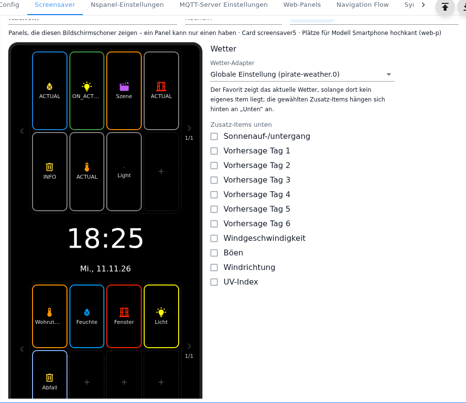

# Web panel

Since version **1.7.0** the adapter also shows the panel UI **in a web browser** — with the same pages,
popups and screensavers as on the NSPanel. It brings its own small web server for this; no Tasmota and no
panel hardware are needed.

There are two kinds:

- **A real panel in the browser:** every configured NSPanel can also be opened in a browser. The browser
  behaves like an **additional** panel with the same configuration.
- **A standalone web panel:** a panel **without any hardware**, e.g. for a tablet on the wall, a phone or
  for trying out pages at the desk.

Contents:

1. [Switching on and address](#1-switching-on-and-address)
2. [Opening a real panel in the browser](#2-opening-a-real-panel-in-the-browser)
3. [Adding a standalone web panel](#3-adding-a-standalone-web-panel)
4. [Choosing the model: format and places](#4-choosing-the-model-format-and-places)
5. [Operation in the browser](#5-operation-in-the-browser)
6. [Protecting access: PIN, HTTPS, security key](#6-protecting-access-pin-https-security-key)
7. [What a web panel cannot do](#7-what-a-web-panel-cannot-do)
8. [Pitfalls](#8-pitfalls)

## 1. Switching on and address

The settings are in the instance settings, tab **Web panels**. At the top the tab shows the address under
which the panels can be reached.



| Field | Meaning |
|---|---|
| **Enable web panels** | Switches the web server on. **On by default.** |
| **Web panel port** | Default `8090`. |
| **Bind address** | Network interface the server listens on. `0.0.0.0` (default) = all. |
| **Host name for the links** | Only used for the links in the admin, the address preview and the log message. Empty = the adapter detects it. With HTTPS enter the name from the certificate. |
| **PIN**, **HTTPS**, **FIDO2** | see [section 6](#6-protecting-access-pin-https-security-key) |

Every panel has its own address, built from its **topic**:

```
http://<ioBroker host>:8090/<topic of the panel>
```

The start page `http://<ioBroker host>:8090/` lists all panels with model and number of connected
browsers.



It is easier from the admin: the button **Open web panel in a new tab** is in the panel overview
(tab *NSPanel settings*), in the [Maintain](Maintain) tab and in [Panelinfo](Panelinfo). If a PIN is set,
this button logs the browser in right away.

> All settings of this tab only apply after **saving** — the instance restarts.

## 2. Opening a real panel in the browser

Nothing to set up: when web panels are switched on, **every** NSPanel can be reached under its topic.
The ID of the panel works instead of the topic as well.



Good to know:

- **The browser navigates independently of the real panel.** It is an additional panel with the same
  configuration — opening another page in the browser does not change the display on the wall.
- **All browsers on the same address stay in sync**: if two devices open the same panel, both show the
  same page.
- The browser shares the **states** with the real panel (`panels.<panel>.*`). Commands under `cmd.*` —
  screensaver or brightness, for example — therefore also act in the browser. The values under `info.*`
  (firmware, Wi-Fi, status) are written by the real panel only.
- If the real panel is **deactivated** or not running, the browser shows nothing either and retries later.

## 3. Adding a standalone web panel

1. Open the tab **NSPanel settings**. Next to *NSPanel initialization* there is the button
   **Add web panel** — it only appears when web panels are switched on.
2. Fill in the dialog:
   - **Panel name** — unique.
   - **Topic** — unique, becomes the path of the address. Letters, digits, `_` and `-` are allowed, plus `/`
     as separator. Not allowed as first part: `assets`, `fonts`, `icons`, `auth`, `ws` (the web server
     uses them itself). Below the field the dialog shows the resulting address.
   - **NSPanel Hardwaremodel** — sets format and aspect ratio of the display. On offer are the three panel
     formats and the two smartphone models **Smartphone portrait** and **Smartphone landscape**; all about
     them in [section 4](#4-choosing-the-model-format-and-places).
   - **Show hardware buttons** — "Shows the two buttons of the NSPanel below the display; the picture gets
     a little smaller." **On** by default for the panel formats, **off** for the smartphone models. As long
     as the checkbox has not been set by hand in the dialog, it follows the default of the model when the
     model is changed.

   

   With a smartphone model the checkbox of the hardware buttons is off by default:

   

3. Confirm with **Save**, then save the instance settings.

The web panel gets an ID of the form `web_` + 12 characters automatically and appears in the panel overview
with the label **Web**. The **pencil** changes name, topic, model and the hardware buttons checkbox — a new
topic is also a new address. It is deleted with the **trash can**; this only works while the instance is
running.



**It gets pages like any other panel:** in the [PageConfig](PageConfig) tab the web panel shows up in the
panel selection, pages and navigation are assigned the same way. A configuration script is **not
needed** — without a script it starts with the admin configuration (from the version after 1.7.0; in 1.7.0
itself a web panel still needed a script).

Its states are under `panels.web_<…>.*`. When no browser is connected any more, it reports itself offline.

## 4. Choosing the model: format and places

The model sets the format a web panel draws in — and with it **how many places** a menu card, the
screensaver and a notification have. Besides the three panel formats there are two **smartphone models**
for standalone web panels: they do not imitate an NSPanel, they fill a phone or tablet.

| Choice in the dialog | Format | Meant for |
|---|---|---|
| **EU-Landscape** | landscape, 480 × 320 | picture of an NSPanel (EU) |
| **US-Landscape** | landscape, 480 × 320 | picture of an NSPanel (US) |
| **US-Portrait** | portrait, 320 × 480 | picture of an NSPanel in portrait |
| **Smartphone landscape** | landscape, 640 × 320 | phone or tablet held landscape, full screen |
| **Smartphone portrait** | portrait, 320 × 640 | phone held portrait, full screen |

The sizes are the fixed drawing area, not the resolution of the device: the browser scales it to the
window. The smartphone models have a 2:1 ratio and leave only narrow margins on common phones (16:9 to
20:9), while a panel format (3:2) leaves wide black bars on the same device.

| Smartphone portrait (`web-p`) | US portrait (`us-p`) |
|---|---|
|  |  |

The same web panel with the same page on the same phone: on the left the smartphone model fills the screen
and shows ten places, on the right the panel format leaves wide bars and six places.

**The orientation belongs to the model.** A web panel does **not** rotate with the device: holding a panel
with *Smartphone portrait* in landscape shows the same picture, smaller and with margins. For both ways of
holding the device, add two web panels with their own topics.

**The smartphone models exist for standalone web panels only:**

- The dialog of a **real** NSPanel still offers the three panel formats only.
- If a hardware panel carries a smartphone model anyway, the adapter **does not create that panel** and
  writes an error to the log ("… is a hardware panel with the web model … - not created. Choose eu, us-l
  or us-p."). Remedy: choose a panel format again in the panel overview.
- The **browser view of a real panel** (section 2) always keeps that panel's format.

### Places of the menu cards

More assigned items than places is not an error — the rest moves on to the following pages of the card
(paging, see [pageMenu](pageMenu)).

| Menu card | EU/US landscape | US portrait | Smartphone landscape | Smartphone portrait |
|---|---|---|---|---|
| `cardEntities` | 4 | 5 | 4 | 8 |
| `cardSchedule` | 6 | 6 | 6 | 11 |
| `cardGrid` | 6 | 6 | 8 | 10 |
| `cardGrid2` | 8 | 9 | 10 | 15 |
| `cardGrid3` | 4 | 4 | 6 | 8 |
| `cardMedia` (options) | 5 | 5 | 6 | 8 |
| `cardThermo2` (places) | 9 | 9 | 9 | 9 |

The menu card editor states this next to the card: "Items per page for each panel model: …". If the same
page is assigned to panels with different models, it warns: "The assigned panels show different numbers of
items per page. The editor shows the largest number; on panels with fewer places the items move on to the
following pages."

The **headline** of a page differs in width as well: it is shortened to 28 characters in landscape, 13 on
US portrait, 16 on *Smartphone portrait* and 45 on *Smartphone landscape*; longer text ends with "…".

### Places of the screensaver

Given as **bottom / indicators / left column**; "–" means: does not exist in this version.

| Version | EU/US landscape | US portrait | Smartphone landscape | Smartphone portrait |
|---|---|---|---|---|
| Standard | 4 / – / – | 4 / – / – | 6 / – / – | 8 / – / – |
| Alternate | 3 / – / – | 3 / – / – | 5 / – / – | 7 / – / – |
| Advanced | 6 / 5 / 3 | 6 / 5 / 3 | 8 / 8 / 3 | 8 / 12 / 4 |
| EasyView | 3 / – / – | 4 / – / – | 4 / – / – | 8 / – / – |
| Tiles | 5 / 7 / – | 4 / 8 / – | 7 / 11 / – | 8 / 8 / – |

Everything else stays the same: one place for the favourite or the alternate display, two status icons,
time and date. The [screensaver editor](screensaver) draws the places of the chosen model and writes
"places for model …" above them; without an assigned panel it says "the places appear as soon as a panel is
chosen".



### Lines of a notification

How many lines a [notification](Screensaver-Notify) shows depends on the text size:

| Text size | 0 | 1 | 2 | 3 | 4 | 5 |
|---|---|---|---|---|---|---|
| Panel formats and *Smartphone landscape* | 7 | 5 | 5 | 4 | 2 | 1 |
| *Smartphone portrait* | 20 | 15 | 15 | 10 | 6 | 3 |

The browser wraps the text itself; there is no fixed number of characters per line.

## 5. Operation in the browser

- **Tapping or clicking** acts like a press on the display — mouse and touch alike.
- **Holding** (from about 0.6 seconds) is the long press: on a tile of a menu page a short press switches,
  holding opens the detail popup — like on the real panel. On an **indicator of the screensaver** holding
  fires the [action on long press](screensaver#action-on-long-press) after 0.5 seconds; unlike on the real
  panel a movement of more than about 20 pixels cancels the long press.
- **The two hardware buttons** are bars below the display. They trigger the action configured for the
  buttons and set `panels.<panel>.buttons.left`/`right`. **They do not switch relays.** In the browser view
  of a real panel the bars are always there; on a standalone web panel the checkbox **Show hardware
  buttons** decides (section 3). On the smartphone models it is off by default — then the whole area is
  left to the UI.
- **Buzzer:** the browser plays the tones itself — but only after the first tap. Browsers require this;
  tones before that are dropped silently.
- **Screensaver and dimming** work like on the panel: after the configured time the display dims, a tap
  wakes it.
- **Size:** the display is scaled to the window with the **aspect ratio of the model**
  ([section 4](#4-choosing-the-model-format-and-places)), free space stays black. **Rotating the device
  does not rotate the UI** — it is only scaled anew. There is no fullscreen button of its own; use the
  browser's fullscreen (on a computer usually `F11`, on a phone the fullscreen mode of the browser or a
  kiosk browser).
- **Connection lost:** the page turns grey with a hint. After an adapter restart the browser reconnects on
  its own.

## 6. Protecting access: PIN, HTTPS, security key

> ⚠️ **Without a PIN every web panel is open** — anyone who reaches the port on the network can operate
> it. Since web panels are on by default, this also applies to every real panel. The log warns about it at
> start. If you do not need web panels, switch them off; if you do, set a PIN.

**Web panel PIN** — one shared PIN for all web panels, real and standalone. Every browser enters it
**once** and stays logged in. A **new PIN logs out all browsers**. After five wrong entries within a minute
that computer has to wait one minute.

**HTTPS (ioBroker certificates)** — serves the panels encrypted. The certificates are chosen from the
ioBroker certificates (system settings): **public certificate**, **private certificate** and, if needed,
the **chained certificate**. Without valid certificates the web panels stay **off** — there is no fallback
to unencrypted HTTP.

**FIDO2 security key** — a security key or passkey can be used instead of the PIN. The PIN stays in place;
the key is a more convenient way to log in. Requirements:

1. HTTPS is switched on,
2. the web panel is opened via a **host name**, **not via an IP address**,
3. the browser trusts the certificate (a self-signed one works when it is installed as trusted in the
   browser or the system).

The key is registered **in the browser**, not in the admin: follow the registration link on the start page
of the web panels (`/auth/fido/register`), log in once with the PIN, give it a name. After that the login
page offers *Sign in with a security key*. In the admin the *Web panels* tab lists all registered keys with
the date of last use; they are also **removed** there (only while the instance is running).

## 7. What a web panel cannot do

A web panel has neither Tasmota nor a Nextion display. Therefore there is:

- **no firmware or TFT update** and nothing to flash; the smartphone models also have **no TFT version** —
  they report the placeholder `1.0.0`,
- **no app:** there is no web manifest and no PWA; a web panel always runs in the browser. For permanently
  mounted devices a kiosk browser (e.g. Fully Kiosk) is the way to go,
- **no rotation of the UI** with the device — the orientation belongs to the model
  ([section 4](#4-choosing-the-model-format-and-places)),
- **no relays** — not even in the browser view of a real panel; the relays of the real panel stay
  untouched,
- **no temperature sensor** (and hence no temperature offset),
- **no Tasmota commands** except the buzzer, no Tasmota restart,
- **no update icon** on the screensaver.

> **The other way round, this is the reason to add a web panel for trying things out:** apart from the
> relays everything can be tested with it — pages, navigation, screensaver, popups, paging, colours.
> Neither a second device nor an emulator is needed; a web panel is added in a minute (section 3).

## 8. Pitfalls

- **Port in use:** if something else already runs on the port, the web panels stay off; the log names the
  next free port. Enter that one in the tab.
- **Settings do not take effect:** all fields of the tab only apply after saving and restarting the
  instance.
- **FIDO2 is not offered:** HTTPS off, opened via an IP address or certificate not trusted — check the three
  requirements from section 6.
- **Wide black bars on the phone:** the web panel uses a panel format. For a picture without bars choose
  one of the smartphone models ([section 4](#4-choosing-the-model-format-and-places)).
- **The panel is not created, the log says "hardware panel with the web model":** a real NSPanel was given
  a smartphone model. These models exist for standalone web panels only.
- **Items are missing on a page after a model change:** the new model has fewer places, the remaining items
  are on the next page of the card (section 4).
- **The web server's own pages** (start page, login, "Panel not found") are English only; the panel UI
  itself uses the configured language.
