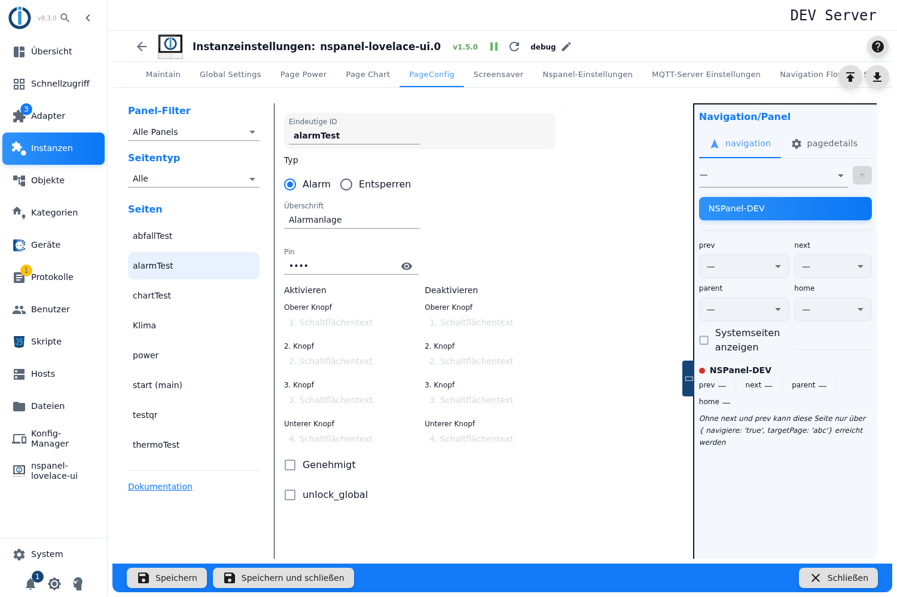
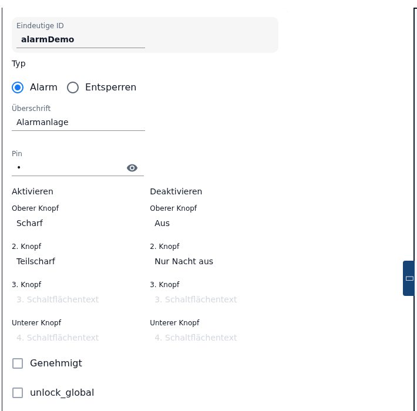
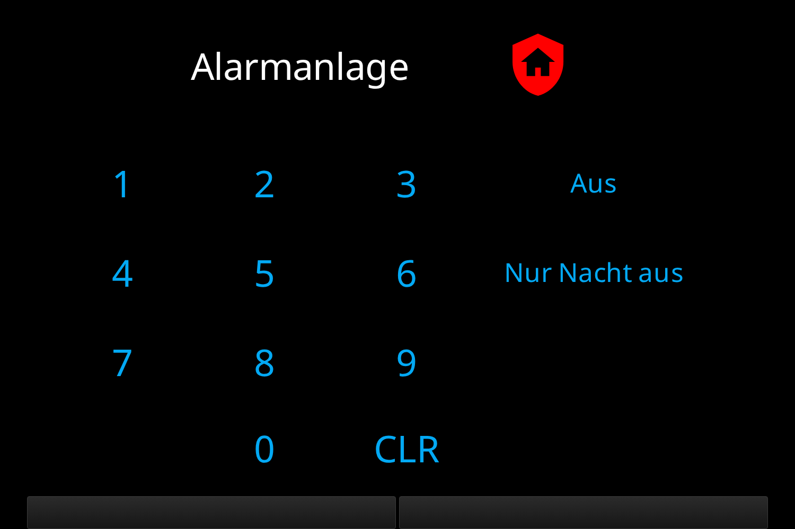
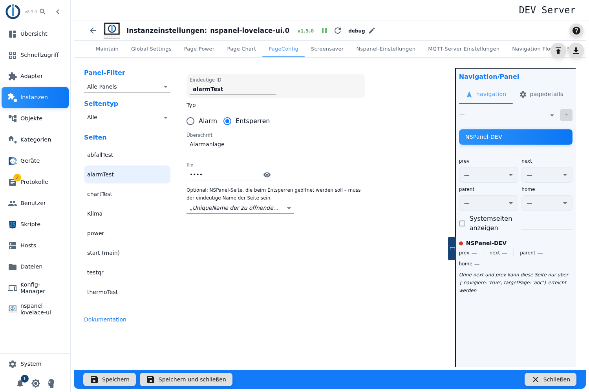

# Alarm and unlock page – configuration in the admin

An alarm page turns the panel into the control unit of an alarm system: four buttons to arm, four to disarm, a PIN pad and three states through which a real system is connected. The same card also serves as an **unlock page** — then it only asks for the PIN and jumps on to another page afterwards.

It is created in the tab **PageConfig**, page type **Alarm**. A configuration script is not needed for this — and not possible either: the adapter explicitly skips a page with the card type `cardAlarm` or `cardUnlock` from a script configuration and logs `is only supported in the admin configuration! Skipped!`. So for this card type there is exactly one way.

Contents:
- [Creating the page](#1-creating-the-page)
- [Operating mode: alarm or unlock](#2-operating-mode-alarm-or-unlock)
- [PIN](#3-pin)
- [The buttons of the alarm page](#4-the-buttons-of-the-alarm-page)
- [States and what the card shows](#5-states-and-what-the-card-shows)
- [Approved: confirmation from outside](#6-approved-confirmation-from-outside)
- [One state for several panels](#7-one-state-for-several-panels)
- [The unlock page and its target](#8-the-unlock-page-and-its-target)
- [The states the adapter creates](#9-the-states-the-adapter-creates)
- [Panel assignment and navigation](#10-panel-assignment-and-navigation)
- [Pitfalls](#pitfalls)

## 1. Creating the page

1. Open the instance settings → tab **PageConfig**.
2. On the left pick the page type **Alarm**, enter a name in the field *New Page*, press **+**.
3. The page appears in the list **Pages**, the editor opens on the right.

The name is the **Unique ID** of the page — other pages address it by that name in their navigation targets. The name is fixed once the page exists; why, is explained under [PageConfig – Overview](PageConfig#creating-and-deleting-pages).

The new page brings along: the **Headline** equal to the page name, the **PIN** `0`, the operating mode **Alarm** and the **top button** of both columns prefilled - *Arm* and *Disarm* (see [section 2](#2-operating-mode-alarm-or-unlock) and [section 4](#4-the-buttons-of-the-alarm-page)).

> **Every field is greyed out while the instance is not running.** The editor watches the `alive` state of the instance for that; with a stopped adapter nothing can be entered. The interface gives no explanation for this.

The link **Documentation** at the bottom of the left-hand column opens exactly this wiki page — it is built from the card type.

## 2. Operating mode: alarm or unlock

Right below the ID sits **Type** with two choices:

| Field | Effect |
|---|---|
| **Alarm** | The full alarm control: eight buttons, state machine, status states. |
| **Unlock** | Only a PIN prompt and a jump to another page. |

The **unlock page is not a page type of its own** — it is created right here, out of an alarm page. That is why you will not find it in the list when creating a page.

> **The preset is *Alarm*.** A new page is created as an alarm system, so the editor shows every field right away. For an unlock page one click on *Unlock* is enough; the button texts then disappear from the view but stay in the configuration.

**Switching later** only hides the fields of the other mode; values you entered stay in the configuration and are still taken into the page. Effective is only what belongs to the chosen mode — the button texts and *Approved* with *Alarm*, the jump target with *Unlock*. One exception is the checkbox *Shared status for all panels*: it is visible in the mode *Alarm* only, but the adapter reads it in **both** modes (see [section 7](#7-one-state-for-several-panels)).

**Headline** is the header line on the panel. Creating the page fills in the page name.

> ⚠️ **An empty headline yields the word `Unlock` on the panel** — even on an alarm page and in every language. The adapter inserts this substitute value when building the page; the page name does not appear.

Headline and button texts also run through the translation table of the adapter: a text that happens to match a translation key is replaced — `on` becomes "on", `off` becomes "off", `Start` becomes "Start", `unlock` becomes "unlock" in the panel language.

## 3. PIN

The field **PIN** accepts digits only; the eye icon shows them in clear text. The PIN applies to both modes: on the alarm page it protects every button, on the unlock page it is the whole point.

Four peculiarities worth knowing:

- **A page without a PIN cannot be configured here.** An empty field is stored as `0`, and `0` is a valid PIN — so it is still prompted for, and on the panel the `0` has to be entered.
- **Leading zeros are dropped.** The entry is turned into a number: `0123` becomes `123`. On the panel `123` then has to be typed in; `0123` counts as a failed attempt.
- **There is no length check** — neither a minimum nor a maximum, and no error message.
- **The central service PIN cannot be reached from here.** The adapter knows the special value `-1` for it: if that is the PIN, the card uses the *Service-Pin* from the [global settings](globelSettings). The input field, however, strips every character except digits, the minus sign included — only the adapter's own built-in system page `///unlock` sets that value.

> **The PIN is stored in clear text** in the adapter configuration (`native.pageConfig[].pin`). Anyone with read access to the ioBroker objects can read it. The central credentials (Admin → System settings → Credentials) are **not** covered by this card — unlike the WiFi password of a [QR page](cardQR), which can come from a credential since 1.5.0.

> ⚠️ **After a failed attempt the card locks — and for ever longer.** The waiting time doubles with every failed attempt (2 s, 4 s, 8 s …) and is **not capped**: after ten attempts more than 17 minutes, after sixteen more than 18 hours. The counter is only reset by the correct PIN or by restarting the adapter. While locked, the card shows "locked for" and the time in the second line, it flashes, carries a red `key-alert-outline` and the pad stays dead. The time **does not count down** — it is one single message and stays unchanged until the lock expires.

## 4. The buttons of the alarm page

Two columns with four fields each. What you enter is the **text** of the button; which action it triggers is fixed. An empty field means: that button does not exist. So you can also offer just one variant.

| Field | Effect |
|---|---|
| Column **Armed**, four fields | Appears in state `disarmed`. A press reports `A1`…`A4` and arms the system (four variants, e.g. "at home" and "away"). **The top field is mandatory.** |
| Column **Disarmed**, four fields | Appears in state `armed`. A press reports `D1`…`D4` and disarms the system. **The top field is mandatory.** |

And this is how the page looks on the panel – a freshly created alarm page starts in the state `armed`, so the buttons of the column *Disarmed* are shown:

> The four fields of both columns carry **the same labels** in the interface — *Top button*, *2. Button*, *3. Button*, *Bottom button*, with the placeholders *1. Button text* to *4. Button text*. There are no separate texts for "5. Button" to "8. Button"; the columns are told apart by their heading only.
>
> The headings read like a state, but they name the **action**: the column *Armed* holds the buttons that arm — so they are visible while the system is **off**. The German version says *Aktivieren* / *Deaktivieren* ("arm" / "disarm") at this point; the same thing is meant.

> **The top button of both columns is mandatory.** Without it the card would be left without any button in one of its two states - and that state could only be left through the state `.status`. That is why *Arm* and *Disarm* sit in those two fields from the start; clear one and the editor turns it red, names the reason and **blocks saving** until a text is back in it. The other six fields are free. The operating mode *Unlock* has no mandatory fields - its single built-in button is enough.
>
> Every field is taken over on its own: a text in the column *Disarmed* needs **no** partner in the same row of the column *Armed*.

> **A new alarm page starts in the state `armed`**, not `disarmed`. So it shows the column *Disarmed* first - with the prefilled button *Disarm* it can be operated right away.

Icons and colors of the card are fixed and not adjustable; there is no icon field for this card type.

## 5. States and what the card shows

The card knows five states. The current one is held by the state `.status`, through which an external system can also dictate the state.

| State | What the card shows | Pad |
|---|---|---|
| `disarmed` | the buttons of the column *Armed*, icon `shield-off` in green | free |
| `armed` | the buttons of the column *Disarmed*, icon `shield-home` in red | free |
| `arming` | a text button with the state name, `shield` in amber, the card flashes | locked |
| `pending` | the same with `shield-off` — the way back | locked |
| `triggered` | a text button, bell `bell-ring` in red, the card flashes | visible, but without function |

- **The card never sets `triggered` itself.** This state comes from outside only, through `.status` = `4` — meant for the system that reports an alarm.
- **There is no way out of `triggered` through the panel.** The pad is released, but in this state the adapter discards every button event. The only way back is a new value in `.status`.
- **On start-up the adapter normalises** `pending` to `armed` and `arming` to `disarmed` — an intermediate state does not survive a restart. `triggered` and the two resting states are kept.

> On the panel the states appear as short forms in the language of the adapter — in English "Armed" (`armed`), "Arming" (`arming`), "Disarm" (`disarmed`), "Pend" (`pending`), "Trig" (`triggered`) and "Locked" (`locked`).

## 6. Approved: confirmation from outside

With the checkbox **Approved** the switching does not go through right away but via an intermediate state: a press in the column *Armed* puts the card into `arming`, writes the event into `.mode` and waits for a confirmation from outside. The way back works the same through `pending`.

| Somebody writes into `.approve` | Effect |
|---|---|
| `true` | `arming` → `armed`, `pending` → `disarmed` — the switching holds. |
| `false` | `arming` → `disarmed`, `pending` → `armed` — the switching is taken back. |

This is meant for a real system that should report for itself that it is genuinely armed (after checking the door contacts, say). Without the checkbox the card switches directly, without an intermediate state.

Points to note:

- The checkbox has to be set, otherwise `.approve` stays without effect — the adapter evaluates the state only while *Approved* is on.
- Writing has to happen **unacknowledged** (`ack = false`), that is the way a script or the object view normally do it. Values with `ack = true` are ignored by the card. After the evaluation the adapter acknowledges the value itself.
- ⚠️ **Without a confirmation the page hangs.** `arming` and `pending` lock the pad; if nobody writes `.approve`, the card keeps flashing for good. The only way out is a new value in `.status`.

## 7. One state for several panels

> The checkbox is labelled **Shared status for all panels**; the hint below it names where the states live. It is not a minor setting though, so here is what it does:

The checkbox moves the status states of the page from `panels.<panel>.alarm.<page>` to **`alarm.<page>`** and thereby keeps the state **the same across all panels**: if one panel switches the system, the adapter pulls all other alarm pages **of the same name** along. Whoever shows the same alarm page on several panels wants that — otherwise the system is armed on one panel and not on the other.

Points to note:

- The alignment only works if the checkbox is set on **every** occurrence of the page; the page name is what is compared.
- After switching it, the states live **somewhere else** — scripts and visualisations pointing at them have to be adjusted. The old states stay behind as leftovers.
- Whoever has only one panel leaves the checkbox off.

## 8. The unlock page and its target

In the operating mode **Unlock** all buttons fall away. The card shows a lock (`lock-remove`), a pad and the label "unlock". After the correct PIN it jumps to the configured target.

The select box below it carries the hint *Optional: NSPanel page to open on unlock — must be the page's uniqueName.*

| Field | Effect |
|---|---|
| **Select list** | All pages the adapter knows — **across all panels**, without the internal system pages (`///…`) and without the page itself. A name already stored that the adapter does not (any longer) know stays visible as an additional entry. |
| left empty | After the correct PIN nothing visible happens. |

- ⚠️ **The list is not limited to the assigned panel.** If the chosen page is not available on the panel that shows this unlock page, the jump does not happen and the log only says `Dont find navigation target for <name>`. The navigation fields in the right-hand column behave differently — they show the pages of the respective panel only.
- ⚠️ **Without a target the page is practically ineffective.** The hint text calls the target *optional*; in fact the adapter then only cycles the status states briefly and stays put. No warning is given, neither in the admin nor in the log.
- An unlock page reacts to `.status` = `4` as well: it then shows "locked", flashes and the pad is dead — permanently, until `.status` is written anew.

The unlock page is useful as a **gate page**: you set it as the navigation target in front of a page not everyone should operate, and enter the actual page as its jump target.

## 9. The states the adapter creates

For every alarm page the adapter creates states under `panels.<panel>.alarm.<pagename>` (or under `alarm.<pagename>`, see [section 7](#7-one-state-for-several-panels)):

| State | Type | Meaning |
|---|---|---|
| `.status` | number, writable | The state, with the plain text list `disarmed` (0), `armed` (1), `arming` (2), `pending` (3), `triggered` (4). **Writable from outside** — this is how an external system reports its state to the panel, and how you get out of a stuck state. Values above 4 set `disarmed`. |
| `.mode` | text, read-only | The last button event (`A1`…`A4` when arming, `D1`…`D4` when disarming). **This is the connector for your own alarm system:** a script listens here and switches the system accordingly. Present in the operating mode *Alarm* only. |
| `.approve` | boolean, writable | The confirmation for [Approved](#6-approved-confirmation-from-outside); set to `false` on start-up. |

Connecting a real system runs through these states exclusively — no states or alias roles are entered in the editor, and none are evaluated. Writing always has to be done **unacknowledged** (`ack = false`); acknowledged values trigger nothing.

> In the object view the three states currently carry their raw names `StateObjects.alarmstatus`, `StateObjects.alarmmode` and `StateObjects.approve` — these translations are missing in the adapter as well.

## 10. Panel assignment and navigation

Panel, navigation targets, *Start page (main)*, *Hidden* and *Screensaver behavior* are in the right-hand column **Navigation/Panel**, described under [PageConfig – Overview](PageConfig#panel-assignment-and-navigation) and [page details](PageConfig#page-details).

- For an alarm page **Screensaver behavior** is worth a look: with *Never activate* the page stays put instead of switching to the [screensaver](screensaver) after the timeout — useful when the state of the system should remain visible at all times.
- A page **without a panel assignment** is not built.
- **This card type does not know page items** — the card consists only of the buttons the state machine dictates.
- All changes take effect with **Save** only; the adapter restarts for that.

## Pitfalls

- **Saving is blocked and a button field is red.** The top button of one of the two columns is empty; both are mandatory in the operating mode *Alarm*.
- **The card flashes and does not react.** Either it is in `arming`/`pending` and waits for `.approve` (checkbox *Approved*), or it is in `triggered`. Both end through `.status` only.
- **The PIN is prompted for although none was entered.** The empty field is stored as `0` in the configuration, and `0` is a valid PIN.
- **The PIN is not accepted.** Leading zeros were lost when saving — the number has to be entered without them.
- **The card is locked for minutes.** The waiting time doubles with every failed attempt and is not capped; it is only reset by the correct PIN or by a restart of the adapter.
- **The panel reads "Unlock".** The headline is empty; the adapter inserts this substitute value.
- **A button text appears different from what was typed in.** The text matches a translation key of the adapter (`on`, `off`, `Start`, `unlock` …) and is replaced.
- **Unlocking does not jump.** Either no target is entered, or the target does not exist on the assigned panel — the select list offers the pages of all panels. This can be checked in the log (`Dont find navigation target`).
- **Scripts no longer find the states.** The checkbox *Shared status for all panels* moves them from `panels.<panel>.alarm.<page>` to `alarm.<page>`.
- **A write access stays without effect.** `.status` and `.approve` have to be written unacknowledged (`ack = false`).
- **Everything greyed out:** the instance is not running. The editor can be used with a running instance only.
