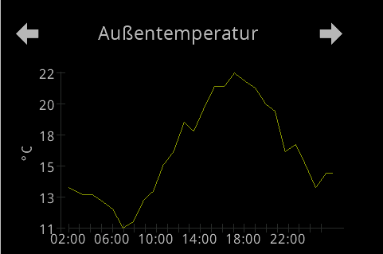
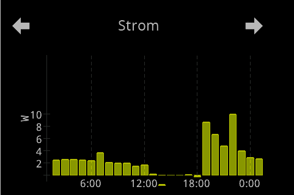
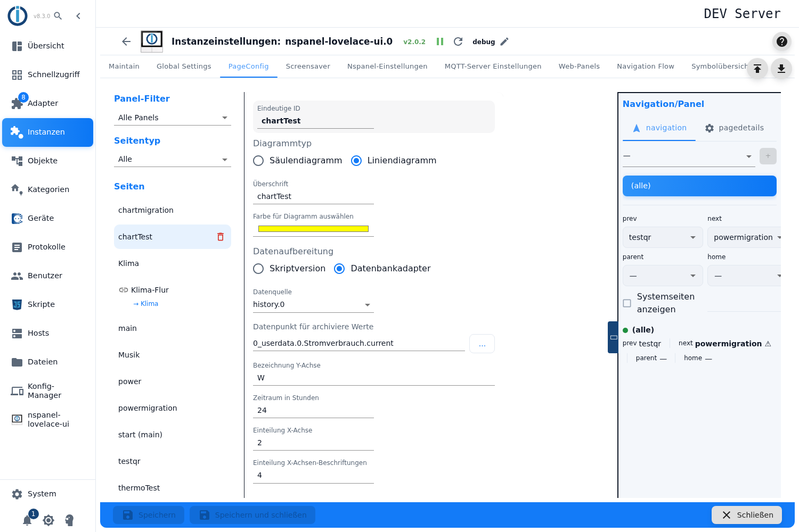
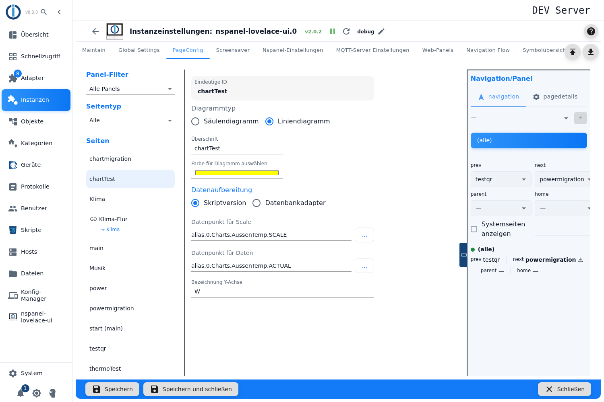
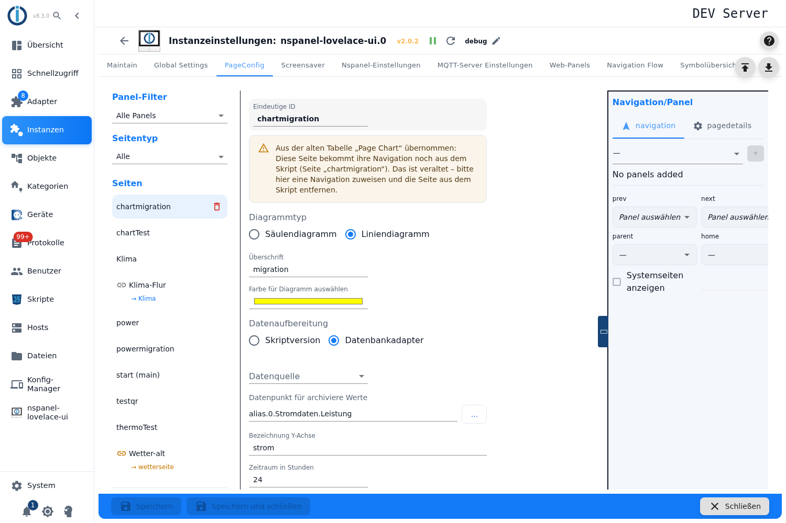

# Chart page – configuration in the admin

The chart page draws **one** measurement over time — as a **column chart** or as a **line chart**. It either fetches the data from a history adapter (InfluxDB, History, SQL) itself, or it takes ready-made values out of two states of your own.

You create it in the **PageConfig** tab, page type **Chart**. No configuration script is needed for that; pages from the old table *Page Chart* reach this page type through the [Migration](Migration).

Contents:
- [Creating the page](#1-creating-the-page)
- [Chart type: columns or line](#2-chart-type-columns-or-line)
- [Headline, colour, axis label](#3-headline-colour-axis-label)
- [Data formatting: the switch](#4-data-formatting-the-switch)
- [Way A: data from a history adapter](#5-way-a-data-from-a-history-adapter)
- [Way B: data from your own states](#6-way-b-data-from-your-own-states)
- [The y-axis and the two-character rule](#7-the-y-axis-and-the-two-character-rule)
- [The time axis](#8-the-time-axis)
- [When the panel redraws](#9-when-the-panel-redraws)
- [Panel assignment and navigation](#10-panel-assignment-and-navigation)
- [Pages from the old table „Page Chart"](#11-pages-from-the-old-table-page-chart)
- [Pitfalls](#pitfalls)

## 1. Creating the page

1. Open the instance settings → tab **PageConfig**.
2. On the left pick the page type **Chart**, enter a name in the field **New Page**, press **+**.
3. The page appears in the list and the editor opens on the right.

A freshly created page is set to **Column chart**, **Script version**, colour **yellow**, **Range in hours** 24, **X-axis ticks** 2, **X-axis labels** 4 and **Factor for card chart** 1. The **Headline** is pre-filled with the page name.

> As with every card type all fields are locked while the instance is not running — without an explanation in the editor.

## 2. Chart type: columns or line

**Chart type** is a radio group offering **Column chart** and **Line chart**. The choice decides more than just the look:

| | **Column chart** | **Line chart** |
|---|---|---|
| Resolution from the database | one average **per hour** | **5-minute grid**, at most 500 points |
| Y-axis | minimum fixed at **0** | spans across the data |
| Handling large numbers | **manual factor** | **automatic** |
| X-axis spacing | labels only | ticks **and** labels set separately |

Rule of thumb: **columns** for hourly values (consumption per hour), **line** for a progression (temperature).

 

The two pictures show the differences: the **line chart** (left) spans the y-axis across the data — here 11 to 22 °C. The **column chart** (right) always starts at **0** and shows one column per hour. Both axis labels stay **two digits**, which is the limit of the panel (see [section 7](#7-the-y-axis-and-the-two-character-rule)). The time labels show the spacing: every four hours on the left, at every hour divisible by four on the right.

Internally both variants carry the same card type `cardChart`; the chart type is a field of the page. That explains why switching between columns and line needs no new page — and why the **Documentation** link reads the same for both (see [section 10](#10-panel-assignment-and-navigation)).

## 3. Headline, colour, axis label

| Field | Effect |
|---|---|
| **Unique ID** | Page name; other pages address this page under it in their navigation targets. Read-only — the name is fixed once the page exists (*"The name is fixed once the page exists - other pages refer to it."*); on the start page its own note stands there: *Start page - published under the id „main".* See [PageConfig – Overview](PageConfig#creating-and-deleting-pages). |
| **Headline** | Header line on the panel. Left empty, the panel shows `Page Chart`. |
| **Select color for chart** | Colour of the curve or of the columns, as a colour picker. Default yellow. |
| **y-axis label** | Text next to the axis, for example `W`. The line chart appends its automatic factor here when needed — `W` then becomes `W x10`. The field is present in both ways of data formatting. |

> There is **one** colour and **one** series per page. The card cannot show several curves in one chart, and accordingly there is no legend — the "legend" consists of the headline and the axis label.

## 4. Data formatting: the switch

The radio group **Data formatting** decides where the values come from:

| Choice | Meaning |
|---|---|
| **Database adapter** | The adapter queries a history adapter itself and works out the presentation. Only with this do range, factor and the axis spacing appear. |
| **Script version** | Axis and values come ready-made from two states of your own. For special cases the automatic way does not cover. |

> The labels here are **swapped and confusing**: the group is called *Data formatting* but decides the **data source**; the field below it is called *data source* but means the **instance of the database adapter**. So read for the function, not the name.

## 5. Way A: data from a history adapter

| Field | Effect |
|---|---|
| **data source** | The instance of the history adapter. The list holds the **enabled** instances of **InfluxDB**, **History** and **SQL** — the editor knows no other history adapters. With none present it says *No instance found*. |
| **data point for values from the database** | The measurement. The picker only shows **states that are actually being logged in the selected instance**; without a selected instance, all those any history adapter records. That is the most useful check in the whole editor. |
| **Range in hours** | How far back it draws; the window always ends "now". Default 24. |
| **Factor for card chart** | Only for the **column chart**. Divides the values before they go to the panel — watts to kilowatts, so the y-axis labels fit into two characters (see [section 7](#7-the-y-axis-and-the-two-character-rule)). |

The adapter requests the data as averages (`getHistory` with `aggregate: average`) — one value per hour for the column chart, a 5-minute grid with at most 500 points for the line chart. If the selected instance is not running, the chart stays empty and there is only a warning in the log. If it does not answer, the query aborts after 15 seconds with an error in the log.

> **Without an instance or without a state, the page falls back to the script way silently** — and then shows an empty chart, because the script states are empty. There is **no** message in the admin. So if you see an empty chart, first check that both fields are filled.

> **Vanished instance:** if the selected instance is later disabled or removed, the field shows **empty** — but it is still stored. The page then looks unconfigured when it is not.

> The **factor** offers `1`, `0.1`, `0.01`, `0.001` — what is meant is a **divisor**: `0.001` means "divide by 1000", so watts → kilowatts. There is no tooltip and the direction cannot be guessed from the label.

## 6. Way B: data from your own states

With **Script version** two different fields appear. Here the adapter computes **nothing** — it passes on whatever is in the states. So the panel format has to be ready there already.

| Field | Effect |
|---|---|
| **Data point for ticks** | A **JSON array** with the values of the y-axis. If the content is not an array or is empty, it is ignored. |
| **Data point for values** | A **string in panel format** that is passed on unchanged: for the column chart `value^label~value~…`, for the line chart `ticks+labels~position:value~…`. |

Both states are watched (see [section 9](#9-when-the-panel-redraws)). Range, factor and axis spacing do not exist in this way — they sit in the values you deliver.

This way is meant for cases the automatic way does not fit. **There is no automatic scaling here**: you have to keep to the panel's two-character rule yourself.

## 7. The y-axis and the two-character rule

It pays to know the panel's contract here, because it explains almost every odd-looking chart:

- Values and tick marks go to the panel **multiplied by 10**; the panel divides by 10 again and prints every mark as a **whole number of at most two characters** — the range that can be shown is therefore **−9 to 99**. 1520 becomes "15".
- The panel spans the axis **exactly across the data** and shows **only marks inside that range**. Extra marks above or below are invisible — so there is no way to give the curve headroom like that.

For the two chart types this means:

**Line chart — does it by itself.** The adapter picks the step as the smallest 1-2-5 value that gives at most five steps across the span, and places marks from the step below the minimum to the step above it, at least two. If a mark does not fit into two characters, it **raises the factor in steps of ten** (up to a maximum of 1,000,000) until it does, and appends it to the axis label — `W` then becomes `W x10`. Nothing to do for that.

**Column chart — here you have to act.** It computes more simply: minimum always **0**, step about one fifth of the maximum with a lower bound that grows with the maximum. There is **no** automatic safeguard against labels that are too long — that is what the **factor** is for. If the axis shows nonsense, the factor is the first lever.

In neither case is there a setting for minimum, maximum or step of the y-axis.

## 8. The time axis

Two fields, both only in the **Database adapter** way:

| Field | Effect |
|---|---|
| **X-axis ticks** | Line chart only. Spacing of the ticks in **hours**. Default 2. Tooltip: *Interval in hours between X-axis ticks (e.g., 2 for a tick every 2 hours)*. |
| **X-axis labels** | Both chart types. Spacing of the time labels in **hours**. Default 4. Tooltip: *Interval in hours between X-axis labels (e.g., 4 for a label every 4 hours)*. |

> For the **column chart** the label spacing works differently than the name suggests: labelled are the columns whose **time of day** is divisible by the value — with 4 that is 0, 4, 8, 12, 16, 20 o'clock. So it is not a spacing "from now", but a grid on the clock.

> For the **line chart** the labels sit **on the ticks**: only a tick whose distance from the start is divisible by the label spacing gets a label. If the label spacing is **not a multiple** of the tick spacing — ticks 4, labels 6, for instance — labels drop out; what remains is labelled only at the least common multiple, here every 12 hours.

> Both fields accept **any** number greater than zero; there is no upper limit. `0`, negative values and text clear the field, which then shows the default as a pale placeholder — and the default applies as well. The old table limited the same fields to 1 to 8 — a good guide for sensible values.

**Range and resolution are linked**, without the editor pointing it out: the line chart fetches at most 500 points, so the 5-minute grid gets coarser from 42 hours on. The column chart produces one column per hour — for a range of a week that is 168 columns on a narrow display.

## 9. When the panel redraws

The page does not draw on a fixed beat but on an occasion:

- **When the page is opened.** As soon as the page becomes visible on the panel, the adapter fetches the data again. So the time window always ends at the moment of opening.
- **On a value change.** In the *Database adapter* way the selected **data point for values from the database** is the trigger itself; in the *Script version* way it is the two states for ticks and values.
- **At most once per minute.** Further triggers within the minute are collected and caught up in one pass afterwards.
- **Only while the page is visible.** As long as another page or the [screensaver](screensaver) is on the panel, triggers are discarded.

If a database query is still running, the adapter delivers the data read last; if the instance does not answer for 15 seconds, an error appears in the log.

## 10. Panel assignment and navigation

Panel, navigation targets, *Start page*, *Hidden* and *Screensaver behavior* live in the right-hand column, described under [PageConfig – Overview](PageConfig#panel-assignment-and-navigation). A page **without** a panel assignment is not built at all.

> The **Documentation** link at the bottom left of the tab builds its address from the **card type**, not from the chart type: column and line chart are both `cardChart`, so the link leads to **this** page in both cases. With the page type filter on *All* or *Main pages* the link takes the card type of the **selected** page; with no page selected it leads to [PageConfig](PageConfig).

## 11. Pages from the old table „Page Chart"

Pages taken over from the old table *Page Chart* show a **yellow warning box** at the top of the editor:

*Migrated from the old table „Page Chart": this page still gets its navigation from the script (page „…"). This is deprecated - assign a navigation here and remove the page from the script.*

What that means: the **content** of this page sits entirely in this editor, but its **place in the navigation** still comes from a page of the configuration script. The name in the box is the **script name** — it differs from the name of the entry when the migration appended a suffix because of a name collision.

While that state lasts:

| Circumstance | Effect |
|---|---|
| The adapter warns at every start | *the navigation from the script is deprecated – assign it in the admin (tab PageConfig, page …) and remove the page from the script* |
| The script page only supplies navigation | Page items of the script page are always discarded; a headline set there, however, wins over the **Headline** of this editor. |
| *Show page permanently* / *Hide page* in the script | take effect in addition to the settings of this editor — what is set is set, and it can only be unset in the script. |
| The box disappears | as soon as the page has a **panel assignment** here. The script page is then a dead reference: the adapter skips it and writes *gets its navigation in the admin (tab PageConfig) – remove it from the script. Skipped!* into the log. |
| There is no admin entry for the script name | The page is not built at all: *No chart page … found in the admin configuration*. |

How the migration runs, which suffixes appear and how the button **Take script into the admin** does the last step is described on [Migration](Migration).

## Pitfalls

> ⚠️ **Empty chart despite a selected database.** With the **data source** or the **data point for values from the database** missing, the page silently works as *Script version* — with empty states and therefore an empty chart. There is no message in the admin.

> **The list of data sources shows enabled instances, not running ones.** The editor reads the instance objects and filters on "enabled"; whether the instance runs is only checked by the adapter. An enabled but stalled instance appears in the list and yields nothing but a log warning and an empty chart at runtime.

> **The state field can be filled by hand.** The filter "logged states only" applies only in the picker behind **…**; a typed ID is taken over unchecked. The empty chart is then the only feedback.

> **The factor is a divisor.** `0.001` means "divide by 1000". It only exists for the column chart in the database way, and there it is the only protection against axis labels that are too long.

> **There is no headroom above or below the curve.** The panel spans the y-axis exactly across the data and shows only marks inside that range. Setting more marks does not help — that applies to the script version too.

> **A large range does not make the chart more precise.** With the line chart the 5-minute grid gets coarser from 42 hours on (the 500-point limit); with the column chart only the number of columns grows — a week gives 168.

> **The right-hand label of the line is not at "now".** The adapter always places an additional labelled tick at the right edge 50 minutes before the current time, regardless of the configured spacing.

> **One series, one colour.** The card knows no several curves, no two y-axes and no legend.

> **All fields stay locked while the instance is not running.** The editor does not say why.

> **After the move out of the old table the work is not done.** As long as the navigation comes from the script, the adapter warns at every start; only a panel assignment here plus removing the page from the script ends that. The way there is described on [Migration](Migration).
