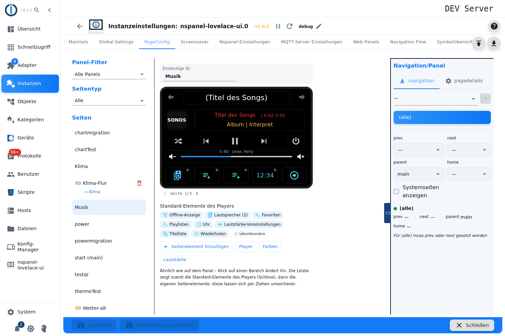
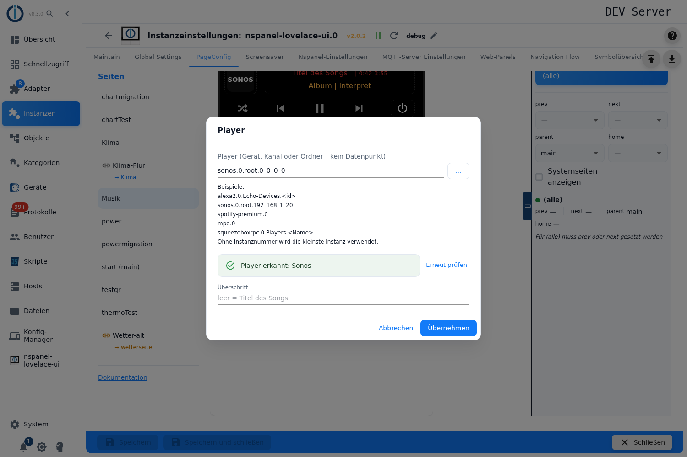
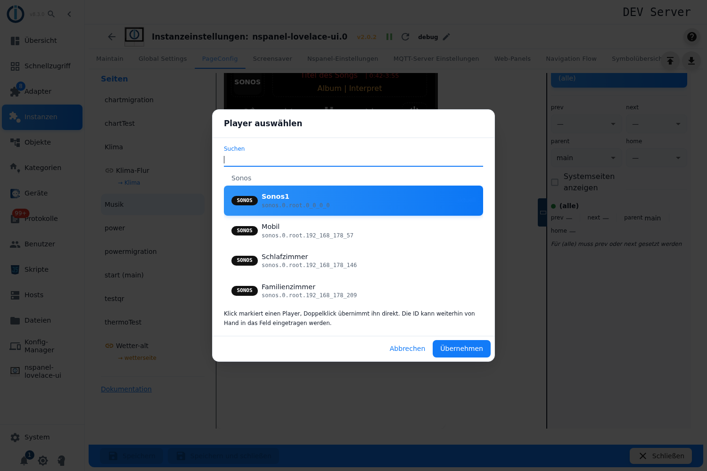
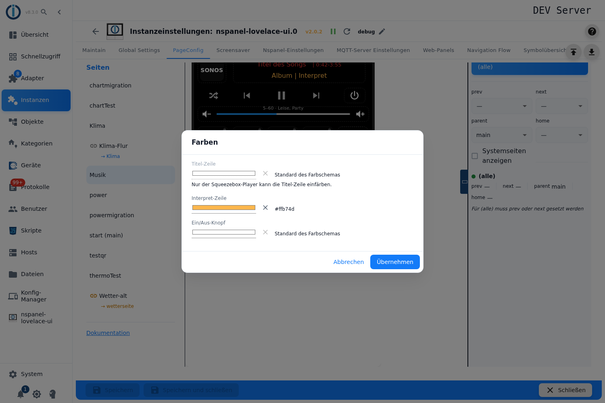
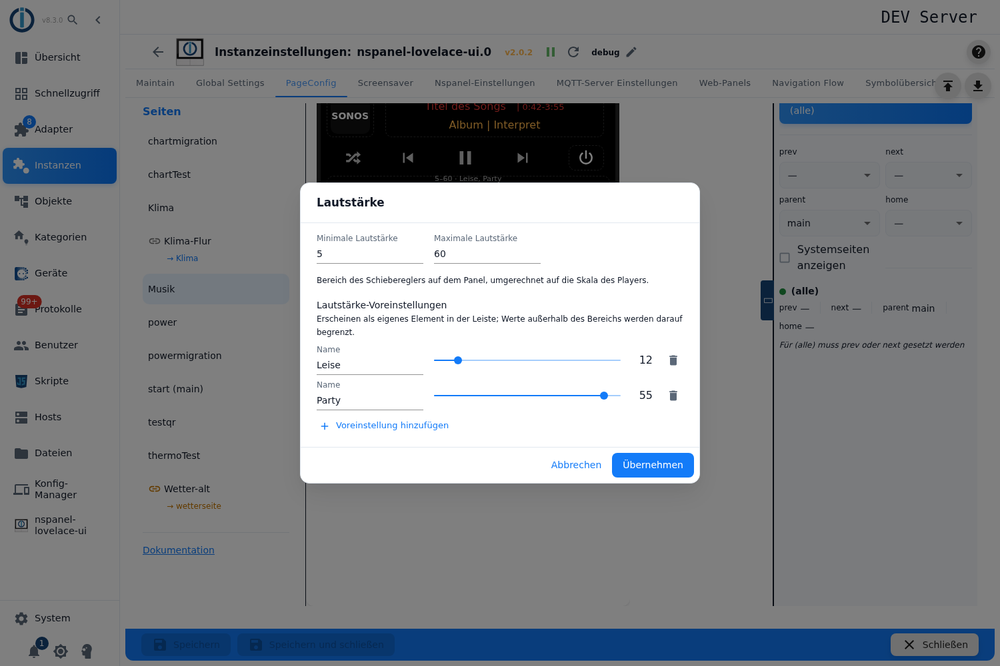
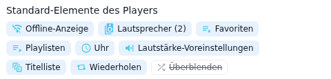
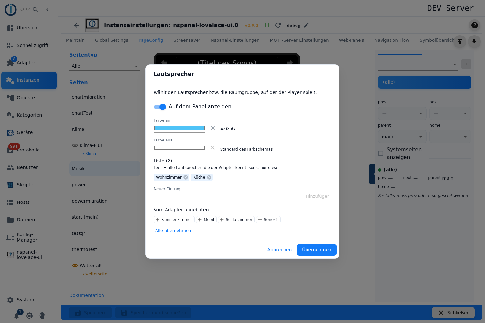
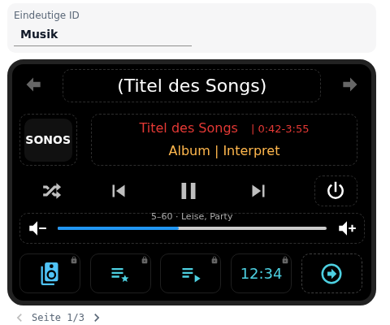

# Media player page – configuration in the admin

The media player page `cardMedia` controls **one** player: header line, logo, title and artist line with the running time, the transport buttons (shuffle, back, play/pause, next), a power button, the volume slider and below it a bar with **five** places. The adapter fills the bar first with the standard items the player offers (speakers, playlists, favorites, clock …), the own page items come after them.

It is created in the tab **PageConfig**, page type **Media player**. The editor draws the page similar to the panel – every spot of the card can be clicked and opens the matching settings.

**Exactly five adapters are supported:** `alexa2`, `sonos`, `spotify-premium`, `mpd` and `squeezeboxrpc`. Any other ID is rejected by the adapter; the editor reports that right away with *„This id does not belong to a supported adapter (alexa2, sonos, spotify-premium, mpd, squeezeboxrpc)."*

Contents:
- [Creating the page](#1-creating-the-page)
- [The editor at a glance](#2-the-editor-at-a-glance)
- [Player, check and headline](#3-player-check-and-headline)
- [Colors](#4-colors)
- [Volume: range and presets](#5-volume-range-and-presets)
- [Standard items of the player](#6-standard-items-of-the-player)
- [The three lists: speakers, playlists, favorites](#7-the-three-lists-speakers-playlists-favorites)
- [Own page items](#8-own-page-items)
- [Paging of the option bar](#9-paging-of-the-option-bar)
- [Panel assignment and navigation](#10-panel-assignment-and-navigation)
- [Pitfalls](#pitfalls)

## 1. Creating the page

1. Open the instance settings → tab **PageConfig**.
2. On the left choose the page type **Media player**, enter a name, press **+**.
3. The page appears in the list, the editor opens on the right. A new page has no player yet: at the top it says *„No player selected yet."* with the button **Player**, which leads straight into the player dialog.

**Unique ID** above the preview is the page name; the field is read-only, the name is fixed once the page exists.

> As with all card types every field is locked while the instance is not running. The editor says so at one spot only, namely in the player dialog: *„The adapter is not running - the player cannot be checked and no names can be read."*

## 2. The editor at a glance



Below the preview sits the hint that sums up the way of working: *„Similar to the panel - click an area to change it. The bar shows the standard items of the player (lock), then the own page items; drag them to change their order."*

| Element | Meaning |
|---|---|
| **Header line** and **logo** | Click → dialog *Player* (tooltip *Player and name*). |
| **Title and artist line**, **power button** | Click → dialog *Colors* (tooltip *Colors of title, artist and power button*). |
| **Volume bar** | Click → dialog *Volume* (tooltip *Volume range and presets*). Above the bar the configured range and the names of the presets are shown. |
| **Transport buttons** in the middle | Not configurable: *„Shuffle, back, play/pause and next are added by the adapter when the player offers them."* |
| **Arrows at the top left/right** | The navigation arrows of the panel, given by the panel. |
| **Places of the bar** | Items with a **lock** are standard items of the player (*standard item of the player - click to change*). Items with a **blue border** are own page items. A place with **+** is free and creates a new page item. |
| **Page x/y** with arrows | Appears as soon as the items do not fit into one bar. |
| **Standard items of the player** | The chips below the preview: all items the chosen backend knows – including the switched off ones (struck through). A click opens the settings of the item. |
| **Add page item** | New own page item, the same as clicking a free place. |
| **Player** / **Colors** / **Volume** | The same three dialogs as buttons. |

Next to it on the right sits the area **Navigation/Panel**, as with all pages.

All four dialogs work on a copy of the entry: **Apply** writes the changes into the page, **Cancel** discards them.

## 3. Player, check and headline



**Player (device, channel or folder - no state)** takes the ID of the player. It can be typed in or chosen from the list through **…**. The help text gives the examples:

```
alexa2.0.Echo-Devices.<id>
sonos.0.root.192_168_1_20
spotify-premium.0
mpd.0
squeezeboxrpc.0.Players.<name>
```

*„Without instance number the lowest instance is used."* — so `spotify-premium` is enough, `spotify` is not.

**The selection list** (button **…**) is not an object tree but a search: it reads the objects of the five adapters and shows everything that qualifies as a player, grouped by adapter and with a logo chip.



| Field | Meaning |
|---|---|
| **Search** | Filters by ID, name and adapter name. |
| Clicking a row | Marks the player; **Select** enters it. A double click takes it over directly. |
| **current** | Mark of the player that is entered in the page. |
| **instance disabled** | The adapter instance is switched off – the player can be chosen nevertheless. |

The hint below the list: *„Click marks a player, double-click takes it over directly. The id can still be typed into the field by hand."* If the search finds nothing, *„No supported media player found - install and set up one of these adapters: …"* appears; if the objects of an adapter cannot be read, it says *„The objects of these adapters could not be read: …"*.

**The check.** As soon as an ID is entered, the editor asks the adapter. It checks the ID on the same path on which it later builds the page, and delivers the names for the three lists along with it.

| Feedback | Meaning |
|---|---|
| *The adapter checks the player ...* | The check is running. |
| **Player accepted: Alexa / Sonos / Spotify / MPD / Squeezebox (LMS)** | The adapter takes the ID. |
| **The adapter does not accept this player:** | Below it the findings of the adapter in their original wording. |
| *This id does not belong to a supported adapter …* | The first segment of the ID is none of the five adapters. |
| *The adapter is not running - …* | The instance is not running; nothing is checked. |

**Check again** repeats the check. That is necessary because the editor remembers the result per ID.

**Headline** (placeholder *empty = title of the song*) is the header line of the card on the panel. If it stays empty, the adapter builds the line itself: from the name of the player and the title of the running song, and if there is none, from the name of the service (`Alexa`, `Sonos`, `Spotify`, `MPD`, `Squeezebox`).

## 4. Colors



Three fields of the same build. Each shows an **×** next to the color (*Back to default*) and, as long as nothing is set, the text *Default of the color theme*.

| Field | Meaning |
|---|---|
| **Title line** | Color of the title line – **usable with Squeezebox only**, otherwise locked with the hint *„Only the Squeezebox player can color the title line."* |
| **Artist line** | Color of the line with album and artist. With the four remaining backends this field colors **the title line as well**. |
| **Power button** | Color of the power button to the right of the transport buttons. |

## 5. Volume: range and presets



| Field | Meaning |
|---|---|
| **Minimum volume** / **Maximum volume** | The section of the player scale that the panel maps onto its slider. Empty = 0 resp. 100. Allowed are 0 to 100; a reversed range is swapped when the page is built. |
| **Volume presets** | Fixed volumes, per row a **Name** and a slider within the configured range. **Add preset** creates a new one, the waste bin deletes it. |

The help texts read *„Range of the slider on the panel, mapped onto the scale of the player."* and *„Appear as their own item in the bar; values outside the range are limited to it."*

An empty name field is marked red and blocks **Apply**. The values are rounded to whole numbers and limited to the range when saving.

## 6. Standard items of the player



Which items there are and in which order they go into the bar is decided by the player – not by the order in the editor:

| Backend | Standard items in the order of the adapter |
|---|---|
| **Alexa** | Reminders · Offline indicator · Speakers · Playlists · Equalizer · Clock · Volume presets · Repeat |
| **Sonos** | Offline indicator · Speakers · Favorites · Playlists · Clock · Volume presets · Track list · Repeat · Crossfade |
| **Spotify** | Offline indicator · Speakers · Playlists · Track list · Clock · Volume presets · Repeat |
| **MPD** | Offline indicator · Repeat · Clock · Volume presets · Crossfade |
| **Squeezebox (LMS)** | Offline indicator · Speakers · Favorites · Playlists · Clock · Volume presets · Track list · Repeat |

A click on a chip or on the place in the bar opens the settings of the item:

| Field | Meaning |
|---|---|
| **Show on the panel** | Switch; off = the adapter does not create the item. For the **Volume presets** it does not exist – instead there is **Edit presets**, which switches over to the volume dialog. |
| **Color on** / **Color off** | Two colors when the item has an off state. |
| **Color** | One color when there is only one state. |
| **List** | Only for *Speakers*, *Playlists* and *Favorites* – see [section 7](#7-the-three-lists-speakers-playlists-favorites). |

Which color fields appear depends on the item and on the backend:

| Item | Color fields |
|---|---|
| **Offline indicator**, **Speakers**, **Repeat** | *Color on* and *Color off* |
| **Crossfade** | *Color on* and *Color off* with Sonos; with MPD **none** |
| **Playlists**, **Favorites**, **Equalizer**, **Clock**, **Volume presets** | *Color* only |
| **Reminders** | *Color off* only |
| **Track list** | none |

The help texts of the dialogs describe what an item does, for example *„Selects the speaker or the room group the player plays on."*, *„Jumps to a title of the current queue."*, *„Bass, mid and treble of the Echo device."* or *„Appears as soon as at least one volume preset is set."*

> The **Offline indicator** takes no place in the preview: *„Only appears while the player is not reachable - it takes no place otherwise."* It can only be seen as a chip below the preview.

## 7. The three lists: speakers, playlists, favorites



The three items *Speakers*, *Playlists* and *Favorites* keep a list of names. It acts as a selection: **empty means everything** the player offers.

| Field | Meaning |
|---|---|
| **List (n)** | The own entries as chips; the × on the chip deletes them. Without an entry it says *Empty*. |
| **New entry** + **Add** | Enters a name by hand; the enter key works like the button. Duplicate names are not taken in. |
| **Offered by the adapter** | The names the adapter read while checking the player and that are not in the list yet. A click on a chip takes it over. |
| **Take all** | Appends **all** offered names to the own list. Existing entries are kept. |

If it says *„The adapter offers no further names for this list."* there, the adapter knows nothing for this list (or everything is in the list already). What is read:

| Backend | Speakers | Playlists | Favorites |
|---|---|---|---|
| **Alexa** | from `Echo-Devices` | – | – |
| **Sonos** | from `root` | – | from the favorites list of the player |
| **Spotify** | from the device list | from the playlist list | – |
| **Squeezebox (LMS)** | from `Players` | queried from the LMS | playable favorites |
| **MPD** | – | – | – |

The hints in the dialog differ per list and backend:

- **Speakers:** *„Empty = all speakers the adapter knows, otherwise only these."*
- **Favorites:** *„Empty = all favorites, otherwise only these."*
- **Playlists** in general: *„Empty = all playlists, otherwise only these."*
- **Playlists with Sonos:** *„The sonos adapter cannot read the playlists - enter the names of the Sonos playlists here. Without a list the item stays without function."*
- **Playlists with Alexa:** *„Entries as `<end of the data point>.<value>`, e.g. `Apple-Music-Playlist.Rock` - the part after the dot is written to the data point."*

## 8. Own page items

Own page items come **after** the standard items of the player. They are created through a free place of the bar (**+**) or through **Add page item**; both open the [pageitem configuration](PageConfig-Dialoge#1-pageitem-configuration).

| Handle | Effect |
|---|---|
| Click on the item | Opens its settings. |
| **‹** / **›** on hover | Swaps the item with its neighbour. |
| **Waste bin** on hover | Deletes the item; the following ones move up. |
| **Dragging** onto another own item | The two swap places. |

Two peculiarities of this card apply to the own items:

- **The name does not appear below the icon.** The dialog points that out: *„On this page only the title of the item's popup – not shown below the icon on the panel."*
- **There is no long press here.** The field is missing because the items of this card do not report a long press on the panel.

## 9. Paging of the option bar



The bar has **five** places. If not everything fits in, it is paged; how, is set on the right in the area **Navigation/Panel** under **Paging of the page items**:

| Choice | Effect |
|---|---|
| **Classic** | *„More items than places: the double arrows of the panel page through them."* |
| **Arrow** | *„More items than places: the last place shows an arrow that pages on."* – four places are left for items. |
| **Automatic** | *„Like classic, the page also advances by itself after the set time."* – plus **Seconds until the next page** (empty = 15). |

In the editor the indicator **Page x/y** below the preview does the paging; with the setting *Arrow* the arrow on the last place does it too (*„Paging arrow (scroll setting 'Arrow') - click shows the next page"*).

**Scroll by** half a page does not exist for this card – that choice only appears on the grid and thermostat pages.

## 10. Panel assignment and navigation

Panel, navigation targets, *Start page*, *Hidden* and *Screensaver behavior* sit in the right column, described under [PageConfig – overview](PageConfig#panel-assignment-and-navigation).

At the bottom **Save** or **Save and close**. The instance restarts afterwards and builds the page.

## Pitfalls

- **Nothing works without a running instance.** All fields are locked, the check of the player does not run and the lists stay empty. Only the player dialog names the reason.
- **The check result is remembered per ID.** If the player adapter is started or the device created only after the check, the old error message stays in place until **Check again** is pressed.
- **A rejected player can be saved nevertheless.** *Apply* in the player dialog is not blocked. The page is then created without content; the reason stands as a warning in the ioBroker log.
- **The findings of the check are the English log texts of the adapter** („… is not a valid sonos device!"), independent of the language of the admin.
- **„Headline" can secretly turn into a state.** If the entered text is the ID of an existing state, the adapter takes its **value** as the header line instead of the text. Useful for a living headline, surprising when it was not intended.
- **The headline of a page link has no effect here.** If a [page link](pageLink) points at the media player page, its headline field stays without consequence: the adapter builds the header line of the card from **Headline** in the player dialog alone.
- **„Minimum/Maximum volume" do not limit the slider.** The slider on the panel stays 0–100; the two values only tell the adapter which section of the **player scale** it maps onto it. The help text in the dialog suggests the opposite. The same scale applies to the values of the presets.
- **Colors for title and artist only take effect while something is playing.** On pause the panel takes its own off colors, the configured color cannot be seen then.
- **„Title line" is locked with four out of five backends** – and with exactly those four **„Artist line"** colors the title line as well. Whoever wants to color only the artist there has no way to do it.
- **An own color on the power button applies to both states.** Without an own color the panel distinguishes on and off; as soon as a color is set, the button stays the same in both states.
- **„Reminders" never reaches the panel.** The editor shows the item as switched on with Alexa and gives it a place in the bar, but the adapter only creates it when it was switched on explicitly – and that is exactly what the admin does not write, not even through the migration from a script. The place in the preview therefore shifts the paging compared to the panel.
- **Playlists with Sonos are without effect unless a list of your own is entered.** The adapter cannot read them and therefore offers no names either; the item stays without function until the names are entered by hand.
- **MPD knows no lists** – speakers, playlists, favorites and track list do not exist there at all; the chips do not appear.
- **The preview counts one place more than the panel.** The editor always keeps one free place for creating items. With exactly five items the preview therefore shows two pages (and with the setting *Arrow* a paging arrow already), while the panel fits all five onto one bar.
- **The pageitem dialog opens in the grid variant.** That is why **Use Value Instead of Icon** and the text/icon size are offered there – and both do take effect here: the adapter counts the media player page among the grid cards. Only the **long press** stays reserved for the three grid variants.
- **The volume presets disappear with their last entry.** The item has no switch; it appears exactly when at least one preset is set.
