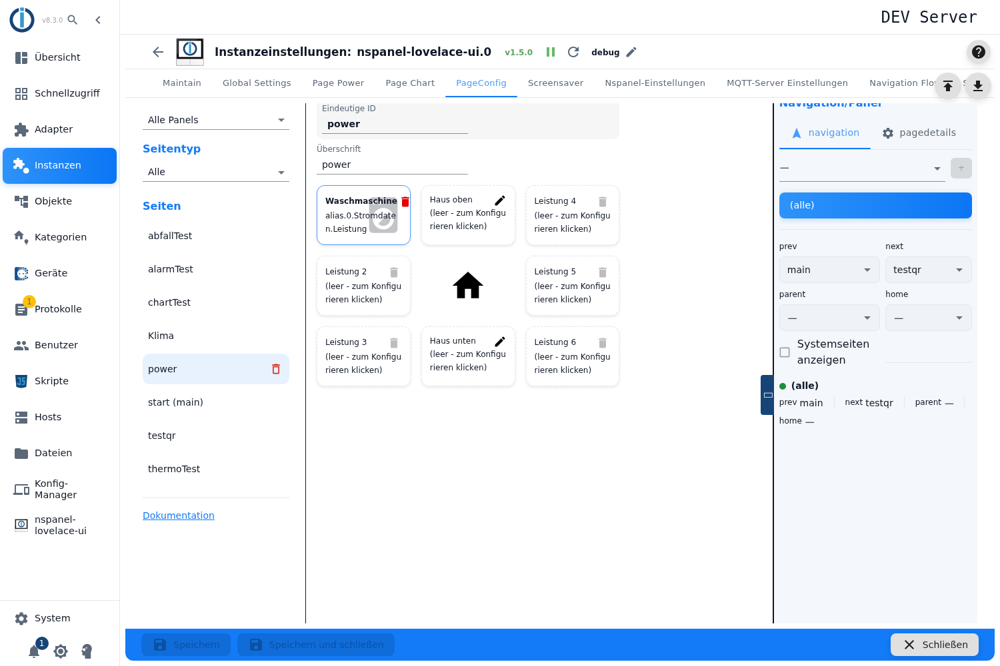
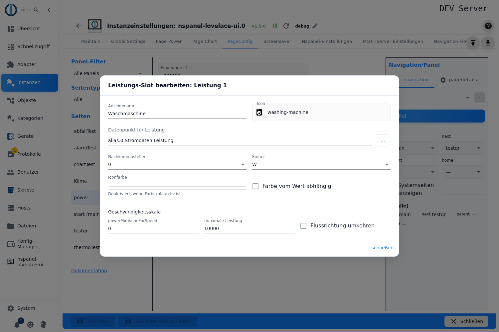
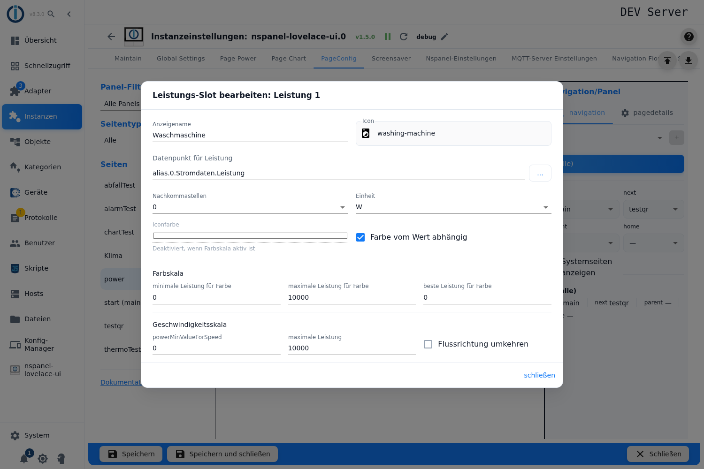
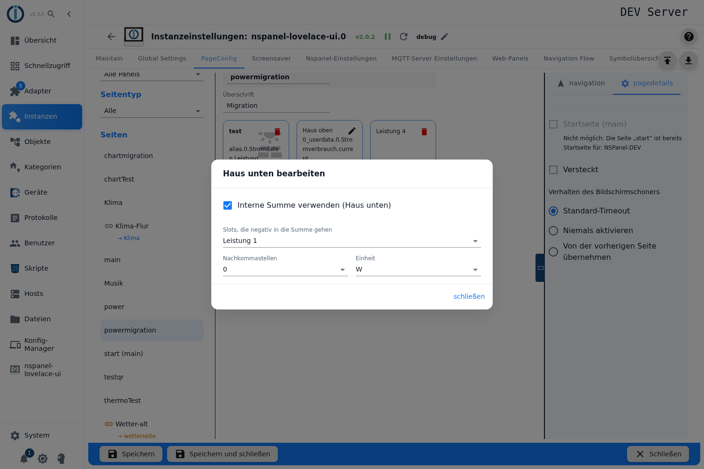
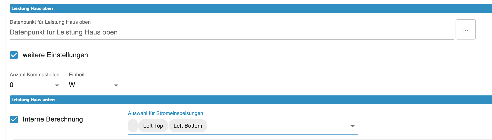

# Power page – configuration in the admin

The power page shows a house in the middle and up to **six energy flows** around it — photovoltaics, grid, battery, heat pump, wallbox. Every flow has an icon, a value and an **animation** whose speed follows the power. The centre is the virtual distribution box: all flows meet there, and above and below the house icon sits one value of its own each.

You create it in the **PageConfig** tab, page type **Power**. Several power pages are possible, and which panel a page appears on is set by the navigation assignment in the same tab — no configuration script is needed for that. Pages coming from the former table *Page Power* or from a script only reach this tab through the [Migration](Migration).

Contents:
- [Creating the page](#1-creating-the-page)
- [The grid: six tiles around the house](#2-the-grid-six-tiles-around-the-house)
- [Setting up a flow](#3-setting-up-a-flow)
- [Colour by value: the colour scale](#4-colour-by-value-the-colour-scale)
- [Speed and flow direction](#5-speed-and-flow-direction)
- [The two house values](#6-the-two-house-values)
- [The internal sum](#7-the-internal-sum)
- [What reaches the panel](#8-what-reaches-the-panel)
- [Panel assignment and navigation](#9-panel-assignment-and-navigation)
- [Pitfalls](#pitfalls)

## 1. Creating the page

1. Open the instance settings → tab **PageConfig**.
2. On the left pick the page type **Power**, enter a name, press **+**.
3. The page appears in the list and the editor opens on the right.

**Unique ID** above the grid is the page name; on the start page the field is locked. **Headline** is the header line on the panel — creating the page fills in the page name, and an empty field shows the page name again on the panel.

> As with every card type the fields of the main form are locked while the instance is not running — without an explanation. For the three dialogs of this page that is only partly true, see [section 3](#3-setting-up-a-flow).

> If the page comes from the old table *Page Power* and has no navigation in the admin yet, a yellow box sits above the grid: *Migrated from the old table „Page Power": this page still gets its navigation from the script (page „…"). This is deprecated - assign a navigation here and remove the page from the script.* What is behind it is described under [Migration](Migration).

## 2. The grid: six tiles around the house

The editor shows the card as a **three-by-three grid**: three tiles on the left, three on the right, in the middle at the top **Home top**, in the centre the house icon and below it **Home bottom**.

| Action | Effect |
|---|---|
| **Clicking one of the six tiles** | opens the dialog *Edit power slot: Power `n`*. |
| **Clicking Home top / Home bottom** | opens *Edit Home top* or *Edit Home bottom*. |
| **Dragging one tile onto another** | **swaps** the two contents. That way the flows can be rearranged without entering them again. |
| **Bin icon** | clears the tile. The button is grey while the tile is empty. |

An empty tile shows *(empty - click to configure)*, an occupied one shows the display name and the ID of the state below it. **There are always exactly six tiles** — no more, no fewer. Unused ones stay empty.

> Dragging only works with a pointing device and only while the instance is running; only the six tiles are swapped, not the two house fields.

> **The house icon itself cannot be configured.** The adapter always puts the icon `home` there, in white. A name next to the house is not possible: the field for it exists in the data model but is never filled, and the interface does not even offer it.

## 3. Setting up a flow

In the *Edit power slot* dialog:

| Field | Effect |
|---|---|
| **Entity headline** | The label above the flow display, for example the name of the consumer. Left empty, there is **no** text on the panel; the tile in the editor then shows "Power" with its number instead. |
| **Icon** | The icon of the flow, from the icon list. The search suggests variants. |
| **Power data point** | The measurement. The picker only shows states of type number. **Without it the tile stays empty on the panel** — no warning is given. |
| **Decimal places** | 0, 1 or 2. |
| **Unit** | The unit the value has **in the state**: W, kW or MW. The adapter scales up or down to the fitting step by itself. |
| **Icon color** | A fixed colour for the icon. Disabled as soon as the colour scale is active — the help text says so: *Disabled when color scale is active*. |
| **Color depends on value** | Switches the colour scale on, see [section 4](#4-colour-by-value-the-colour-scale). |

The same state feeds **value, colour and animation** at once.

> ⚠️ **The unit describes the state, it is not a target unit.** The adapter reads it as the unit of the raw value and converts to the base unit: with **kW** it multiplies the value by 1000, with **MW** by a million. So for a state that delivers watts, **W** belongs here — with **kW** the panel shows values a factor of 1000 too high.

> **The unit chosen in the dialog applies.** A unit on the state (`common.unit`) is not read at runtime. It comes into play exactly once, namely when taking the page over from the old table (see [Migration](Migration)) — after that it sits as a value in the field. If the page comes from there and carries a unit other than W, kW or MW (kWh, for instance), the picker adds that unit as a fourth entry. Once it is deselected, it is gone from the list.

> **Generation and consumption are not configured**, they follow from the **sign** of the measurement and the checkbox *Reverse flow direction*. The convention is: generators flow **towards the house**, consumers **away from it**. That sentence appears nowhere in the interface — yet it is the key to a coherent display.

> The three dialogs of this page only have **close**, no cancel: every entry takes effect on the page immediately. And unlike the main form, the fields stay usable **even with a stopped instance** — with the exception of *Power data point* and *Icon*, which both need a running instance.

## 4. Colour by value: the colour scale

With **Color depends on value** the icon is tinted according to the power. The section **Color scale** with three fields then appears:

| Field | Effect |
|---|---|
| **minimum power for color** | The lower end of the scale. Default 0. |
| **maximum power for color** | The upper end. Default 10000. |
| **best value for color** | The value that counts as "good". Default 0. |

The computation uses a fixed gradient **from red through yellow to green**. The colours cannot be configured — the theme colours of the panel and the icon colour have no effect here. The assignment is:

- **best value** gets **green**,
- **minimum** and **maximum power** both get **red**,
- in between the gradient runs through yellow.

That gives the three usual settings:

- **Example 1 — 0 W green, 100 W red:** minimum power `0`, maximum power `100`, best value `0`.
- **Example 2 — 0 W red, 100 W green:** minimum power `0`, maximum power `100`, best value `100`.
- **Example 3 — −50 W red, 0 W green, 100 W red:** minimum power `-50`, maximum power `100`, best value `0`.

> **The three limits apply to the raw value of the state**, not to the step shown. For a state in watts, `10000` is therefore 10 kW.

> **A measurement outside the span silently widens it.** If the value is below the minimum or above the maximum, the adapter computes with the measurement as the new end — so the colour does not "stick" at red, the gradient is stretched instead.

> The fields accept **any** number. If the maximum is below the minimum, the adapter swaps the two limits and **reverses the gradient** — then the *best value* gets red. An empty field does not yield a valid value.

> The **icon colour set earlier stays stored**, even while the scale is active and the field appears disabled. Switch the scale off later and the old colour is back. With **no** icon colour set and the scale off, the panel draws the icon **white**.

> **Check pages coming from the old table:** there the static icon colour was only taken over when the checkbox for the colour scale was explicitly off. Rows whose checkbox was never touched arrive **without** an icon colour and the icon is white. The colour scale itself only counts as taken over when the checkbox was set **and** all three limits were numbers. So after a [Migration](Migration), go through the six tiles once.

## 5. Speed and flow direction

The **Speed scale** section controls the animation — it runs faster the greater the power.

| Field | Effect |
|---|---|
| `powerMinValueForSpeed` | The power at which the dot **stands still**. Default 0 — with it the dot is motionless at 0 W. |
| **Maximum power** | The power at which the animation runs at **100 %**, that is fastest. Default 10000. In between the speed grows evenly with the power. |
| **Reverse flow direction** | Reverses the direction of travel — for flows whose state carries the sign the other way round. |

The direction of travel comes from the **sign**: a negative measurement makes the dot run the other way, and the checkbox *Reverse flow direction* reverses both.

> ⚠️ **The first field shows the raw key `powerMinValueForSpeed` instead of a label** — the adapter is missing the translation, in both languages. What is meant is the **minimum power for the speed**, the counterpart of the field next to it.

> The label **Maximum power** effectively exists twice: here for the animation, further up as *maximum power for color* for the gradient. They can only be told apart by the section headings *Color scale* and *Speed scale*.

> **The speed is not capped.** Above the *Maximum power* the adapter keeps computing beyond 100 %, below the minimum into the negative — where the direction of travel flips. These two limits apply to the **raw value** of the state as well.

## 6. The two house values

Above and below the house icon sits one value each, configured through the tiles **Home top** and **Home bottom**. Both dialogs only know **Data point for Power Home top** or **Home bottom**, **Decimal places** and **Unit** — no icon, no name, no colour, no animation.

Common practice: at the top the current consumption of the house, at the bottom the balance or the feed-in.

> ⚠️ **The house values neither convert nor shorten.** Unlike the six tiles they get no automatic unit step and no space check: the adapter formats the raw value with the configured decimal places and appends the chosen unit unchanged. So the unit has to match what is in the state here — 1234.5 W does **not** become 1.2 kW here but `1234,5 W`.

> A side effect of the same computation: the house values write a decimal **comma** (`1234,5 W`), the six tiles a decimal **point** (`1.2 kW`).

## 7. The internal sum

Instead of a state of its own, **Home bottom** can show a sum of the six flows. Tick **Use internal sum (Home bottom)** for that; the field for the state disappears and a multiple selection with the entries **Power 1** to **Power 6** appears instead.

The selected tiles are **added up**, the remaining ones count as zero.

> ⚠️ **The German label says the opposite.** There it reads *Slots, die negativ in die Summe gehen* ("slots that enter the sum negatively") — in fact the selected tiles enter the sum **unchanged, that is positively**, and all unselected ones as zero. Nothing is negated. The English label (*Slots that contribute to the sum*) describes it correctly. So when setting it up: **select the tiles that should contribute to the sum.**

> **An empty selection means "all six".** If you tick the box and select nothing, the adapter sums up **all** tiles. So the checkbox immediately delivers a result nobody selected.

> **The sum adds raw values.** It converts no units: a tile in kW and one in W are added as bare numbers. *Reverse flow direction* has no effect on the sum either — the checkbox only turns the animation around, not the sign of the summand. If you need a balance whose parts have different signs, you have to model that in the state itself.

## 8. What reaches the panel

The card has a fixed layout: headline, house icon with two values, six flows with icon, name, value and animation. It refreshes at most every two seconds.

> **Six characters are available for the value of a tile.** If the space is not enough, the adapter scales up to the next larger unit by itself — or down for very small values — and **cuts the decimal places if need be**. The *Decimal places* setting is therefore a wish, not a promise: `1234.5 W` will rather become `1.2 kW`. This applies **only to the six tiles**, not to the house values (see [section 6](#6-the-two-house-values)).

> **Nothing on the card can be operated.** The power page has no page items and no popups; only the navigation arrows of the panel can be tapped.

## 9. Panel assignment and navigation

Panel, navigation targets, *Start page*, *Hidden* and *Screensaver behavior* live in the right-hand column, described under [PageConfig – Overview](PageConfig#panel-assignment-and-navigation).

The **Documentation** link at the bottom left of the tab builds its address from the **selected page type** — with **Power** it leads to this page. With the filter on *All* or *Main pages* it follows the card type of the selected entry.

If a page that still comes from a script is to be managed here, the way leads through the [Migration](Migration). That page also holds the rules for pages taken over from the old table *Page Power*, and why the adapter keeps warning as long as the navigation still comes from the script.

## Pitfalls

- **The unit describes the state, not the display.** **kW** on a watt state delivers values a factor of 1000 too high. The step of the display is chosen by the adapter itself.
- **`common.unit` on the state is ignored at runtime.** Only the choice in the dialog counts; the unit of the object was used once, during the [Migration](Migration).
- **The gradient is red–yellow–green and cannot be configured.** Green sits on the *best value*, red on **both** ends. If you only want a rise from red to green, set the *best value* to the maximum (example 2).
- **Best value and maximum power on the same value are allowed but delicate.** If the measurement hits that value exactly, the adapter computes a division by zero and the colour is undefined for that cycle. A small gap between the two fields avoids it.
- **All limits for colour and speed apply to the raw value** of the state, not to the unit the panel shows.
- **Without an icon colour and without the colour scale the icon is white.** On pages from the old table that is the normal case when the checkbox *Color depends on value* was never touched there.
- **A measurement outside the colour scale stretches it** instead of sticking at the end — the colours then shift for all other values too.
- **`powerMinValueForSpeed` is a missing translation key**, not a special field. What is meant is the minimum power for the speed.
- **"Maximum power" appears twice in the dialog** — once for the colour, once for the speed. Only the section heading tells them apart.
- **The house values neither shorten nor convert.** A value that is too long overflows there, and a wrong unit goes unnoticed because nobody checks it.
- **"Slots, die negativ in die Summe gehen" is mislabelled** in German. What you select are the tiles that **contribute**.
- **The internal sum checkbox without a selection sums all six tiles.**
- **The internal sum adds bare numbers** — mixed units and *Reverse flow direction* are not taken into account.
- **Without a state a tile stays empty on the panel**, without a hint in the admin.
- **The dialogs know no cancel.** Every entry takes effect immediately; only *Power data point* and *Icon* need a running instance, everything else can be changed with a stopped instance too.
- **Dragging the tiles needs a running instance** and a pointing device; the two house fields cannot be swapped.
