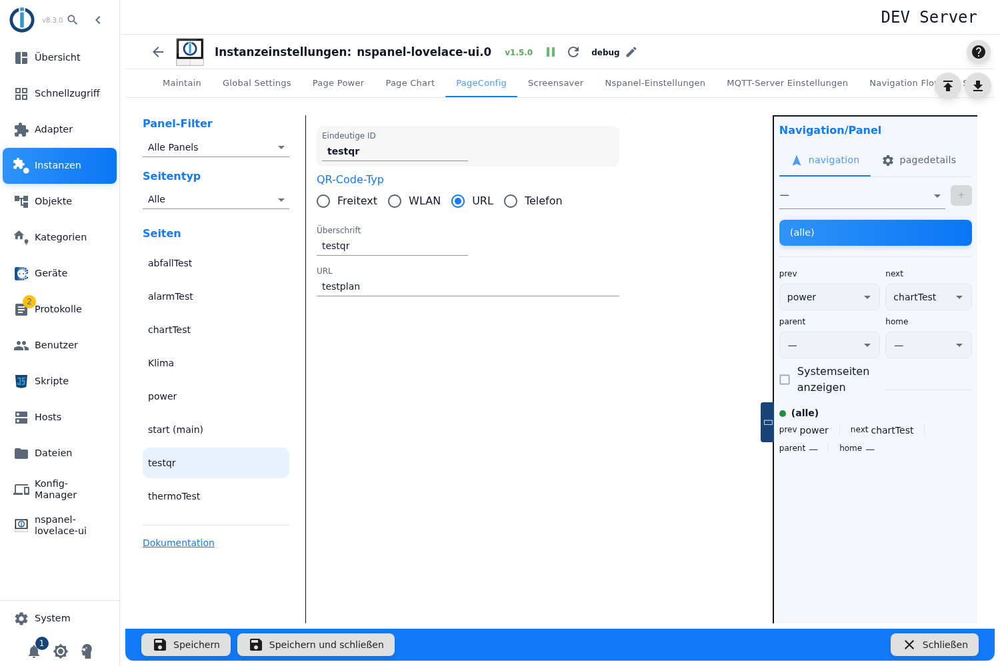
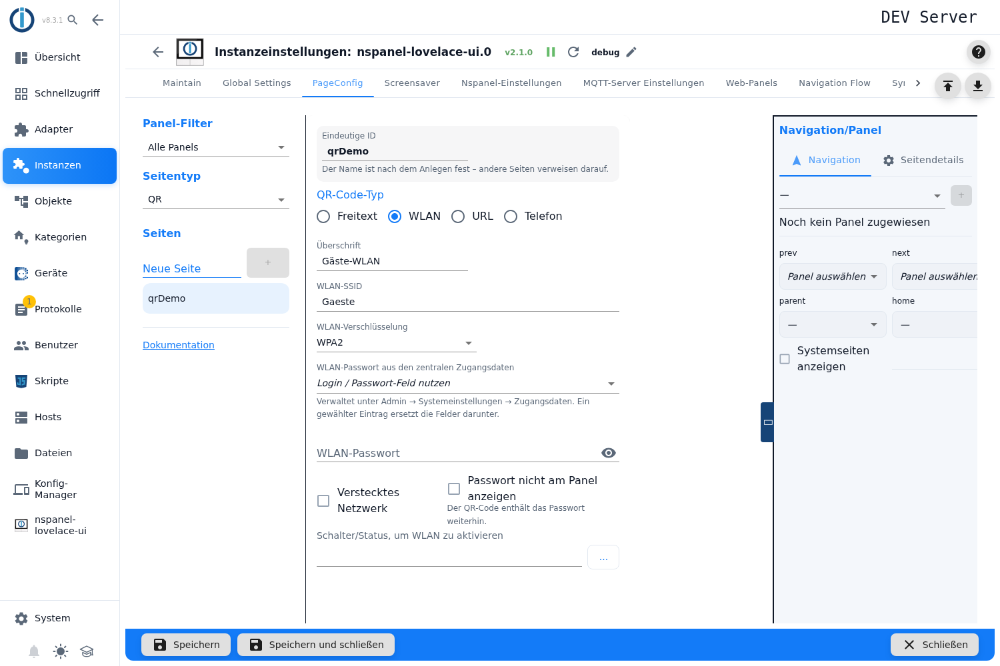
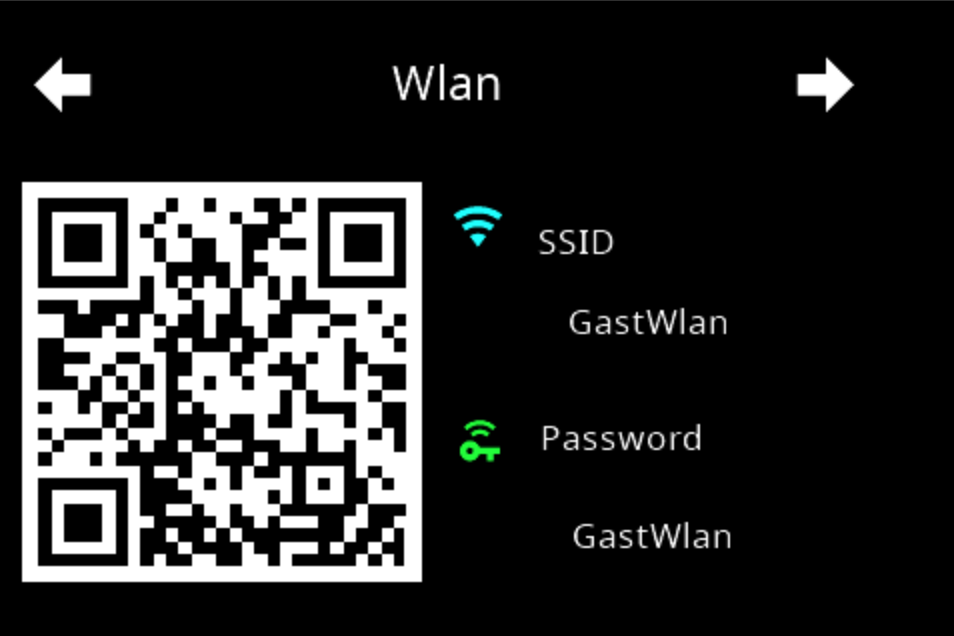
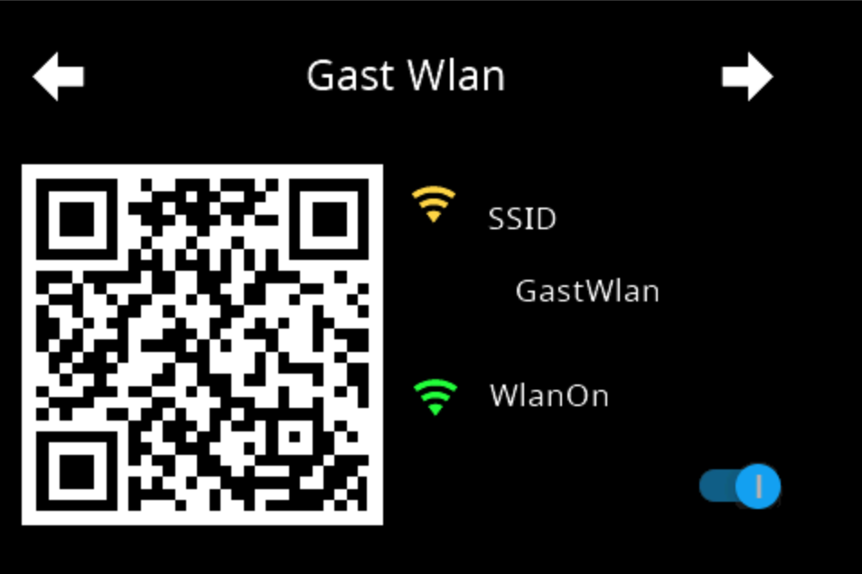
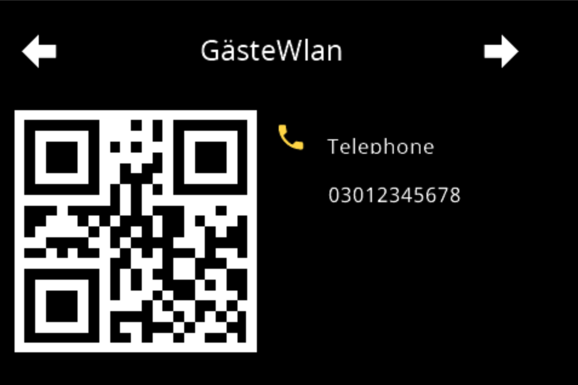
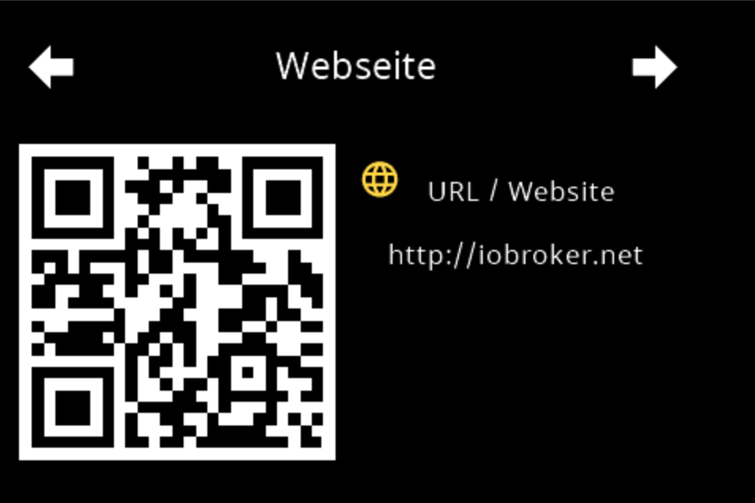

# QR code page – configuration in the admin

The QR page shows a **QR code** on the panel with two lines of text below it. The most common purpose: guests scan the code and are on the WiFi without typing the password. The card can also carry any text, a web address or a phone number.

It is created in the tab **PageConfig**, page type **QR**. That is the only way: a page with the card type `cardQR` in a configuration script is discarded by the adapter with `Page: <name> with card type cardQR is only supported in the admin configuration! Skipped!` and is not built (`config-manager.ts`).

The QR code itself is drawn by the panel firmware. The adapter only sends the string — very long contents therefore become unreadable quickly on the small display.

Contents:
- [Creating the page](#1-creating-the-page)
- [QR code type](#2-qr-code-type)
- [Headline and content](#3-headline-and-content)
- [WiFi: encryption, password, hidden network](#4-wifi-encryption-password-hidden-network)
- [The password from the central credentials](#5-the-password-from-the-central-credentials)
- [Enabling the WiFi with a switch](#6-enabling-the-wifi-with-a-switch)
- [What appears on the panel](#7-what-appears-on-the-panel)
- [Panel assignment and navigation](#8-panel-assignment-and-navigation)
- [Taken over from the old table](#9-taken-over-from-the-old-table)
- [Pitfalls](#pitfalls)

## 1. Creating the page

1. Open the instance settings → tab **PageConfig**.
2. On the left under **Page Type** pick the entry **QR**, enter a name in the field **New Page**, press **+**.
3. The page appears in the list **Pages**, the editor opens on the right.

The name is shown in the editor as **Unique ID** and is the ID of the page — other pages address it by that name in their navigation targets. The field is locked while the page is marked as the start page; the editor then shows the hint *Start page - published under the id "main"…*. For renaming and its pitfalls see [PageConfig – Overview](PageConfig#creating-renaming-and-deleting-pages).

The fields **Panel Filter** and **Page Type** above the list only filter what the list shows.

> **Every field is greyed out while the instance is not running.** The editor queries the adapter live; with a stopped adapter nothing can be entered and nothing can be created. The interface gives no explanation for this — the greyed-out form is the only hint.

The link **Documentation** at the bottom right of the tab leads to exactly this wiki page (`cardQR`).

## 2. QR code type

Four radio buttons under **QR Code Type** decide **what** the code contains. Which fields appear below depends on it:

| Type | String in the code | Further fields |
|---|---|---|
| **Free Text** | the content unchanged | none |
| **WiFi** | `WIFI:T:<encryption>;S:<SSID>;P:<password>;H:true;` — without the checkbox *Hidden Network* it ends with `H:;` | WiFi Encryption, central credentials, WiFi Password, Hidden Network, Hide Password, switch |
| **URL** | `URL:<address>` | none |
| **Phone** | `TEL:<number>` | none |

On a new page the type is preset to **Free Text**. With **Phone** the country code belongs in the number (`+49…`), otherwise the phone cannot dial it.

## 3. Headline and content

**Headline** sits as the header line above the code. Creating the page fills in the page name; if the field stays empty, the panel shows `Page QR`.

The field below it carries the actual content and **changes its label** with the type: *QR String*, *WiFi SSID*, *URL* or *Phone Number*.

> **Nothing is validated here.** No required entry, no length limit, no check whether an address looks like an address. An empty field produces an empty QR code — and you only see that on the panel, because the editor has no preview.

Three things the adapter does with the texts, worth knowing when a code does not work:

- **A tilde `~` is replaced by `-`.** This applies to the whole message sent to the panel, so to SSID and password as well. A password containing a tilde arrives changed — without any notice.
- **Special characters in the WiFi code are not escaped.** If the SSID or password contains a `;`, `:`, `,` or `\`, that breaks the structure of the `WIFI:` code and the scanner reads nonsense. Whoever has such characters in the password has to write the QR card off for it.
- **The headline runs through the dictionary of the adapter.** If it happens to carry a keyword of the adapter translation (`hidden`, for instance), the panel shows the translated text instead of the entry.

## 4. WiFi: encryption, password, hidden network

These fields only appear for the type **WiFi**, in this order: WiFi Encryption, central credentials, WiFi Password, the two checkboxes, switch.

**WiFi Encryption** — the choices are *No Password*, *WPA*, *WPA2*, *WPA3* and *WEP*.

> ⚠️ **As long as the field has not been touched, the interface shows `WPA2`, but the adapter writes `WPA` into the QR code.** The displayed value is only a preset of the interface, nothing is stored until you touch it; without a stored value the fallback `WPA` applies — twice, when building the page and when sending it. Many devices connect anyway, some do not — and then you go looking for the mistake in the SSID. **So set the field deliberately once**, even if "WPA2" is already showing.

**WiFi Password** — the password in clear text; the eye icon toggles the display. The field falls away when the encryption is set to *No Password*, and it is locked while an entry is selected under *Wifi password from the central credentials* (see [section 5](#5-the-password-from-the-central-credentials)).

> ⚠️ **A password entered here is stored unencrypted in the instance configuration** (`native.pageConfig[].qrPass`) and is readable by anyone with read access to the objects. It is stored encrypted only when it comes from the central credentials. Whoever does not want that uses a separate guest network for the visitors with a password whose loss does not hurt.

> ⚠️ **`No Password` does not remove the password.** The choice only hides the fields; everything stays stored. The adapter still puts the password into the string (`WIFI:T:nopass;…;P:<password>;`) and also shows it in the second line of the card. The same applies when switching the QR type: password, encryption type and switch stay in the configuration invisibly. Whoever wants to get rid of them clears the fields while the type is still WiFi and the encryption is not *No Password*.

**Hidden Network** — writes `H:true` into the code so the scanner also connects to a network that does not broadcast its name. Without the checkbox the string ends with `H:;`.

**Hide Password** — leaves the password line on the panel empty.

> ⚠️ **This is not a security feature.** The checkbox only hides the text line; **the QR code still contains the password** and any scanner reads it out. That is exactly what the card is for. The checkbox helps against someone reading over your shoulder, not against a photo of the code.

## 5. The password from the central credentials

The WiFi password does not have to sit in the instance configuration. The select box **Wifi password from the central credentials** above the password field refers to an entry from *Admin → System settings → Credentials* instead; only its object ID is stored then (`system.credentials.<name>`), the value is read and decrypted by the adapter at runtime. The hint below the field puts it briefly: *Managed under Admin → System settings → Credentials. A selected entry replaces the field(s) below.*

| Entry in the list | Effect |
|---|---|
| **Use the login / password field** (first entry) | no central entry; the field **WiFi Password** applies. |
| `<name> (login & password)` | the adapter takes the **password** of the entry, the user name is ignored. |
| `<name> (key)` | the adapter takes the **key** of the entry. |

The list is reloaded every time it is opened, so an entry created in the system settings in the meantime appears without reloading the page. The secrets themselves never reach the browser.

What happens without a usable entry:

| Situation | Behaviour |
|---|---|
| no entry selected | the field **WiFi Password** applies. |
| entry selected, but empty | warning in the log (`Credential "…" is empty - using the field of the instance settings instead`), the field **WiFi Password** applies. |
| entry deleted or not readable | warning in the log (`Cannot read credential "…"`), the field **WiFi Password** applies. In the editor the error text reads *The selected credential no longer exists - the field(s) below are used*. |
| list cannot be loaded | *The list of credentials could not be loaded*; the stored field stays unchanged. |
| neither entry nor field filled | the code is built with an empty `P:`, without a message. |

> ⚠️ **If the entry falls away, the password field stays locked.** The lock depends solely on the fact *that* an ID is stored — not on whether it can still be resolved. The editor does report that "the field(s) below" now apply, but it allows no entry. To fill it in, first set the select box back to **Use the login / password field**.

> **Leading and trailing spaces are lost.** The adapter trims the value it reads (`trim`) — on both paths, central entry and field. A password that begins or ends with a space arrives shortened in the code.

The adapter watches every entry in use: **if its value changes, the instance restarts** and builds the pages with the new password (`Credential "…" has new values - restarting the adapter to apply them`). Renaming or a new icon trigger no restart — what is compared is a fingerprint of the values, not the object. If the entry is **deleted**, the instance keeps running with the value read at start-up and only reports `Credential "…" was deleted - after a restart the fields of the instance settings are used instead`.

> That the password came from a central entry is written to the **debug** log only (`QR page '<name>': password taken from credential "<name>"`). For the adapter's other credentials (MQTT, Tasmota WebUI) the adapter reports this as info.

## 6. Enabling the WiFi with a switch

**Switch / state to enable WiFi** takes a state with `type=boolean` that is both readable and writable (the object picker only offers such states). The usual case: the guest network on the router is normally off and is only switched on when visitors are there.

What this state **really** does is not stated like that in the interface:

- The **second line of the card turns into a switch**. It shows a green `wifi` icon with `WlanOn` or a grey `wifi-off` with `WlanOff`, and a press on it toggles the state.
- **The password line disappears with it**, because there is only this one line. Whoever wants the switch *and* the password display cannot have both on this card. The checkbox *Hide Password* is without effect in this variant.
- The QR code itself stays visible unchanged — even while the network is off.

> ⚠️ **The field only appears with WiFi, but it works with every type.** If the QR type is later switched to *Free Text*, *URL* or *Phone*, the state stays stored and the second line keeps showing the WiFi switch with `WlanOn`/`WlanOff` — on a URL card. To remove it, set the type back to **WiFi** and clear the field.

On the left the card **without** a switch, on the right **with** one: the second line carries either the password or the button — not both.

 

## 7. What appears on the panel

The card has a fixed layout: headline, QR code, and below it **exactly two lines**.

| Line | Content |
|---|---|
| **1** | Icon and label per type — **Free Text**: `qrcode-scan`, *without* a label and **without a value** · **WiFi**: `wifi` with "SSID" · **URL**: `web` with "URL / Website" · **Phone**: `phone` with "Telephone". With WiFi, URL and Phone the entered content is shown as the value. |
| **2** | Without a switch: icon `key-wireless` with "Password" and the password as the value — empty when *Hide Password* is set. With Free Text, URL and Phone this line stays without an icon and without a text. With a switch: the button from [section 6](#6-enabling-the-wifi-with-a-switch). |

The same card as a phone number and as a web address:

 

> The labels of these two lines — "SSID", "Password", "URL / Website", "Telephone", "WlanOn", "WlanOff" — are hard-coded **in English** in the adapter source and have no entry in any dictionary. So they read the same in every panel language.

The card refreshes at most once per second. There is no limit on how many QR pages you create.

## 8. Panel assignment and navigation

Panel, navigation targets, **Start page (main)**, **Hidden** and **Screensaver behavior** are — as with every card type — in the right-hand column and are described under [PageConfig – Overview](PageConfig#panel-assignment-and-navigation). The QR page has no peculiarities there; it can also serve as the start page.

A reminder: a page **without a panel assignment** is not built and does not exist on the panel.

## 9. Taken over from the old table

Whoever used to keep the QR pages in the separate table `pageQRdata` will find them as pages in the PageConfig tab after the update. The conversion happens by itself on the first start, the old table is removed afterwards.

Taken over are: unique ID, headline, QR code type, content, switch state, *Hidden Network*, *Hide Password*, *Hidden* and *Screensaver behavior*.

> ⚠️ **Password and encryption type have to be entered anew.** The conversion carries over **neither** of them. Afterwards the password field is empty and the encryption falls back to `WPA`. The QR code is still built and looks valid; only nobody connects any more. There is no log message about it — unlike the tables *Page Power* and *Page Chart* that moved later and do report their take-over.
>
> So after updating an existing installation: **open every QR page once**, enter the password and set the encryption deliberately.

Since **2.0.0** the button **Take script over into admin** in the tab `Maintain` also clears out the references to QR pages from a configuration script. The preview says *This page type is configured in the admin only – the reference in the script is dead and is removed*; no admin entry is created in the process, as the page itself was always configurable in the admin only. The procedure is described under [Migration](Migration). Afterwards the panel can be detached from the script completely with **Panel uses no script** (see [NSPanelsetting](NSPanelsetting)).

## Pitfalls

- **`WPA2` is shown, `WPA` is sent.** The preset of the interface is not stored; without a stored value the adapter writes `WPA`. Set the field **WiFi Encryption** deliberately once.
- **After the take-over from `pageQRdata` password and encryption type are missing.** Enter both anew, see [section 9](#9-taken-over-from-the-old-table).
- **`No Password` deletes nothing.** The stored password is still in the code and in the password line of the card.
- **A switch state once set also works after a type change.** Then a WiFi switch hangs on a URL or phone card.
- **Locked password field although no credential entry exists.** Set the select box back to **Use the login / password field** first.
- **Special characters break the WiFi code**: `;`, `:`, `,`, `\` are not escaped, `~` becomes `-`, leading and trailing spaces are trimmed.
- **No field is required, no check runs.** An empty content field produces an empty code; that only becomes apparent on the panel, because the editor has no preview.
- **Everything greyed out:** the instance is not running. The editor can be used with a running instance only.
- **The page is missing on the panel:** check the panel assignment — without an assignment the page is not built.
- **A QR page in a configuration script stays without effect.** The adapter skips it with a warning; the configuration belongs in the admin.
