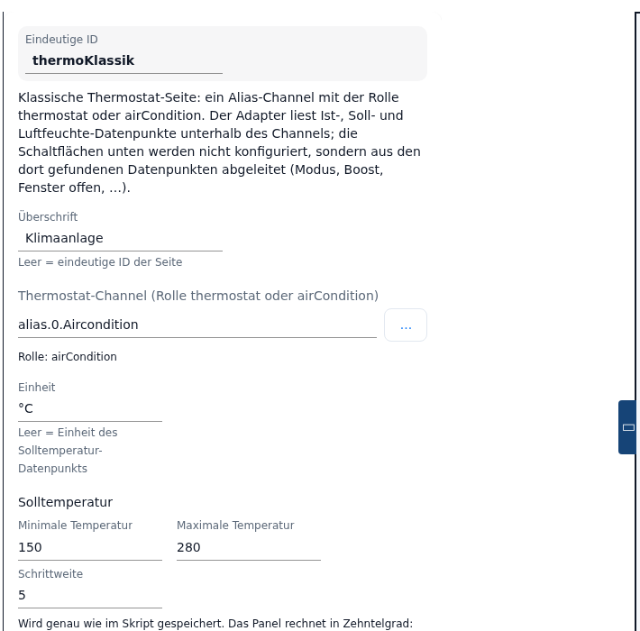
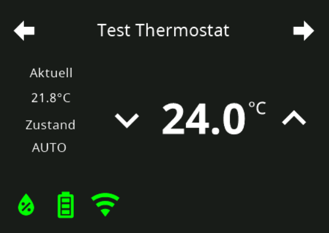
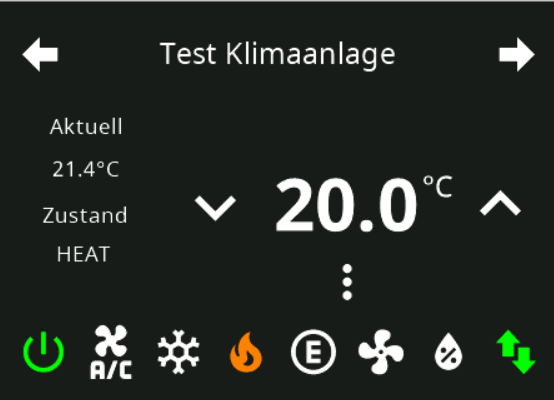
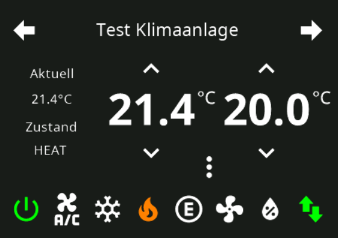
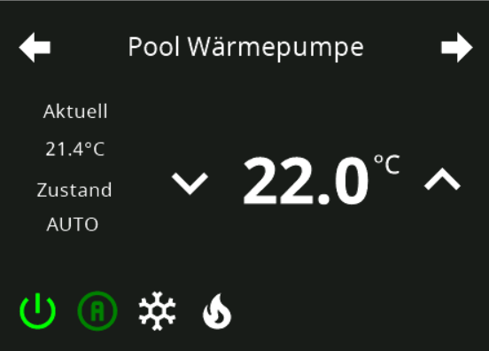
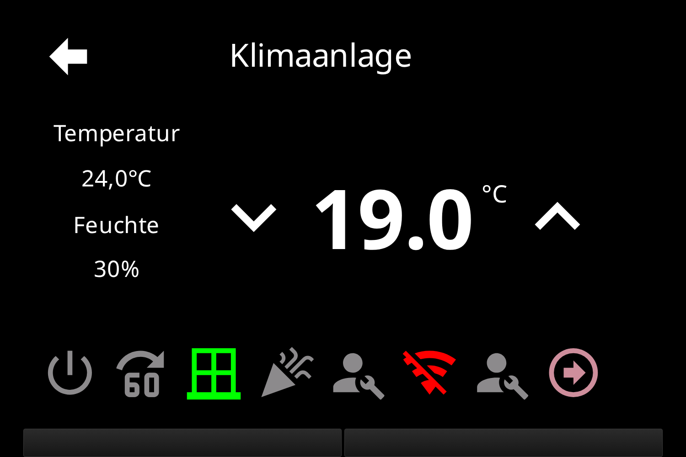

# Page Thermo (classic) – configuration in the admin

The classic thermostat page `cardThermo` shows **one** thermostat: on the left the actual temperature and the humidity, in the middle the set point with the − and + keys, below it a bar with **eight** slots for mode icons and status displays. It is created in the tab **PageConfig**, page type **Thermostat (classic)**.

Only the **Headline**, the **Thermostat channel**, the **Unit** and the limits of the set temperature are configured. Everything else is derived by the adapter from the states it finds below the channel – the editor says so itself: *"Classic thermostat page: one alias channel with the role thermostat or airCondition. The adapter reads the actual, set and humidity states below the channel; the buttons at the bottom are not configured but derived from the states it finds there (mode, boost, window open, ...)."*

In the adapter the admin page runs through the same code as a `cardThermo` page from a script (`ConfigManager.getPageThermo`); with the same entries the result on the panel is identical.

Contents:
- [Creating the page](#1-creating-the-page)
- [cardThermo or cardThermo2](#2-cardthermo-or-cardthermo2)
- [The fields of the editor](#3-the-fields-of-the-editor)
- [Minimum, maximum, step](#4-minimum-maximum-step)
- [What the adapter builds from the states](#5-what-the-adapter-builds-from-the-states)
- [Eight slots and the paging arrow](#6-eight-slots-and-the-paging-arrow)
- [Saving, panel assignment, navigation](#7-saving-panel-assignment-navigation)
- [Take-over from the script](#8-take-over-from-the-script)
- [Pitfalls](#pitfalls)

## 1. Creating the page

1. Open the instance settings → tab **PageConfig**.
2. In the list **Pages** on the left click the PLUS, choose the type **Thermostat (classic)** and enter a **Unique ID** (the page name the navigation refers to).
3. The new page appears in the list; the editor opens on the right. A new page has no channel yet – without a channel the adapter builds an empty card and writes the reason as an error into the log of the instance.

The fields **Panel Filter** and **Page Type** above the list only filter what the list shows.

## 2. cardThermo or cardThermo2

Both cards control heating and air conditioning, they differ in scope:

| | `cardThermo` (classic) | [`cardThermo2`](cardThermo2) |
|---|---|---|
| Data sources per page | exactly **one** | up to **eight** |
| Own slots (page items) | none in the admin – the eight slots are filled by the adapter alone | own page items per heat circuit, in addition to the generated buttons |
| `airCondition` with `SET` **and** `SET2` | shows **two set points side by side** on one card | becomes **two heat circuits** (heating and cooling) with one set point each |
| Mode icons | only from the `MODE` state of an `airCondition` channel; with the role `thermostat` there are none | own **mode display** with freely chosen mode texts |
| Icon, color and unit of the value lines | not configurable | adjustable per line |
| Paging | automatic as soon as more than eight slots come together – not adjustable | three paging modes in the page details |
| Option *Values in tenths* (tab **Global Settings**) | without effect | applies to the limits of the set temperature |

In short: `cardThermo` is the quick card for **one** thermostat whose alias brings along many states (window, party, vacation, error …), and the only card that shows two set points of an `airCondition` channel side by side. Whoever needs several heat circuits, own buttons or an adjustable appearance takes [cardThermo2](cardThermo2).

## 3. The fields of the editor

| Field | Meaning |
|---|---|
| **Unique ID** | Page name; read-only, fixed once the page exists. On the start page the note names the id `main`. |
| **Headline** | Header line of the page on the panel. Hint text: *Empty = unique ID of the page*. |
| **Thermostat channel (role thermostat or airCondition)** | Alias channel, device or folder with `common.role` `thermostat` or `airCondition`. The object tree behind **…** shows only objects with these roles; an ID typed in by hand is checked by the editor when the field is left. If it matches, *Role: …* appears below it, otherwise a warning: *The object … was not found* or *The channel … has the role "…" – expected thermostat or airCondition*. Which states the adapter looks for below the channel is in [section 5](#5-what-the-adapter-builds-from-the-states) and in the [alias table](ALIAS). |
| **Unit** | Text behind the temperatures (e.g. `°C`). Hint text: *Empty = unit of the set temperature state* – that applies to the big number, the line of the actual temperature then stays without a unit (see [Pitfalls](#pitfalls)). The humidity always shows `%`. |
| **Set temperature** with **Minimum temperature**, **Maximum temperature**, **Step** | Limits and step of the set point, see [section 4](#4-minimum-maximum-step). |

The labels of the value lines on the panel are fixed: *Temperature* above the actual temperature, *Humidity* above the humidity. The actual temperature shows one decimal place, the humidity none.

**Start page (main)**, **Hidden**, **Screensaver behavior** and the navigation targets are on the right in the column **Navigation/Panel** – described under [PageConfig](PageConfig#panel-assignment-and-navigation) and [page details](PageConfig#page-details). Paging settings do not appear there for this card; they belong to the menu, Thermo2 and media pages only.

## 4. Minimum, maximum, step

The three values are stored **exactly as the script would have them** – so that a page taken over keeps its numbers. Which unit they have is decided by the adapter from the **maximum**; the hint text below the fields says the same:

- **Maximum ≥ 100**: all three values are **tenths of a degree** – `100 / 300 / 1` means 10 °C to 30 °C in steps of 0.1 °C; a step of `5` would be 0.5 °C.
- **Maximum < 100**: all three values count as **degrees** and are multiplied by 10 – `15 / 28 / 0.5` means 15 °C to 28 °C in steps of 0.5 °C.
- A step below one tenth of a degree is raised to one tenth by the adapter.
- **Empty fields**: the adapter takes `common.min` / `common.max` / `common.step` of the set temperature state; without them 15 °C to 30 °C in steps of 0.5 °C apply. A `0`, on the other hand, stays a valid minimum.

The option *Values in tenths* in the tab **Global Settings** concerns `cardThermo2` only, not this page – its hint text says so explicitly.

## 5. What the adapter builds from the states

Below the headline **nothing is configured**. The adapter looks below the channel for `common.role` and `common.type` (see the [alias table](ALIAS)) and builds the values and the bar from them. **Only the set point `SET` is required**; without it the build of the page stops with an error in the log.

Which states are looked for at all depends on the role of the channel:

| Role | Evaluated |
|---|---|
| `thermostat` | `SET` (`level.temperature`, required), `ACTUAL` (`value.temperature`, `SET` as a substitute), `HUMIDITY` (`value.humidity`) · bar: `POWER` (`switch.power`), `BOOST` (`switch.mode.boost` / `switch.boost`), `WINDOWOPEN` (`sensor.window`), `PARTY` (`switch.mode.party`), `MAINTAIN` (`indicator.maintenance`), `UNREACH` (`indicator.maintenance.unreach`), `LOWBAT` (`indicator.maintenance.lowbat`), `ERROR` (`indicator.error`), `VACATION` (state with **exactly this name**), `WORKING` (`indicator.working`) |
| `airCondition` | `SET` and `SET2` (both `level.temperature`, both have to carry **exactly these names**), `ACTUAL`, `HUMIDITY` · bar: `MODE` (`value.mode.airconditioner`), `POWER` (`switch`), `BOOST`, `MAINTAIN`, `UNREACH`, `ERROR` |

Not evaluated are `MODE` and `MODESET` with the role `thermostat` as well as `USERICON`, `SPEED`, `SWING` and `SWING2`; `WINDOWOPEN`, `PARTY`, `LOWBAT`, `VACATION` and `WORKING` are known to the role `thermostat` only.

Switchable are only those slots whose state may be written: the mode icons, `POWER`, `BOOST` and `PARTY`. `WINDOWOPEN`, `MAINTAIN`, `UNREACH`, `LOWBAT`, `ERROR`, `VACATION` and `WORKING` are pure displays – pressing them does nothing.

The following pictures show the four typical results.

### Thermostat: one set point

Role `thermostat`. On the left **Temperature** (`ACTUAL`) and – if a `HUMIDITY` state is present – **Humidity**; in the middle the set point `SET` with the − and + keys. The bar at the bottom is filled by the optional states named above, one slot per state found. The auto / manual buttons of the picture come from the original script: for this role the adapter does not look for states `AUTOMATIC`, `MANUAL` or `OFF` and therefore never generates those buttons. A `MODE` state does not become icons with `thermostat` either.

### Air conditioner: mode icons

Role `airCondition` with a `MODE` state. The adapter derives the icons from `common.states` of that state – it has to be a **list** of the English keywords, and the position in the list is the value the slot writes. Recognised, in this order, are: `OFF` (`power-off`), `AUTO` (`alpha-a-circle`), `COOL` (`snowflake`), `HEAT` (`fire`), `ECO` (`alpha-e-circle-outline`), `FAN_ONLY` (`fan`), `DRY` (`water-percent`). Keywords missing from the list get no icon; a value → text mapping (`{"0": "off", "1": "automatic"}`) is not recognised by the adapter – then no mode icon appears at all. Without any `common.states` the built-in list `OFF, AUTO, COOL, HEAT, ECO, FAN, DRY` applies (index = value), which yields six icons (see [Pitfalls](#pitfalls)). After them follow the slots of the remaining states (`POWER`, `BOOST`, `MAINTAIN`, `UNREACH`, `ERROR`).

### Air conditioner: two set points

Role `airCondition` with `SET` **and** `SET2`: the panel shows two set points side by side, e.g. heating and cooling. Both states have to be named exactly `SET` and `SET2`, otherwise the adapter does not find them. The bar below as in the picture before.

### Heat pump: four modes

Role `airCondition` whose `MODE` state lists only `OFF`, `AUTO`, `COOL` and `HEAT` in `common.states` – accordingly exactly four icons appear.

## 6. Eight slots and the paging arrow

The bar at the bottom has **exactly eight slots**. The adapter fills them in this order:

1. the mode icons of an `airCondition` channel (`OFF`, `AUTO`, `COOL`, `HEAT`, `ECO`, `FAN_ONLY`, `DRY`),
2. `POWER`, `BOOST`, `WINDOWOPEN`, `PARTY`, `MAINTAIN`, `UNREACH`, **`MAINTAIN` a second time**, `LOWBAT`, `ERROR`, `VACATION`, `WORKING` – each only if the state is present.

It follows that:

- **Up to eight slots** all appear. With seven or eight they start at the first place; with six and fewer the adapter indents them towards the middle.
- **From the ninth slot on** the eighth place becomes the **paging arrow** (arrow to the right), and seven slots remain per page. The arrow is not configurable, cannot be moved and pages in a circle.
- A fully equipped alias exceeds the eight places easily: `thermostat` can generate eleven slots, `airCondition` with seven modes thirteen. Then the bar always has two pages.
- Every generated slot costs a place. Whoever wants to influence the order or the selection has to remove states from the alias – in the admin there are no own page items for this card.

The picture shows a complete `thermostat` alias: on/off, boost, window open (green, because it is open),
party, maintenance, unreachable, maintenance once more — and on the eighth place the paging arrow. The
two identical wrenches are the duplicated `MAINTAIN` block from the [Pitfalls](#pitfalls).

## 7. Saving, panel assignment, navigation

- On the right in the area **Navigation/Panel** assign the panel and set the navigation (`prev`, `next`, `parent`, `home`) – like for the other page types. Without `next`/`prev` of its own the page is only reachable when **another** page points at it with its `prev`/`next` or a page item has it as a target; a neighbour that arises that way is shown in the field in grey.
- At the bottom **Save** or **Save and close**. The instance restarts afterwards and builds the page.
- If the card stays empty (no channel, object missing, wrong role, `SET` not found), the reason is in the log of the instance as an error.

## 8. Take-over from the script

The [migration](Migration) turns a `cardThermo` page of the script into an entry of this page type. Taken over are: `heading` → **Headline**, `items[0].id` → **Thermostat channel**, `items[0].unit` → **Unit**, `minValue`/`maxValue`/`stepValue` → the three numbers (unchanged, see [section 4](#4-minimum-maximum-step)).

**Styling the panel showed before is lost in the process** – the admin has no equivalent for this card:

- **Further items.** All `items` after `items[0]` are built by the adapter on the script path as own slots behind the generated buttons. The take-over drops them without notice; the preview counts 0 elements for the page.
- **The mode popup.** With `setThermoAlias` and `popupThermoMode1` to `popupThermoMode3` up to three selection lists are created on the script path; only through them does the panel release the additional button that opens this popup. `name` supplies its headline, `onColor` the color; the icon in the popup is fixed. The lists occupy none of the eight places. The take-over drops that too; afterwards the button on the panel is missing.
- Without effect on both paths are only `iconArray`, `setThermoDestTemp2` and `popUpThermoName` as well as the icon, color and name fields of `items[0]` apart from `name` and `onColor`.

The page is skipped – and thus left in the script – only when the admin entry would build a **different** page: no item, `items[0]` without `id` (or a navigation or `native` item), a `unit` that is not text or is empty, a `minValue`/`maxValue`/`stepValue` that is not a number, or a field this page does not have (the paging fields, for instance).

## Pitfalls

- **Nothing works without a running instance.** All fields are locked and the channel is not checked.
- **An unusable channel can be saved.** The editor only warns. The page is then created as an empty card, the reason is in the log as an error.
- **"Screensaver behavior" has no effect on this card.** When building the page the adapter resets the setting to *Default timeout* – even *Never activate* and *Inherit from previous page* stay without consequence (known bug). **Hidden** and **Start page (main)** work normally.
- **An empty unit costs the unit of the actual temperature.** The big number then gets `common.unit` of the set temperature state, but the line of the actual temperature gets no unit at all. Whoever wants to see `°C` enters it.
- **The unit of the humidity is fixed to `%`** and cannot be changed.
- **The maximum determines the unit of all three numbers.** If only the maximum is left empty, minimum and step count as tenths of a degree while the maximum comes from the state – a `15` in the minimum thus becomes 1.5 °C. Either fill all three fields or leave all three empty.
- **`MAINTAIN` occupies two places.** `getPageThermo` contains the block twice: a channel with `indicator.maintenance` generates two slots with the same wrench and the same state, differing only in the color of the active condition (known bug). Count it in when counting the eight places.
- **Inactive mode icons can look wrong.** If `AUTO` is in `common.states`, the icons generated after it (`COOL`, `HEAT`, `ECO`, `FAN_ONLY`, `DRY`) show the outlined A of the automatic mode in their inactive condition instead of their own icon; only the active icon is correct (known bug). Without `AUTO` in the list this does not occur.
- **Without `common.states` the fan icon is missing.** The built-in substitute list contains `FAN`, but the adapter looks for `FAN_ONLY` – six icons remain (`OFF`, `AUTO`, `COOL`, `HEAT`, `ECO`, `DRY`).
- **`SET`, `SET2` and `VACATION` are found by name.** With an `airCondition` channel the set point states have to be named exactly `SET` and `SET2`, `VACATION` exactly `VACATION` (not `Vacation`). With the role `thermostat` the role `level.temperature` is enough for the set point.
- **The bar cannot be sorted.** Order, icons and colors of the generated slots are fixed. Own slots and the mode popup are known to this card in a script configuration only; the [migration](Migration) does not take them along (see [section 8](#8-take-over-from-the-script)).
