# Page Thermo2 – configuration in the admin

The thermostat page `cardThermo2` is created in the admin: tab **PageConfig**, page type **Thermostat (Thermo2)**. The editor draws the page the way the panel shows it – every spot of the card can be clicked and opens the matching settings. In the adapter the admin page runs through the same code as a page taken over from a script (`PageThermo2.getPage`), so the result on the panel is identical.

The page manages **several heat circuits**, shows three value lines per circuit (actual temperature, set temperature in the ring, humidity) plus a mode display, and takes **nine slots** for page items around the ring – four on the left, four on the right and one between − and +. Whoever only needs a single thermostat without own slots takes [Page Thermo (classic)](cardThermo).

**Which states a heat circuit needs** – this applies no matter how the page is created:

- The data source is an alias channel with the role **`thermostat`** or **`airCondition`**; every other role is rejected by the adapter. An `airCondition` channel yields **two** heat circuits: heating through `SET`, cooling through `SET2`.
- **Only `SET` is required**, the writable set temperature (`level.temperature`). Optional are `ACTUAL` (actual temperature), `HUMIDITY`, `MODE` or `MODESET` (operating mode) and the states the adapter turns into buttons (see [section 4](#4-the-buttons-from-the-alias)). If one of them is missing, that spot stays empty.
- **Only `USERICON` is not evaluated.** The alias table still carries the note *Not supported in cardThermo2* at `ERROR`, `MAINTAIN`, `PARTY`, `VACATION` and `WORKING` – that is outdated, all five do become buttons. With `airCondition`, `SPEED`, `SWING` and `SWING2` stay unused in addition.
- The full table of all roles is in the [Alias Table](ALIAS).

Alternatively a heat circuit can be assembled from **single data points** (set, actual, humidity, mode). The adapter then generates no buttons.

Contents:
- [Creating the page](#1-creating-the-page)
- [The editor at a glance](#2-the-editor-at-a-glance)
- [Heat circuit: data source and headline](#3-heat-circuit-data-source-and-headline)
- [The buttons from the alias](#4-the-buttons-from-the-alias)
- [Set temperature: minimum, maximum, step](#5-set-temperature-minimum-maximum-step)
- [Value display: icon, color, unit](#6-value-display-icon-color-unit)
- [Mode display](#7-mode-display)
- [Circuit icon](#8-circuit-icon)
- [Page items: adding, moving, free slots](#9-page-items-adding-moving-free-slots)
- [Order of the slots](#10-order-of-the-slots)
- [Paging of the slots](#11-paging-of-the-slots)
- [Panel assignment, navigation, saving](#12-panel-assignment-navigation-saving)
- [Take-over from a script](#13-take-over-from-a-script)
- [Pitfalls](#pitfalls)

## 1. Creating the page

1. Open the instance settings → tab **PageConfig**.
2. In the list **Pages** on the left click the PLUS, choose the type **Thermostat (Thermo2)** and enter a **Unique ID** (the page name the navigation refers to).
3. The new page appears in the list; the editor opens on the right. A new page has no heat circuit yet – the editor says *"At least one heat circuit with a channel is required, otherwise the page shows nothing"* and offers the button **Heat circuit** (see [section 3](#3-heat-circuit-data-source-and-headline)).

The fields **Panel Filter** and **Page Type** above the list only filter what the list shows. The general handling of the page list is described under [PageConfig – Overview](PageConfig).

## 2. The editor at a glance

| Field | Effect |
|---|---|
| **Unique ID** | Page name; read-only, fixed once the page exists. On the start page its own note stands there (*"Start page - published under the id 'main' …"*). |
| **Tabs above the preview** | One tab per heat circuit, the way the panel counts them: an `airCondition` channel gives two tabs (heating and cooling, the second one with the suffix *(cooling)*). The **+** on the right adds a heat circuit; from eight stored data sources on it is locked (*"At most 8 heat circuits (an airCondition counts twice)"*). |
| **Headline** in the preview | Click → dialog **Heat circuit** (data source, headline, order, remove). |
| **Line 1** (thermometer, actual temperature) and **line 3** (drop, humidity) | Click → dialog **Value display** (icon, color, unit). |
| **Big number** in the ring | Click → dialog **Set temperature** (minimum / maximum temperature, step). |
| **Mode text** below the ring | Click → dialog **Mode display** (mode texts). |
| **The nine slots** | The page items in the order of the panel: four on the left, four on the right, the ninth between − and +. Dashed = free, lock = taken by the adapter, green border = item for this heat circuit only, blue border = item for all heat circuits. |
| **Page x** with arrows | If the nine slots are not enough, the editor spreads the slots over several pages. |
| **Order of the slots** | The order in which the adapter fills the slots, see [section 10](#10-order-of-the-slots). |
| **Add page item** | New item for the selected heat circuit – the same as clicking a free slot. |
| **Circuit icon** | Dialog for icon and colors of the heat circuit selector slots. |

The hint text below the preview says the same: *"Click the headline, the values or the mode to open the settings; the nine slots are the page items (the ninth between - and +) … An airCondition channel gives two heat circuits."*

The slots are filled in this order – which is exactly the order the adapter fills them in at runtime:

1. with **more than one** heat circuit, one **selector slot** per circuit (①, ② …) – they appear in every circuit,
2. the **buttons** the adapter generates from the states of the alias – only at the circuit concerned,
3. the **own page items** in their stored order.

To the right of it, as on all pages, is the column **Navigation/Panel** (panel assignment, navigation targets, page details), see [section 12](#12-panel-assignment-navigation-saving).

## 3. Heat circuit: data source and headline

A click on the **Headline** opens the dialog of the selected circuit, the **+** above the preview the dialog for a new one.

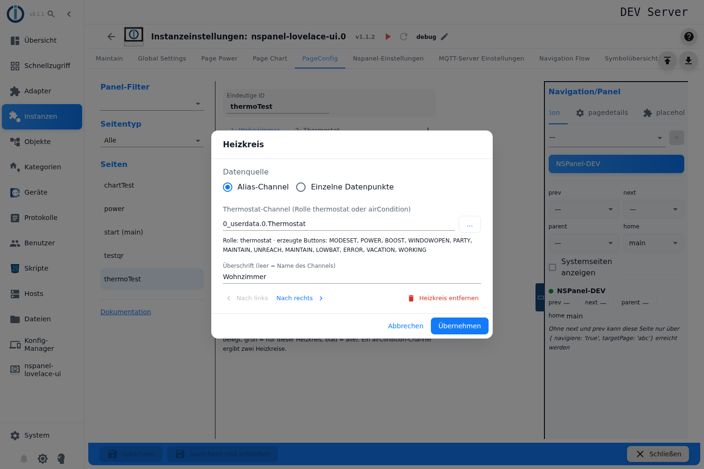

**Data source** is a radio group with **Alias channel** and **Single data points**.

**Alias channel:** field **Thermostat channel (role thermostat or airCondition)**. The ID can be typed in or picked from the object tree with **…**; the tree shows channels, devices and folders with a matching role.

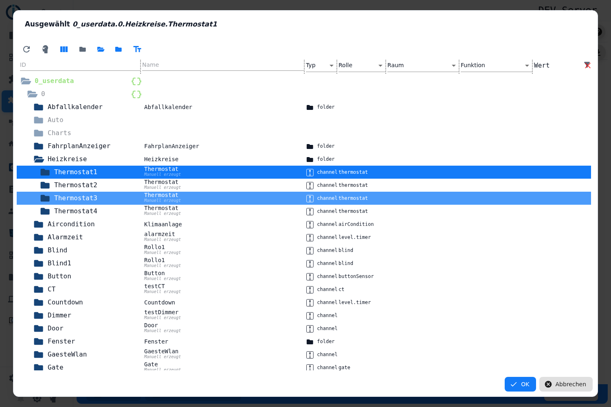

Right after the selection the editor checks the object and shows **Role: …** and **generated buttons: …** below it – the list of buttons the adapter builds from the states it found. If the object is missing or has another role, a warning appears (*"The object %s was not found"* or *"The channel %s has the role '%s' - expected thermostat or airCondition"*):

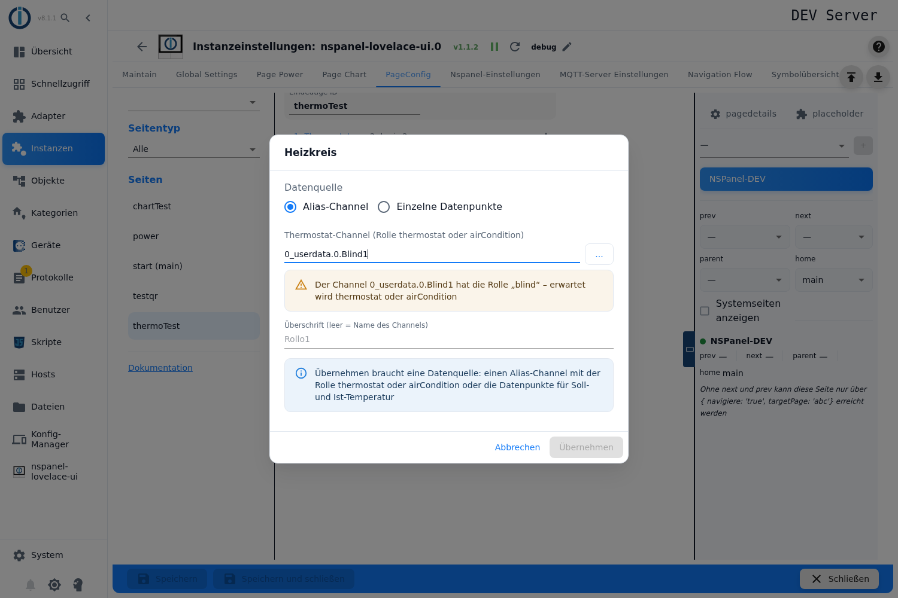

**Single data points:** instead of an alias, four data points are given directly – **Set temperature (writable)**, **Actual temperature**, **Humidity (optional)** and **Mode (optional, number or text)**. Set and actual are required, a heat circuit without both is not stored. In this mode the adapter generates no buttons; on/off is derived from the mode data point (0 = off).

**Headline (empty = name of the channel):** this headline is shown by the panel above the ring. With an `airCondition` channel there is an additional **Headline cooling (airCondition)** for the second tab (empty = `COOLING`).

**Move left / Move right** changes the order of the heat circuits – and thus the numbers of the selector slots; the items move along. **Remove heat circuit** deletes it together with the items bound to it only.

**Apply** is possible only once the data source is plausible; otherwise the dialog says *"Apply needs a data source: an alias channel with the role thermostat or airCondition, or the set and actual temperature data points"*. A new heat circuit is created with **Apply** only – **Cancel** leaves nothing behind.

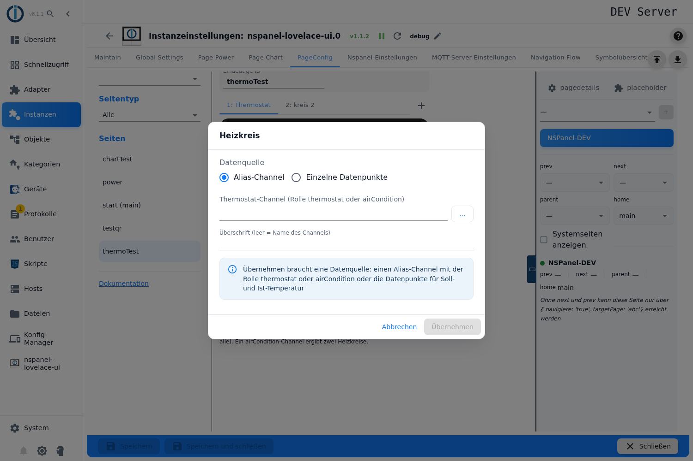

If an older configuration contains heat circuits without a data source, the editor reports that above the tabs (*"%s heat circuit(s) without data source - the adapter skips them"*) and offers **Remove**; when removing, the items keep their heat circuits.

## 4. The buttons from the alias

What is listed under **generated buttons** is **not configured**: the adapter looks below the channel for `common.role` and `common.type` (the names of the states are arbitrary apart from the exceptions named below) and creates one slot per state found – **each of them uses up one of the nine places**, in this order:

| State | Slot on the panel | Role |
|---|---|---|
| `MODESET` | selection list of the operating mode; the icon follows the value (0 power-off, 1 heat-wave, 2 snowflake, 3 refresh-auto), the headline of the popup is the `common.name` of the state | both |
| `POWER` | `power-standby`, on/off | both |
| `BOOST` | `fast-forward-60`, on/off | both |
| `WINDOWOPEN` | `window-open-variant` / `window-closed-variant` | `thermostat` only |
| `PARTY` | `party-popper` | `thermostat` only |
| `MAINTAIN` | `account-wrench` | both |
| `UNREACH` | `wifi-off` / `wifi` | both |
| `LOWBAT` | `battery-low` / `battery-high` | `thermostat` only |
| `ERROR` | `alert-circle` | both |
| `VACATION` | `palm-tree` | `thermostat` only |
| `WORKING` | `briefcase-check` | `thermostat` only |

These slots are marked with a **lock** in the preview and cannot be edited. With only one heat circuit the selector slot falls away and the buttons start at place 1.

For `VACATION` and `USERICON` (with `airCondition` also for `SET` and `SET2`) the adapter does **not** search by role but for the state with **exactly that name** below the channel – `….VACATION`, not `….Vacation`.

## 5. Set temperature: minimum, maximum, step

Click the **big number** in the ring.

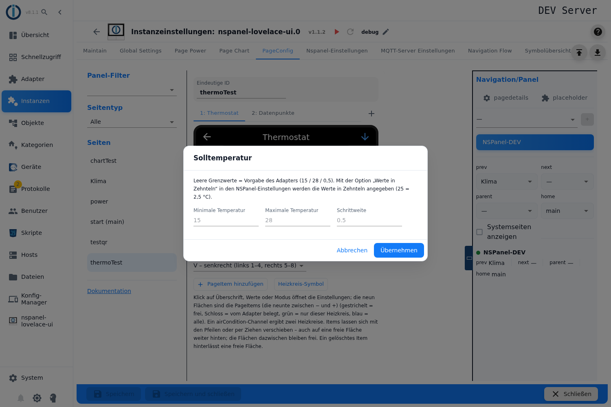

| Field | Effect |
|---|---|
| **Minimum temperature** | Lower end of the ring. Empty = 15. |
| **Maximum temperature** | Upper end. Empty = 28. |
| **Step** | Step of the − and + keys. Empty = 0.5. |

The hint in the dialog names both points: *"Empty limits = adapter defaults (15 / 28 / 0.5). With the option 'Values in tenths' in the NSPanel settings the values are given in tenths (25 = 2.5 °C)."* The option **Values in tenths** applies to the whole instance and to `cardThermo2` only; it affects these three numbers exclusively. The adapter rounds the step up to one tenth of a degree and limits the set point it reads to the configured window.

## 6. Value display: icon, color, unit

Click **line 1** (actual temperature) or **line 3** (humidity). The dialog contains both lines one below the other, headed **Line 1: actual temperature (the unit is used for the set temperature too)** and **Line 3: humidity**.

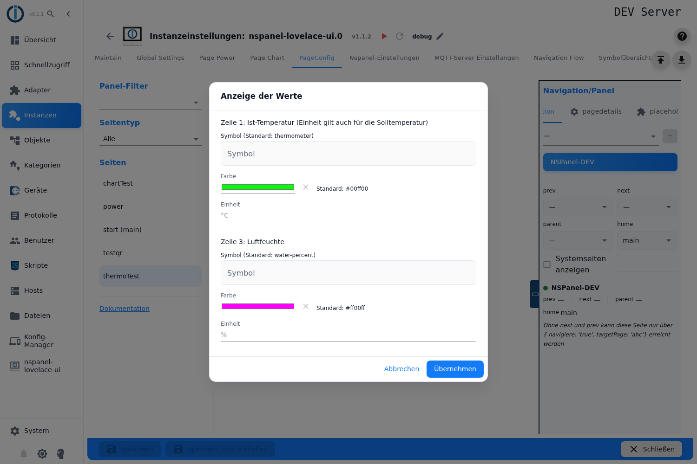

| Field | Effect |
|---|---|
| **Icon** | Icon in front of the value, from the icon list. Default `thermometer` (line 1) or `water-percent` (line 3). |
| **Color** | Color of icon and value. Default green (line 1) or magenta (line 3); **Back to default** resets it. |
| **Unit** (line 1) | Text behind the value. The field applies to **line 1 and to the big number in the ring** (the set temperature). Empty = `°C`. |
| **Unit** (line 3) | Text behind the humidity. Empty = `%`. |

The unit next to the **big number** in the ring comes from the **Unit** field of line 1 – so the note in the dialog heading is correct.

## 7. Mode display

Click the **mode text** below the ring.

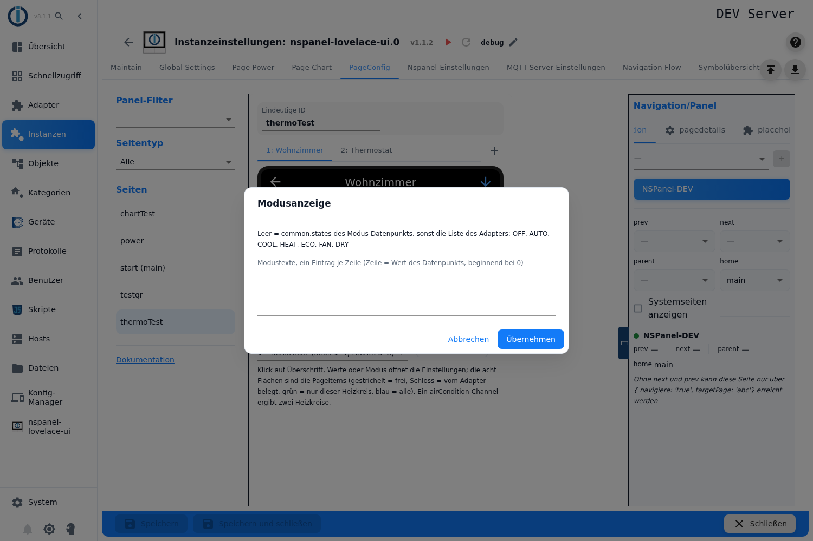

**Mode texts, one per line (line = value of the data point, starting at 0).** The hint below it names the precedence: *"Empty = common.states of the mode data point, otherwise the list of the adapter: OFF, AUTO, COOL, HEAT, ECO, FAN, DRY"*. The texts are translated as far as the adapter knows them.

The adapter reads the text from `MODE`; if that state is missing, `MODESET` takes its place. On the **Single data points** path the mode data point given there applies, and the same list determines the text; a value other than 0 means "on" there.

## 8. Circuit icon

Button **Circuit icon** below the preview.

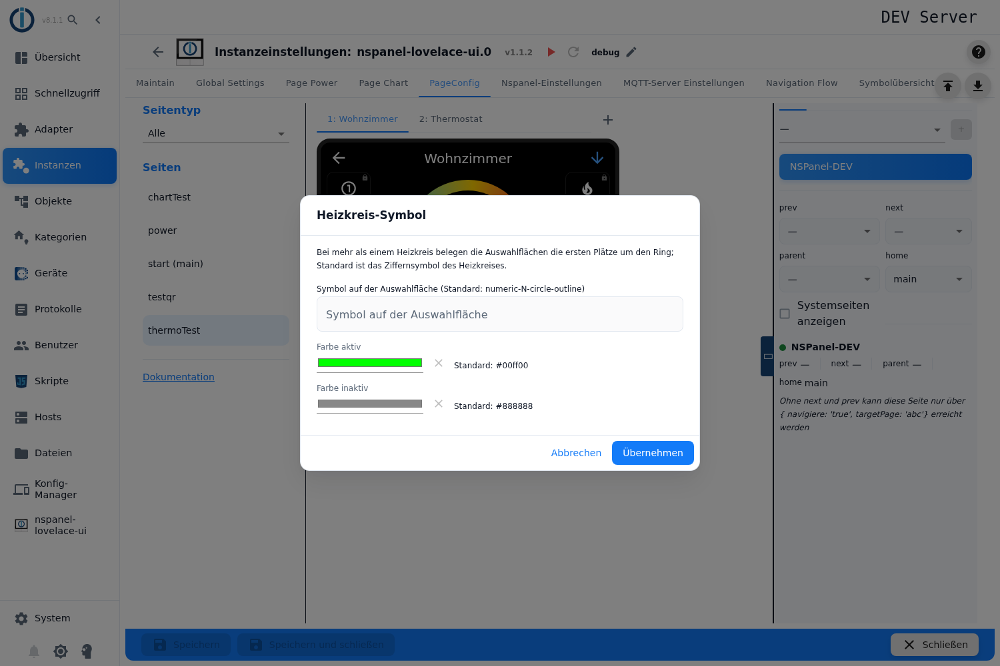

The hint in the dialog: *"With more than one heat circuit the selector slots take the first places around the ring; the default is the numeral icon of the circuit."*

| Field | Effect |
|---|---|
| **Icon on the selector slot** | Default is the numeral of the heat circuit (`numeric-1-circle-outline`, `numeric-2-circle-outline` …). |
| **Color active** | Color while this heat circuit is selected. Default green. |
| **Color inactive** | Color of the other selector slots. Default grey. |
| **For the cooling circuit (airCondition)** | With an `airCondition` channel icon and both colors appear a second time for the cooling circuit; there blue and a dark blue-grey are the defaults. |

## 9. Page items: adding, moving, free slots

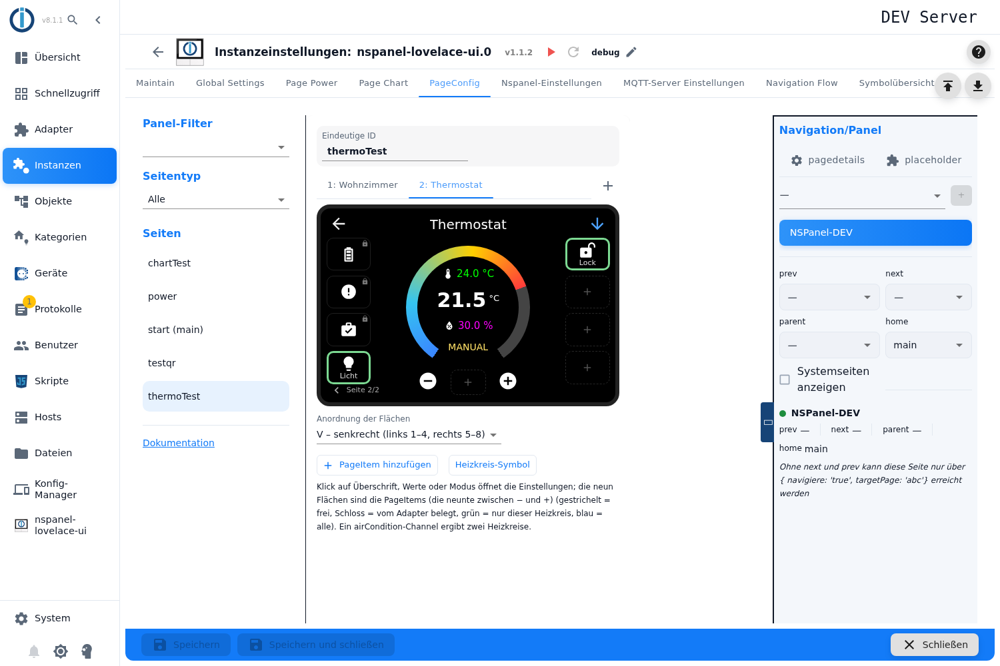

| Action | Effect |
|---|---|
| **Click on a free slot** or **Add page item** | Opens the item dialog. If a slot further back is clicked, the item lands exactly there; the slots before it stay free as reserved gaps. |
| **Click on an item** | Opens the item dialog for editing. |
| **Arrows on hover** | Move the item one slot to the left or to the right. |
| **Dragging onto a taken slot** | The two swap places. |
| **Dragging onto a free slot further back** | The item lands there, the slots in between stay free. |
| **Trash** | Deletes the item; its slot stays free as a reserved gap, the other items keep their places. A second click on the same gap removes it. |

The hint below the preview says the same: *"Items can be moved with the arrows or by dragging - also onto a free slot further back; the slots in between stay free. A deleted item leaves a free slot."* Reserved gaps **between** items are stored, gaps **at the end** are dropped by the adapter.

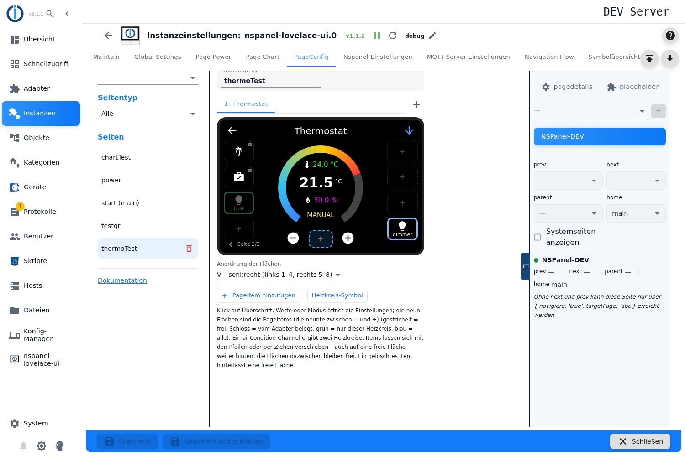

The item dialog is the general page item dialog, described under [Recurring dialogs](PageConfig-Dialoge). Three things are special on this card:

- The field **Heat circuit** exists here only: **all heat circuits** or exactly one. It is preset to the currently selected circuit; a bound item appears there only.
- **The name does not label the slot.** Below the name field and in the hint of the dialog *Dynamic name* it says: *"On this page only the title of the popup - it is not shown below the icon on the panel."* So the name is exclusively the headline of the popup the slot opens.
- **There is no long press here** – the field is missing because the slots of this card report no long press on the panel. **Text Size** and **Use Value Instead of Icon**, on the other hand, are available and are evaluated by the adapter for this card too; for icon slots the selection offers only the fonts with icons (1, 3 and 4).

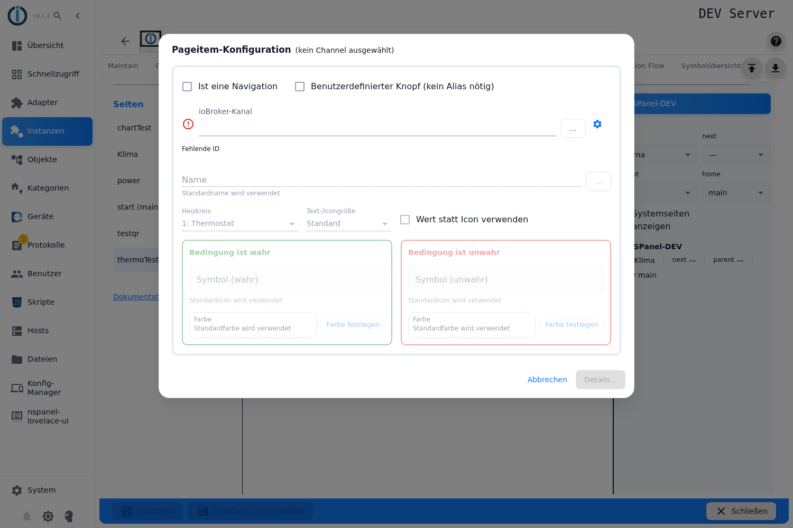

Items for **all heat circuits** can sit on **different slots** per circuit, because every circuit has a different number of generated buttons in front of it. The editor always shows the layout of the selected circuit.

## 10. Order of the slots

Select box **Order of the slots** below the preview:

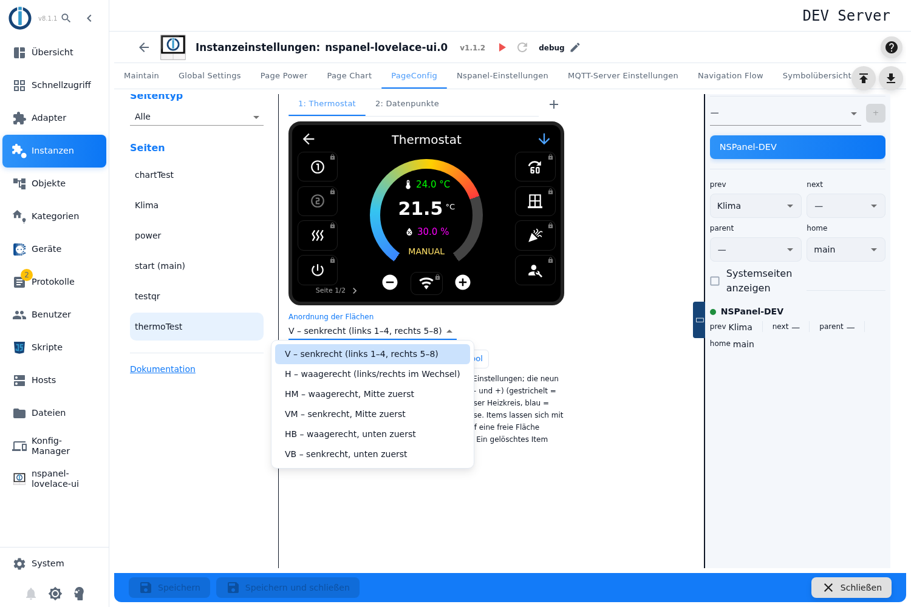

| Value | Label in the admin | Layout |
|---|---|---|
| **V** | vertical (left 1–4, right 5–8) | Default. On the left from top to bottom 1–4, on the right 5–8, **the ninth slot between − and + is sent along**. |
| **H** | horizontal (left/right alternating) | 1 top left, 2 top right, 3 left, 4 right … |
| **HM** | horizontal, middle first | like H, but starts in the second row. |
| **VM** | vertical, middle first | like V, but starts in the second row. |
| **HB** | horizontal, bottom first | |
| **VB** | vertical, bottom first | |

The editor draws the slots in the chosen order. **Only with `V` does the adapter fill all nine slots.** With every other order it merely re-sorts the eight side slots, the ninth stays empty – the editor then shows it greyed out with a lock and the hint *"Sort order %s: the adapter fills only the eight side slots - this slot stays empty, an item here is not shown on the panel"*.

## 11. Paging of the slots

More than nine slots are spread over several pages by the adapter. **How** the paging works is not set in the editor but on the right in the column **Navigation/Panel** under the page details (see [PageConfig – Overview](PageConfig#page-details)).

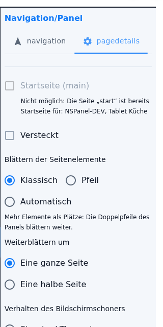

**Paging of the page items:**

| Choice | Effect |
|---|---|
| **Classic** | *"More items than places: the double arrows of the panel page through them."* – the default. The navigation arrows at the top of the panel become paging arrows as long as there is another page. |
| **Arrow** | *"More items than places: the last place shows an arrow that pages on."* – here that is the **ninth** slot between − and +; eight places remain for slots. The arrow only appears once more than nine slots come together, and on the last page it pages back to the first. |
| **Automatic** | *"Like classic, the page also advances by itself after the set time."* – with the field **Seconds until the next page** (empty = 15). |

**Scroll by** (**Full page** / **Half page**) appears on this card because it is in the list of half-page-capable cards. The choice is, however, **without effect**: when building the page the adapter resets the value to *Full page* in both directions.

## 12. Panel assignment, navigation, saving

- Panel, navigation targets (`prev`, `next`, `parent`, `home`), **Start page (main)**, **Hidden** and **Screensaver behavior** are on the right in the column **Navigation/Panel**, described under [PageConfig – Overview](PageConfig#panel-assignment-and-navigation). Without `next`/`prev` the page is reachable only through a dedicated navigation target.
- At the bottom **Save** or **Save and close**. The instance restarts afterwards and builds the page.
- If the adapter does not build the page or skips a heat circuit (object missing, wrong role, `SET` not found or not writable), the reason is in the log of the instance – among others *invalid SET datapoint. Not exists or not writeable!*
- The card is also reproduced in the [web panel](WebPanel); since 2.0.2 it takes over the sizes and positions of the slots from the HMI there.

## 13. Take-over from a script

A `cardThermo2` page from a configuration script can be taken over into the admin completely, see [Migration](Migration). In the process `thermoItems` become heat circuits, `sortOrder` becomes the **Order of the slots**, `items` become the page items and `filter` becomes the field **Heat circuit**; `id` yields the data source *Alias channel*, `set`/`thermoId1`/`thermoId2`/`modeId` the data source *Single data points*.

One field stops the take-over: **`power`** on the heat circuit – for an own on/off state the admin has no field (*the admin has no power state*). In the admin the on/off condition comes from `MODESET` or from the mode data point. Likewise rejected are unknown fields on the heat circuit, an empty or faulty `modeList` and an unknown `sortOrder`.

## Pitfalls

- **Without a running instance the editor is locked.** All fields are greyed out, roles and generated buttons are not checked.
- **The ninth slot exists only with the order `V`.** With every other order the adapter sends the eight side slots only; an item on the ninth does not appear. The editor then marks it with a lock – so whoever changes the order afterwards loses one taken slot per page.
- **"Paging: Arrow" and an order other than `V` are mutually exclusive.** The paging arrow sits on the ninth slot – exactly the one that falls away with H, HM, VM, HB and VB. The page can then no longer be paged, because in that setting the navigation arrows do not page either.
- **"Scroll by half page" is offered but never used.** For this card the adapter always resets the value to *Full page*.
- **Up to and including 2.0.2 the second unit did not reach the panel.** The adapter took the **Unit** field of line 1 for both value lines – a humidity thus got `°C` appended, and the set temperature stayed without a unit. Both are fixed in the version after 2.0.2; whoever still runs 2.0.2 or older enters the unit matching the actual temperature in line 1 and lives with it at the humidity.
- **The placeholders deceive with "Values in tenths".** If the option is active in the NSPanel settings, a 15 entered in the field *Minimum temperature* means 1.5 °C – the placeholders in the dialog still show 15 / 28 / 0.5.
- **Reserved gaps appear in every heat circuit.** The editor remembers the heat circuit of a free slot, the adapter drops that binding when building the page. A gap meant for heat circuit 1 only shifts the slots of all other circuits by one place.
- **The preview counts one place more than the panel.** The editor always keeps one free slot open for adding. With exactly nine slots it therefore shows two pages, while the panel fits everything on one page.
- **The preview does not know the paging setting.** It always pages with the **Page x** display below the card, even in the setting *Arrow* – the ninth slot does not become the paging arrow there.
- **An `airCondition` without `SET2` yields only one heat circuit.** The editor shows two tabs nevertheless, and the adapter drops the cooling circuit with a warning in the log. All items bound to a **later** heat circuit then end up at the wrong circuit.
- **The limit "eight" means two different things.** The **+** locks after eight stored data sources, the panel on the other hand counts heat circuits – and an `airCondition` channel counts twice. Five `airCondition` channels yield ten heat circuits; the adapter cuts down to eight and reports *Heat cycles are 10, but only 8 are supported!*
- **Without `ACTUAL`, line 1 shows the set point.** With the role `thermostat` the adapter falls back to `SET` and writes an info into the log (*using SET instead*). With `airCondition` the line stays empty.
- **A state is missing despite a matching role.** `VACATION` and `USERICON` (and with `airCondition` also `SET` and `SET2`) have to be named **exactly** that; the preview **generated buttons** shows only what the adapter really finds.
- **The alias table is outdated at this point.** The note *Not supported in cardThermo2* at `ERROR`, `MAINTAIN`, `PARTY`, `VACATION` and `WORKING` is no longer true – all five do become buttons, each taking one of the nine places. Really ignored is only `USERICON`.
- **Buttons for AUTOMATIC, MANUAL and OFF cannot exist.** The adapter contains code for them, but the alias definition of `thermostat` and `airCondition` knows no such states – neither the preview in the heat circuit dialog nor the panel ever shows them.
- **The headline of the page has no effect.** What stands above the ring is always the **Headline** of the selected heat circuit. A headline text handed to this page through a [link](pageLink) therefore stays without consequence.
- **There is no field for the on/off state.** The adapter derives the condition from `MODESET` or from the mode data point (0 = off). A `power` in the script prevents the take-over of the page into the admin.
