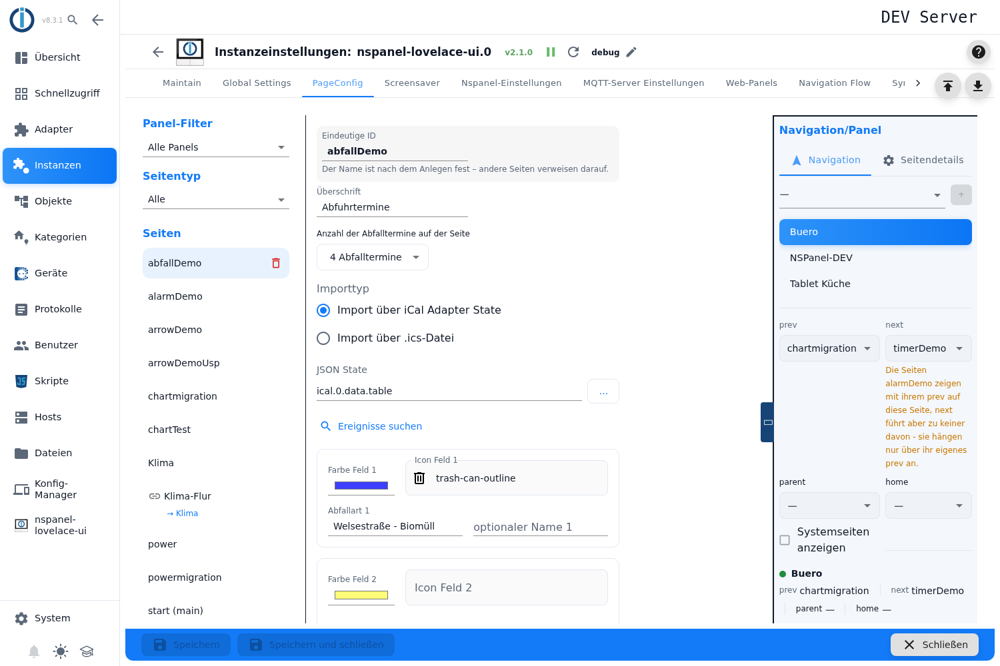
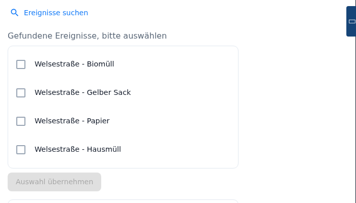
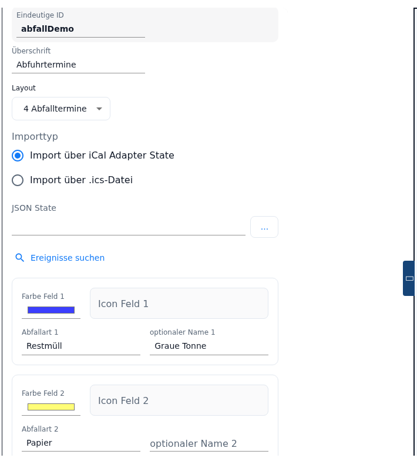

# Trash page – configuration in the admin

The trash page shows the next **waste collection dates**: one line per date with a coloured icon, the name of the waste type and when it is collected — "today", "tomorrow", the weekday or the date. The dates come from a state of the **ical adapter** or from an uploaded **`.ics` file**.

You create it in the **PageConfig** tab, page type **Trash**. The adapter does **not** build a card type of its own from the entry but an ordinary list page (see [section 2](#2-what-the-adapter-builds-from-the-entry)).

Contents:
- [Creating the page](#1-creating-the-page)
- [What the adapter builds from the entry](#2-what-the-adapter-builds-from-the-entry)
- [The editor at a glance](#3-the-editor-at-a-glance)
- [Where the dates come from](#4-where-the-dates-come-from)
- [Searching for events and applying them](#5-searching-for-events-and-applying-them)
- [The six waste types](#6-the-six-waste-types)
- [How a date finds its line](#7-how-a-date-finds-its-line)
- [What appears on the panel](#8-what-appears-on-the-panel)
- [When the dates are refreshed](#9-when-the-dates-are-refreshed)
- [Panel assignment and navigation](#10-panel-assignment-and-navigation)
- [State of 2.0.2](#11-state-of-202)
- [Pitfalls](#pitfalls)

## 1. Creating the page

1. Open the instance settings → tab **PageConfig**.
2. On the left pick **Trash** as the **Page Type**, enter a name under **New Page**, press **+**.
3. The page appears in the list **Pages** and the editor opens on the right.

**Unique ID** is the page name other pages use to address this page in their navigation targets; while the page is flagged as **Start page (main)** the field is locked (notice below it: *"Start page - published under the id „main". …"*). For renaming see [PageConfig – Overview](PageConfig#creating-renaming-and-deleting-pages).

**Headline** is the header line on the panel; left empty, the panel shows `Trash`.

Below the page list the **Documentation** link leads straight to this page.

> All fields of the editor are locked while the instance is not running. The editor gives no hint about it.

## 2. What the adapter builds from the entry

There is no card type `cardTrash` on the panel. From the entry the adapter builds an ordinary list page based on the template `entities.waste-calendar`:

| Setting **Layout** | Card on the panel | Lines |
|---|---|---|
| *4 trash entries* | `cardEntities` | 4 |
| *6 trash entries* | `cardSchedule` | 6 |

Each line becomes a page item with the role `text.list` that reads icon, colour, name and date from an internal state `pageTrash_<Unique ID>`. The adapter fills that state from the source of the dates (see [section 9](#9-when-the-dates-are-refreshed)).

From this follows:

- The number of date lines is tied to the card type and cannot be chosen freely.
- The **Layout** setting also changes the way the date is written (see [section 8](#8-what-appears-on-the-panel)).
- A trash page can only be created **in the admin**. The configuration script does not know the page type; a trash page is a hand-built list page with states of its own there. Such a script page can **not** be converted into the page type **Trash** through the [Migration](Migration) either — the admin cannot represent the template of a page, and the migration reports *"A field of the page cannot be represented in the admin"* for it.

## 3. The editor at a glance

The editor is a form, from top to bottom:

| Field | Meaning |
|---|---|
| **Unique ID** | Page name; locked on the start page. |
| **Headline** | Header line on the panel; empty → `Trash`. |
| **Layout** | Number of date lines: *4 trash entries* or *6 trash entries*. |
| **Import type** | *Import via iCal Adapter State* or *Import via .ics file*. |
| **JSON State** or **.ics file including path** | The source of the dates, depending on the import type (see [section 4](#4-where-the-dates-come-from)). |
| **Search events** / **Upload file** | Reads the source and lists the event names occurring in it. |
| Six blocks **Color/Icon/Trash type/Optional label** | One block per waste type (see [section 6](#6-the-six-waste-types)). |

> The label **Layout** is misleading — what is meant is the **number** of dates. The proper text only sits in the tooltip (*Number of trash entries on the page*) and is therefore practically invisible. The word "Layout" is also hard-coded in English and is not translated in any language.

## 4. Where the dates come from

Under **Import type** there are two ways:

| Choice | What is needed |
|---|---|
| **Import via iCal Adapter State** | A state of the ical adapter holding the table of dates. |
| **Import via .ics file** | A calendar file uploaded into the file area of the instance. |

**Way 1 — ical adapter.** The field **JSON State** takes the state with the list of dates; the ical adapter usually provides it under `ical.<n>.data.table`. The content has to be a JSON array (as text or as an object), and every entry needs the fields **`_date`** (date of the appointment) and **`event`** (event name). Dates before today (midnight) are discarded; there is **no** sorting — the order the adapter delivers applies.

> The object picker only shows **states whose ID begins with `ical.`**. If you provide your dates through a script or in `0_userdata`, you will not find your state in the dialog and have to **type the ID into the field by hand** — that works, but nothing tells you so. The label *JSON State* reads the same in every language and does not say that the ical adapter's table of dates is meant.

**Way 2 — `.ics` file.** **Upload file** opens the file picker (`.ics` only). The file goes under its name into the **file area of the instance** (`nspanel-lovelace-ui.0`), and its name then enters itself into the field **.ics file including path**. A status line reports the result:

- *"'file.ics' uploaded – 24 appointments found. Please select the ones to display."*
- *"'file.ics' uploaded, but no appointments were found in the file."*

The adapter reads the file from the file area again on every run. Here too only dates from today on count; they are additionally **sorted** by date.

> The help text *"Path to the .ics file in the ioBroker file system. Automatically filled in when uploading the file"* means the file area of the **instance**, not the file system of the host. A path entered by hand has to be relative to that; a path like `/opt/iobroker/…` finds no file and the log reports *"File … does not exist in ioBroker files"*.

## 5. Searching for events and applying them

For the page to show anything, the adapter has to know **which event name belongs to which waste type**. There is a helper for that:

1. On the state way press the button **Search events**: the editor reads the state and collects the values of `event` occurring in it, each one once. On the file way the same list appears **already at the upload**; there is no search button there.
2. The names appear as a list of checkboxes — heading **Found events, please select** (state way) or **Select events** (file way). **At most six** can be ticked; after that the remaining lines are locked.
3. **Apply selection** enters the ticked names into the fields *Trash type 1* to *6* — in the order in which they were ticked, not in the order of the list.

> ⚠️ **"Apply selection" overwrites all six trash type fields.** Every field without a ticked name is **cleared**. Colours, icons and the optional labels stay untouched. If you have already curated the waste types by hand, it is better to add entries by hand.

> After applying, the event list is gone (it is reset together with the selection). For a second round you have to search or upload again. The same happens when the **Import type** is changed.

> The error messages of this search are hard-coded notice windows and **partly German, partly English** — regardless of the language of the admin: *"Bitte wählen Sie zuerst einen State aus"*, *"State enthält keine Daten"*, *"State enthält kein Array"*, but then *"Upload failed: …"* and *"Failed to read file"*.

## 6. The six waste types

Below that are **six identically built blocks**, one per waste type:

| Field | Meaning |
|---|---|
| **Color field *n*** | The colour of the icon. Defaults of a new page: 1 blue `#3c3fff`, 2 yellow `#fffd77`, 3 light grey `#d2d2d2`, 4 orange `#de8900`, 5 and 6 light grey `#d2d2d2`. |
| **Icon field *n*** | The icon from the icon picker. Without one the adapter uses `calendar-month`. |
| **Trash type *n*** | **The search term** used to assign dates to this line — see [section 7](#7-how-a-date-finds-its-line). |
| **Optional label *n*** | What is **displayed** on the panel when it should differ from the search term. Handy when the calendar delivers "Restabfallbehaelter 240l" but the panel should read "Residual waste". |

> **Six blocks are always shown, and all six take effect** — even with the setting *4 trash entries*. The search for the matching line runs across all six terms; only the number of **lines on the panel** is limited. A match in block 5 or 6 therefore takes one of the four places just the same.

## 7. How a date finds its line

This is the core of the configuration and is explained nowhere in the interface:

- For every date the adapter checks whether the event name **contains** the text from **Trash type *n*** — it is a substring search, not an exact match, and it is case sensitive. So "Bio" also matches "Biotonne 14-täglich", while "bio" does not.
- It is checked **from 1 to 6**, and the **first match wins**. With overlapping terms the order decides: with "Papier" in field 1 and "Altpapier" in field 3, both end up in line 1 with the colour, icon and name of field 1.
- **Empty fields are skipped**, as are dates without an event name.
- **Dates without a match are discarded** — they do not appear at all.
- At most **six** dates are collected, after that the adapter stops.

From this follows the most common cause of an empty card: with **no** waste type entered, not a single date matches and the page stays empty for good. There is no warning for that.

Best practice: pick **short, unambiguous terms** and fetch the exact spelling through *Search events*.

## 8. What appears on the panel

One line per date: icon in the chosen colour, the name (the optional label, otherwise the trash type) and the date on the right. The order is the one of the source — sorted by date on the file way, as delivered on the state way.

The date is shown in stages:

| Date | with *4 trash entries* | with *6 trash entries* |
|---|---|---|
| today | `today` | `today` |
| tomorrow | `tomorrow` | `tomorrow` |
| in 2 to 7 days | long weekday (`Donnerstag`) | short weekday (`Do`) |
| later | `15.11.2026` | `15.11.26` |

> The words for today and tomorrow are hard-coded **in English** (`today`, `tomorrow`), while weekday and date are fixed to **German** (`de-DE`). On a German panel it therefore reads "today" above a date `15.11.2026`, on an English one the weekdays are German. The language of the adapter is not evaluated here.

Internally the adapter keeps up to six dates ready; with the setting *4 trash entries* the panel shows the first four.

## 9. When the dates are refreshed

The adapter fetches the dates **when the instance starts** and after that in the hourly loop **every six hours** — on the full hours 0, 6, 12 and 18. There is no monitoring of the ical state: a new date in the calendar or a newly uploaded file only becomes visible with the next run. If you do not want to wait, restart the instance.

Every run writes the result into the internal state `pageTrash_<Unique ID>`. Problems with the source appear as a warning or an error in the ioBroker log, for example *"No trash state defined for entry …"*, *"Trash state … has no data ."* or *"No trash .ics-file defined for entry …"*.

## 10. Panel assignment and navigation

Panel, navigation targets, *Start page (main)*, *Hidden* and *Screensaver behavior* live in the right-hand column, described under [PageConfig – Overview](PageConfig#panel-assignment-and-navigation).

At the bottom **Save** or **Save and close**. The instance restarts afterwards and builds the page.

## 11. State of 2.0.2

Nothing changed on the trash page itself between 2.0.0 and 2.0.2. Three general changes from 2.0.0 matter for setting it up:

- A configuration script is **no longer needed**. A panel with the option *Panel uses no script* can consist of admin pages alone, the trash page included.
- The **Documentation** link below the page list leads to the wiki page of the chosen card type — for this page type therefore to `cardTrash`.
- The new page type **Page link** ([pageLink](pageLink)) can show a trash page under a second name on another panel. Content and dates stay those of the original page.

## Pitfalls

- **Nothing works without a running instance.** All fields are locked, search and upload do not run. Unlike other page types, the editor gives no hint about the reason here.
- **"today" and "tomorrow" stay English, weekday and date stay German.** Both are hard-coded and do not follow the language of the adapter.
- **No trash type entered = permanently empty page.** Without a search term no date matches; neither the editor nor the log points it out.
- **Fewer matching dates than lines fills the log.** Every line reads its entry by index; if it is missing, the adapter reports *"Read for dp: ///pageTrash_… is invalid! … Error: TypeError …"* for each missing line. The affected line shows nothing meaningful. To avoid that, pick *4 trash entries* and keep at least four trash types curated.
- **"Apply selection" clears whatever is not ticked** — in all six trash type fields, the hand-filled ones included. The transfer follows the order of clicking.
- **All six trash types take effect, even with four date lines.** Blocks 5 and 6 are not ineffective; a match there takes one of the four places.
- **The object picker filters hard on `ical.`.** Any other source (script, `0_userdata`) can only be reached by typing the ID.
- **The state has to deliver `_date` and `event`.** With `_date` missing — because the state only knows `date`, for instance — the filter on past dates does not catch and the panel reads `01.01.1970`.
- **There is no sorting on the state way.** If the ical adapter delivers the table unsorted, the lines appear in that order on the panel too. Only the file way sorts by date.
- **The field ".ics file including path" means the file area of the instance**, not the file system of the server. A file of the same name is overwritten on upload.
- **Up to six hours of delay.** Neither a change in the calendar nor a newly uploaded file takes effect immediately; the dates are only fetched at the start and on the hours 0, 6, 12 and 18.
- **Messages in two languages.** The notice windows of the event search are partly German, partly English hard-coded; the log messages are English.
- **An entry from an older admin version without the list of waste types arrives empty.** The adapter then fills six empty blocks with the default colours — there is no conversion of old single fields, the waste types have to be entered again.
