# Device with details and device page

Many devices deliver more values than fit on a tile: temperature, Wi-Fi signal, battery, power, firmware … A page item of the kind **Device with details** shows any device from the object tree without an alias for every single value. A short tap switches the device (or does what you set), a long press opens a **detail page** with the values you ticked.

Instead of the detail page the long press can open a **device page**: a page of its own for exactly this device, with a big icon, fixed places for values, buttons, switches or a progress bar, and a status line. That suits a robot vacuum, a washing machine, a lawn mower or a car, for example.

Both exist **only in the admin** (tab PageConfig), not in the configuration script.

Contents:
- [What is what?](#what-is-what)
- [Quick start: device with detail page](#quick-start-device-with-detail-page)
- [Quick start: device page](#quick-start-device-page)
- [Reference](#reference)
  - [1. Creating the item and choosing the device](#1-creating-the-item-and-choosing-the-device)
  - [2. Short tap](#2-short-tap)
  - [3. Filter list and detail page](#3-filter-list-and-detail-page)
  - [4. Long press opens: detail page or device page](#4-long-press-opens-detail-page-or-device-page)
  - [5. Setting up the device page](#5-setting-up-the-device-page)
  - [6. The three layouts](#6-the-three-layouts)
  - [7. What fits into which slot](#7-what-fits-into-which-slot)
  - [8. Appearance per panel model](#8-appearance-per-panel-model)
  - [9. Operation on the panel](#9-operation-on-the-panel)
  - [10. Limits](#10-limits)
- [Pitfalls](#pitfalls)

## What is what?

| Term | Meaning |
|---|---|
| **Device with details** | A **Kind of item** in the [Pageitem Configuration](PageConfig-Dialoge#1-pageitem-configuration). The item sits on a grid page or an entities page like any other. |
| **Device** | An object of type *device* or *channel* in the object tree of ioBroker, e.g. `shelly.0.SHPLG-S#123456#1` or `0_userdata.0.Vacuum`. All states below it are the "values of the device". |
| **Detail page** | A list with the ticked values of the device. The adapter generates it itself, you do not have to create it. |
| **Device page** | A page with a big device icon and fixed places. The adapter generates it as well; you only choose the layout and what stands in which place. |
| **Slot** | A place on the device page. Every slot has a fixed kind: info line, large value, progress bar, button, switch or status icon. |

What to take depends on what you want to see on the panel:

| I want to … | take … |
|---|---|
| simply look up the values of a device as a list | **Device with details** with the **detail page** – [quick start](#quick-start-device-with-detail-page) |
| operate a device on a page of its own: start, pause, remaining time, progress, state | **Device with details** with the **device page** – [quick start](#quick-start-device-page) |
| also reach the whole list of values from the device page | device page with the **i icon** – it opens the detail page |
| operate a light, a blind or a socket with its usual popup | a **Standard** item with an alias channel, see [Pageitem Configuration](PageConfig-Dialoge#1-pageitem-configuration) – such a channel can also be put into a slot of the device page |

This is what a device page looks like (layout "Control" on the EU panel):

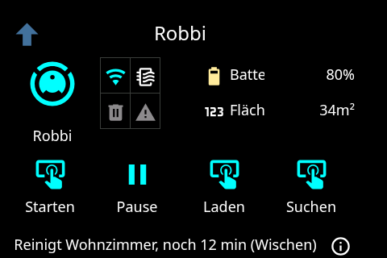

## Quick start: device with detail page

1. **Create the page item.** In the tab **PageConfig** open a grid page (cardGrid, cardGrid2, cardGrid3) or an entities page and click a free place. – *Result: the Pageitem Configuration is open.*
2. **Choose the kind.** At the very top, at **Kind of item**, choose **Device with details**. – *Result: instead of the channel field there is **Device (object of type device or channel)**.*
3. **Choose the device.** Type the ID or pick it in the object tree through **…**. – *Result: below the field stand the name of the device and how many entries are ticked, e.g. "Robbi - 14 entries ticked".*
4. Set the **Short tap**: if a tap should switch the device, **A state of the device (on/off or button)** stays; otherwise **None (details only)**.
5. Open the **Filter list** and tick what the detail page should show. Change the order by dragging. **Apply.**
6. **Long press opens** stays at **Detail page**.
7. **Apply** and then **Save** in the tab. – *Result: the adapter restarts.*
8. **Try it on the panel:** long press the item on a grid page, on an entities page tap the icon or the name on the left (this needs a current TFT, see [Limits](#10-limits)). – *Result: the detail page appears, its heading is the name of the device.*

## Quick start: device page

Requirement: an item of the kind **Device with details** as in the quick start above. On a hardware panel the device page also needs a current TFT version, see [Limits](#10-limits).

1. Open the item in the tab **PageConfig** and choose **Device page** at **Long press opens**. – *Result: the area of the device page appears below; the info places are already filled with the first ticked entries of the filter list.*
2. Choose the **Layout**: **1 – Control**, **2 – Progress** or **3 – Values**. The small pictures show where which slot sits; the numbers belong to the rows below.
3. Choose the **Main icon**, e.g. `robot-vacuum`. Empty = the icon of the item.
4. **Status line**: choose the value that should stand at the bottom as text, e.g. the status of the device.
5. **Status icons** (layouts 1 and 3 only, optional): choose how much room the small status icons get and fill the **Status icon places** below, see [Status icons](#status-icons). Default: **No status icons**.
6. Fill the **Slots**: pick a value of the device per row. Only what fits the kind of the slot is offered.
7. **Apply** and then **Save** in the tab. – *Result: the adapter restarts.*
8. **Try it on the panel:** long press the item. – *Result: the device page appears. The "i" at the bottom right opens the detail page.*

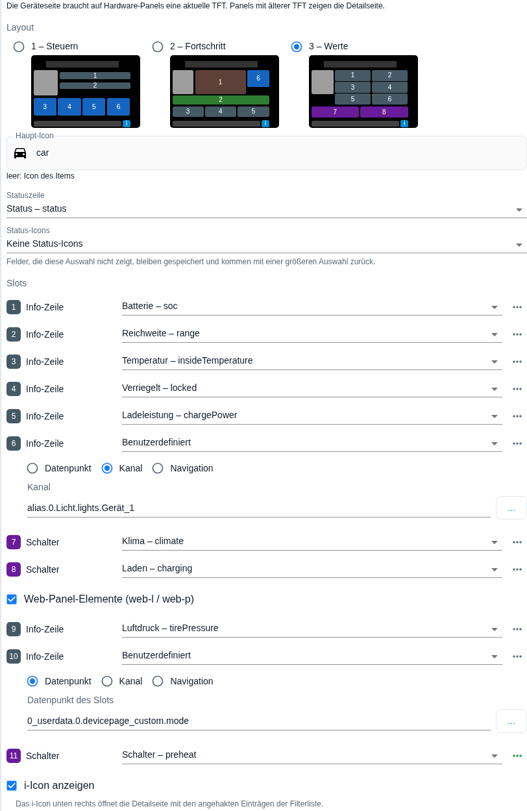

## Reference

The following sections describe every setting in detail.

## 1. Creating the item and choosing the device

The kind **Device with details** exists on the pages whose places report a long press or a tap on the left part: **cardGrid**, **cardGrid2**, **cardGrid3** and **cardEntities**. On other pages the dialog does not offer it.

The field **Device (object of type device or channel)** holds the ID of the device. The dialog checks it and writes below what it found:

| Text below the field | Meaning |
|---|---|
| *Choose the device whose details the item shows.* | The field is still empty. |
| *Name - n entries ticked* | The device was found; the detail page has that many rows. |
| *The object does not exist.* | A typo, or the device was deleted. |
| *Only objects of type device or channel can be chosen.* | A single state or a folder was chosen, for example. |
| *An instance or the root of an adapter cannot be chosen.* | e.g. `shelly.0` – many devices lie below it, not one. |
| *The devices of this adapter lie on another level of the object tree.* | For known adapters the dialog knows on which level a device lies – choose the object on that level. |
| *The info channel of an instance is no device.* | `<adapter>.<n>.info` cannot be chosen. |

The device consists of its states and the states of **one** sub folder (e.g. `Relay0.Power`); for hmip it reaches one level deeper. States lying deeper still do not appear.

For **shelly**, **sonoff**, **zigbee2mqtt**, **hm-rpc** and **hmip** the adapter brings a mask: it recognises temperature, voltage, power, signal, firmware and so on and gives them readable names and fitting icons. For all other adapters it assigns the values by their role.

**Name** at the very bottom is the label of the item on its page. Empty: the name of the chosen state or channel, without one the name of the device.

## 2. Short tap

What a short tap on the item does:

| Choice | Effect |
|---|---|
| **A state of the device (on/off or button)** | Below it you choose the **State of the device (on/off)**. An on/off value is toggled, a button is pressed (marked "button, writes true" in the list). If the device has a switch, it is preselected. Without a chosen state the item cannot be applied. |
| **None (details only)** | The short tap does nothing. Default when the device has nothing to switch. |
| **Navigation to a page** | The short tap opens a **Target page**. |
| **Popup of an alias channel (e.g. light)** | The short tap operates an alias channel like a standard item, e.g. with the light popup. The channel is chosen only in this case. |
| **Open the device page** | The short tap already opens the device page (the long press still does as well). Only selectable when **Device page** is chosen at **Long press opens**; if you switch back to **Detail page** there, the short tap jumps to **None**. |

You can switch between the choices without losing anything as long as the dialog is open. Only what is chosen at **Apply** is saved.

## 3. Filter list and detail page

The button **Filter list** opens the list of all values of the device.

| Element | Meaning |
|---|---|
| **Tick** | Ticked rows appear on the detail page – in the order of the list. Ticked ones stand at the top, the others below. Nothing is hidden automatically: what appears is decided by you alone. |
| **Drag to move**, **Up**, **Down** | change the order. |
| **Entry** | The readable name of the row (temperature, voltage, signal …). For adapters without a mask you assign a state to an entry here; its role suggests it. |
| **State** | The state the adapter found for the entry. If it does not fit, pick another one. |
| **2nd line** | Appears for ticked rows with the **same name** (several temperatures, say). The adapter then automatically appends what the states differ in ("Temperature Relay0", "Temperature Ext 100"). An own text in the field replaces the automatic one and always applies. |

A new item starts with the entries you last ticked for a device of **the same adapter**; the first time with the suggestions of the mask.

**The detail page** is a normal entities page. Its heading is the name of the device, the back arrow leads to the page it was opened from. Per page it shows as many rows as every entities page of the model (EU/US landscape and smartphone landscape 4, US portrait 5, smartphone portrait 8); more rows page on.

What a row shows and can do depends on the state:

| State | Row | Operation |
|---|---|---|
| on/off, writable | switch on the right | switches |
| on/off, read only | text "On" or "Off" | – |
| button (write only) | button on the right | presses |
| number or text with a value list, writable | the text of the current value | a tap opens the selection |
| number or text with a value list, read only | the text of the current value | – |
| number | value with unit | – (writable numbers are not adjusted here either) |
| text | the text | – |

A battery level in percent shows a battery icon that follows the level in steps of 10 %.

## 4. Long press opens: detail page or device page

| Choice | Effect |
|---|---|
| **Detail page** | Default. The long press (grid pages) or the tap on icon or name (entities page) opens the detail page. |
| **Device page** | It opens the device page. The detail page is then reached through the "i" of the device page, if it is shown. The settings of [section 5](#5-setting-up-the-device-page) appear below. |

Here too nothing is lost when switching as long as the dialog is open. The device page is only saved when **Device page** is chosen at **Apply**.

## 5. Setting up the device page

From top to bottom: **Layout** with preview, **Main icon**, **Status line**, **Status icons** (layouts 1 and 3 only), **Slots**, **Status icon places**, **Web panel elements (web-l / web-p)** and **Show i icon**. The picture under [Quick start: device page](#quick-start-device-page) shows the whole area.

When switched on for the first time, the dialog fills the info places (info line, large value) one after the other with the ticked entries of the filter list. Buttons, switches, progress bar and the status line stay empty, status icons are set to **No status icons** – you choose those yourself.

### Layout

Three layouts are available, see [The three layouts](#6-the-three-layouts). The preview shows the slots with their numbers.

If you change the layout, the slots are kept **by their number** (slot 1 stays slot 1). If a value no longer fits the kind of the slot afterwards, it is shown in red with "does not fit this slot". If the new layout has fewer slots, the surplus ones are lost. The status icons are not affected: their choice and their places stay saved with every change of layout, see [Status icons](#status-icons).

### Main icon

The big icon at the top left. Empty = the icon of the item. Below it the panel always shows the name of the device.

### Status line

The wide line at the bottom shows a value as text – e.g. the programme of the washing machine or "Cleaning living room, 12 min left". The selection offers **empty**, **Custom data point** and then all values of the device.

With **Custom data point** the line shows any state, which need not belong to the device – e.g. a text below `0_userdata.0` that a script puts together. The field **Data point of the status line** appears below: type the ID or pick it through **…**. As long as the field is empty or the state does not exist, the line stays empty.

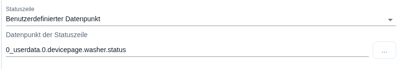

A text that does not fit into the line is shown on the panel in parts one after the other, see [Operation on the panel](#9-operation-on-the-panel).

### Filling the slots

Every row below **Slots** stands for one place: first the number from the preview, then the kind, then the selection. The **Status icon places** are filled the same way. The selection offers:

- **empty** – the place stays free on the panel,
- **User defined** – something that need not belong to the device (next section),
- the **values of the device** that fit the kind of the slot (see [What fits into which slot](#7-what-fits-into-which-slot)). A value need not be ticked in the filter list for that.

A saved value that no longer exists in the device is shown in red with "not found in the device" and stays saved until you change it.

### User defined: data point, channel or navigation

After choosing **User defined**, what the slot shows instead appears below the row:

| Choice | Effect |
|---|---|
| **Data point** | Any state, e.g. below `0_userdata.0`. It behaves like a value of the device: name, icon and unit come from the state. |
| **Channel** | An alias channel, e.g. a light, a blind or a socket from `alias.0`. It looks and is operated like on a grid page: a tap switches; blind, selection and timer open their popup; a dimmable light opens it when held. The object selection shows only channels that fit the kind of the slot. |
| **Navigation** | A place only for jumping: you choose the **Target page**. Only for info line, button and status icon. |

If the entered ID does not fit the kind of the slot or does not exist, "does not fit this slot", "data point not found" or "channel not found" stands in red below the field. It can still be saved; the slot then stays empty on the panel.

### Settings of the element

The button **…** at the right of every filled row opens the settings of this one element. Everything in it is optional; the button is **green** as soon as something is set. If you choose another value for the slot afterwards, the settings stay; an emptied slot loses them.

For info line, large value, progress bar, button and switch it is the familiar [Pageitem Configuration](PageConfig-Dialoge#1-pageitem-configuration) – without the choice of the channel:

| Field | Meaning |
|---|---|
| **Name** | Own label of the element. Empty = the automatic name. A long name is cut off at the width of the field. |
| **Is a navigation** and **Target page** | The short tap opens the target page and does nothing else, see [Jumping from the device page to another page](#jumping-from-the-device-page-to-another-page). |
| **Text / icon size** | The font of the icon, see [The text/icon size](PageConfig-Dialoge#the-texticon-size). Not for the progress bar. |
| **Icon and colour** for "true" and "false" | Own icon and own colour per state, see [Icon and colour](PageConfig-Dialoge#icon-and-colour-for-true-and-false). Numbers and texts have no "false": they show the icon and the colour of "true". |
| **Color Options** (colour scale) | The colour follows the value, see [Color Options](PageConfig-Dialoge#6-color-options). For the progress bar this is the colour of the bar. |
| **Long press** | Only for button and switch: a state a long press on the element writes. On a button it is set to "true", on a switch it is toggled. |

For a **channel** the fields its role also has on a grid page are added.

An example – one button for "running / pause": put an on/off value into a button slot, choose `pause` as icon for true and `play` for false. The tap toggles, the icon changes with it.

**Status icons** have a small dialog of their own, **Settings of the element**: icon and colour for true and false, **Color scale …** and **Short tap** (**Standard** or **Navigation** with a target page). If the place holds an alias channel socket or button, **Long press** is added.

### Jumping from the device page to another page

Two ways lead from the device page to another page, e.g. to the room selection of the robot vacuum:

- **A filled slot navigates.** In the settings of the element (**…**) tick **Is a navigation** and choose the **Target page** (for a status icon: **Short tap** → **Navigation**). The slot looks as before – icon, name, value –, but the tap now opens the page and does nothing else: a button no longer presses, an on/off value no longer switches. In a switch slot the tap on icon and name navigates; the switch itself keeps switching.
- **A place only for jumping.** In the selection of the slot choose **User defined** and below it **Navigation**, then the **Target page**. The place shows an icon and, as its label, the name of the target page; an own label, icon and colour are set through **…**.

Channels that open their popup at once (blind, gate, lock, selection, timer) have no navigation – there the popup always comes. Light, fan and slider open their popup only when held: the short tap navigates, holding still opens the popup.

If **target page not found** stands in red below the row, the page does not exist (any more).

> **Back does not automatically lead to the device page.** The arrows of the target page lead where you set them up for that page. If "up" should lead back to the page with the device, enter that page as the parent page of the target page; from there you open the device page again through the item.

### Status icons

Layout 1 and layout 3 can show a row of small **status icons**, e.g. for Wi-Fi, bin full, filter, error. The icons stand in a grid of boxes with a thin grey frame. Layout 2 has no status icons.

- A status icon shows **only an icon in its colour**, without name and value.
- The icon comes automatically (the same as in an info line with this value); an own one is chosen through **…**, e.g. `delete-empty` for "empty the bin".
- The colour comes automatically: on/off values in the colours *activated* / *deactivated* of the [colour theme](colorTheme), other values in the colour of their group.

#### Setting the status icons

1. At **Status icons** (below the status line) choose how much room the icons get – this is the **stage**:

   | Layout | Choice |
   |---|---|
   | 1 – Control | **No status icons** · **1–3 columns (up to 6 icons)** · **4–5 columns (up to 10 icons), info lines without name** · **6–8 columns (up to 16 icons), without info lines** |
   | 3 – Values | **No status icons** · **1–4 icons, instead of tile 1** · **5–8 icons, instead of tiles 1 and 2** |

   Layout 2 has no such choice.
2. Below the slots the **Status icon places** appear – as many as the choice holds (layout 1: 6, 10 or 16; layout 3: 4 or 8). Each place is filled like a slot: **empty**, **User defined** (data point, channel or navigation) or a value of the device. **…** opens the [settings of the element](#settings-of-the-element).
3. The preview at the layout shows the division of the chosen stage: the grid with all columns of the stage and next to it or below it what is left of the info lines and tiles.

What the stage covers is hidden by the dialog: in layout 1 with **6–8 columns** the slots 1 and 2 (the two info lines), in layout 3 slot 1 or the slots 1 and 2 (the first tiles).

| Layout 1, **1–3 columns**: slots 1–6 and six places | Layout 1, **6–8 columns**: slots 1 and 2 hidden, sixteen places |
|---|---|
|  | 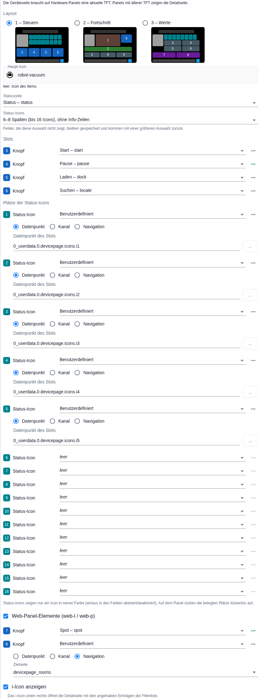 |
| **Layout 3, 1–4 icons, instead of tile 1**: slot 1 hidden, four places | |
| 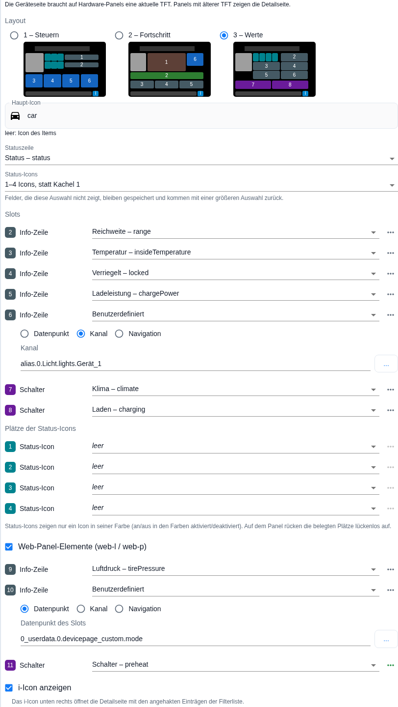 | |

The pictures were taken from a German admin.

**Hiding is not deleting.** What the choice does not show – places above the chosen number and the covered slots – stays saved with what is assigned to it and its settings. If you later choose more room again, everything is back. On the panel none of it appears as long as it is hidden.

| 6–8 columns, place 8 filled | made smaller to 1–3 columns: place 8 hidden, slots 1 and 2 back | 6–8 columns again: place 8 still filled |
|---|---|---|
|  |  |  |

**Change of layout.** The choice and the status icon places stay saved when the layout changes. If the new layout does not have the chosen stage, the largest one it has applies there – e.g. **6–8 columns** becomes **5–8 icons, instead of tiles 1 and 2** on layout 3 with the first eight places. Back on layout 1 all sixteen places are there again. Layout 2 shows no status icons, but does not lose them either.

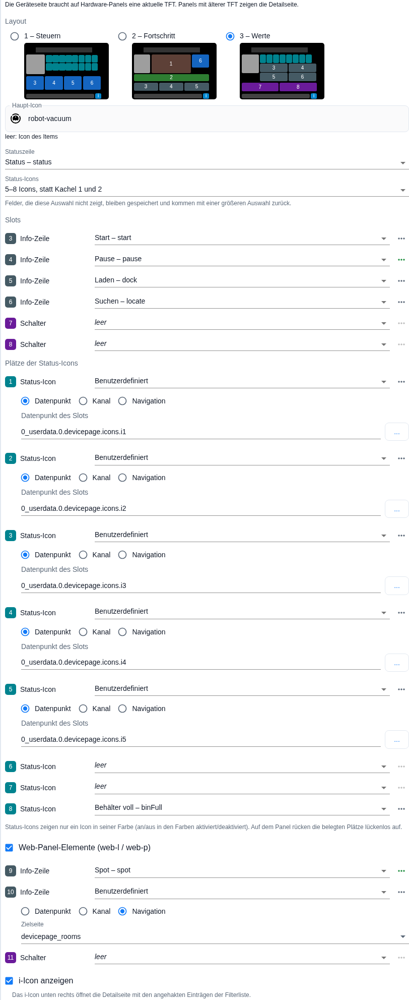

#### The stage: how much room the grid gets

How many status icons the page can show is set by the **stage** – the choice **Status icons** in the dialog. The larger the stage, the more icons fit – and the more of the rest has to make room. The stage is fixed for the page: on the panel nothing appears or disappears when a value changes.

**Layout 1 – Control:** the grid has two rows and stands next to the big icon (in US portrait and on Smartphone portrait below it). It grows to the right into the info lines.

| Stage | Status icons | What the two info lines show |
|---|---|---|
| no status icons | – | icon, name and value across the full width |
| 1–3 columns | up to 6 | icon, **short name**, value – the name is narrow and is cut off earlier (in US portrait: as with 4–5 columns) |
| 4–5 columns | up to 10 | icon and value, **no name** |
| 6–8 columns | up to 16 | **no info lines** – the grid needs all the room |

**This is how it looks on the panel** (EU panel, pictures of the real display software):

<table>
<tr>
<td align="center" width="33%"> 0 icons · no status icons</td>
<td align="center" width="33%"> 2 icons · stage 1–3 columns</td>
<td align="center" width="33%">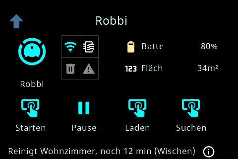 4 icons · stage 1–3 columns</td>
</tr>
<tr>
<td align="center" width="33%"> 6 icons · stage 1–3 columns</td>
<td align="center" width="33%">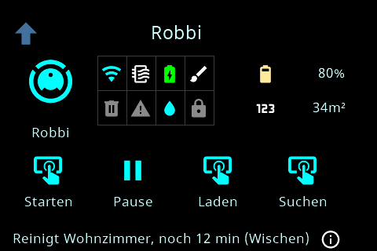 8 icons · stage 4–5 columns</td>
<td align="center" width="33%"> 10 icons · stage 4–5 columns</td>
</tr>
<tr>
<td align="center" width="33%">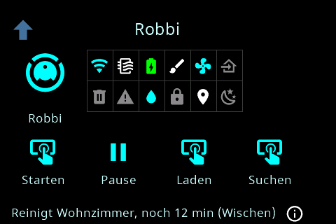 12 icons · stage 6–8 columns</td>
<td align="center" width="33%">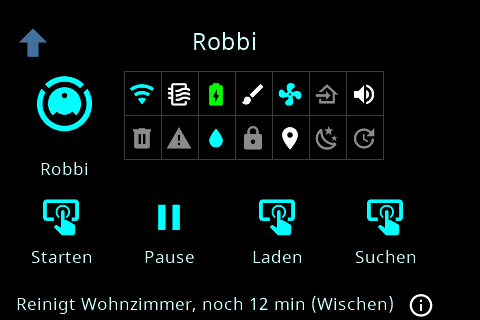 14 icons · stage 6–8 columns</td>
<td align="center" width="33%"> 16 icons · stage 6–8 columns</td>
</tr>
</table>

US portrait (pictures of the real display software)

<table>
<tr>
<td align="center" width="20%"> 0 icons · no status icons</td>
<td align="center" width="20%"> 2 icons · stage 1–3 columns</td>
<td align="center" width="20%"> 4 icons · stage 1–3 columns</td>
<td align="center" width="20%">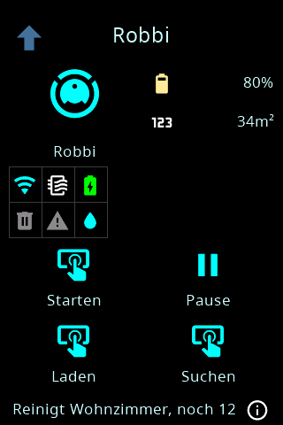 6 icons · stage 1–3 columns</td>
<td align="center" width="20%">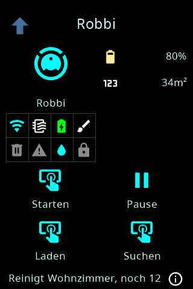 8 icons · stage 4–5 columns</td>
</tr>
<tr>
<td align="center" width="20%"> 10 icons · stage 4–5 columns</td>
<td align="center" width="20%"> 12 icons · stage 6–8 columns</td>
<td align="center" width="20%"> 14 icons · stage 6–8 columns</td>
<td align="center" width="20%">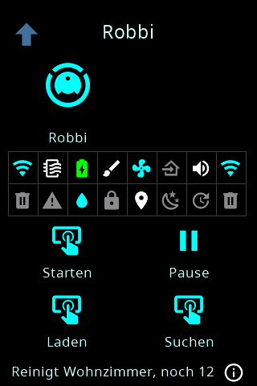 16 icons · stage 6–8 columns</td>
</tr>
</table>

**Layout 3 – Values:** the grid has one row and stands in the first row of info tiles.

| Stage | Status icons | What is left out |
|---|---|---|
| no status icons | – | nothing, all six info tiles |
| 1–4 | up to 4 | the **first** info tile (slot 1) |
| 5–8 | up to 8 | the **first two** info tiles (slots 1 and 2) |

**This is how it looks on the panel** (EU panel, pictures of the real display software):

<table>
<tr>
<td align="center" width="33%">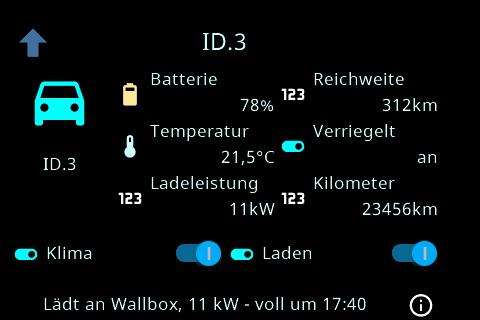 0 icons · no status icons</td>
<td align="center" width="33%"> 1 icon · stage 1–4</td>
<td align="center" width="33%">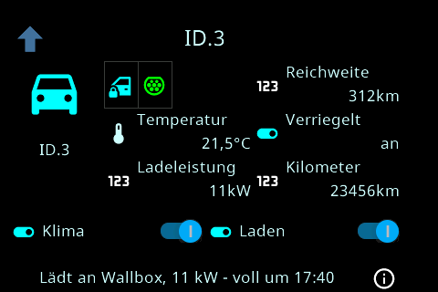 2 icons · stage 1–4</td>
</tr>
<tr>
<td align="center" width="33%">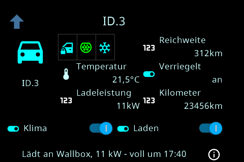 3 icons · stage 1–4</td>
<td align="center" width="33%">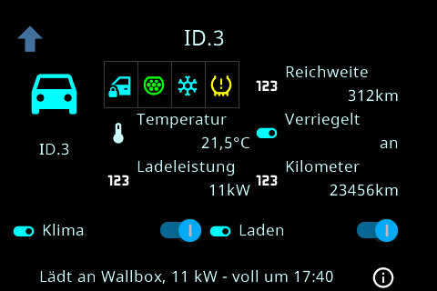 4 icons · stage 1–4</td>
<td align="center" width="33%">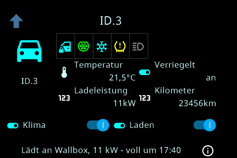 5 icons · stage 5–8</td>
</tr>
<tr>
<td align="center" width="33%"> 6 icons · stage 5–8</td>
<td align="center" width="33%">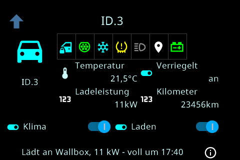 7 icons · stage 5–8</td>
<td align="center" width="33%"> 8 icons · stage 5–8</td>
</tr>
</table>

US portrait (pictures of the real display software)

<table>
<tr>
<td align="center" width="20%">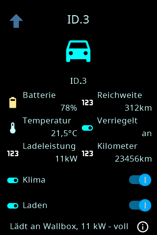 0 icons · no status icons</td>
<td align="center" width="20%"> 1 icon · stage 1–4</td>
<td align="center" width="20%"> 2 icons · stage 1–4</td>
<td align="center" width="20%">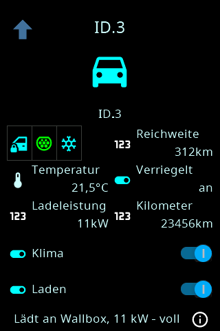 3 icons · stage 1–4</td>
<td align="center" width="20%">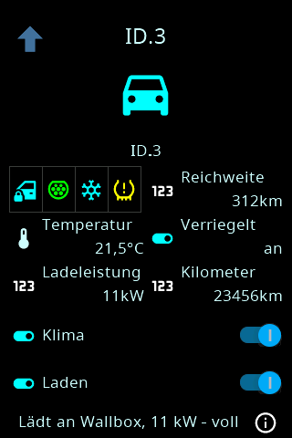 4 icons · stage 1–4</td>
</tr>
<tr>
<td align="center" width="20%">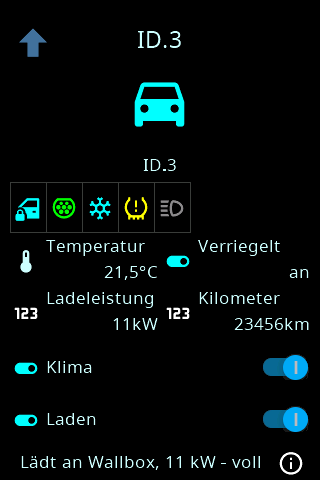 5 icons · stage 5–8</td>
<td align="center" width="20%"> 6 icons · stage 5–8</td>
<td align="center" width="20%">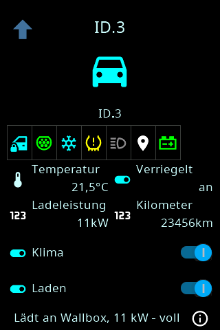 7 icons · stage 5–8</td>
<td align="center" width="20%">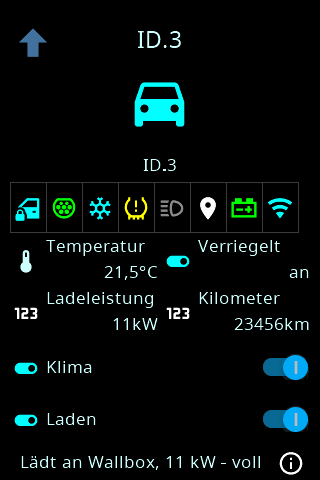 8 icons · stage 5–8</td>
</tr>
</table>

Layout 2 has no status icons.

**What you see on the panel:**

- Only as many columns appear as are filled – at most as many as the stage allows. If only five icons are filled in the stage 6–8, three columns are shown; the info lines stay away anyway, because that follows the stage, not the number of icons.
- The filled places move up **without gaps**: if you leave place 2 empty and fill place 3, place 3 stands in second position on the panel. The order of the filled places is kept.
- The icons fill the grid **column by column**: top, bottom, then the next column (layout 3 has only one row). If the last column is only half filled, its empty box keeps its frame.
- What the stage covers (the info lines of layout 1 in the stage 6–8, the first info tiles of layout 3) is not shown on the panel – even when the slot is filled.

**Nothing is lost when making the stage smaller.** If you choose a smaller stage, what is assigned to the status icons, info lines and info tiles that are then no longer visible stays stored. With a larger stage it is back.

#### Tapping and holding a status icon

A status icon is an element like the others of the page, only smaller. What tapping and holding do depends on what lies on the place:

| What the place holds | short tap | hold (about half a second) |
|---|---|---|
| value of the device or own data point | nothing | nothing |
| … with **Short tap: Navigation** (through **…**) | opens the target page | nothing |
| **User defined → Navigation** | opens the target page | nothing |
| **Channel**: socket, button, simple light | switches or presses | for socket and button the data point of **Long press**, if set; otherwise nothing |
| **Channel**: dimmable/colour light, fan, slider | light and fan switch | opens the popup |
| **Channel**: blind, gate, lock, selection, timer | opens the popup at once | – |

On the hardware panel the box turns grey while you touch it and blinks when held, like the other elements. A popup from a status icon has no heading. An empty box does not react.

This is how it looks on Smartphone landscape (US portrait is shown by the collapsed pictures above):

| | no status icons | 1–3 columns | 4–5 columns | 6–8 columns |
|---|---|---|---|---|
| **Smartphone landscape** | 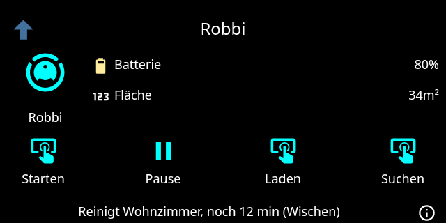 |  |  |  |

| | no status icons | 1–4 | 5–8 |
|---|---|---|---|
| **Smartphone landscape** | 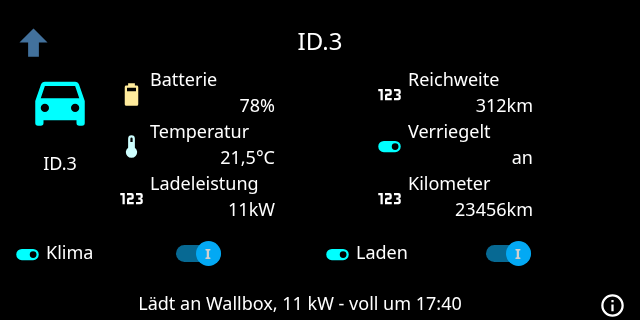 |  |  |

- **US portrait** and **Smartphone portrait:** the grid of layout 1 stands below the big icon, where the info lines are otherwise; in the stages 1–3 and 4–5 the info lines move right of the big icon (only icon and value). On Smartphone portrait the big icon stands in the middle as long as nothing stands next to it (no status icons, 6–8 columns).
- **US landscape:** like the EU panel, moved a little to the right.
- **Smartphone landscape:** like the EU panel; the info lines reach the right edge, so the short name is wider. There are not more status icons than on the EU panel.

### Show i icon

Default: on. The "i" at the bottom right opens the detail page with the ticked entries of the filter list. If nothing is ticked in the filter list, it does not appear.

### Additional elements for smartphone web panels

The models **Smartphone landscape** (`web-l`) and **Smartphone portrait** (`web-p`) of a [web panel](WebPanel#4-choosing-the-model-format-and-places) have more room and can show additional elements per layout:

| Layout | on every panel | additionally on smartphone web panels | slot numbers | there in total |
|---|---|---|---|---|
| **1 – Control** | 2 info lines, 4 buttons, up to 16 status icons | 2 buttons | 7–8 | 6 buttons |
| **2 – Progress** | large value, progress bar, 3 info lines, 1 button | 1 info line, 2 buttons | 7 (info line), 8–9 (buttons) | 4 info lines, 3 buttons |
| **3 – Values** | 6 info lines, 2 switches | 2 info lines, 1 switch | 9–10 (info lines), 11 (switch) | 8 info lines, 3 switches |

For this the tick box **Web panel elements (web-l / web-p)** stands below the slots (default: off). Its tooltip explains it: *Additional slots of this layout. Only standalone web panels of the models web-l and web-p show them, all other panels show the page without them.* When it is set, the additional slots appear below it, numbered on. Each one is filled and set up like any other slot of the same kind – same selection, same **…**. None is prefilled.

- **Removing the tick only hides them.** The additional slots disappear from the dialog and from the web panel; what was chosen for them stays saved and is back after ticking again.
- **Change of layout:** the additional slots keep their order among themselves – the first additional slot stays the first. Its kind may change (a button in layout 1, an info line in layouts 2 and 3); if what was chosen no longer fits, it is shown in red with "does not fit this slot". Layout 1 has only two additional slots: changing to it loses the third – even while the tick is not set. A status icon never becomes an additional slot and vice versa.
- **Hardware panels never show the additional elements** – nor does the browser picture of a real panel or a web panel with one of the three panel formats. If the same page is assigned to such a panel and to a smartphone web panel, the additional elements are simply missing there; everything else is the same.
- On the web panel an additional element behaves like any other of its kind (tap, hold, popup). Empty additional slots leave no gap – not even in front of a filled one: the filled ones move up, the row is laid out anew for them.
- No more text fits into a field because of this – there are more elements, not longer ones. Names and values have the same maximum length everywhere, see [Limits](#10-limits).

How this looks is shown by the pictures under [Smartphone landscape](#smartphone-landscape-web-l) and [Smartphone portrait](#smartphone-portrait-web-p).

## 6. The three layouts

The pictures show the EU panel with the icons the adapter chooses by itself (own icons and colours are set through **…**). The other models follow in [section 8](#8-appearance-per-panel-model).

### 1 – Control

For devices you start and stop: robot vacuum, lawn mower.

- 2 **info lines** next to the icon (slots 1–2),
- 4 **buttons** below (slots 3–6),
- up to 16 **status icons** in the grid next to the big icon, depending on the stage, see [Status icons](#status-icons).

### 2 – Progress

For devices with a programme that runs down: washing machine, dryer, dishwasher.

- 1 **large value** (slot 1), e.g. the remaining time,
- 1 **progress bar** across the whole width (slot 2),
- 3 **info lines** as small tiles (slots 3–5),
- 1 **button** at the top right (slot 6).

### 3 – Values

For devices with many readings: car, sensors.

- 6 **info lines** as tiles in two columns (slots 1–6, row by row: 1 top left, 2 top right, 3 middle left …),
- 2 **switches** below (slots 7–8),
- up to 8 **status icons** in one row in the place of the first tiles, depending on the stage, see [Status icons](#status-icons).

The same on all three layouts: at the top the heading (the name of the device) with the arrows, at the top left the big **main icon** with the name of the device, at the bottom the **status line** and to its right the **i icon**.

## 7. What fits into which slot

| Kind | Shows | Which values (device or own data point) | Which alias channels |
|---|---|---|---|
| **Info line** | icon, name, value | all | all (light, socket, blind, selection, slider, timer, sensors …) |
| **Large value** | the value in a big font, the name below | all | everything with a readable value: sensors, slider, selection, timer, light/socket (on/off) |
| **Progress bar** | name and bar | numbers. The bar shows 0–100 %; if the state has a minimum and a maximum, the value is scaled with them. | slider, volume |
| **Button** | icon and name | buttons (write only) or writable on/off values | all |
| **Switch** | icon, name and switch | writable on/off values | socket, light (also dimmable/coloured), fan |
| **Status icon** | only icon and colour | all | all |

Media channels and timetables fit into no slot.

## 8. Appearance per panel model

The device page exists on all five models. What stands in which slot is the same everywhere – only the arrangement follows the format. The preview in the dialog of the admin shows the arrangement of the EU panel; how the page looks on the other models is shown by the pictures here.

The pictures show the same three devices per model: a robot vacuum (layout 1), a washing machine (layout 2) and a car (layout 3), with the icons the adapter chooses by itself. They were taken in the web panel with the respective model; the texts on the panel are German.

### EU landscape (`eu`)

| 1 – Control | 2 – Progress | 3 – Values |
|---|---|---|
|  |  |  |

### US landscape (`us-l`)

The same arrangement as on the EU panel. The content sits 15 pixels further right because the visible area of the US display lies there.

| 1 – Control | 2 – Progress | 3 – Values |
|---|---|---|
|  |  |  |

### US portrait (`us-p`)

In portrait the elements are arranged anew:

- **Layout 1:** the main icon at the top left with the name below it. Below them the two info lines across the full width – or, with status icons, their grid; the info lines then stand right of the main icon (see [Status icons](#status-icons)). Then the four buttons as a 2×2 block (slot 3 top left, 4 top right, 5 bottom left, 6 bottom right).
- **Layout 2:** main icon and large value at the top, the progress bar below. The three infos are full lines (name left, value right) instead of tiles, the button lies below them across the full width.
- **Layout 3:** the main icon at the top in the middle, its name below across the full width. The six info tiles in two columns, the two switches as lines one below the other.

The status line is narrower here (262 instead of 390 pixels). The status texts of the examples no longer fit – the pictures show their first part, see [Alternating status text](#9-operation-on-the-panel).

| 1 – Control | 2 – Progress | 3 – Values |
|---|---|---|
|  |  |  |

### Smartphone landscape (`web-l`)

A standalone web panel with this model uses the whole area (640 × 320). The arrangement is that of the EU panel, stretched in width: no text field is narrower than there (only the names of buttons standing close together are 4 pixels narrower), the info lines of layout 1 and the status line (580 pixels) are clearly wider. The [additional elements](#additional-elements-for-smartphone-web-panels) fall into line: in layout 1 one row with up to six buttons, in layout 2 up to three buttons at the top right and four info tiles in one row, in layout 3 a third column of info tiles and a third switch.

| | 1 – Control | 2 – Progress | 3 – Values |
|---|---|---|---|
| without web panel elements |  |  | 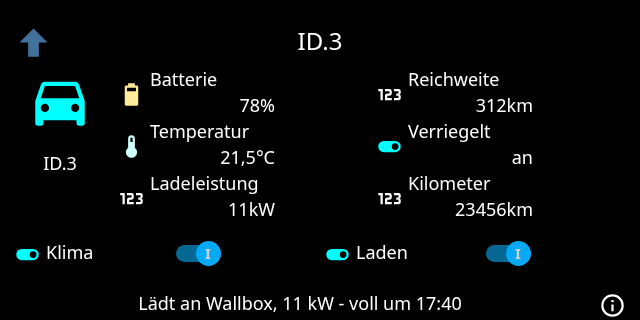 |
| with web panel elements |  |  |  |

### Smartphone portrait (`web-p`)

A standalone web panel with this model uses the whole area (320 × 640). The arrangement is that of US portrait; the additional height carries the [additional elements](#additional-elements-for-smartphone-web-panels) as further lines: in layout 1 a third row with two buttons, in layout 2 a fourth info line and up to three buttons in one row, in layout 3 a fourth row of info tiles and a third switch line. Without them the lines spread over the height with larger gaps. The main icon of layout 1 stands in the middle as long as nothing stands next to it (no status icons or 6–8 columns). As in US portrait the status line is 262 pixels wide.

| | 1 – Control | 2 – Progress | 3 – Values |
|---|---|---|---|
| without web panel elements |  |  |  |
| with web panel elements | 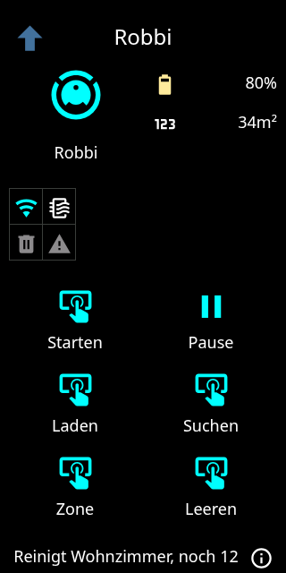 |  |  |

### A real panel in the browser

The [browser picture of a real panel](WebPanel#2-opening-a-real-panel-in-the-browser) and a web panel with one of the three panel formats draw the page like the hardware of the respective model – that is, as in the sections EU, US landscape and US portrait above and always without additional elements.

## 9. Operation on the panel

**Opening.** On a grid page **long press** the item: after about half a second the background of the tile blinks green and grey on a hardware panel – this shows that the long press is recognised; on **release** the page opens. On an entities page a tap on the icon or the name on the left is enough. With the short tap **Open the device page** a short tap is enough on both.

**Back.** The arrow at the top left leads from the device page to the page of the item, from the detail page to the page it was opened from (behind the "i", that is, back to the device page).

**Tapping and holding on the device page:**

| Element | short tap | holding (about half a second) |
|---|---|---|
| **Main icon** | like the short tap of the item if **A state of the device** is chosen there (switches or presses); otherwise nothing | nothing |
| **Info line**, **large value**, **progress bar**, **status icon** with a value | nothing – except for a writable value with a value list in an info line: there the tap opens the selection | nothing |
| **Button** | presses the button or toggles the on/off value | writes the state from **Long press**, if set; otherwise nothing |
| **Switch** | the switch on the right switches | as for the button (holding the icon or the name) |
| element with **navigation** | opens the target page | as without navigation |
| **Channel**: socket, simple light | switches | nothing; for a socket the state from **Long press**, if set |
| **Channel**: dimmable/coloured light, fan, slider | light and fan switch | opens the popup |
| **Channel**: blind, gate, lock, selection, timer | opens the popup at once | – |
| **i icon** | opens the detail page | like the short tap |
| **Status line** | nothing | nothing |

If an element without a popup is held, its background blinks green and grey after half a second on a hardware panel; the action is triggered on release. The **web panel does not show this blinking** – neither on the grid page nor on the device page; the long press works the same there, only without the feedback. A long press never counts as a short tap: if no long press is set for the element, nothing happens.

**Popups** are the usual ones (light, blind, selection, slider, timer …). After closing, the device page is there again. A popup from a status icon has no heading.

**Alternating status text.** If the text does not fit into the status line – its width depends on the model, see [Limits](#10-limits) –, the adapter splits it at word boundaries into at most **three parts** and shows them one after the other, changing every **3 seconds**, round and round. What would be left after the third part is dropped; the third then ends with "…". If the text changes, the display starts again with the first part. While a popup is open, the change pauses.

## 10. Limits

- **TFT version.** On a hardware panel the device page needs **TFT 6.3.0** or newer – on all three hardware models. With an older TFT the long press (and the short tap **Open the device page**) opens the **detail page** instead. The dialog puts it this way: *On hardware panels the device page needs a current TFT. Panels with an older TFT show the detail page.* The tap on icon or name on an entities page and the blinking on a long press need the new TFT as well. A web panel needs no TFT and always shows the device page.
- **Names and values: at most 31 bytes** – that is 31 characters, umlauts and special characters count twice. Anything longer is cut off without "…". This limit is the same on all models, also for the additional elements of the smartphone web panels.
- **The visible width depends on the model.** Mostly the field ends before the 31 bytes are reached – then the panel cuts off at the edge of the field, even in the middle of a letter (in the picture of layout 2 above the name "Waschmaschine" below the icon). Widths in pixels; the font is 24 pixels high, a letter is just under 10 pixels wide on average. Info line as *name / value*:

  | Model | Status line | Layout 1 | Layout 2 | Layout 3 |
  |---|---|---|---|---|
  | **EU landscape**, **US landscape** | 390 | device name 110 · info line 164 / 110, **with 1–3 columns of status icons 49 / 110, with 4–5 columns – / 87** · button 104 | device name 96 · large value 190 · progress bar 429 · info line 104 / 104 · button 100 | device name 100 · info line 125 / 125 · switch 125 |
  | **US portrait** | 262 | device name 150 · info line 156 / 104, with 1–5 columns of status icons – / 106 · button 148 | device name 90 · large value 172 · progress bar 300 · info line 156 / 104 · button 300 | device name 300 · info line 112 / 112 · switch 212 |
  | **Smartphone landscape** | 580 | device name 110 · info line 354 / 110, with 1–3 columns of status icons 239 / 110, with 4–5 columns – / 277 · button 104, six of them 100 each | device name 96 · large value 190 · progress bar 620 · info line 104 / 104 · button 100, two or three of them 96 each | device name 100 · info line 125 / 125 · switch 125 |
  | **Smartphone portrait** | 262 | device name 150 (without status icons and with 6–8 columns 300) · info line 156 / 104, with 1–5 columns of status icons – / 106 · button 148 | device name 90 · large value 172 · progress bar 300 · info line 156 / 104 · button 300, two of them 148 each, three 96 each | device name 300 · info line 112 / 112 · switch 212 |

  The large value is drawn in the big font: a digit needs 33 pixels there, "12:34" 149 pixels.

  Next to the grid of the status icons the panel takes the name of an info line with at most **15 bytes** (1–3 columns) and the value with at most **19 bytes** (4–5 columns); this is the same on all models.
- **Units stand at the value without a space** ("80%", "34m²", "60°C"). This is intended and saves room.
- **The large value** has a font of its own with digits, letters (also ä, ö, ü) and the characters `: % ° , . - /`. It cannot show a **€**.
- **The status line** has one line; its width is in the table above. Longer text alternates in up to three parts (each at most 63 bytes), see [Operation on the panel](#9-operation-on-the-panel).
- **Numbers cannot be adjusted on the detail page**, even if the state is writable. Switches, buttons and values with a value list can be operated. If you need a slider, put an alias channel (slider) into a slot of the device page.
- **The kind of a slot is fixed.** You choose *what* a slot shows, not *how*: number, position and kind of the places are given by the layout.
- **Generated pages cannot be edited.** Device page and detail page are not in the page list of the tab PageConfig. In the [navigation flow](naviFlow) the device page appears read-only (with a lock) below the page of its item.

The technical details (protocol, dimensions) are available for developers in [doc/ideas/device-details](https://github.com/ticaki/ioBroker.nspanel-lovelace-ui/tree/main/doc/ideas/device-details) (German).

## Pitfalls

- **The detail page comes instead of the device page.** The TFT of the panel is too old, see [Limits](#10-limits).
- **On the entities page nothing happens on a tap on the left.** That needs the new TFT as well. The switch on the right of the row works independently of it.
- **A slot stays empty on the panel.** The state or channel does not exist (any more) or does not fit the kind of the slot – the row is then red in the dialog. For a channel a warning is written to the log when the adapter starts (*Page '…', page item …: Device page slot …*).
- **The info lines in layout 1 are shorter or missing.** That is the [stage of the status icons](#status-icons): with 1–3 columns the name is short, with 4–5 columns it is missing, with 6–8 columns the info lines are missing completely. In layout 3 the first info tiles are missing the same way. What is assigned stays stored; with a smaller stage it is visible again.
- **Slots or status icon places are missing in the dialog.** The chosen stage of the status icons hides them; what is assigned to them is still saved and back with a larger stage, see [Setting the status icons](#setting-the-status-icons).
- **A filled status icon is missing on the panel.** Its place lies above the chosen stage (then hidden in the dialog), or the data point or channel does not exist (any more) – the row is red in the dialog then.
- **Slots are missing after a change of layout.** The slots are kept by their number. Of the additional slots of the smartphone web panels the third is lost when changing to layout 1. The status icons are kept.
- **The additional elements are missing on the panel.** They only appear on standalone web panels with the models *Smartphone landscape* and *Smartphone portrait* – and only while the tick box **Web panel elements (web-l / web-p)** is set.
- **Nothing blinks in the web panel on a long press.** Only the hardware panel shows the blinking; the web panel still triggers on release.
- **A long press on a button of the device page does nothing.** No **Long press** is set for the element. This is intended: a long press is never taken as a short tap.
- **The tap on a navigation slot does nothing.** The target page no longer exists or is not assigned to this panel. The log holds one warning about it (*… the target page "…" of element … is not assigned to panel … - the tap does nothing!*).
- **No way leads back from the target page to the device page.** See the note under [Jumping from the device page to another page](#jumping-from-the-device-page-to-another-page).
- **The i icon is missing although the tick is set.** Nothing is ticked in the filter list – the detail page would have no rows then.
- **The selections show only the saved values.** The adapter is not running right now; it delivers the values of the device to the dialog. The item can still be saved unchanged.
- **"Apply" does not save yet.** As with every page item, everything only takes effect with **Save** in the tab PageConfig; the adapter restarts for it.
