# Device with details and device page

Many devices deliver more values than fit on a tile: temperature, Wi-Fi signal, battery, power, firmware … A page item of the kind **Device with details** shows any device from the object tree without an alias for every single value. A short tap switches the device (or does what you set), a long press opens a **detail page** with the values you ticked.

Instead of the detail page the long press can open a **device page**: a page of its own for exactly this device, with a big icon, fixed places for values, buttons, switches or a progress bar, and a status line. That suits a robot vacuum, a washing machine, a lawn mower or a car, for example.

Both exist **only in the admin** (tab PageConfig), not in the configuration script.

Contents:
- [What is what?](#what-is-what)
- [Quick start: device with detail page](#quick-start-device-with-detail-page)
- [Quick start: device page](#quick-start-device-page)
- [Reference](#reference)
  - [1. Creating the item and choosing the device](#1-creating-the-item-and-choosing-the-device)
  - [2. Short tap](#2-short-tap)
  - [3. Filter list and detail page](#3-filter-list-and-detail-page)
  - [4. Long press opens: detail page or device page](#4-long-press-opens-detail-page-or-device-page)
  - [5. Setting up the device page](#5-setting-up-the-device-page)
  - [6. The three layouts](#6-the-three-layouts)
  - [7. What fits into which slot](#7-what-fits-into-which-slot)
  - [8. Appearance per panel model](#8-appearance-per-panel-model)
  - [9. Operation on the panel](#9-operation-on-the-panel)
  - [10. Limits](#10-limits)
- [Pitfalls](#pitfalls)

## What is what?

| Term | Meaning |
|---|---|
| **Device with details** | A **Kind of item** in the [Pageitem Configuration](PageConfig-Dialoge#1-pageitem-configuration). The item sits on a grid page or an entities page like any other. |
| **Device** | An object of type *device* or *channel* in the object tree of ioBroker, e.g. `shelly.0.SHPLG-S#123456#1` or `0_userdata.0.Vacuum`. All states below it are the "values of the device". |
| **Detail page** | A list with the ticked values of the device. The adapter generates it itself, you do not have to create it. |
| **Device page** | A page with a big device icon and fixed places. The adapter generates it as well; you only choose the layout and what stands in which place. |
| **Slot** | A place on the device page. Every slot has a fixed kind: info line, large value, progress bar, button, switch or status icon. |

What to take depends on what you want to see on the panel:

| I want to … | take … |
|---|---|
| simply look up the values of a device as a list | **Device with details** with the **detail page** – [quick start](#quick-start-device-with-detail-page) |
| operate a device on a page of its own: start, pause, remaining time, progress, state | **Device with details** with the **device page** – [quick start](#quick-start-device-page) |
| also reach the whole list of values from the device page | device page with the **i icon** – it opens the detail page |
| operate a light, a blind or a socket with its usual popup | a **Standard** item with an alias channel, see [Pageitem Configuration](PageConfig-Dialoge#1-pageitem-configuration) – such a channel can also be put into a slot of the device page |

This is what a device page looks like (layout "Control" with own icons for the buttons, EU panel):

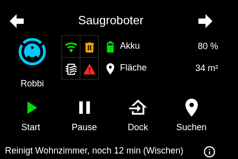

## Quick start: device with detail page

1. **Create the page item.** In the tab **PageConfig** open a grid page (cardGrid, cardGrid2, cardGrid3) or an entities page and click a free place. – *Result: the Pageitem Configuration is open.*
2. **Choose the kind.** At the very top, at **Kind of item**, choose **Device with details**. – *Result: instead of the channel field there is **Device (object of type device or channel)**.*
3. **Choose the device.** Type the ID or pick it in the object tree through **…**. – *Result: below the field stand the name of the device and how many entries are ticked, e.g. "Robbi - 14 entries ticked".*
4. Set the **Short tap**: if a tap should switch the device, **A state of the device (on/off or button)** stays; otherwise **None (details only)**.
5. Open the **Filter list** and tick what the detail page should show. Change the order by dragging. **Apply.**
6. **Long press opens** stays at **Detail page**.
7. **Apply** and then **Save** in the tab. – *Result: the adapter restarts.*
8. **Try it on the panel:** long press the item on a grid page, on an entities page tap the icon or the name on the left (this needs a current TFT, see [Limits](#10-limits)). – *Result: the detail page appears, its heading is the name of the device.*

<!-- BILD FOLGT (BILDER.md): admin-device-item.png -->
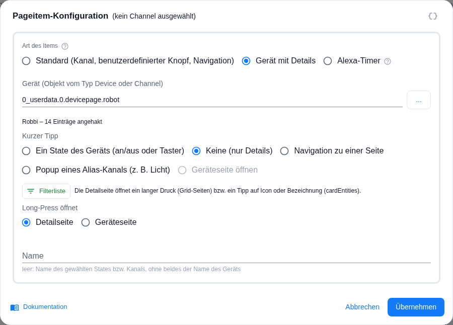

## Quick start: device page

Requirement: an item of the kind **Device with details** as in the quick start above. On a hardware panel the device page also needs a current TFT version, see [Limits](#10-limits).

1. Open the item in the tab **PageConfig** and choose **Device page** at **Long press opens**. – *Result: the area of the device page appears below; the info places are already filled with the first ticked entries of the filter list.*
2. Choose the **Layout**: **1 – Control**, **2 – Progress** or **3 – Values**. The small pictures show where which slot sits; the numbers belong to the rows below.
3. Choose the **Main icon**, e.g. `robot-vacuum`. Empty = the icon of the item.
4. **Status line**: choose the value that should stand at the bottom as text, e.g. the status of the device.
5. Fill the **Slots**: pick a value of the device per row. Only what fits the kind of the slot is offered.
6. **Apply** and then **Save** in the tab. – *Result: the adapter restarts.*
7. **Try it on the panel:** long press the item. – *Result: the device page appears. The "i" at the bottom right opens the detail page.*

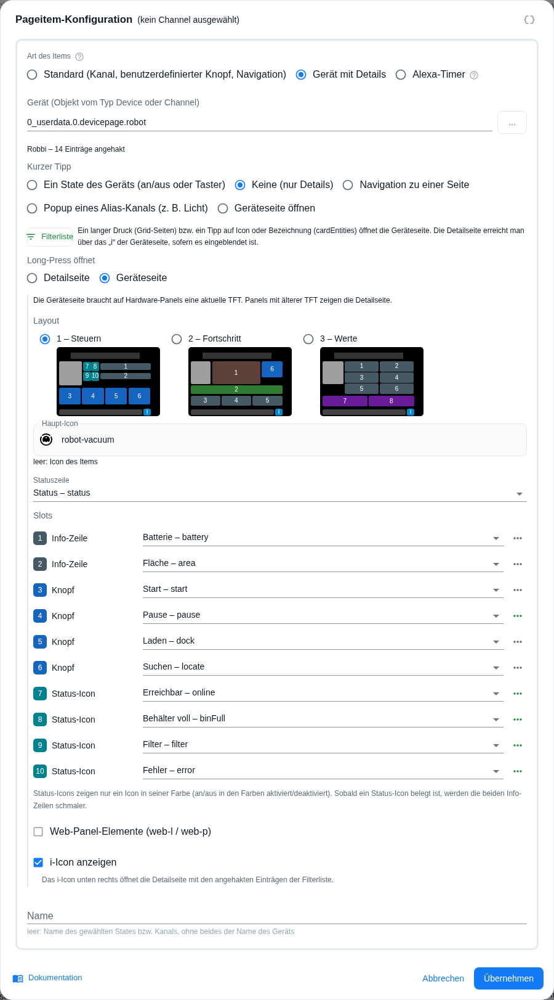

## Reference

The following sections describe every setting in detail.

## 1. Creating the item and choosing the device

The kind **Device with details** exists on the pages whose places report a long press or a tap on the left part: **cardGrid**, **cardGrid2**, **cardGrid3** and **cardEntities**. On other pages the dialog does not offer it.

The field **Device (object of type device or channel)** holds the ID of the device. The dialog checks it and writes below what it found:

| Text below the field | Meaning |
|---|---|
| *Choose the device whose details the item shows.* | The field is still empty. |
| *Name - n entries ticked* | The device was found; the detail page has that many rows. |
| *The object does not exist.* | A typo, or the device was deleted. |
| *Only objects of type device or channel can be chosen.* | A single state or a folder was chosen, for example. |
| *An instance or the root of an adapter cannot be chosen.* | e.g. `shelly.0` – many devices lie below it, not one. |
| *The devices of this adapter lie on another level of the object tree.* | For known adapters the dialog knows on which level a device lies – choose the object on that level. |
| *The info channel of an instance is no device.* | `<adapter>.<n>.info` cannot be chosen. |

The device consists of its states and the states of **one** sub folder (e.g. `Relay0.Power`); for hmip it reaches one level deeper. States lying deeper still do not appear.

For **shelly**, **sonoff**, **zigbee2mqtt**, **hm-rpc** and **hmip** the adapter brings a mask: it recognises temperature, voltage, power, signal, firmware and so on and gives them readable names and fitting icons. For all other adapters it assigns the values by their role.

**Name** at the very bottom is the label of the item on its page. Empty: the name of the chosen state or channel, without one the name of the device.

## 2. Short tap

What a short tap on the item does:

| Choice | Effect |
|---|---|
| **A state of the device (on/off or button)** | Below it you choose the **State of the device (on/off)**. An on/off value is toggled, a button is pressed (marked "button, writes true" in the list). If the device has a switch, it is preselected. Without a chosen state the item cannot be applied. |
| **None (details only)** | The short tap does nothing. Default when the device has nothing to switch. |
| **Navigation to a page** | The short tap opens a **Target page**. |
| **Popup of an alias channel (e.g. light)** | The short tap operates an alias channel like a standard item, e.g. with the light popup. The channel is chosen only in this case. |
| **Open the device page** | The short tap already opens the device page (the long press still does as well). Only selectable when **Device page** is chosen at **Long press opens**; if you switch back to **Detail page** there, the short tap jumps to **None**. |

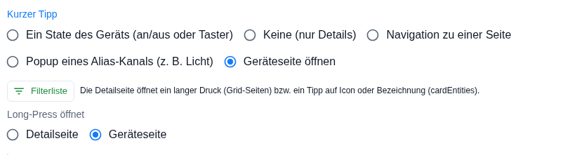

You can switch between the choices without losing anything as long as the dialog is open. Only what is chosen at **Apply** is saved.

## 3. Filter list and detail page

The button **Filter list** opens the list of all values of the device.

<!-- BILD FOLGT (BILDER.md): admin-filterlist.png -->
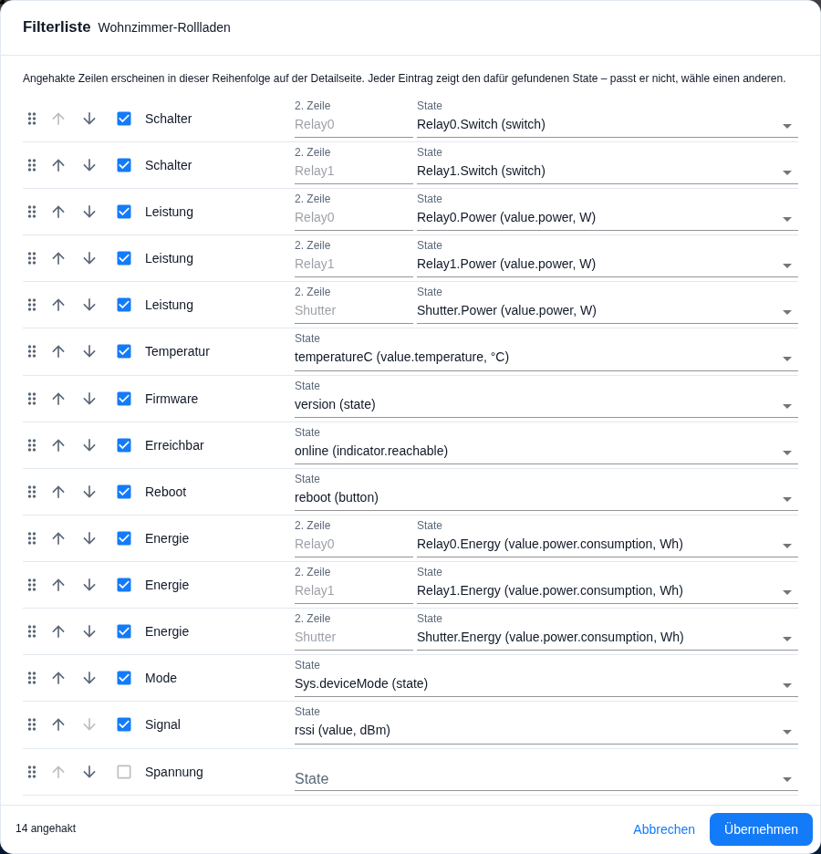

| Element | Meaning |
|---|---|
| **Tick** | Ticked rows appear on the detail page – in the order of the list. Ticked ones stand at the top, the others below. Nothing is hidden automatically: what appears is decided by you alone. |
| **Drag to move**, **Up**, **Down** | change the order. |
| **Entry** | The readable name of the row (temperature, voltage, signal …). For adapters without a mask you assign a state to an entry here; its role suggests it. |
| **State** | The state the adapter found for the entry. If it does not fit, pick another one. |
| **2nd line** | Appears for ticked rows with the **same name** (several temperatures, say). The adapter then automatically appends what the states differ in ("Temperature Relay0", "Temperature Ext 100"). An own text in the field replaces the automatic one and always applies. |

A new item starts with the entries you last ticked for a device of **the same adapter**; the first time with the suggestions of the mask.

**The detail page** is a normal entities page. Its heading is the name of the device, the back arrow leads to the page it was opened from. Per page it shows as many rows as every entities page of the model (EU/US landscape and smartphone landscape 4, US portrait 5, smartphone portrait 8); more rows page on.

<!-- BILD FOLGT (BILDER.md): eu-detail-page.png -->
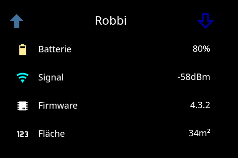

What a row shows and can do depends on the state:

| State | Row | Operation |
|---|---|---|
| on/off, writable | switch on the right | switches |
| on/off, read only | text "On" or "Off" | – |
| button (write only) | button on the right | presses |
| number or text with a value list, writable | the text of the current value | a tap opens the selection |
| number or text with a value list, read only | the text of the current value | – |
| number | value with unit | – (writable numbers are not adjusted here either) |
| text | the text | – |

A battery level in percent shows a battery icon that follows the level in steps of 10 %.

## 4. Long press opens: detail page or device page

| Choice | Effect |
|---|---|
| **Detail page** | Default. The long press (grid pages) or the tap on icon or name (entities page) opens the detail page. |
| **Device page** | It opens the device page. The detail page is then reached through the "i" of the device page, if it is shown. The settings of [section 5](#5-setting-up-the-device-page) appear below. |

Here too nothing is lost when switching as long as the dialog is open. The device page is only saved when **Device page** is chosen at **Apply**.

## 5. Setting up the device page

When switched on for the first time, the dialog fills the info places (info line, large value) one after the other with the ticked entries of the filter list. Buttons, switches, progress bar, status icons and the status line stay empty – you choose those yourself.

### Layout

Three layouts are available, see [The three layouts](#6-the-three-layouts). The preview shows the slots with their numbers.

If you change the layout, the slots are kept **by their number** (slot 1 stays slot 1). If a value no longer fits the kind of the slot afterwards, it is shown in red with "does not fit this slot". If the new layout has fewer slots, the surplus ones are lost.

### Main icon

The big icon at the top left. Empty = the icon of the item. Below it the panel always shows the name of the device.

### Status line

The wide line at the bottom shows a value as text – e.g. the programme of the washing machine or "Cleaning living room, 12 min left". The selection offers **empty**, **Custom data point** and then all values of the device.

With **Custom data point** the line shows any state, which need not belong to the device – e.g. a text below `0_userdata.0` that a script puts together. The field **Data point of the status line** appears below: type the ID or pick it through **…**. As long as the field is empty or the state does not exist, the line stays empty.

A text that does not fit into the line is shown on the panel in parts one after the other, see [Operation on the panel](#9-operation-on-the-panel).

### Filling the slots

Every row below **Slots** stands for one place: first the number from the preview, then the kind, then the selection. The selection offers:

- **empty** – the place stays free on the panel,
- **User defined** – something that need not belong to the device (next section),
- the **values of the device** that fit the kind of the slot (see [What fits into which slot](#7-what-fits-into-which-slot)). A value need not be ticked in the filter list for that.

A saved value that no longer exists in the device is shown in red with "not found in the device" and stays saved until you change it.

### User defined: data point, channel or navigation

After choosing **User defined**, what the slot shows instead appears below the row:

| Choice | Effect |
|---|---|
| **Data point** | Any state, e.g. below `0_userdata.0`. It behaves like a value of the device: name, icon and unit come from the state. |
| **Channel** | An alias channel, e.g. a light, a blind or a socket from `alias.0`. It looks and is operated like on a grid page: a tap switches; blind, selection and timer open their popup; a dimmable light opens it when held. The object selection shows only channels that fit the kind of the slot. |
| **Navigation** | A place only for jumping: you choose the **Target page**. Only for info line, button and status icon. |

If the entered ID does not fit the kind of the slot or does not exist, "does not fit this slot", "data point not found" or "channel not found" stands in red below the field. It can still be saved; the slot then stays empty on the panel.

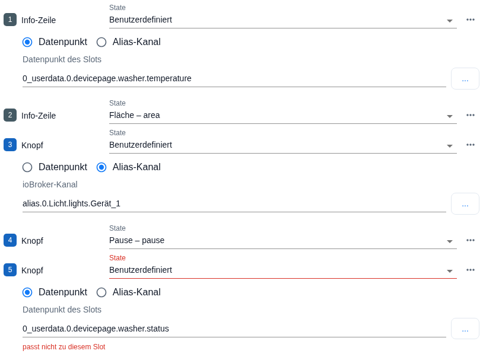

### Settings of the element

The button **…** at the right of every filled row opens the settings of this one element. Everything in it is optional; the button is **green** as soon as something is set. If you choose another value for the slot afterwards, the settings stay; an emptied slot loses them.

For info line, large value, progress bar, button and switch it is the familiar [Pageitem Configuration](PageConfig-Dialoge#1-pageitem-configuration) – without the choice of the channel:

<!-- BILD NEU AUFNEHMEN (BILDER.md): admin-slot-dialog.png zeigt noch den früheren kleinen Dialog -->
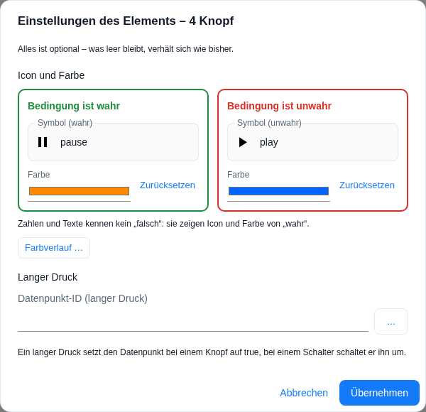

| Field | Meaning |
|---|---|
| **Name** | Own label of the element. Empty = the automatic name. A long name is cut off at the width of the field. |
| **Is a navigation** and **Target page** | The short tap opens the target page and does nothing else, see [Jumping from the device page to another page](#jumping-from-the-device-page-to-another-page). |
| **Text / icon size** | The font of the icon, see [The text/icon size](PageConfig-Dialoge#the-texticon-size). Not for the progress bar. |
| **Icon and colour** for "true" and "false" | Own icon and own colour per state, see [Icon and colour](PageConfig-Dialoge#icon-and-colour-for-true-and-false). Numbers and texts have no "false": they show the icon and the colour of "true". |
| **Color Options** (colour scale) | The colour follows the value, see [Color Options](PageConfig-Dialoge#6-color-options). For the progress bar this is the colour of the bar. |
| **Long press** | Only for button and switch: a state a long press on the element writes. On a button it is set to "true", on a switch it is toggled. |

For a **channel** the fields its role also has on a grid page are added.

An example – one button for "running / pause": put an on/off value into a button slot, choose `pause` as icon for true and `play` for false. The tap toggles, the icon changes with it.

**Status icons** have a small dialog of their own, **Settings of the element**: icon and colour for true and false, **Color scale …** and **Short tap** (**Standard** or **Navigation** with a target page).

<!-- BILD FOLGT (BILDER.md): admin-slot-dialog-status.png -->
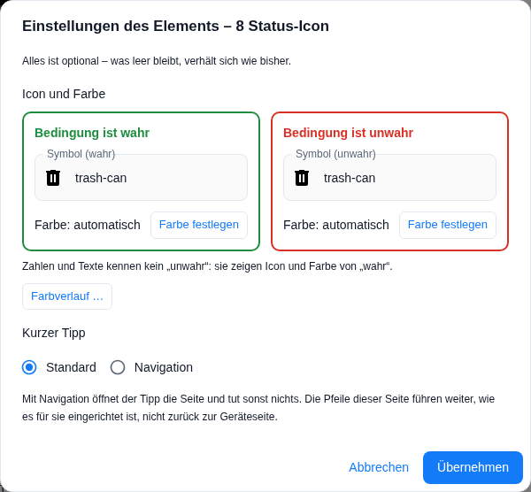

### Jumping from the device page to another page

Two ways lead from the device page to another page, e.g. to the room selection of the robot vacuum:

- **A filled slot navigates.** In the settings of the element (**…**) tick **Is a navigation** and choose the **Target page** (for a status icon: **Short tap** → **Navigation**). The slot looks as before – icon, name, value –, but the tap now opens the page and does nothing else: a button no longer presses, an on/off value no longer switches. In a switch slot the tap on icon and name navigates; the switch itself keeps switching.
- **A place only for jumping.** In the selection of the slot choose **User defined** and below it **Navigation**, then the **Target page**. The place shows an icon and, as its label, the name of the target page; an own label, icon and colour are set through **…**.

Channels that open their popup at once (blind, gate, lock, selection, timer) have no navigation – there the popup always comes. Light, fan and slider open their popup only when held: the short tap navigates, holding still opens the popup.

If **target page not found** stands in red below the row, the page does not exist (any more).

> **Back does not automatically lead to the device page.** The arrows of the target page lead where you set them up for that page. If "up" should lead back to the page with the device, enter that page as the parent page of the target page; from there you open the device page again through the item.

### Status icons

Only layout 1 has four places of the kind **Status icon** (slots 7–10): small icons in a 2×2 grid right next to the big icon, e.g. for Wi-Fi, bin full, filter, error.

- A status icon shows **only an icon in its colour**, without name and value.
- The icon comes automatically (the same as in an info line with this value); an own one is chosen through **…**, e.g. `delete-empty` for "empty the bin".
- The colour comes automatically: on/off values in the colours *activated* / *deactivated* of the [colour theme](colorTheme), other values in the colour of their group.
- If all four are empty, the page looks as it does without them. If **at least one** is filled, the whole grid appears (empty fields stay as empty boxes) and the two info lines get **narrower** – long names are then cut off earlier. The dialog points this out below the slots.

| With status icons | Without status icons |
|---|---|
|  | 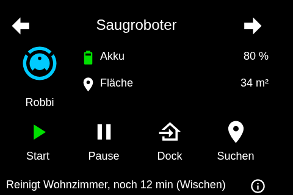 |

### Show i icon

Default: on. The "i" at the bottom right opens the detail page with the ticked entries of the filter list. If nothing is ticked in the filter list, it does not appear.

### Additional elements for smartphone web panels

The models **Smartphone landscape** and **Smartphone portrait** of a [web panel](WebPanel#4-choosing-the-model-format-and-places) have more room and can show additional elements per layout:

| Layout | on every panel | additionally on smartphone web panels | there in total |
|---|---|---|---|
| **1 – Control** | 2 info lines, 4 buttons, 4 status icons | 2 buttons | 6 buttons |
| **2 – Progress** | large value, progress bar, 3 info lines, 1 button | 1 info line, 2 buttons | 4 info lines, 3 buttons |
| **3 – Values** | 6 info lines, 2 switches | 2 info lines, 1 switch | 8 info lines, 3 switches |

For this there is a tick box in the area of the device page (default: off). Only when it is set do the additional places appear below **Slots**.

<!-- TODO nach Integration: genaue Beschriftung des Häkchens (und sein Hilfstext) aus admin/i18n/en/translations.json wörtlich einsetzen; Position im Dialog (über/unter den Slots) und Nummern/Bezeichnung der Zusatz-Plätze prüfen; prüfen, was beim Ausschalten mit belegten Zusatz-Plätzen passiert (bleiben sie gespeichert?) -->

<!-- BILD FOLGT (BILDER.md): admin-web-extra.png -->
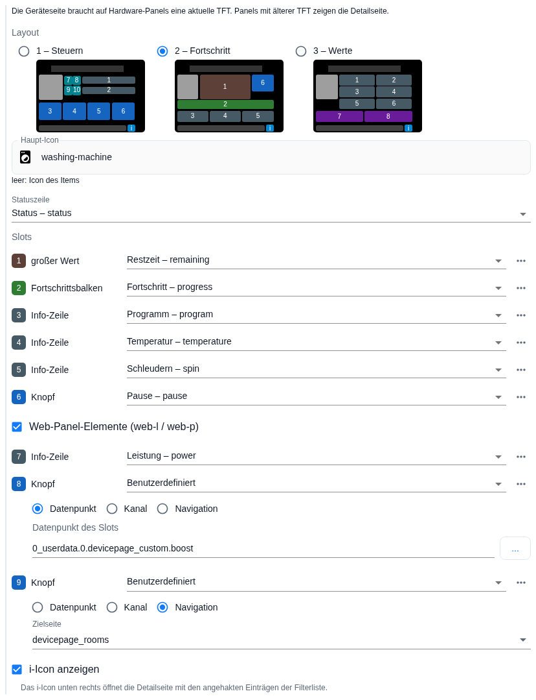

- **Hardware panels never show the additional elements** – nor does the browser picture of a real panel or a web panel with one of the three panel formats.
- If the same page is assigned to a hardware panel and to a smartphone web panel, the hardware panel shows the places it knows; the additional ones are simply missing there.
- The text lengths are the same on all models, see [Limits](#10-limits).

How this looks is shown by the pictures under [Smartphone landscape](#smartphone-landscape-web-l) and [Smartphone portrait](#smartphone-portrait-web-p).

## 6. The three layouts

The pictures show the EU panel with own icons; the other models follow in [section 8](#8-appearance-per-panel-model).

### 1 – Control

For devices you start and stop: robot vacuum, lawn mower.

- 2 **info lines** next to the icon (slots 1–2),
- 4 **buttons** below (slots 3–6),
- 4 **status icons** in a 2×2 grid next to the big icon (slots 7–10), see [Status icons](#status-icons).

### 2 – Progress

For devices with a programme that runs down: washing machine, dryer, dishwasher.

- 1 **large value** (slot 1), e.g. the remaining time,
- 1 **progress bar** across the whole width (slot 2),
- 3 **info lines** as small tiles (slots 3–5),
- 1 **button** at the top right (slot 6).

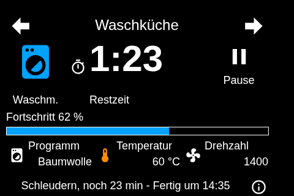

### 3 – Values

For devices with many readings: car, sensors.

- 6 **info lines** as tiles in two columns (slots 1–6, row by row: 1 top left, 2 top right, 3 middle left …),
- 2 **switches** below (slots 7–8).

<!-- TODO nach Integration: /mnt/projekte/nspanel emu/cardDevice3-neu.png (2026-11-24) zeigt Layout 3 mit einer Spalte aus fünf Status-Icons am rechten Rand und schmaleren Info-Kacheln. Wenn das der Zielstand ist: hier, unter "Status icons" (bisher "only layout 1"), in der Tabelle der Zusatz-Elemente und in §10 (Feldbreiten) nachziehen. -->

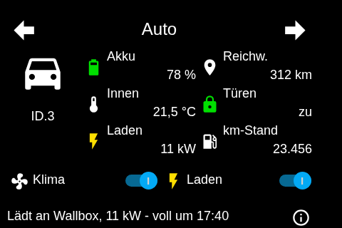

The same on all three layouts: at the top the heading (the name of the device) with the arrows, at the top left the big **main icon** with the name of the device, at the bottom the **status line** and to its right the **i icon**.

## 7. What fits into which slot

| Kind | Shows | Which values (device or own data point) | Which alias channels |
|---|---|---|---|
| **Info line** | icon, name, value | all | all (light, socket, blind, selection, slider, timer, sensors …) |
| **Large value** | the value in a big font, the name below | all | everything with a readable value: sensors, slider, selection, timer, light/socket (on/off) |
| **Progress bar** | name and bar | numbers. The bar shows 0–100 %; if the state has a minimum and a maximum, the value is scaled with them. | slider, volume |
| **Button** | icon and name | buttons (write only) or writable on/off values | all |
| **Switch** | icon, name and switch | writable on/off values | socket, light (also dimmable/coloured), fan |
| **Status icon** | only icon and colour | all | all |

Media channels and timetables fit into no slot.

## 8. Appearance per panel model

The device page exists on every model. What stands in which slot is the same everywhere – only the arrangement follows the format. The pictures show the same three devices per model: a robot vacuum (layout 1), a washing machine (layout 2) and a car (layout 3), here with the icons the adapter chooses by itself.

<!-- TODO nach Integration: alle Aussagen dieses Abschnitts am Code prüfen (heute: supportsCardDevice/CARD_DEVICE_MODELS nur eu und web-l). Insbesondere: us-l wirklich wie EU; Anordnung us-p für Layout 2 und 3 beschreiben (bisher kenne ich nur Layout 1); eigenes Layout web-l/web-p auf voller Bühne beschreiben; ob ein Web-Panel mit Panel-Format (eu/us-l/us-p) genau wie die Hardware zeichnet. -->

<!-- BILD FOLGT (BILDER.md): alle Bilder dieses Abschnitts außer web-cardDevice*.png -->

### EU landscape (`eu`)

| 1 – Control | 2 – Progress | 3 – Values |
|---|---|---|
|  | 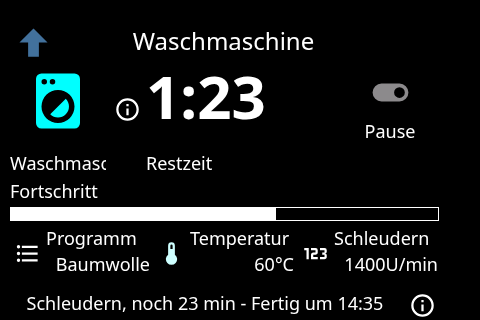 | 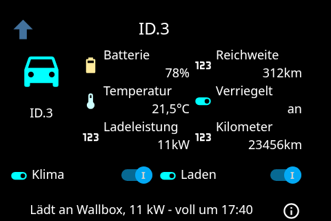 |

### US landscape (`us-l`)

Like the EU panel.

| 1 – Control | 2 – Progress | 3 – Values |
|---|---|---|
| 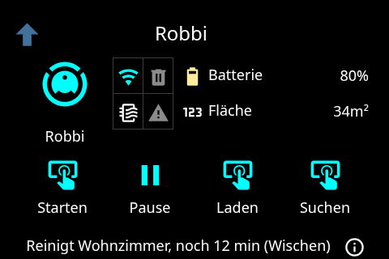 | 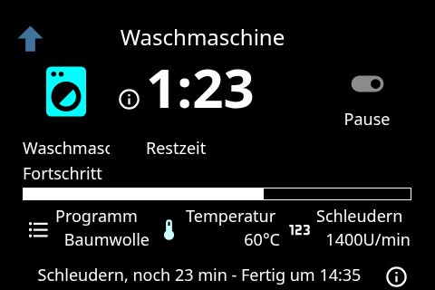 | 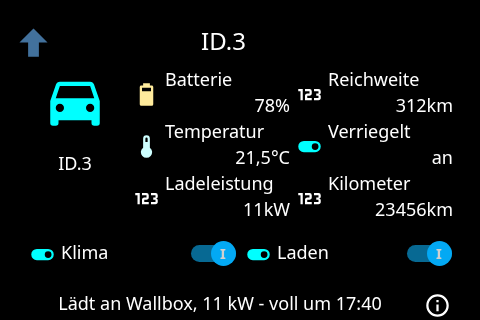 |

### US portrait (`us-p`)

In portrait the elements are arranged anew. Layout 1: the main icon at the top left, the 2×2 status icons to its right, below them the info lines across the full width, the buttons in a 2×2 block and the status line at the bottom.

| 1 – Control | 2 – Progress | 3 – Values |
|---|---|---|
| 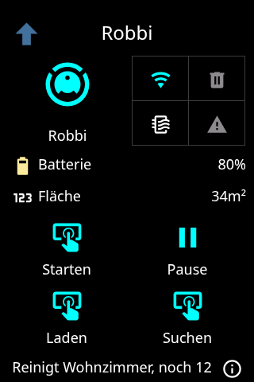 | 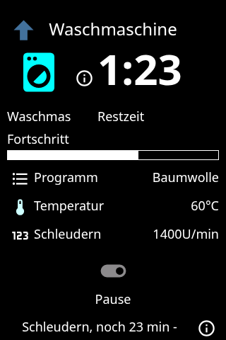 | 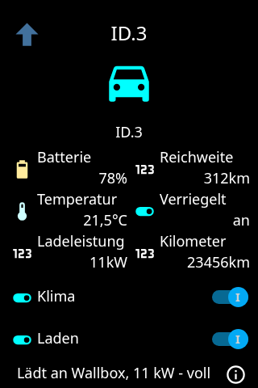 |

### Smartphone landscape (`web-l`)

A standalone web panel with this model uses the whole area (640 × 320) with an arrangement of its own. Upper row: without additional elements; lower row: with the [additional elements](#additional-elements-for-smartphone-web-panels).

| | 1 – Control | 2 – Progress | 3 – Values |
|---|---|---|---|
| Standard | 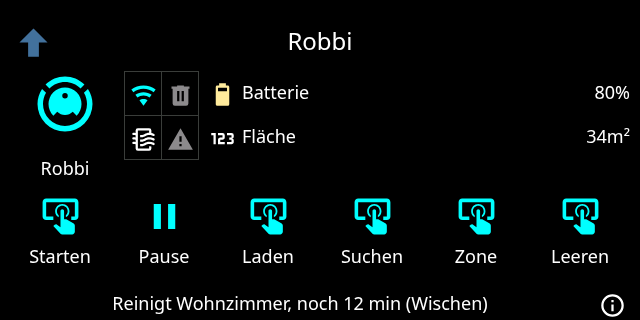 | 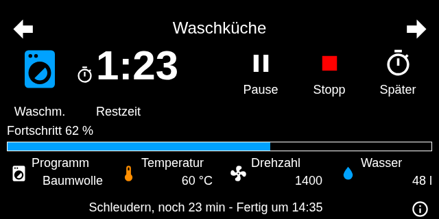 | 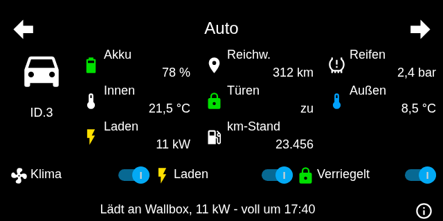 |
| with extras |  |  |  |

### Smartphone portrait (`web-p`)

A standalone web panel with this model uses the whole area (320 × 640) with an arrangement of its own.

| | 1 – Control | 2 – Progress | 3 – Values |
|---|---|---|---|
| Standard |  | 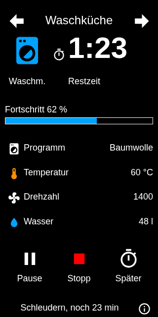 | 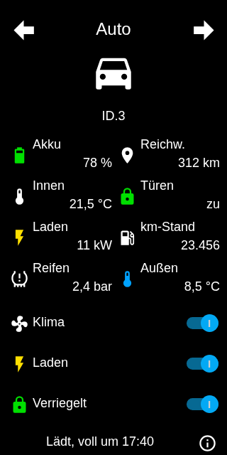 |
| with extras |  |  |  |

### A real panel in the browser

The [browser picture of a real panel](WebPanel#2-opening-a-real-panel-in-the-browser) and a web panel with one of the three panel formats look like the hardware – that is, as in the sections EU, US landscape and US portrait above.

## 9. Operation on the panel

**Opening.** On a grid page **long press** the item: after about half a second the background of the tile blinks green and grey – this shows that the long press is recognised; on **release** the page opens. On an entities page a tap on the icon or the name on the left is enough. With the short tap **Open the device page** a short tap is enough on both.

<!-- TODO nach Integration: Blinken beim langen Druck – gilt es auf allen Hardware-Modellen (Changelog heute: "needs a new TFT, eu") und zeigt es auch das Web-Panel? Text danach anpassen. -->

**Back.** The arrow at the top left leads from the device page to the page of the item, from the detail page to the page it was opened from (behind the "i", that is, back to the device page).

**Tapping and holding on the device page:**

| Element | short tap | holding (about half a second) |
|---|---|---|
| **Main icon** | like the short tap of the item if **A state of the device** is chosen there (switches or presses); otherwise nothing | nothing |
| **Info line**, **large value**, **progress bar**, **status icon** with a value | nothing – except for a writable value with a value list in an info line: there the tap opens the selection | nothing |
| **Button** | presses the button or toggles the on/off value | writes the state from **Long press**, if set; otherwise nothing |
| **Switch** | the switch on the right switches | as for the button (holding the icon or the name) |
| element with **navigation** | opens the target page | as without navigation |
| **Channel**: socket, simple light | switches | nothing; for a socket the state from **Long press**, if set |
| **Channel**: dimmable/coloured light, fan, slider | light and fan switch | opens the popup |
| **Channel**: blind, gate, lock, selection, timer | opens the popup at once | – |
| **i icon** | opens the detail page | like the short tap |
| **Status line** | nothing | nothing |

If an element without a popup is held, its background blinks green and grey after half a second; the action is triggered on release. A long press never counts as a short tap: if no long press is set for the element, nothing happens.

**Popups** are the usual ones (light, blind, selection, slider, timer …). After closing, the device page is there again. A popup from a status icon has no heading.

**Alternating status text.** If the text does not fit into the status line, the adapter splits it at word boundaries into at most **three parts** and shows them one after the other, changing every **3 seconds**, round and round. What would be left after the third part is dropped; the third then ends with "…". If the text changes, the display starts again with the first part. While a popup is open, the change pauses.

## 10. Limits

- **TFT version.** On a hardware panel the device page needs a TFT version that contains it. With an older TFT the long press (and the short tap **Open the device page**) opens the **detail page** instead. The tap on icon or name on an entities page and the blinking on a long press need the new TFT as well. A web panel needs no TFT.
  <!-- TODO nach Integration: TFT-Version eintragen (CARD_DEVICE_MIN_TFT steht vorläufig auf 6.2.0 und wird zum Release angehoben); je Modell (eu / us-l / us-p) prüfen, ob dieselbe Version gilt; prüfen, ob es nach der Integration noch ein Modell gibt, das immer auf die Detailseite zurückfällt. -->
- **Names and values: at most 31 characters** (umlauts and special characters count twice). Anything longer is cut off without "…". Mostly, however, the field ends before that – then the panel cuts off at the edge of the field, even in the middle of a letter. This is the same on all models. The font is 24 pixels high, a letter is just under 10 pixels wide on average:

  | Layout | Name of the device below the icon | Name of a slot | Value of a slot |
  |---|---|---|---|
  | **1 – Control** | 110 px | info line 164 px, **with status icons 86 px**; button 104 px | info line 110 px |
  | **2 – Progress** | 96 px | large value 190 px; progress bar 429 px; info line 104 px; button 100 px | large value 190 px in the big font (a digit 33 px); info line 104 px |
  | **3 – Values** | 100 px | info line 125 px; switch 125 px | info line 125 px |

  <!-- TODO nach Integration: "Textlängen überall gleich" und die Feldbreiten gegen DEVICE_PAGE_FIELDS und die us-p-/Web-Layouts prüfen (Tabelle = EU-HMI, doc/ideas/device-details/device-page-hmi.md). -->
- **Units stand at the value without a space** ("80%", "34m²", "60°C"). This is intended and saves room.
- **The large value** has a font of its own with digits, letters (also ä, ö, ü) and the characters `: % ° , . - /`. It cannot show a **€**.
- **The status line** has one line (390 pixels wide). Longer text alternates in up to three parts, see [Operation on the panel](#9-operation-on-the-panel).
- **Numbers cannot be adjusted on the detail page**, even if the state is writable. Switches, buttons and values with a value list can be operated. If you need a slider, put an alias channel (slider) into a slot of the device page.
- **The kind of a slot is fixed.** You choose *what* a slot shows, not *how*: number, position and kind of the places are given by the layout.
- **Generated pages cannot be edited.** Device page and detail page are not in the page list of the tab PageConfig. In the [navigation flow](naviFlow) the device page appears read-only (with a lock) below the page of its item.

The technical details (protocol, dimensions) are available for developers in [doc/ideas/device-details](https://github.com/ticaki/ioBroker.nspanel-lovelace-ui/tree/main/doc/ideas/device-details) (German).

## Pitfalls

- **The detail page comes instead of the device page.** The TFT of the panel is too old, see [Limits](#10-limits).
- **On the entities page nothing happens on a tap on the left.** That needs the new TFT as well. The switch on the right of the row works independently of it.
- **A slot stays empty on the panel.** The state or channel does not exist (any more) or does not fit the kind of the slot – the row is then red in the dialog. For a channel a warning is written to the log when the adapter starts (*Page '…', page item …: Device page slot …*).
- **The info lines in layout 1 suddenly cut off earlier.** A status icon is filled; the two info lines are then narrower (name 86 instead of 164 pixels).
- **Slots are missing after a change of layout.** The slots are kept by their number. Layout 2 has only 6 slots: going from layout 1 there and back loses the status icons 7–10.
- **A long press on a button of the device page does nothing.** No **Long press** is set for the element. This is intended: a long press is never taken as a short tap.
- **The tap on a navigation slot does nothing.** The target page no longer exists or is not assigned to this panel. The log holds one warning about it (*… the target page "…" of element … is not assigned to panel … - the tap does nothing!*).
- **No way leads back from the target page to the device page.** See the note under [Jumping from the device page to another page](#jumping-from-the-device-page-to-another-page).
- **The i icon is missing although the tick is set.** Nothing is ticked in the filter list – the detail page would have no rows then.
- **The selections show only the saved values.** The adapter is not running right now; it delivers the values of the device to the dialog. The item can still be saved unchanged.
- **"Apply" does not save yet.** As with every page item, everything only takes effect with **Save** in the tab PageConfig; the adapter restarts for it.
