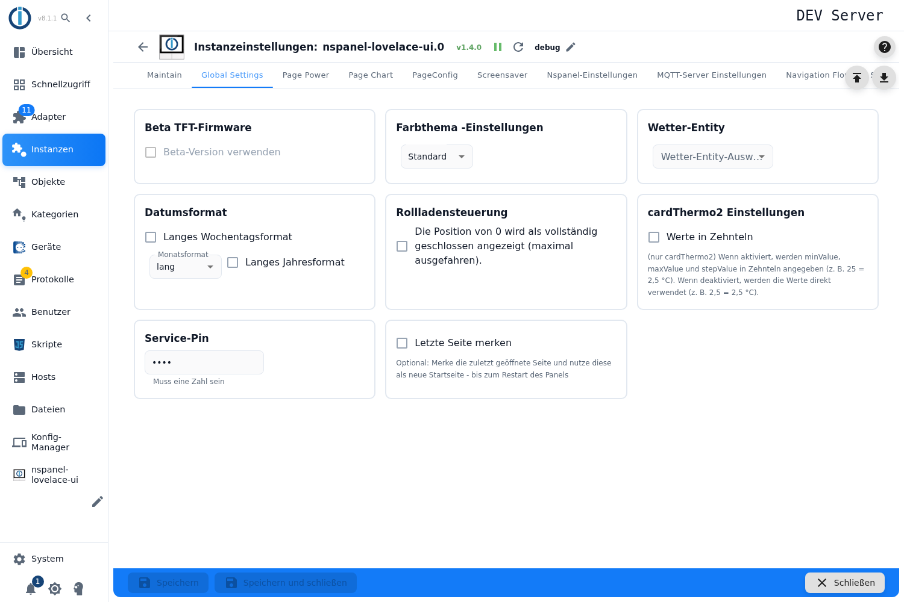

# Global settings

These settings apply to **all panels of the instance** together — unlike the page and screensaver configuration, which is made per panel.

| Setting | Effect |
|---|---|
| **Beta TFT firmware → use the beta version** | *TFT UPDATE* in the [maintain](Maintain) tab then installs the beta instead of the stable firmware. Only usable in **expert mode**, and the box turns red while the tick is set — a deliberate warning. |
| **Colour theme** | Colour scheme of the panel: standard, tropical, technical, sunset, volcano or your own colours. With your own colours an additional tab appears in which every colour is set individually ([colour themes](colorTheme)). |
| **Weather entity** | The adapter instance the weather data comes from. The supported weather adapters are offered — brightsky, OpenWeatherMap, Pirate Weather and AccuWeather. |
| **Date format** | **Long weekday format** spells the weekday out, **month format** chooses between spelled out, abbreviated and numeric, **long year format** shows four digits instead of two. |
| **Shutter control** | Defines whether position 0 means *fully closed*. This convention differs between manufacturers — here it is switched for all shutter items. |
| **cardThermo2 → values in tenths** | Only affects `cardThermo2`: are minimum, maximum and step given in tenths (25 = 2.5 °C) or directly (2.5 = 2.5 °C). |
| **Service PIN** | Numeric PIN for the panel's service pages. Stored encrypted. |
| **Remember last page** | The panel remembers the page last opened and uses it as its start page — until the panel restarts. |

## Notes

- **Saving restarts the instance**, and that affects all panels at once.
- The fields are disabled while the instance is not running.
- The weather source has to exist as its own adapter instance; the field does not accept free input.
