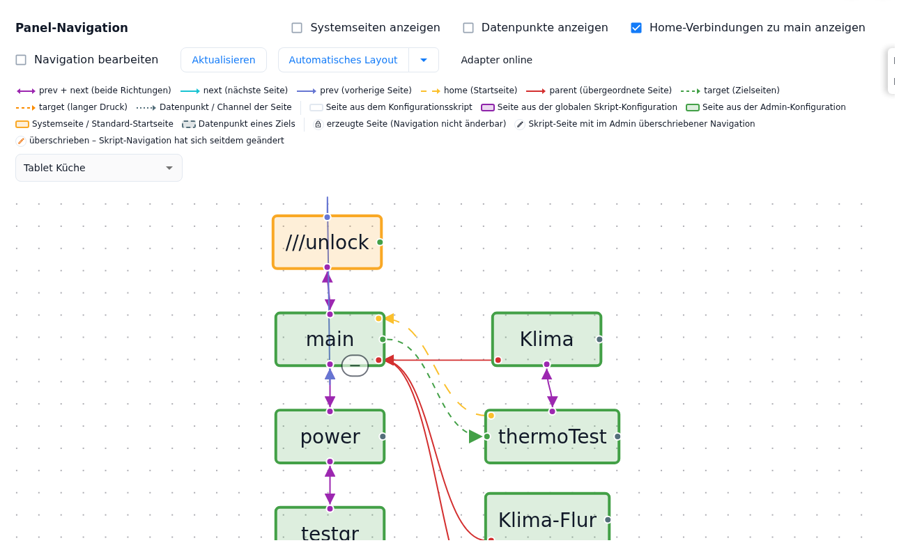
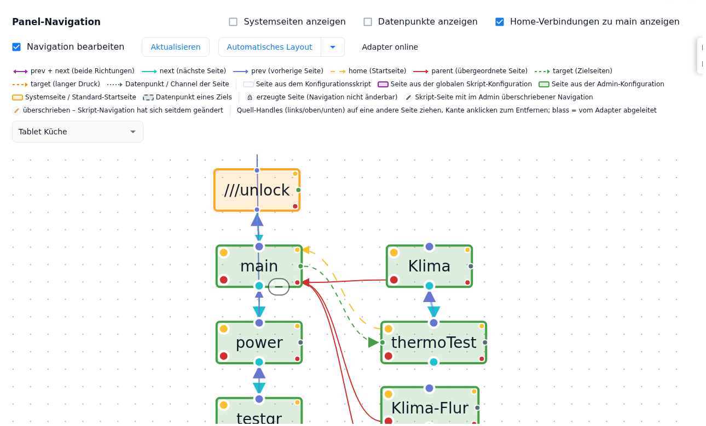
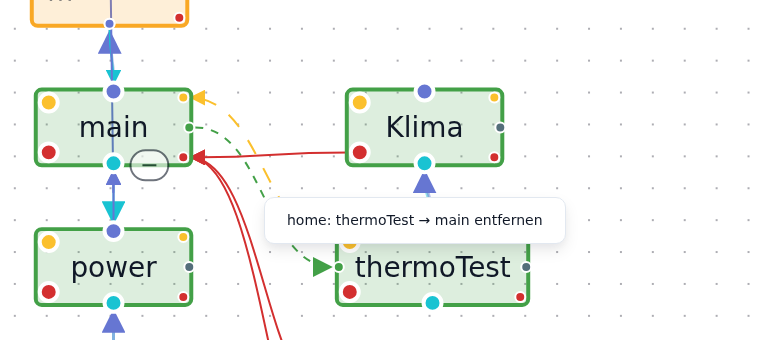
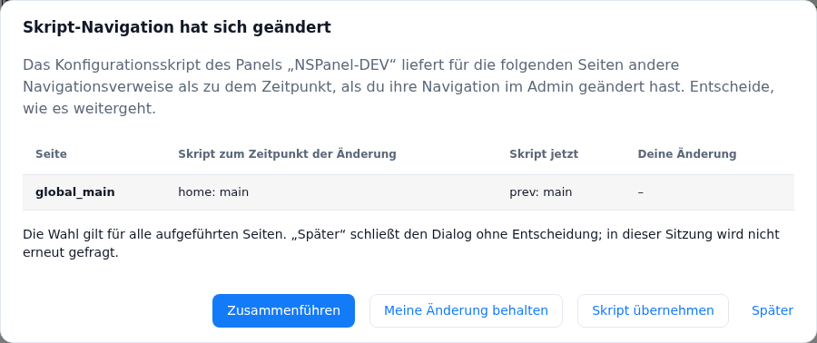

# Navigation Flow

This tab draws the **navigation of a panel as a graph**: every page is a **node**, every connection between two pages a **line**. It shows at a glance whether the pages hang together as intended, and where each page comes from. Since 2.0.0 the tab is also an **editor**: with the tick box *Edit navigation*, `prev`, `next`, `home` and `parent` are dragged in the graph instead of being filled in field by field in the tab [PageConfig](PageConfig).

Contents:
- [What the tab shows](#1-what-the-tab-shows)
- [Header: filters and buttons](#2-header-filters-and-buttons)
- [Reading the legend](#3-reading-the-legend)
- [Arranging and collapsing](#4-arranging-and-collapsing)
- [Page details on the right](#5-page-details-on-the-right)
- [Editing the navigation](#6-editing-the-navigation)
- [Scope for pages assigned to all panels](#7-scope-for-pages-assigned-to-all-panels)
- [Overriding script pages](#8-overriding-script-pages)
- [Saving and restart](#9-saving-and-restart)
- [Pitfalls](#pitfalls)

## 1. What the tab shows

The graph shows **what the adapter really built at its last start** — not the content of the form. Per panel it shows:

- **Pages** as nodes, with the name the page is addressed with in the navigation (the start page always as `main`).
- **Navigation links** as coloured lines: `prev`, `next`, `home`, `parent`.
- **Target pages** of page items: a short press on a page item leads to one page, a long press to a second one. A target reachable both ways is drawn only once (as a short press).
- The node **Screensaver**, as soon as a link or a page item calls up the screensaver at once (see [showing the screensaver at once](screensaver#15-showing-the-screensaver-at-once)). It is a system page without navigation of its own, carries the lock and stays visible even without the tick box *Show system pages*.
- **States and channels** a page works with — as nodes of their own if wanted. A navigation target that is read from a state gets such a node too: where it leads is only decided at runtime, but where it comes from is visible.

The tab needs a **running instance**. At the top right it says **Adapter online** or **Adapter offline**; if the adapter does not answer within three seconds, "No data - Adapter might be offline or no panel configured." appears instead of the graph.

## 2. Header: filters and buttons

| Control | Effect |
|---|---|
| **Panel selection** (below the legend) | Chooses the panel whose navigation is shown. The browser remembers the choice and restores it on the next visit. |
| **Show system pages** | Shows or hides the internal pages (`///…`). The unlock page `///unlock` always stays visible. Pages that turn up when it is switched on are placed around the nodes that already stand. |
| **Show states** | Shows the state and channel nodes. They stand in an outer column on the right at the height of their page and move no page. |
| **Show home links to main** | Switched off, the `home` lines pointing at `main` disappear — in large configurations almost every page has one and they cover everything else. They stay visible on the page just clicked and on pages with unsaved changes. The state is remembered **per panel**. |
| **Edit navigation** | Switches the edit mode on, see [section 6](#6-editing-the-navigation). The tick box stays disabled as long as there is no navigation data or the panel reports no topic. |
| **Refresh** | Fetches the navigation data from the adapter again. Changes to links that are not saved yet are kept. |
| **Auto layout** (main button) | Places **only nodes without a saved position**, next to the page that leads to them. All other nodes stay where they are. If there is nothing to place, a message says "All nodes already have a position". |
| **▾ next to the button** | Menu with *Place nodes without a position* (the same as the main button) and *Rearrange everything…*. |
| **Rearrange everything…** | Rearranges **every visible node** (a tree starting at the main page, with many pages in several bands next to each other). ⚠️ This overwrites all positions set by hand — so the admin asks first ("Reorder navigation?", *Cancel — keep order* / *Reorder — apply layout*). |

The three display tick boxes are **display filters only** and change nothing in the configuration.

On tablets and phones a note next to the panel selection points out that buttons from other flows need a **double tap**.

## 3. Reading the legend

The **colour of a line** says how two pages are linked:

| Line | Meaning |
|---|---|
| violet, arrow at both ends | `prev` **and** `next` — the connection holds in both directions |
| turquoise | `next` (next page) |
| blue-violet | `prev` (previous page) |
| yellow, dashed | `home` (jump to the start page) |
| red | `parent` (parent page) |
| green, dashed | target page of a page item (short press) |
| orange, dashed | target page on a long press |
| blue-grey, thin dotted | state or channel the page uses |

The **border of a node** says where the page comes from: without colour from the configuration script of the panel, violet from the global script configuration, **green from the admin configuration**, yellow a system page or the default start page, blue-grey dashed a state node (not a page).

On top of that there are three **marks on a node**:

| Mark | Meaning |
|---|---|
| **Lock** | Page generated by the adapter from a page item (a popup, for example). Its navigation cannot be changed. |
| **Pencil** | Script page whose navigation is overridden in the admin (see [section 8](#8-overriding-script-pages)). |
| **Pencil in the warning colour** | The same page, but the script now delivers other links than it did at the time of the change. |
| **Dashed outer border with a dot** | The links of this page were changed and are not saved yet. |

The origin answers the frequent question "why does the panel look different from what the script describes". **With an equal name the admin page does not automatically win**, though: a script page of the same panel keeps its name as long as the admin page is not the start page, the instance option for precedence is not set and the page pushed aside does not come from the global script or from the script of another panel — otherwise the adapter logs "Page with name … already exists, skipping!" and the admin page is dropped. The rule with all its exceptions is on [Pages](Pages).

## 4. Arranging and collapsing

- **Moving nodes:** The arrangement can be dragged freely. It is saved automatically in the background (timer, panel change, leaving the tab) — there is no button of its own for it. A node moved by hand keeps its position permanently.
- **Collapsing and expanding a subtree:** Pages with sub pages carry a small button at the bottom right. Collapsed it shows **+N** with the number of hidden pages, expanded a minus; expanded it only becomes clearly visible when the page is hovered. The collapsed state is remembered **per panel** in the browser. Without a remembered state the subtree of the **service pages below `///unlock`** is collapsed — which only becomes visible with the tick box *Show system pages*.
- **Lines into a collapsed subtree** are redirected to the collapsed page and drawn pale dotted. They are display only: no menu, not movable.
- Pages in a collapsed subtree get **no position**; they are sorted in next to the standing nodes only when the subtree is expanded.

## 5. Page details on the right

A **click on a node** opens a panel on the right and highlights all lines of that page. For a page it holds the name, the headline (as long as it is a fixed one and not read from a state), the card type, the screensaver behaviour, the paging settings and the number of page items. If the page belongs to the admin configuration, the button **Open page configuration** leads straight into the tab [PageConfig](PageConfig) on that page; moved nodes are saved beforehand.

A **state or channel node** shows *State info* or *Channel info* instead: the id, the headlines, in which role and with which item type the page uses it, whether the value is shown instead of the icon, and the icons — if an icon itself comes from a state, the panel shows the **current value** together with the note which state it comes from. A click on the free area closes the panel.

## 6. Editing the navigation

The tick box **Edit navigation** turns the graph into an editor.

**What changes in the picture.** Every editable page shows four enlarged **source handles**, and every page additionally shows the four target handles so that a connection can be dropped on it. Two-way `prev`/`next` connections are **no longer drawn as one violet double-arrow line** in edit mode, but as two separate lines: here every line stands for exactly one entry of the configuration.

**Setting a link.** Drag the source handle onto the target page. Which handle is dragged decides the link:

| Handle on the node | Link |
|---|---|
| top centre | `prev` |
| bottom centre | `next` |
| top left | `home` |
| bottom left | `parent` |

Dropping also works on the **area** of the target node — nobody has to hit the small handle. A page cannot link to itself. The end of an existing, editable line can be dragged to another page; dragged into empty space, the line stays as it was.

**Removing a link.** A **click on the line** opens a menu at the pointer position. It lists **all** links between the two pages in both directions — `a.next = b` and `b.prev = a` lie on top of each other. Every entry that stands in the configuration can be removed (*Remove prev: a → b*).

**Three cases in which nothing works:**

- **Generated pages** (lock) have no source handles. Their navigation is determined by the page item they came from.
- **System pages** and state nodes are not editable pages; they may only be the **target** of a line.
- **Derived links** are drawn pale and thinner and are greyed out in the menu: "Derived by the adapter (default home or chaining) - cannot be removed". This concerns the automatic `home` of a page without any link of its own and the counterparts the adapter sets itself when chaining the admin pages.

If, according to the **current, not yet saved** configuration, the page is not assigned to the chosen panel at all, the warning "This page is not assigned to this panel in the current configuration - check the assignment in the page configuration tab" appears at the bottom. The graph then still shows the page from the last adapter start.

**Where the change is written:** for an admin page into its panel assignment (the same place the tab [PageConfig](PageConfig#panel-assignment-and-navigation) edits with four select fields) — so the two ways are interchangeable. For a script page into a list of overrides of its own, see [section 8](#8-overriding-script-pages).

## 7. Scope for pages assigned to all panels

If an admin page takes its navigation from the assignment **(all)**, there is no row of its own for the panel shown that the change would fit into. The admin therefore asks ("Page is assigned to all panels"):

- **Change for all panels** — the change lands in the row *(all)* and holds everywhere.
- **Only for this panel (…)** — a **panel-specific assignment** is created that takes precedence over *(all)* from then on. It starts as a copy of the links from *(all)* so that the other links of the page are kept on this panel.
- **Cancel** — nothing is written.

The choice is remembered per page and panel for the session; the next link of the same page is written without asking.

> On a chart or power page taken over from the old admin tables that still takes its navigation from the script, this ends with the first link set here: from then on the navigation from the admin holds. See [Migration](Migration).

## 8. Overriding script pages

Pages from the configuration script (the panel's own or the global one) can be relinked here too. The **script stays untouched**: the change is stored as an *override* in the instance configuration and laid over the script navigation by the adapter at every start — so it also survives sending the script again. Such pages carry a **pencil** in the graph.

Every override additionally remembers which links the script delivered **at the time of the change**. If it now delivers others, the override counts as stale: the pencil turns to the warning colour, and when the panel is loaded or changed the admin asks ("Script navigation changed"). The dialog compares three columns per page — *Script at the time of the change*, *Script now*, *Your change* — and offers four ways that hold **jointly for all pages listed**:

| Button | Effect |
|---|---|
| **Merge** | Links that were changed by hand stay; all others follow the script. |
| **Keep my change** | The links stay unchanged; the new script state is only remembered as the new basis (the warning disappears). |
| **Take over the script** | The override is dropped, the page follows the script again. On a panel with the tick box *Panel uses no script* ([NSPanelsetting](NSPanelsetting)) this button is not offered. |
| **Later** | Closes the dialog without a decision. It is not asked again in this session. |

An override can also be taken back one by one: the menu of a line holds *Restore script navigation of "…"* for that.

A stale override is applied nevertheless — so the panel runs with what was set here until the question is decided.

## 9. Saving and restart

Two things are saved separately:

- **The arrangement of the nodes** belongs to the panel, not to the instance configuration. It is saved automatically: about every ten seconds, when the panel is changed, when another tab is opened and when the page is left. The adapter has to run for that; if it is offline, nothing is saved.
- **Changed links** stand in the form of the admin and only take effect with **Save**. While they are open, the pages concerned carry the dashed border and the note "Changes are applied with 'Save', the adapter restarts then; the final chaining of prev/next is computed by the adapter." stands at the top.

After saving, the adapter restarts. The tab notices this itself, shows "Adapter is restarting, the view will be refreshed …" and reads the navigation again after three seconds, then every two seconds for at most one minute. The old view stays in the meantime. As soon as the new data reflects a change, the page loses its mark; if marks are left over, another read attempt follows automatically.

**What the adapter still changes while building** — whoever does not recognise the lines afterwards finds the reason here:

- A page without any link of its own (and that is not the start page) gets `home` to the start page — an emergency exit, not navigation.
- `home` or `parent` pointing at the page itself are dropped.
- The own `prev`, `next`, `home` and `parent` of the **start page** are ignored: its neighbours come from the pages whose `prev`/`next` points at it. The same holds for a page that is simply named `main` — then with a warning in the log.
- `prev`/`next` of the **admin pages** are computed into a chain: pages sharing the same `prev` hang one after another in the order of the page list. An **explicit `next`** is not overwritten by the chain — if the `next` page is part of the group it comes first behind the page, otherwise the own link stays and the group only hangs on by its `prev`. The preview in the graph only approximates it; the final picture is only there after the restart.
- A link to a page the panel does not have is dropped (the adapter warns in the log).

## Pitfalls

- **"Auto layout" does not rearrange everything.** The main button places only nodes without a saved position; if all of them stand, only the message "All nodes already have a position" appears. Only *Rearrange everything…* in the menu next to it tidies up the whole graph — with a confirmation, because all positions set by hand are lost. Nodes in **collapsed** subtrees are left out and are placed only when the subtree is expanded.
- **The tick box *Edit navigation* is grey.** Then either there is no navigation data, or the chosen panel reports no topic (panel not in the panel table of the instance). Without a topic there is no assignment a change could be written into.
- **A pale line cannot be deleted.** It does not stand in the configuration but is derived by the adapter. Removing it would create it again at once — which is why the menu entry is greyed out.
- **A page looks orphaned after switching *Show home links to main* off.** The filter only hides the line, not the link.
- **The override of a script page comes to nothing when an admin page replaces the same page.** The adapter then takes the navigation node out again and logs a warning ("page is replaced by the admin configuration"). Overrides for generated pages and for pages whose navigation node is named differently in the script than the page are equally without effect. If the script no longer delivers the page at all, the override stays and waits (log entry on info level).
- **Changing the tab makes changed links invisible.** Leave the tab and come back and the view is rebuilt: the dashed border and the line drawn ahead are gone, the graph shows the state of the last adapter start again. **The change is still in the form** nevertheless and is applied with *Save*. Whoever really wants to drop it has to leave the instance settings without saving.
- **Links of the start page can be set here but have no effect.** In the tab [PageConfig](PageConfig#panel-assignment-and-navigation) the four navigation fields of a page flagged as the start page are locked; in the edit mode of the flow they are not. A link drawn here is stored, but when building the adapter **discards the own links of the start page** entirely (log entry on debug level) — after the next start the old connection is back. To change the neighbourhood of the start page, edit the **neighbouring page** and point its `prev`/`next` at the start page.
- **The question about a stale override comes only once per session.** Whoever chooses *Later* does not see the dialog again until the admin page is reloaded; the warning colour on the pencil stays, though.
- **On tablets and phones** buttons from other flows need a **double tap**.
