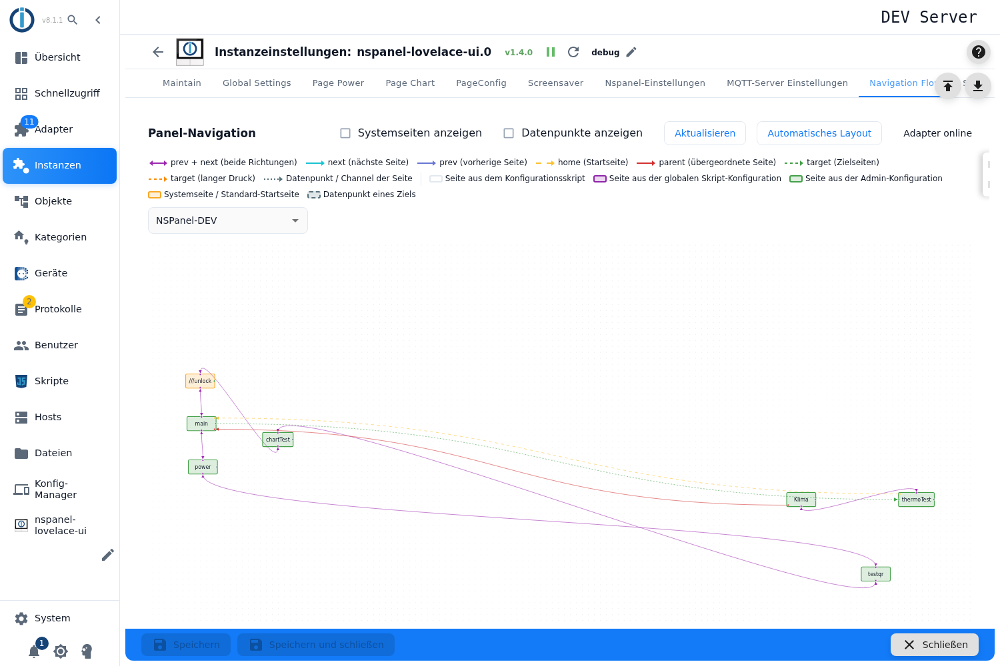

# Navigation flow

This tab draws the **navigation of a panel as a graph**: every page is a node, every connection between two pages an edge. It shows at a glance whether the pages hang together as intended — and where each page comes from.

## Controls

| Control | Effect |
|---|---|
| **Panel selection** | Chooses whose navigation is shown. The browser remembers the choice. |
| **Show system pages** | Shows or hides the internal pages (`///…`). The unlock page `///unlock` always stays visible. |
| **Show states** | Additionally shows the states a page uses as a target. |
| **Refresh** | Fetches the navigation data from the adapter again. |
| **Automatic layout** | Rearranges all nodes (a tree starting at the main page). ⚠️ This overwrites the positions you set yourself, so the admin asks first. |
| **Dragging nodes** | The arrangement can be dragged freely. It is saved automatically in the background; there is no separate button. |
| **Clicking a node** | Opens the details of that page on the right — name, headline, states in use. If the page belongs to the admin configuration, a button leads straight to its page configuration. |

## Reading the legend

The **colour of an edge** says how two pages are linked: both ways (prev + next), forward only, backward only, jump to the start page, to the parent page, to a target page, on long press — and as a thin line the states of a page.

The **border of a node** says where the page comes from: the configuration script, the global script configuration, the **admin configuration**, a system page, or a state of a target. That distinction answers the frequent question "why does the panel look different from what the script says" — an admin page replaces the script page of the same name.

## Notes

- If the top right says **adapter offline**, or "no data" appears, the instance is not running or no panel is configured.
- The two tick boxes (system pages, states) are display filters only and change nothing in the configuration.
- On tablets and phones, buttons from other flows need a **double tap**.
