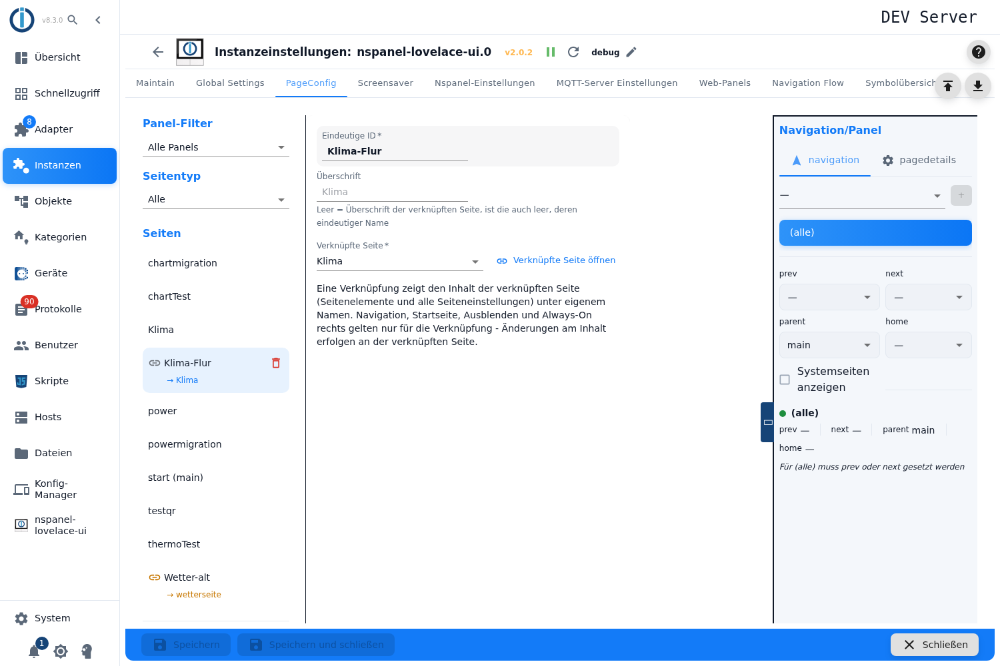
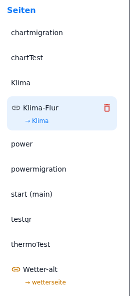
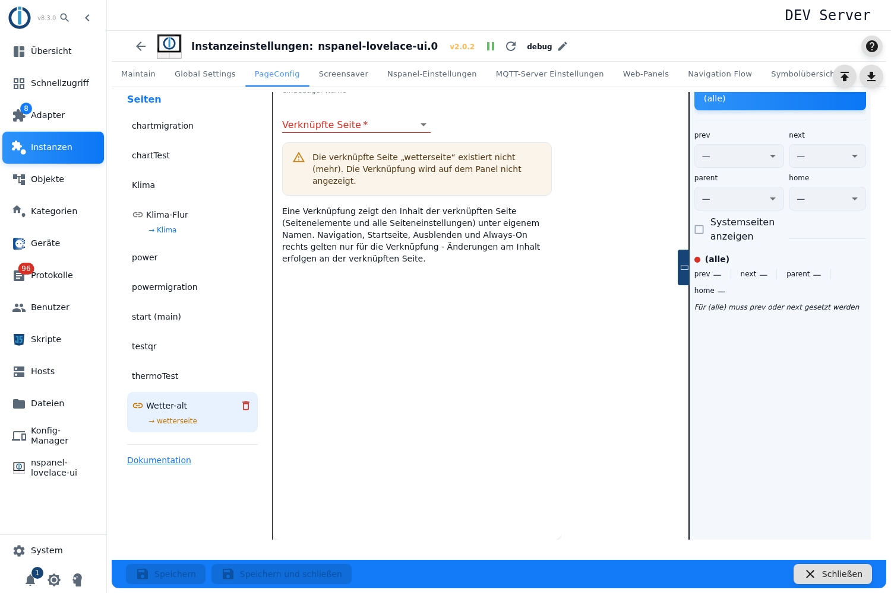

# Page link – configuration in the admin

A **page link** shows the content of another admin page under its own name, its own headline and its own navigation. It is created in the tab **PageConfig**, page type **Page link**.

This page type exists **in the admin only**. There is no way through the configuration script: the adapter resolves the link before the pages are built, and at page build time it does not know this card type at all.

Contents:
- [What this page type is for](#1-what-this-page-type-is-for)
- [Creating a page link](#2-creating-a-page-link)
- [The fields of the page link](#3-the-fields-of-the-page-link)
- [The page link in the page list](#4-the-page-link-in-the-page-list)
- [What the panel sees](#5-what-the-panel-sees)
- [Panel assignment and navigation](#6-panel-assignment-and-navigation)
- [The two error cases](#7-the-two-error-cases)
- [Pitfalls](#pitfalls)

## 1. What this page type is for

The same page is to appear at **several places of the navigation** — the weather page once behind the start page of the living room panel and once in the paging chain of the hallway panel, the garage overview as a normal page on one panel and as the start page on the other. Without a page link the page would have to be created a second time and maintained twice on every change; and a page cannot be duplicated in the tab **PageConfig** either.

The page link solves that: the content stays maintained **once** — on the linked page —, the link only brings its own ID, its own headline and its own place in the navigation. The hint below the editor says the same in one sentence:

> A link shows the content of the linked page (page items and all page settings) under its own name. Navigation, start page, hidden and always on on the right only apply to the link - changes to the content are made on the linked page.

Every page type can be linked — [pageMenu](pageMenu), [cardAlarm](cardAlarm), [cardQR](cardQR), [cardPower](cardPower), [cardChart](cardChart), [cardTrash](cardTrash), [cardThermo2](cardThermo2), [cardThermo](cardThermo) and [cardMedia](cardMedia). Only the [screensaver](screensaver) is not a page of this list and is therefore out of the question as a target.

## 2. Creating a page link

1. Open the instance settings → tab **PageConfig**.
2. On the left choose the page type **Page link**, enter a name in the field **New Page**, press **+**.
3. The link appears in the list **Pages**; its editor opens on the right with three fields.

As with every page the name is the **unique ID** under which the panel knows this page — other pages address it by that name in their navigation targets. `main` is reserved and is rejected, so is a name already in use.

A new page link has **no target** yet; until one is chosen the selection field carries the hint *Select the page whose content this link shows.*

As with all page types: the fields can only be used while the **instance is running**.

## 3. The fields of the page link

| Field | Meaning |
|---|---|
| **Unique ID** | The name of the link and therefore the name under which this page sits on the panel. Locked while the link is marked as the start page. |
| **Headline** | The header line on the panel. **Empty** takes over the headline of the linked page — the help text reads *Empty = headline of the linked page, if that is empty too its unique name*. The field shows the inherited headline as a pale placeholder as long as nothing is entered. |
| **Linked page** | The target: the page whose content is shown. The list contains all pages of the configuration **except other page links** and except the link itself, sorted alphabetically by ID; the start page carries the addition `(main)`. |
| **Open linked page** | Button next to the selection field: jumps to the linked page in the list to edit its content. It only appears once a valid target is set. |

The page link has no more fields than that — everything else sits either on the linked page or on the right in the column **Navigation/Panel**.

## 4. The page link in the page list

In the list **Pages** a page link can be recognised by two things:

- A **chain symbol** in front of the name. It turns **yellow** when the target cannot be resolved.
- Below it a small line **→ target name**. A click on it selects the linked page; if that page lies outside the panel filter in use, the filter is reset to all panels for it. With a broken target the line is yellow and not clickable.

The page type **Page link** in the selection field above additionally filters the list down to all page links.

## 5. What the panel sees

Important for the understanding: **the panel never gets a page link.** When the instance starts, the adapter replaces every link with an **independent copy of the linked page**, even before the pages are built. Everything that happens afterwards — page build, navigation, log entries — refers to that copy and calls it by the name of the link.

Where the copy takes its data from:

| Data | Source |
|---|---|
| Unique ID | **page link** |
| Headline | **page link**, empty: the one of the linked page, empty: its unique ID |
| Panel assignment and navigation targets (*next*, *prev*, *home*, *parent*) | **page link** |
| **Start page (main)** | **page link** |
| **Hidden** | **page link** |
| **Screensaver behavior** | **page link** |
| Card type, page items, all remaining fields of the card | **linked page** |

The copy is a real copy: the linked page stays untouched, and both pages appear on the panel separately and as equals. That is exactly why the same overview can be the start page on one panel and an ordinary page in the paging chain on another.

> With a linked **[cardChart](cardChart)** or **[cardPower](cardPower)** page that still takes its navigation from an old script table (see [Migration](Migration)), the adapter resets that origin in the copy: the link navigates exclusively through the targets entered on it on the right. Without those entries it can only be reached through a button with a `navigate` command.

## 6. Panel assignment and navigation

Panel, navigation targets, **Start page (main)**, **Hidden** and **Screensaver behavior** sit in the right column as with every page type and are described under [PageConfig – overview](PageConfig). For page links the following applies there in addition:

- A page link **without a panel assignment** is not built — the panel filter *Not assigned* finds it again.
- As a rule, the link and the linked page should **not both** be assigned to the **same panel**: the panel would then carry the same content twice, under two names. That only makes sense if the second version is deliberately placed differently, hidden or as the start page for example.
- For the start page mark the usual rules apply: only one per panel, and a panel has to be assigned.

## 7. The two error cases

**The target is missing.** No target chosen, or the linked page has been deleted in the meantime. The editor shows the warning *The linked page "…" does not exist (anymore). The link is not shown on the panel.*, the selection field is red, the chain symbol in the list yellow. The adapter skips the link when building the pages and writes a warning into the log (`target page '…' does not exist - skipping!`).

**The page link points at a page link.** Chains are not foreseen; here too the link is skipped and logged (`links of links are not supported - skipping!`). This case cannot be produced through the selection field — it offers no page links. It can arise nevertheless when the linked page is deleted and later a **page link with the same name** is created. The way out is always the same: choose the page that really carries the content as the target.

In both cases the same applies: the page is missing on the panel **entirely** — navigation targets of other pages that point at the link then lead nowhere.

## Pitfalls

> ⚠️ **Deleting the linked page does not clean up the page link.** It stays in place with its old target and is broken from then on. Before deleting a page it is worth a look at the list whether a line **→ name** points at it.

> **Renaming the linked page, on the other hand, is followed through:** the admin enters the new name in all page links that point at this page. If the **link itself** is renamed, the general rule from [PageConfig](PageConfig) applies: *next*, *prev*, *home*, *parent* and `navigate` commands of other pages keep the old name and have to be adjusted.

> **The content cannot be changed on the page link.** Whoever wants to adjust something on the panel has to do it on the linked page — and the change then appears on **all** links of that page. The button **Open linked page** is the short way there.

> **An empty headline is not an error.** It is the normal state of a fresh page link and means „take over the headline of the linked page". Only an entry makes the header line on the panel independent.

> **This page type does not exist in the configuration script.** A page link is a matter of the admin only; it can point at a page the admin manages, not at a page coming from a script.

> **After saving, the instance restarts.** Only then is the link resolved and the copy built — log warnings about broken links therefore appear on start, not on saving.
