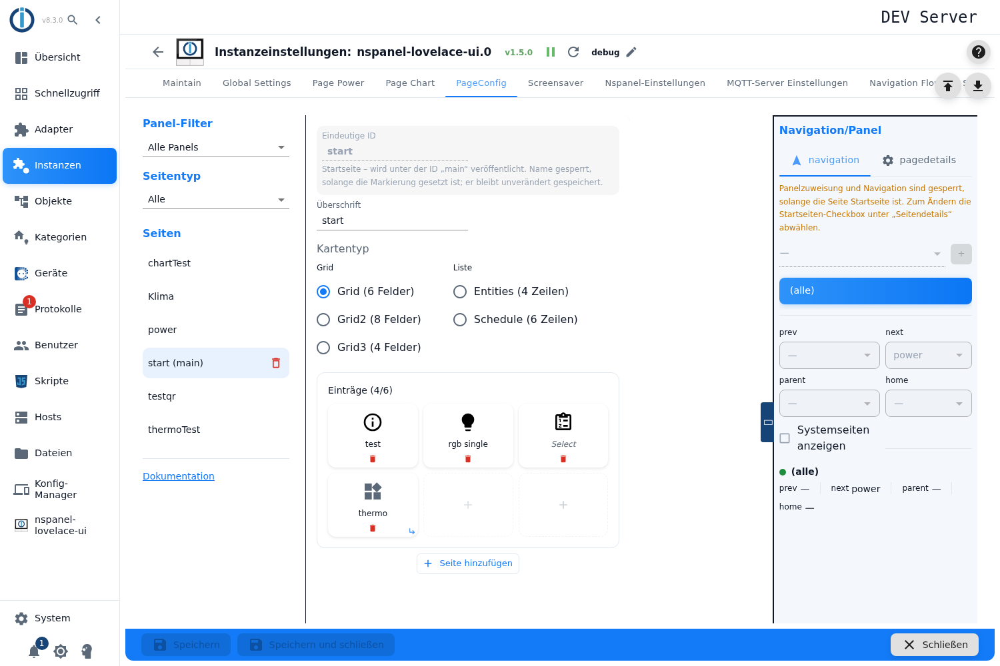
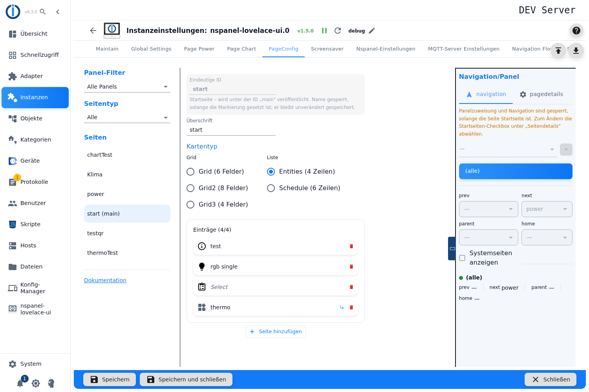
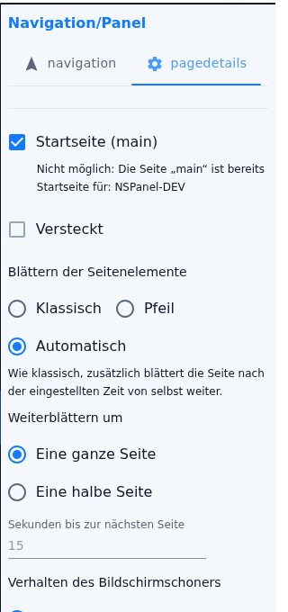

# Menu pages – configuration in the admin

The menu page is the workhorse card type: a page of **tiles** that switch devices, show values or jump to other pages. Five variants sit behind it — three grids and two lists. You create it in the **PageConfig** tab, page type **Menu page**.

Contents:
- [Creating the page](#1-creating-the-page)
- [The five variants](#2-the-five-variants)
- [Filling the tiles](#3-filling-the-tiles)
- [Rearranging tiles](#4-rearranging-tiles)
- [Copying and pasting tiles](#5-copying-and-pasting-tiles)
- [More entries: further pages](#6-more-entries-further-pages)
- [Paging of the page items](#7-paging-of-the-page-items)
- [What the tiles show](#8-what-the-tiles-show)
- [Panel assignment and navigation](#9-panel-assignment-and-navigation)
- [What changed with 2.0.0 to 2.0.2](#10-what-changed-with-200-to-202)
- [Pitfalls](#pitfalls)

## 1. Creating the page

1. Open the instance settings → tab **PageConfig**.
2. On the left pick the page type **Menu page**, enter a name, press **+**.
3. The page is created as **Grid (6 slots)** — you switch the variant afterwards in the editor.

**Headline** is the header line on the panel; left empty, the panel uses the page name.

> The **Unique ID** field is **read-only**: the name of a page is fixed once it exists, and the note below says so ("The name is fixed once the page exists - other pages refer to it."). If the page is the start page, its own notice stands there instead ("Start page - published under the id „main""); the start page is set through the **Start page (main)** mark in the page details, not through the name. Why the name is fixed, and how a page can still end up with another name, is explained under [PageConfig – Overview](PageConfig#creating-and-deleting-pages).

## 2. The five variants

Under **Card type** they sit in two groups:

| Group | Variant | Slots per page | Presentation |
|---|---|---|---|
| **Grid** | Grid (6 slots) | 6 | tiles, three columns |
| | Grid2 (8 slots) | 8, on a **us-p** panel **9** | tiles, four columns (us-p: three) |
| | Grid3 (4 slots) | 4 | tiles, two columns |
| **List** | Entities (4 rows) | 4, on a **us-p** panel **5** | rows, one column |
| | Schedule (6 rows) | 6 | rows, schedule presentation |

**Grids** show large tiles with an icon, **lists** show narrow rows — for many values at once.

> Technically these are **two separate selection groups**. Picking a list only clears the mark among the grids because the other group then has no valid value. It looks like one selection but behaves like two.

**Switching the variant keeps every tile** — even when the new variant has fewer slots. Nothing is deleted and no warning is given: the surplus tiles move onto a second page (see [section 6](#6-more-entries-further-pages)).

**Grid2 and the panel model:** the variant is only available when all assigned panels are of the same model. With mixed models it is disabled, and a Grid2 already set is **reset to Grid automatically** — the notice "cardGrid2 is disabled: the assigned panels have different models …" explains that while the conflict lasts. If all assigned panels are us-p, the entry reads **Grid2 (9 slots – us-p)** and the editor draws nine tiles in three columns. Without a panel assignment the editor assumes 8 slots.

> **With *Entities* the editor swallows one row on a us-p panel.** It always assumes four rows, but the panel shows **five** there. The fifth is only reachable in the editor through an extra page and paging. For Grid2 the model dependency is built in, for Entities it is not.

## 3. Filling the tiles

A click on a **dashed, empty tile** opens the [pageitem configuration](PageConfig-Dialoge#1-pageitem-configuration) — the same dialog the thermostat and the media page use as well. That is where you decide whether the tile operates a **device**, jumps to **another page** or switches a **single state**.

A click on an **occupied** tile opens it for editing. The **red bin icon** in the tile clears it again — **without a confirmation and without undo**.

Above the grid sits **Items (*filled* / *slots in total*)**.

Which fields of the dialog a menu page offers in addition depends on the variant:

| Setting | On which variant | Effect |
|---|---|---|
| **Text Size** | Grid, Grid2, Grid3 only | Nextion font 0–5 instead of the default size: `0 – 24 px (text only)`, `1 – 32 px`, `2 – 32 px (text only)`, `3 – 48 px`, `4 – 80 px bold`, `5 – 128 px bold (ASCII only)`. While the tile shows an **icon**, only the fonts **1, 3 and 4** can be chosen — the others contain no icons. Another value already stored stays in the list and is flagged with "This font has no icons - the icon stays empty on the panel". |
| **Use Value Instead of Icon** | Grid, Grid2, Grid3 only | The tile shows the value as text. Then all six fonts can be chosen; with font 5 the dialog points out "ASCII only - no °, umlauts or other special characters". |
| **Long press** | Grid, Grid2, Grid3 only | A second function on the same tile — either switch a state **or** jump to a page. Only for navigation tiles, the user-defined button and states with `role=button`; an item with a popup would collide with the long press. |
| **Prefix** and **Suffix** of the value (gear icon on the channel ID) | Entities, Schedule only | The adapter puts them before and after the value on the list cards only. On a grid variant both entries have no effect. |

The long press is not missing on **Entities** and **Schedule** out of negligence: only the tiles of the three grid variants report a `buttonPress3` at the HMI; the rows of the lists always report a short press.

A tile the dialog cannot represent takes the raw item through **Enter the item as raw data (JSON)**. In the grid it is then called **Raw data: …**; the fields of the dialog are no longer used for it.

> A gap in the middle of the row is allowed: click an empty tile further back and the item lands exactly there, the tiles before it stay empty. On the panel **those gaps still take up their place** — the adapter fills them with empty items. Only gaps **at the end** are dropped.

## 4. Rearranging tiles

Occupied tiles can be **picked up with the mouse and dragged onto another tile**. That works across page boundaries too, and in the list view just as in the grid.

> **Dragging swaps, it does not move.** Drag tile 1 onto tile 5 and the item from 5 then sits in place 1 — the tiles in between do **not** shift up. So rebuilding an order means swapping step by step. The interface says nothing about this.

Dragging needs a pointing device; it is not available on a touch device.

## 5. Copying and pasting tiles

A fully configured tile can be transferred instead of entered again — with a row of similar lamps that is where most of the work is saved.

1. **Right-click** the occupied tile → **Copy item**.
2. **Right-click** the target tile → **Paste item**.

This also works **from one menu page into another**: switch page, right-click, paste.

What you need to know:

- On an **empty** tile the menu opens **only** when something has been copied before. On an occupied tile both entries appear, with *Paste item* greyed out while the clipboard is empty.
- **There is no display of the clipboard.** The only sign that something is in it is that the menu opens on empty tiles.
- **The clipboard belongs to the menu editor.** It survives switching to another **menu** page, but **not** a detour via a page of a different type (thermostat, QR, alarm …) — then it is gone. Reloading the interface clears it as well.
- **Pasting onto an occupied tile overwrites it without asking.** There is no undo.
- **Pasting further back fills the gaps before it with empty tiles** — and those take up their place on the panel.
- **No long press:** without a right-click, copying and pasting are **unreachable**, so they cannot be used on a tablet or phone. There are no keyboard shortcuts like Ctrl+C either.
- **The card type is not checked when pasting.** A tile copied on a grid carries its grid settings (Text Size, *Use Value Instead of Icon*, long press) onto an Entities or Schedule row, where they have no effect.

## 6. More entries: further pages

More entries than slots? Then **further pages** are created, and the panel pages through them.

- **Add page** creates another empty page.
- Additional pages also appear **by themselves** as soon as a tile beyond the capacity is filled.
- A separator **Page *n* / *m*** shows where you are; an empty last page can be removed again with **Remove empty page**.
- There is no upper limit on the number of entries.

> **An empty page created with "Add page" is not permanent.** It only lives in the interface: after switching the variant, changing to another page type or reloading it is gone again. Only a **filled** tile makes a page permanent.
>
> When switching to **another menu page**, however, the counter travels along: an empty extra page then appears there as well, although it was never asked for. That one is display only too and disappears on a reload.

## 7. Paging of the page items

How the panel pages through several pages is **not in the editor** but in the **right-hand column** under the page details — between **Hidden** and **Screensaver behavior**. The fields appear on **every** menu page, even while it fills a single page only, and likewise on [cardThermo2](cardThermo2) and [cardMedia](cardMedia).

The radio group **Paging of the page items** has three values; the admin writes the matching notice below it:

| Choice | Notice in the admin | Behaviour on the panel |
|---|---|---|
| **Classic** (default) | "More items than places: the double arrows of the panel page through them." | The two navigation buttons of the header line become **up/down arrows**. A **short** press pages within the page, a **long** press leaves it through the normal navigation. On the first page the left button and on the last page the right button stay the ordinary navigation. All slots can be used. |
| **Arrow** | "More items than places: the last place shows an arrow that pages on." | The **last place of every page** becomes the next-page arrow (circled arrow to the right, text "more") and is not available for an item. It only pages **forwards** and jumps from the last page back to the first. The navigation buttons of the header line keep their ordinary function. As long as all entries fit on one page, **no** arrow appears and the place is free to use. |
| **Automatic** | "Like classic, the page also advances by itself after the set time." | The window moves on by itself after the set time, as long as the page is visible and the panel is awake. Paging by hand is **not** possible then: the navigation buttons stay the ordinary navigation. |

**Scroll by** — appears only with *Classic* and *Automatic*, and only where the card can do it: **Grid, Grid2, Grid3** (and cardThermo2). On **Entities**, **Schedule** and cardMedia the field is missing.

| Choice | Effect |
|---|---|
| **Full page** (default) | The window advances by the full number of slots — page by page without overlap. |
| **Half page** | The window stays as wide as the card but advances by **half** the number of slots only: Grid by 3, Grid2 by 4, Grid3 by 2. The half that is kept stays in place while paging. The arrows of the header line are then **filled** instead of outlined. |

**Seconds until the next page** — appears only with *Automatic*. The field is empty and shows the default **15** as a placeholder; empty therefore means 15 seconds.

> The field does accept values below 2 seconds, but the adapter turns them into **3 seconds**. It cannot go lower.

Without a real panel the paging can be inspected in the [Web panel](WebPanel); tapping and holding behave like at the HMI there since 2.0.0.

## 8. What the tiles show

The label of a tile in the editor follows an order of precedence:

1. the **name** from the pageitem configuration,
2. otherwise the name of the **ioBroker channel** — then shown **grey and italic**, so you can see it was not set by you,
3. otherwise a technical note such as `3: (dimmer)` or just the slot number.

A tile with raw data carries **Raw data** plus an excerpt from the JSON instead. A small branch icon marks tiles that **jump to another page**. The tooltip shows the ioBroker ID behind it.

On the panel, unused slots stay empty. How many characters a label takes depends on the font size and the panel model and is not fixed — keep it short when in doubt and check on the panel.

## 9. Panel assignment and navigation

Panel, navigation targets, *Start page (main)*, *Hidden*, the paging settings from [section 7](#7-paging-of-the-page-items) and *Screensaver behavior* live in the right-hand column, described under [PageConfig – Overview](PageConfig#panel-assignment-and-navigation).

For menu pages the panel assignment matters twice over: it decides not only where the page appears but, through the panel model, also **how many slots** are available and whether the Grid2 variant can be chosen at all.

## 10. What changed with 2.0.0 to 2.0.2

| Version | Change to the menu cards |
|---|---|
| 2.0.0 | The **paging** can be set in the admin — the three fields from [section 7](#7-paging-of-the-page-items). Before that only a script configuration knew them. |
| 2.0.0 | The **long press** is only offered on Grid, Grid2 and Grid3 now, as at the HMI. On Entities and Schedule it never had an effect. |
| 2.0.0 | **Raw data (JSON)** for single tiles; the slot is then called "Raw data: …". |
| 2.0.0 | Button tiles (`role=button`) take a **target page**: switch and then change the page. |
| 2.0.0 | Fixed: **prefix and suffix** of the value were swapped. Anyone who entered them swapped has to swap them back. |
| 2.0.0 | Fixed: a long press also triggered the short one. |
| 2.0.0 | New icons (Material Design Icons 7.4.47); shutters show their position as an icon — that needs HMI/TFT 6.0.2. |
| 2.0.0 | An admin page assigned to a panel displaces the page of the same name from the global script. |
| 2.0.2 | The **Text Size** names the pixel size of every font; with an icon only the fonts 1, 3 and 4 can be chosen, and font 5 is marked as "ASCII only". |
| 2.0.2 | The button "…" next to the name is called **Dynamic name** and is only used while the name field is empty; it no longer offers unit and date format (they were ignored). |

## Pitfalls

> ⚠️ **With *Arrow*, editor and panel diverge as soon as it is a list.** On Entities and Schedule the editor draws **no** arrow placeholder and splits the pages into 4 or 6 rows, while the panel uses the last row for the arrow and splits into 3 or 5 rows. Nothing is lost, but the page split in the editor does not match the one on the panel. On the grid variants the editor draws the placeholder correctly — but only once there is more than one page.

> ⚠️ **Half pages cannot be seen in the editor.** The editor always splits into full pages; half-page paging is a behaviour of the panel alone. Which tile sits next to which after a press can only be judged on the panel or in the [Web panel](WebPanel).

> **"Half page" disappears with *Arrow*.** If the presentation is set to *Arrow*, the admin hides the field — the stored value is kept and takes effect again as soon as *Classic* or *Automatic* is set back. On cards that cannot do a half page, the adapter silently resets it to the full page when building the page.

> **With *Automatic* there is no manual mode.** The header line arrows navigate to the neighbouring page there, not within the page. Anyone wanting both — paging by hand *and* advancing automatically — does not get it; the notice "like classic" refers to the page split alone.

> **With *Arrow* you can only go forwards.** There is no backwards arrow in the tile; the way back is paging on until it wraps around.

> **The headline is not the page name.** Left empty, the panel takes the **Unique ID** as the header line. The ID cannot be changed later — whoever wants another header line enters a **Headline**.

> **Gaps in the middle of the filling cost space.** The adapter fills them with empty items; only gaps at the end are dropped. A page that looks "tidy" with a gap in the second row therefore has one tile fewer on the panel than the count in the editor suggests.

> **Grid2 falls back to Grid silently.** As soon as the panel assignment mixes models, the editor resets the variant by itself. The tiles are kept, but the page split changes — and with it what appears on which page on the panel.

> **Taken over from a script:** a menu page with `scrollType: half` on a card that cannot do a half page (Entities, Schedule) can **not** be taken over — the preview of the [Migration](Migration) lists it under the problems and skips it. Tiles with a long press on Entities and Schedule are taken over, their long press is dropped in the process and listed under "Long press dropped".

> **Everything the admin does not offer** is only reachable from a script through the [Migration](Migration).
