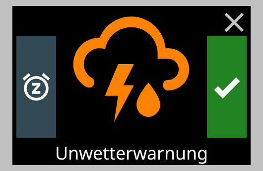
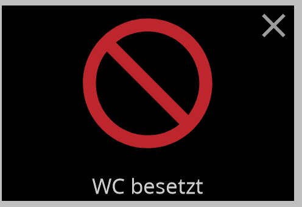
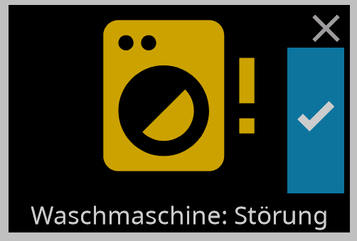
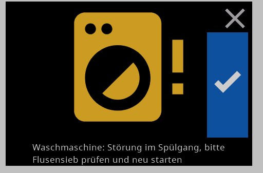

# Popups

**Two different things** are called popup in this adapter:

1. **The detail popup of a tile** — light, shutter, thermostat, timer, selection list. It opens from a page
   when you tap a tile, it belongs to that page item, and it is configured there (see
   [recurring dialogs](PageConfig-Dialoge)). The timer popup has a page of its own: [timer popup](popupTimer).
2. **The notification popup** — a page of its own that puts a message on top of everything else. That is
   what this page is about.

> **The notification popup is never created anywhere.** It is a **system page**: every panel gets two of
> them at start — one for the adapter's system messages and one for your own. The admin does not offer this
> page type, and neither does the configuration script. The page is driven **only** by **states** or by
> **`sendTo`**.

Contents:
- [Way 1: the states](#1-way-1-the-states)
- [Way 2: `sendTo`](#2-way-2-sendto)
- [The queue](#3-the-queue)
- [The three buttons, the X and the feedback states](#4-the-three-buttons-the-x-and-the-feedback-states)
- [How it looks on the panel](#5-how-it-looks-on-the-panel)
- [Big icon (from TFT 6.2.0)](#6-big-icon-from-tft-620)
- [Fonts (textSize)](#7-fonts-textsize)
- [Pitfalls](#pitfalls)

## 1. Way 1: the states

Each panel carries a set of fields under
`nspanel-lovelace-ui.<instance>.panels.<panel>.cmd.pagePopup.`. You fill them and then trigger
**`activate`** — only that button reads **all** fields and sends the message off.

| State | Type | Default | Meaning |
|---|---|---|---|
| `id` | string | empty | Name used to recognise the message again. **Empty deletes all** stored popups. |
| `global` | boolean | false | Send to every panel instead of just this one. |
| `activate` | button | — | Triggers the send. |
| `priority` | number | 50 | Smaller = further to the front. **≤ 0 deletes** the popup with this `id`, **≤ −100** every popup whose `id` starts with it. |
| `type` | string | `information` | `information` or `acknowledge`. |
| `headline` / `colorHeadline` | string / json | empty / white | Headline and its colour. |
| `text` / `colorText` | string / json | empty / white | Message text and its colour. |
| `buttonLeft` / `buttonMid` / `buttonRight` (+ `colorButton…`) | string / json | empty / white | Label and colour of the three buttons. |
| `icon` / `iconColor` | string / json | empty | Icon in front of the headline; with `largeIcon` the big icon. |
| `largeIcon` | boolean | false | Show the message with a big icon, see [Big icon](#6-big-icon-from-tft-620). |
| `buttonLeftIcon` / `buttonRightIcon` | string | empty | Only with `largeIcon`: icon on the left/right button. Left is "No / Next", right is "Yes / OK" – so the tick goes on the right. |
| `textSize` | number 0–5, 8 | 3 | Font, and with it how many lines fit, see [Fonts (textSize)](#7-fonts-textsize). `6`/`7` count as `3`. |
| `buzzer` | boolean | false | One beep when the message appears. |
| `alwaysOn` | boolean | **true** | The popup stays instead of giving way to the screensaver. |

On this path:

- **Empty fields stay empty.** The substitutes *Missing Headline* / *Missing Text* only exist on the
  `sendTo` path.
- **The buzzer can only be on or off here.** A custom Tasmota pattern can only be passed through `sendTo` —
  and it only sounds at all when `cmd.isBuzzerAllowed` is set on the panel.

## 2. Way 2: `sendTo`

From a script this is the more convenient way, because everything goes in one call:

```javascript
sendTo('nspanel-lovelace-ui.0', 'setPopupNotification', {
    id: 'test3',
    headline: 'test3',
    buttonLeft: 'next',
    buttonRight: 'oki',
    text: 'It is alive!!!'
});
```

In full, with every field the adapter evaluates:

```typescript
type PagePopupDataDetails = {
    id?: string;                 // missing → 'missing'
    priority?: number;           // missing → 50
    type?: 'information' | 'acknowledge';   // missing → 'information'
    headline: string;            // missing → 'Missing Headline'
    text: string;                // missing → 'Missing Text'
    panel?: string | string[];   // missing → to every panel
    global?: boolean;            // only false switches global off
    colorHeadline?: { r: number; g: number; b: number } | string;
    buttonLeft?: string;
    colorButtonLeft?: { r: number; g: number; b: number } | string;
    buttonMid?: string;
    colorButtonMid?: { r: number; g: number; b: number } | string;
    buttonRight?: string;
    colorButtonRight?: { r: number; g: number; b: number } | string;
    colorText?: { r: number; g: number; b: number } | string;
    textSize?: string;           // 0–5, 8
    icon?: string;
    iconColor?: { r: number; g: number; b: number } | string;
    largeIcon?: boolean;         // true → big icon (from TFT 6.2.0)
    buttonLeftIcon?: string;     // only with largeIcon: name of the icon
    buttonRightIcon?: string;    // only with largeIcon: name of the icon
    alwaysOn?: boolean;          // missing → true
    buzzer?: boolean | string;   // true or a Tasmota pattern
};

const message: PagePopupDataDetails = {
    id: 'test3',
    priority: 49,
    headline: 'test3',
    buttonLeft: 'next',
    buttonRight: 'oki',
    text: 'It is alive!!!',
    type: 'information',
};

sendTo('nspanel-lovelace-ui.0', 'setPopupNotification', message);
```

The colour fields take an `{r,g,b}` object **or** a string such as `#ff0000`. An unusable value silently
falls back to the default colour. If **no panel is online**, the adapter says so in the callback
(`{ error: 'No Panels Online' }`); a panel name that does not exist ends up as an error in the log.

## 3. The queue

Several messages live side by side and are sorted **ascending by `priority`** — the smallest number comes
first. The panel always shows the front one.

> **At most ten popups** are kept per panel; anything beyond that is dropped. Broken JSON is **discarded
> without a word** — no log entry, no reaction on the panel.

## 4. The three buttons, the X and the feedback states

The three buttons are **answer buttons**: label and colour come from `buttonLeft`, `buttonMid`,
`buttonRight` and `colorButton…`; a button without a label is not shown. **Which colour a button gets without
an entry depends on the way:** over `sendTo` a colour that is not named stays open and the defaults apply –
left **yellow**, middle **red**, right **green**. Over the datapoints the three `colorButton…` hold **white**
and are always sent along – there every button is white until you change the datapoints. What a press does is fixed – and different for each button:

| Button | Queue | Afterwards |
|---|---|---|
| **left** | An `acknowledge` message moves **to the end** of the queue ("later again"); an `information` message is done – with `global` on the other panels as well. | The popup shows the next message; if none is left it returns to the previous page. If more than one message is waiting and the field is empty, the adapter labels the button *Next* by itself. |
| **middle** | The message is done – but **only on this panel**; a `global` message stays on the other panels. | The popup closes and returns to the previous page, even if further messages are waiting. |
| **right** | The message is done, with `global` on **all** panels. With `type: 'acknowledge'` and no label of its own it reads **`ok`**. | The popup shows the next message; if none is left it returns to the previous page. |
| **X** | An `information` message is done; an `acknowledge` message stays in the queue and, with `alwaysOn`, comes back by itself after **five minutes**. | Closes the popup only on the panel where it was pressed. |

There is no "clear all" button – a script does that through the fields above: leaving `id` empty and triggering
`activate` empties the whole queue, `priority` ≤ 0 takes the message with this `id` out, ≤ −100 all whose
`id` starts like that (via `sendTo` `{ id: 'test3', priority: -1 }` is enough).

What was pressed ends up in states – **not** below `cmd`:

- per panel, always: `…panels.<panel>.pagePopup.id` gets the `id` of the message, and `.buttonLeft`,
  `.buttonMid` or `.buttonRight` – depending on the button – the `id` as well.
- for all panels together, **only with `global`**: `nspanel-lovelace-ui.<instance>.pagePopup.id` gets
  `<panel>.<id>` (with the name of the panel where it was pressed), `.buttonLeft`/`.buttonMid`/`.buttonRight`
  the plain `id`.

> Up to and including 2.2.0 the **left** button wrote the value with the panel name in front into the local
> state and did not write the global one at all. Since the version after it behaves like the other two – a
> script that tested for "ends with my id" keeps working; one that read the panel name from the local value has
> to switch to the global state.

## 5. How it looks on the panel

- **Long text rotates.** If the text does not fit into the lines `textSize` allows, the panel pages through
  it (about 3 seconds per block, shorter when it wraps back to the start).
- **Only an empty icon field stays empty.** An unknown name is passed on to the panel unchanged; the log only gets a *debug* entry.
- **A tilde becomes a hyphen.** `~` separates the fields in the message to the panel, so the adapter replaces it
  with `-` in **every** field – in the headline, the text and the button labels alike.
- **`alwaysOn: true` keeps the popup open**, otherwise the panel timeout applies and the screensaver takes
  over. Tapping the screensaver brings an open popup back.

## 6. Big icon (from TFT 6.2.0)

For messages you want to recognise from across the room – toilet occupied, severe weather, washing machine done:
with **`largeIcon: true`** the panel shows the message as a big icon with **one line of text** below it, plus the X
and up to two buttons as vertical columns on the left and right; on US portrait they sit side by side along the bottom edge. There is no new interface – it is the fields of
way 1 and way 2 plus `largeIcon`. **Without `largeIcon` everything stays as before**: `icon` is then the small icon
in front of the headline.

| Severe weather with two buttons | Occupied, no buttons | Long text in one line | 24 px in two lines |
|---|---|---|---|
|  |  |  |  |

It needs a panel with **TFT 6.2.0 or newer** or a web panel. A panel with an older TFT shows the same message the
classic way.

| Field | Meaning |
|---|---|
| **`largeIcon`** | `true` switches on the look with the big icon. |
| **`icon`** / **`iconColor`** | The big icon and its colour (default white). The panel only has the icons of the list below; so does a web panel, any other icon only with the instance option **Web panel: allow extensions over the hardware panel** (see [web panel](WebPanel#1-switching-on-and-address)); the option stays greyed out as long as **Enable web panels** is off, and it also applies to the **browser clone** of a hardware panel – that one then shows every icon although the panel itself only has the list below. Without a valid icon the info icon `information-outline` appears. |
| **`text`** / **`colorText`** | The text line. Text that is too long is cut with `...`, it does not page. After the line break a limit of **199 bytes** applies on top – UTF-8 bytes are counted, not characters, so an umlaut counts twice. Anything beyond that the adapter cuts off silently (no log entry). `headline` is not shown here. The classic popup of section 4 does **not** have this limit. |
| **`textSize`** | `3` (default) = 48 px and `2` (also `1`) = 32 px, **one** line each; `0` = 24 px in **two** lines. `4`, `5` and `8` count as `3`. The upright us-p shows more lines. |
| **`buttonLeftIcon`** / **`colorButtonLeft`** | Left button: icon and background colour. Acts like the left button of section 4 – **"No / Next"**: feedback in `.buttonLeft`, an `acknowledge` message is **not** acknowledged. Fitting: `close-thick` or `alarm-snooze`. |
| **`buttonRightIcon`** / **`colorButtonRight`** | Right button: icon and background colour. Acts like the right button of section 4 – **"Yes / OK"**: feedback in `.buttonRight`, the message is acknowledged. Fitting: `check-bold`. |

Without a button icon a button follows the labels of section 4: if `buttonLeft` has a text, the left button shows
`close-thick`; if `buttonRight` has one (with `acknowledge` automatically `ok`), the right one shows `check-bold`. If
more messages are waiting, the left button shows `arrow-right-bold` ("next"). Otherwise the button is left out.
The other way round the **icon alone** is enough: a `buttonLeftIcon` or `buttonRightIcon` that is set creates the
button without any label – unlike the classic popup, where a button without text stays invisible.
Button icons that fit: OK `check-bold`, confirm `check-circle-outline`, later `alarm-snooze`, open `door-open` or
`lock-open-variant-outline`, decline `close-thick`.

> **Tick on the right.** The buttons keep their role from section 4, whatever icon they show: the **left** one is
> "No / Next" – it writes the `id` to `.buttonLeft`, and an `acknowledge` message is **not** acknowledged but put at
> the end of the queue; if it is the only one, it reappears at once. The **right** one is "Yes / OK" – it writes to
> `.buttonRight` and acknowledges the message. So a tick (`check-bold`) belongs on the right; on the left
> `close-thick` or `alarm-snooze` fit. The default icons are already arranged this way.

```javascript
sendTo('nspanel-lovelace-ui.0', 'setPopupNotification', {
    id: 'storm',
    headline: 'Storm',                 // for panels with an older TFT
    text: 'Severe weather warning',
    largeIcon: true,
    icon: 'weather-lightning-rainy',
    iconColor: '#ff8000',
    buttonLeftIcon: 'alarm-snooze',     // left: remind me later
    colorButtonLeft: '#304850',
    buttonRightIcon: 'check-bold',      // right: acknowledge
    colorButtonRight: '#208020',
    type: 'acknowledge',
});
```

The panel has these big icons (names of the Material Design Icons):
`alert`, `information-outline`, `doorbell`, `package-variant-closed`, `mailbox-up`, `phone-ring`,
`shield-alert`, `alarm-light`, `window-open-variant`, `window-open-hinged-variant`, `window-shutter-alert`,
`door-open`, `garage-open`, `ev-station`, `power-socket-de`, `battery-alert-variant-outline`, `calendar`,
`calendar-alert`, `calendar-clock`, `bell-ring`, `trash-can`, `wifi-off`, `web-off`, `cloud-off-outline`,
`lan-disconnect`, `cancel`, `toilet`, `door-closed-lock`, `weather-rainy`, `weather-lightning`,
`weather-lightning-rainy`, `weather-hail`, `weather-pouring`, `weather-snowy-heavy`, `weather-windy`,
`weather-tornado`, `home-alert`, `subway-alert-variant`, `home-flood`, `snowflake-alert`, `sun-thermometer`,
`weather-fog`, `washing-machine`, `tumble-dryer`, `dishwasher`, `washing-machine-alert`, `tumble-dryer-alert`,
`dishwasher-alert`, `fridge-alert`, `water-boiler-alert`, `robot-vacuum-alert`, `radiator-off`, `water-alert`,
`smoke-detector-alert`, `fire-alert`

These icons only come with TFT 6.3.0 (together with the device page); on an older TFT the icon stays
empty:
`garage-variant`, `garage-open-variant`, `chevron-triple-up`, `chevron-triple-down`, `chevron-triple-left`,
`chevron-triple-right`, `school`, `gate-open`, `door-sliding-open`, `lock-open-alert`, `car-door`,
`garage-alert-variant`, `gate-alert`, `key-alert`, `molecule-co2`, `thermometer-alert`, `heat-wave`, `fan-alert`,
`flash-alert`, `car-battery`, `battery-charging-high`, `motion-sensor`, `cctv`, `lightbulb-alert`, `leak`,
`water-pump-off`, `pill`, `pill-multiple`, `medication`, `bus-school`, `stove`, `pot-steam`

The [icon overview](symbolOverview#large-notification-popupnotify3) in the admin shows exactly these icons with the
button **Large notification (popupNotify3)**.

## 7. Fonts (textSize)

`textSize` selects the font of the message text. Allowed are `0`–`5` and `8`; `6` and `7` are internal fonts of the
HMI and, like any invalid value, count as `3`. The lines apply to the classic popup and to the
[big icon](#6-big-icon-from-tft-620).

| Value | Font | Icons | Character set | Typical use | Lines classic | Lines big icon (landscape; portrait) |
|---|---|---|---|---|---|---|
| `0` | 24 px | no | large: Latin, Greek, Cyrillic, some CJK | long messages | 7 (web-p 20) | 2 (4) |
| `1` | 32 px | yes | Latin-1 (no `€`) + icons | text with embedded icons | 5 (web-p 15) | 1 (3), like `2` |
| `2` | 32 px | no | like `0` | medium-length messages | 5 (web-p 15) | 1 (3) |
| `3` | 48 px (default) | yes | Latin-1 (no `€`) + icons | short messages | 4 (web-p 10) | 1 (2) |
| `4` | 80 px bold | yes | Latin-1 (no `€`) + icons | one or two words | 2 (web-p 6) | 1 (2), like `3` |
| `5` | 128 px bold | no | ASCII only (no umlauts) | number or abbreviation | 1 (web-p 3) | 1 (2), like `3` |
| `8` | 96 px bold | no | ASCII only, built as a clock font | time, number | 1 (web-p 3) | 1 (2), like `3` |

- **Models:** fonts `1`, `3`, `4`, `5` and `8` are the same on all panels. `0` and `2` differ: the us-l has many
  more Chinese characters (kana and hangul are missing on all models), the us-p lacks e.g. the currency signs (`€`). The web panels draw with
  browser fonts and therefore show almost everything.
- **Missing characters do not appear.** If the font does not have a character, the panel silently leaves it out –
  without a gap. Example: `Größe` with `5` becomes `Gre`.
- **Icons in the text** (characters from the icon range) are shown only by `1`, `3` and `4`.

## Pitfalls

**No big icon without `largeIcon`.** An `icon` on its own stays the small icon in front of the headline – existing
scripts keep working unchanged.

**Older TFT: classic look.** If the panel has no TFT 6.2.0, it shows the message the classic way despite
`largeIcon`. The adapter writes a warning to the log once.

**Without a valid icon the info icon appears.** If `icon` is missing, the name is unknown or the icon is not in the
list of section 6, the panel shows `information-outline` and the adapter warns once in the log. An unknown button
icon is reported as well and replaced by the default icon; if the button has no default icon, it stays away.

**With the big icon, headline and middle button are missing.** `headline` and `buttonMid` are not shown there.
If you also serve older panels, fill in `headline` anyway.

**The tick belongs on the right button.** Left is "No / Next": an `acknowledge` message is not acknowledged there but
put at the end of the queue – if it is the only one, it is back at once. Put the tick on the left and you get a popup
that seemingly cannot be dismissed. Only the right button acknowledges.
