# Export and import a panel configuration

The configuration of a panel can be saved to a file in the admin and read back in. Two buttons on the panel card under [NSPanel settings](NSPanelsetting) are all it takes: one writes a JSON file, the other reads it back — with a review first, in which every page is listed on its own and conflicts are decided by hand.

Two use cases:

- A **backup** before larger changes. If something goes wrong, the same file goes back into the same panel.
- **Transfer to another panel**, for instance when a second panel is to look exactly like the first one or a panel is replaced — into another ioBroker installation as well.

Contents:
- [What is in the file](#1-what-is-in-the-file)
- [Exporting](#2-exporting)
- [PINs and Wi-Fi passwords](#3-pins-and-wi-fi-passwords)
- [Importing: choosing the parts](#4-importing-choosing-the-parts)
- [The import mode](#5-the-import-mode)
- [The review](#6-the-review)
- [Name conflicts](#7-name-conflicts)
- [Pages that also exist in a script](#8-pages-that-also-exist-in-a-script)
- [The confirmation for "Overwrite completely"](#9-the-confirmation-for-overwrite-completely)
- [The result](#10-the-result)
- [When the changes take effect](#11-when-the-changes-take-effect)
- [Error cases](#12-error-cases)
- [Pitfalls](#pitfalls)

## 1. What is in the file

The file is a JSON file. Its head holds a format marker, the format version, the adapter version, the time of the export and the source panel with name, topic and **model**. Below that lie three parts, which are selected individually on import:

| Part | Content |
|---|---|
| **Pages** | All admin pages the panel shows, each with the navigation that applies on this panel (*previous*, *next*, *up*, *home*). In addition the target pages of page links, even when they are not assigned to the panel itself — otherwise the link would be empty after the import. And the pages for "all panels" that this panel **hides**. |
| **Screensaver** | The screensaver of the panel with the notifications it uses. The panel assignment of the screensaver does not travel along — on import it gets the target panel. |
| **Other** | The two hardware buttons and the panel settings, that is the datapoints under `panels.<id>.cmd.`: screensaver timeout, layout, rotation time, double click, info icon, brightness (day, night, standby, schedule), temperature offset, buzzer, card display, detaching of the buttons and the navigation point of the start page. Plus `Panel uses no script` and the changed navigation of script pages (navigation overrides) — both only take effect on an import with **Overwrite completely**. |

The dialog texts of the three parts read *Pages assigned to the panel with their navigation*, *Screensaver of the panel with its notifications* and *Hardware buttons and panel settings (datapoints `cmd.*`); with "Overwrite completely" also the navigation overrides*.

Not in the file: the command datapoints of the panel (buzzer, relays, popups, page jumps), the texts of the screensaver notifications taken from datapoints and — importantly — **everything that comes from a script**. Export and import only cover the pages from the [PageConfig](PageConfig) tab and the screensaver from the [Screensaver](screensaver) tab. Pages of the panel script and of the global script are left untouched; on import they only matter as neighbours by name (see [section 8](#8-pages-that-also-exist-in-a-script)).

## 2. Exporting

1. Switch to the **NSPanel settings** tab.
2. In the card of the panel, click the button with the downwards arrow at the top right — tooltip **Export panel configuration**. Next to it sits its counterpart **Import panel configuration** with the upwards arrow.

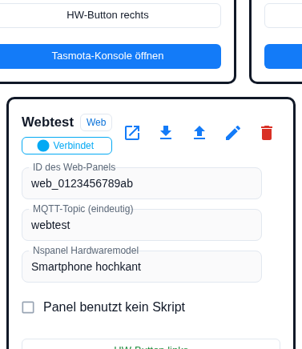

3. If a page of the panel holds a PIN or a Wi-Fi password, the question from [section 3](#3-pins-and-wi-fi-passwords) comes up. Otherwise the admin writes the file right away.
4. The browser downloads the file. The name follows the scheme `nspanel-<panel name>-<yyyy-mm-dd>.json`, for example `nspanel-Livingroom-2026-11-11.json`; characters other than `A–Z`, `a–z`, `0–9`, `_` and `-` become `_` in the panel name.

Both buttons are locked as long as the panel has no id and no topic. The export does not need a running instance — with one exception: the panel settings are datapoints, and whatever the admin cannot read is left out of the file.

Afterwards a message appears above the cards:

| Message | Situation |
|---|---|
| *Panel configuration exported to `<file>` (pages, screensaver, buttons and panel settings).* | All fine, no secrets involved. |
| *PINs and passwords were not exported, they have to be entered again after an import on these pages: `<pages>`* | Export without secrets. |
| *The file contains PINs and passwords in plain text - keep it safe.* | Export with secrets. |
| *Export of the panel configuration failed: `<reason>`* | Nothing was written. |

## 3. PINs and Wi-Fi passwords

The question only appears when the panel really shows pages with secrets: an [alarm or unlock page](cardAlarm) with a PIN of its own or a [QR page](cardQR) with a filled Wi-Fi password.

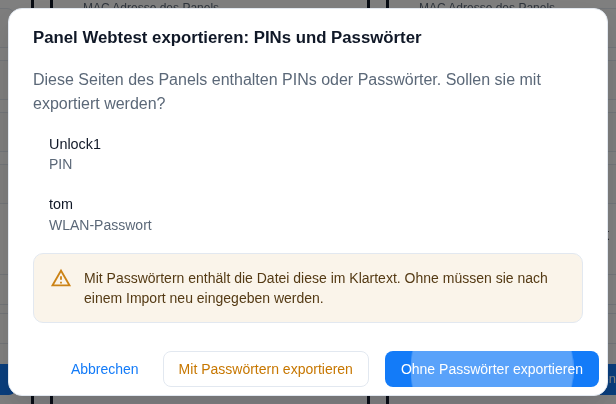

The dialog is called **Export panel `<name>`: PINs and passwords** and says: *These pages of the panel contain PINs or passwords. Should they be included in the export?* Below it the pages concerned are listed with the respective field (**PIN** or **Wi-Fi password**) and the note *With passwords, the file contains them in plain text. Without them, they have to be entered again after an import.*

| Button | Effect |
|---|---|
| **Export without passwords** (default) | The fields are missing from the file — they are left out, not emptied. The file can be passed on safely. |
| **Export with passwords** | PIN and Wi-Fi password are in the file in plain text. |
| **Cancel** | Nothing is written. |

A PIN that uses the **global password of the instance** is no secret: the page then holds no value of its own, only the reference to it. Such a PIN always travels along, and it does not trigger the question either. The same goes for an empty Wi-Fi password.

When a file without secrets is imported, **newly created or renamed** pages get a safe substitute: alarm and unlock pages the global password of the instance, QR pages an empty Wi-Fi password. **Existing pages keep their secrets** — even when the rest of the page is replaced by the content of the file. Which pages need attention is shown in the review (*The import contains no PINs or passwords. After the import, please enter the passwords again on these pages: …*) and again in the result.

## 4. Importing: choosing the parts

The import button opens the dialog **Import into panel `<name>`**. The first step asks: *Which parts of the file should be imported?* All three parts are preselected.

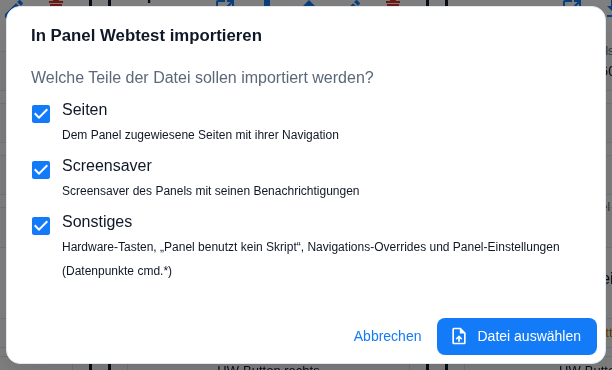

**Choose file** opens the file dialog (filter `.json`). The admin then checks the file:

- If it is damaged, not JSON or not a panel configuration of this adapter, the error message appears in the same step and nothing goes further — see [section 12](#12-error-cases).
- If a **selected** part is missing from the file, it is skipped; at the top *Not in the file, skipped: `<parts>`* appears, and the result names it once more.
- If the file holds nothing for the selected parts, the dialog says *The file holds no pages and no screensaver for the selected parts.*

If the file is fine, the **review** opens. Up to here and in the review as well, nothing is changed.

## 5. The import mode

At the very top of the review sits the switch **Import mode** with two positions.

| Mode | What it does |
|---|---|
| **Merge** (default) | *Adds the admin pages of the file. Pages of the panel script, navigation overrides and "panel uses no script" stay unchanged.* |
| **Overwrite completely** | *Replaces everything specific to this panel with the file: own page assignments with their navigation, exclusions, navigation overrides; the panel script is switched off. Pages for "all panels" and pages of the global script stay.* |

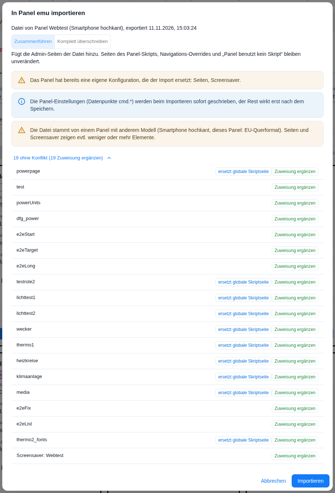

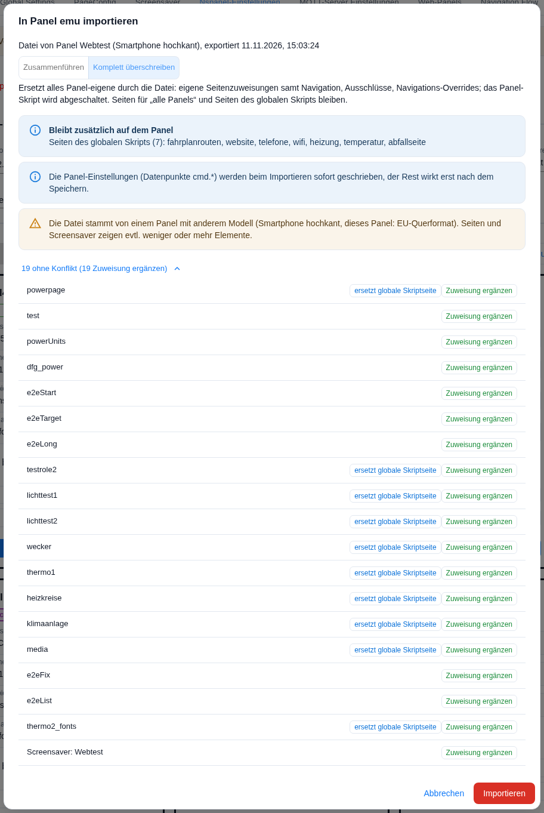

Both modes have in common that the admin pages assigned to **this panel** so far are **detached** from the panel first. The pages themselves are kept and stay in the page list; they are only no longer assigned to this panel. After that the pages of the file go onto the panel.

**Overwrite completely** goes further:

| Affected | What happens |
|---|---|
| Own pages of the panel | All old assignments are gone; afterwards the panel holds exactly what the file brings. |
| Hidden "all panels" pages | The exclusions of the source apply on the target as well; an exclusion that only existed on the target is lifted. |
| Pages for "all panels" and pages of the **global** script | Stay on the panel with their navigation. The review lists them under **Also stays on the panel**; if there is nothing, it reads *nothing – the panel shows only the imported pages*. |
| The **panel script** | Is switched off: the checkbox `Panel uses no script` is set, the pages of the panel script disappear from the panel. The script configuration is not deleted. |
| Navigation overrides of the panel | Are deleted and replaced by those of the file. |
| Other panels | Do not change. |

The mode can **only be chosen together with the part "Pages"**; otherwise the button is locked and the note *"Overwrite completely" is only possible together with the group Pages.* stands next to it. In the mode **Overwrite completely** the **Import** button is red as well.

## 6. The review

Below the switch stands the origin of the file (*File of panel `<name>` (`<model>`), exported `<time>`*), then the notes that apply to this import:

| Note | When |
|---|---|
| *The panel already has its own configuration that the import replaces: `<parts>`.* | Only for the parts that really are configured on the target **and** that the import actually changes. An unchanged backup going back into the same panel does not trigger the note. |
| *The file comes from a panel of another model (…, this panel: …). Pages and screensaver may show fewer or more elements.* | The model of the source does not match the target. The import is not blocked. |
| *The import contains no PINs or passwords. …* | The file was exported without secrets. |
| *The panel settings (datapoints `cmd.*`) are written immediately when importing, the rest only takes effect after saving.* | The part **Other** is included. |
| *These pages have the names of pages of the panel script. The script takes precedence, the imported pages do not appear on this panel: `<pages>`* | See [section 8](#8-pages-that-also-exist-in-a-script). |

Below that every page of the file — and, if imported as well, the screensaver — is listed with its status. Pages without a conflict are collapsed (**`n` without conflict**, with the counts underneath, for instance *20 unchanged, 3 add assignment*); a click shows them.

| Status | Meaning |
|---|---|
| **unchanged** | The page lies on the panel exactly like this already — nothing happens. |
| **add assignment** | The page exists already with the same content, it is additionally assigned to this panel. |
| **change navigation** | The page is on the panel already, but gets the navigation from the file. |
| **remove assignment** | In the file the page was only the target of a page link, not a page of the source panel. It is not assigned on the target either. |
| **create new** | The page does not exist yet. |
| **different** | A page with this name exists already, but with different content — see [section 7](#7-name-conflicts). |
| **skip** | This page of the file is not taken over (only as the chosen resolution of a conflict). |

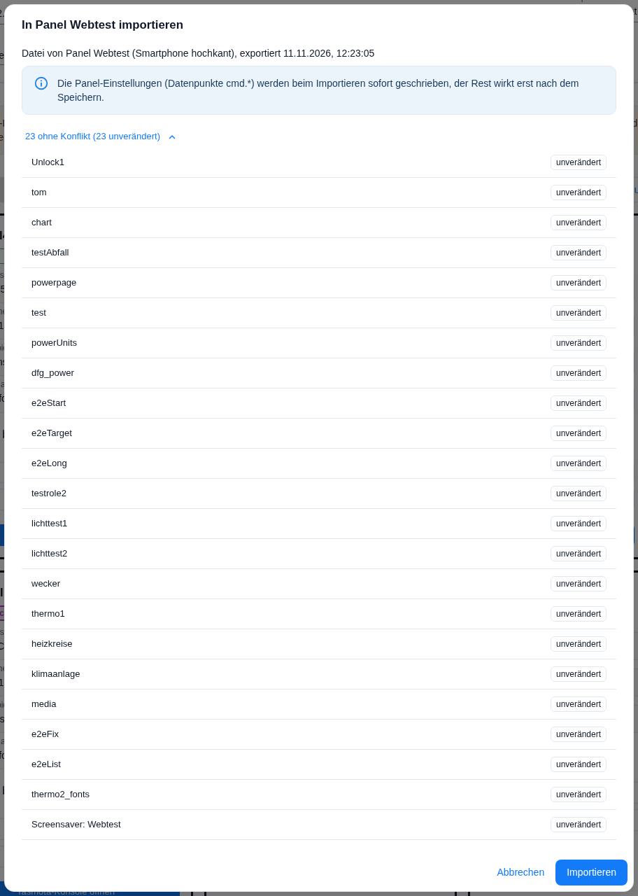

In the most common case — a backup going back into the same panel or an import into an empty panel — there is nothing to decide: pressing **Import** is enough.

## 7. Name conflicts

A conflict arises when the instance already holds a page of the same name whose content differs from the file. The status then reads **different** and the column **Action** offers three resolutions:

| Resolution | Effect |
|---|---|
| **rename** (default) | The page from the file is created under a new name; the existing page stays as it is. |
| **replace existing** | The existing page gets the content from the file. |
| **skip** | The page from the file is not taken over. |

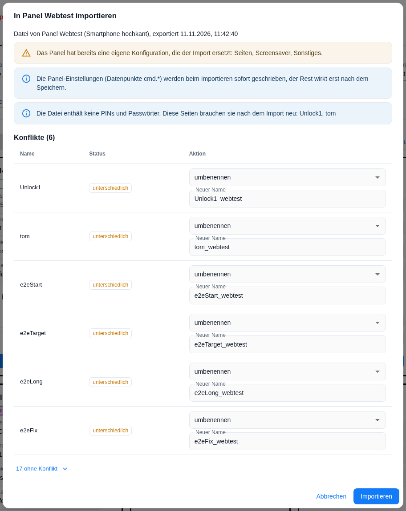

**The proposed name** is `<original name>_<topic>`, where only the last section of the target topic is taken and reduced to `A–Z`, `a–z`, `0–9`, `_` and `-` — so `e2eLong` becomes `e2eLong_webtest` on the panel with the topic `nspanel/webtest`. If that one is taken too, the admin appends `_2`, `_3` … The field **New name** can be overwritten freely, but is checked:

| Message | Reason |
|---|---|
| *Enter a name without leading or trailing spaces* | Empty or spaces at the edges. |
| *"main" is reserved for the start page* | `main` is the fixed name of the start page. |
| *Names starting with /// are reserved* | Internal targets start with `///`. |
| *This name is used twice in this import* | Two rows of the same import carry the same name. |
| *A page or screensaver with this name exists already* | The name is already taken in the instance. |

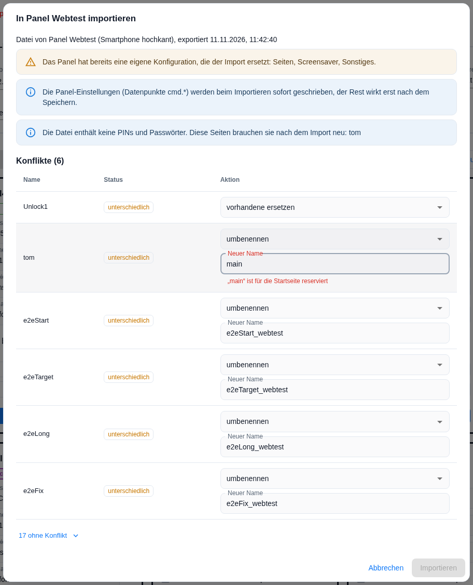

As long as a name is invalid, **Import** stays locked.

**A look at the differences.** A click on the status **different** opens the dialog **Differences: `<page>`** with three columns — *What*, *Existing*, *In the file*. Fields are named as in the editor (*Headline*, *Item 3*, *Navigation: previous*), missing values read *missing*, new ones *added*.

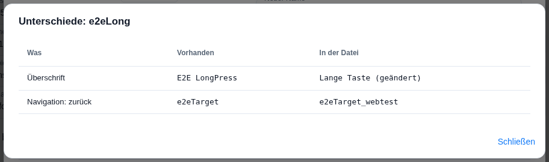

**Renaming ripples.** When a page is renamed, the admin carries the new name through all references of the imported data: navigation (*previous*, *next*, *up*, *home*), target pages of page links and of items, the page after unlocking, screensaver actions, the targets of the hardware buttons and the navigation point of the start page. Pages that refer to a renamed page therefore become **different** themselves — in that case the difference dialog says *Only references to renamed pages differ.* This repeats until nothing changes any more; a name typed by hand is passed on in the same way.

**Replacing asks back.** If other panels use the existing page as well, the admin asks again with **Replace `<page>`?**: *The existing `<page>` is overwritten with the content of the file.* Below that stands *These panels use it as well and change too:* with the list (a page for "all panels" appears in it as **all panels**) or *No other panel uses it.* **Cancel** is preselected.

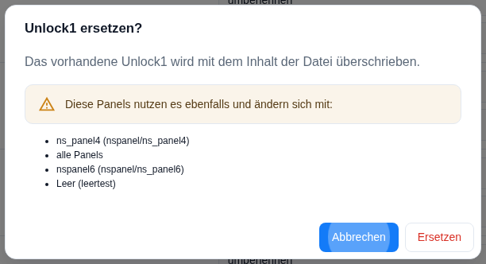

## 8. Pages that also exist in a script

If a page of the file carries the name of a page from a script, a second note stands next to the status. This is not a conflict in the sense above — script pages and admin pages live in different places — but a question of which of the two the panel shows.

| Note | Meaning |
|---|---|
| **replaces global script page** | The global script has a page of this name. On this panel the imported admin page is shown; other panels keep seeing the script page. |
| **replaces page of the panel script** | The admin page takes the place of the page of the same name in the panel script. This always applies to the **start page**; for all other pages only when the instance option `adminOverridesScriptPages` is set (default: off, with no field of its own in the admin). |
| **page of the panel script takes precedence** | The panel script has a page of this name and keeps it; the imported page does not appear on this panel. Remedy: rename it or use **Overwrite completely**. |

The notes only exist in the mode **Merge** and only as long as the panel uses a script at all. After **Overwrite completely** the panel script is off, so only *replaces global script page* remains. If the admin cannot read the script configuration, *Script pages unknown (script configuration not readable).* is shown instead of the notes.

## 9. The confirmation for "Overwrite completely"

Before overwriting, the question **Overwrite `<panel>` completely?** appears with the sentence *The current configuration of this panel is replaced by the file.* and four blocks:

| Block | Content |
|---|---|
| Pages | *`n` own pages are removed from this panel (the pages themselves are kept)* — the list can be unfolded. Otherwise: *No own pages are removed from this panel.* |
| Script | *The panel script is switched off ("panel uses no script"). These `n` script pages disappear from the panel:* with their names. If the panel has no script already: *The panel already uses no script.* |
| Navigation overrides | *`n` navigation overrides of this panel are deleted: …* and *The file brings `n` navigation overrides: …*, otherwise *The panel has no navigation overrides.* |
| **Also stays on the panel** | *Pages for all panels (`n`)* and *Pages of the global script (`n`)*. |

Plus the sentence *Pages for "all panels" and pages of the global script stay unchanged on this panel, with their navigation. Other panels are not affected.* **Cancel** is preselected; the red button reads **Overwrite completely**.

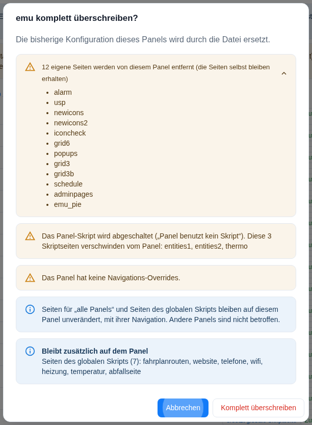

## 10. The result

After the import the dialog shows **Import into panel `<name>`: result**. Every section only appears when it has something to report:

| Section | Content |
|---|---|
| *The panel script was switched off ("panel uses no script").* | Only after **Overwrite completely**. |
| *Navigation points to pages that are not on this panel (`n`)* | Per hit `<page> – <direction> → <target>`, entries from an override with the addition *(override)*. Plus *Not corrected automatically – please check the navigation of these pages.* |
| *Please enter PIN / password again on these pages:* | Pages with a substitute value, see [section 3](#3-pins-and-wi-fi-passwords). |
| *New pages* · *Renamed* (`old → new`) · *Replaced* · *Skipped* · *Unchanged* · *Assignment or navigation changed on existing pages* | The balance of the pages. |
| *New start page of the panel* · *No longer the start page of this panel, other panels keep it* | Start page. |
| *Pages for all panels hidden on this panel* | Exclusions. |
| *Screensaver* | Name and action, or *none (the source panel has no screensaver of the admin)*. |
| *Notifications added under a new id* | Notifications of the screensaver whose id was taken already. |
| *Navigation overrides deleted* · *Navigation overrides taken over* | Only after **Overwrite completely**. |
| *Panel settings written* · *Panel settings not written, the datapoint does not exist yet* | The part **Other**. |
| *Not in the file* | Parts that were selected but missing. |

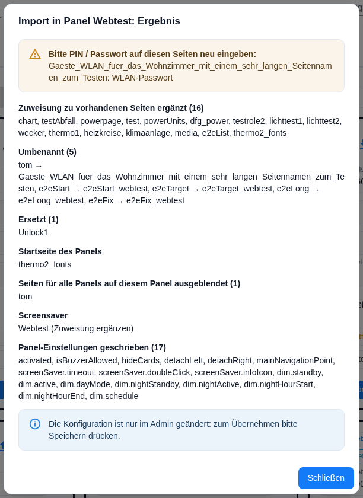

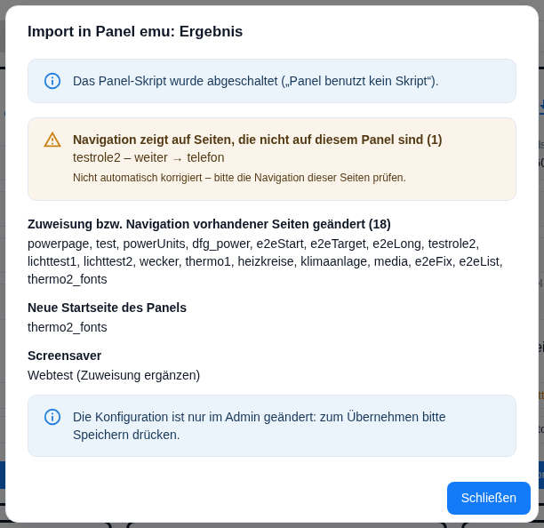

The section **Navigation points to pages that are not on this panel** deserves a second look: the admin does not correct such references, so the panel runs into an empty direction. More about how the references work together is under [navigation flow](naviFlow).

## 11. When the changes take effect

| What | When |
|---|---|
| Pages, screensaver, notifications, hardware buttons, navigation, `Panel uses no script`, navigation overrides | Only with **saving** the instance settings. Until then everything only lives in the admin. |
| Panel settings (datapoints `cmd.*`) | **Immediately when importing.** They are datapoints, not part of the instance configuration. |

The dialog says so beforehand (*The panel settings (datapoints `cmd.*`) are written immediately when importing, the rest only takes effect after saving.*) and again at the end: *The configuration is changed in the admin only: press Save to apply it.*

Two panel settings are deliberately left out when the target has a screensaver from the admin: **layout** and **rotation time** of the screensaver. The adapter writes both from the screensaver entry anyway. Settings whose datapoint does not exist yet — for instance on a panel that has never run — are skipped and named in the result.

## 12. Error cases

| Message | Situation |
|---|---|
| *The file is no valid JSON: `<reason>`* | The file could not be read. |
| *The file is no panel configuration export of this adapter.* | The format marker is missing — for instance in an adapter backup or a foreign file. |
| *The file is damaged or incomplete (at `<place>`).* | The structure is wrong; the place names the path at which the check failed. |
| *The file was written by a newer adapter (format version `n`), please update the adapter.* | The file is younger than the adapter that is to read it. |

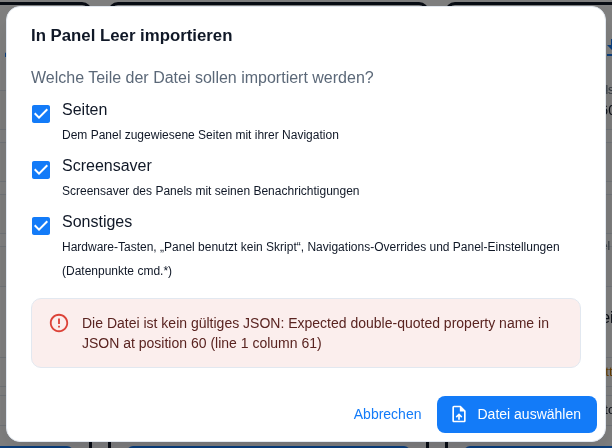

Not an error, only a warning is the **model mismatch**: if the file comes from a panel of another model — EU landscape against a smartphone in portrait, say — not always the same number of elements fits onto a page or into the screensaver. The import runs through anyway; the pages should be looked at afterwards.

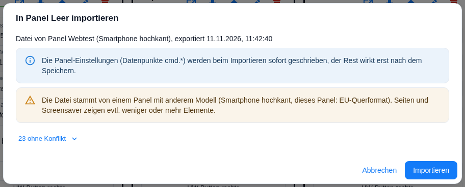

## Pitfalls

- **The export takes the state currently shown in the admin** — including unsaved changes. Whoever wants to back up the saved state saves first or reloads the page.
- **Save after the import.** Apart from the panel settings nothing takes effect on its own. Leaving the admin without saving means nothing was imported — but the panel settings have been written all the same.
- **Detached is not deleted.** Pages of the target panel that are not in the file only lose their assignment to this panel. They stay in the page list and keep their name taken — so a later import of the same names leads to conflicts.
- **"replace existing" reaches beyond the panel.** All other resolutions only concern the target panel; replacing changes the page itself and with it every panel that shows it. Hence the confirmation with the list.
- **A replaced entry keeps its PIN.** If the file held no secrets, the PIN of the existing page stays — even though the rest of the page comes from the file. Newly created pages, in contrast, get the global password of the instance.
- **Overwrite completely deletes the navigation overrides even without the part "Other".** If the part is deselected, the overrides of the target are removed and no new ones come in.
- **After "Overwrite completely" the checkbox `Panel uses no script` is set.** Whoever wants the panel script back removes the checkbox in the panel card and saves; the script configuration is not deleted (see [migration](Migration)).
- **"Merge" ignores `Panel uses no script` and the overrides from the file.** Both are part of **Other**, but are not applied in this mode — the target keeps its own state.
- **Dangling navigation references stay.** The result lists them, but does not correct them.
- **Renaming creates follow-up conflicts.** A renamed page changes all pages that refer to it; those then appear as *different* as well. That is normal — the difference dialog says so.
- **Another model is no obstacle, but a request to check.** The import runs through; whether all elements fit onto the page is decided on the panel.
