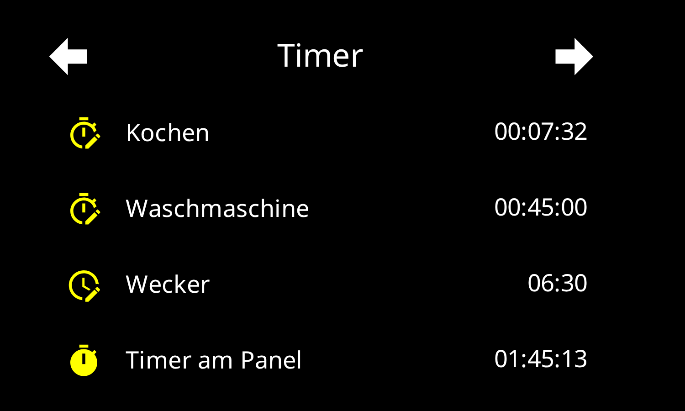
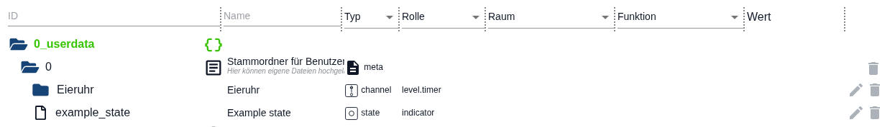
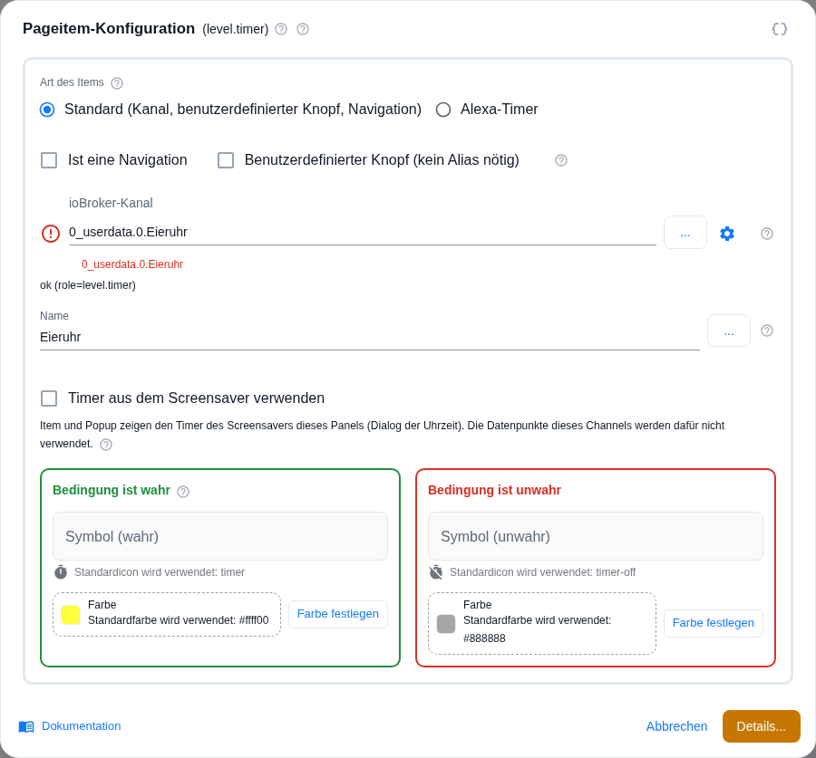
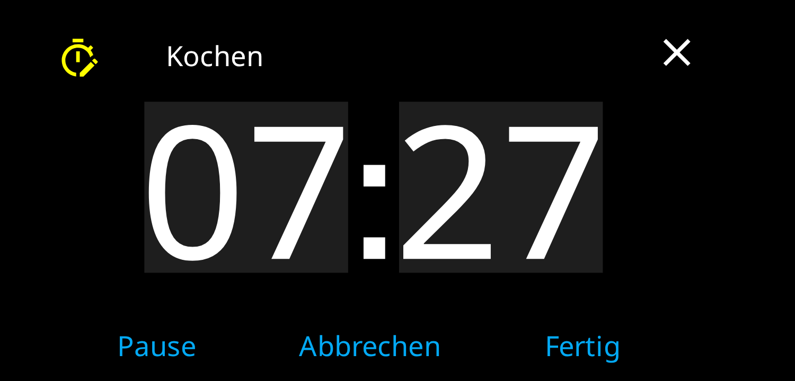
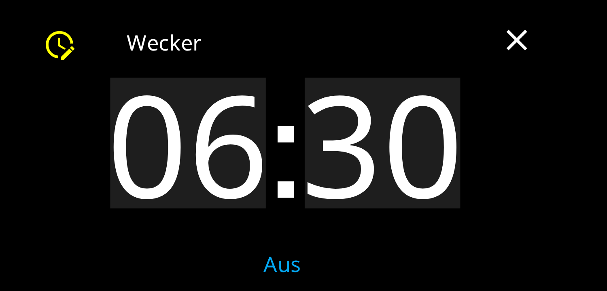
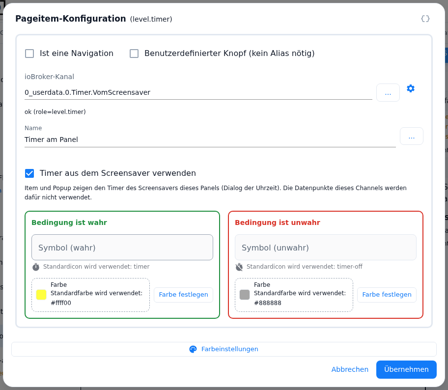
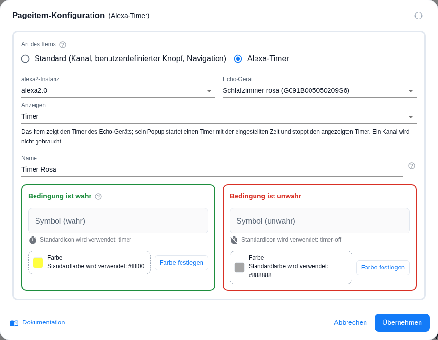
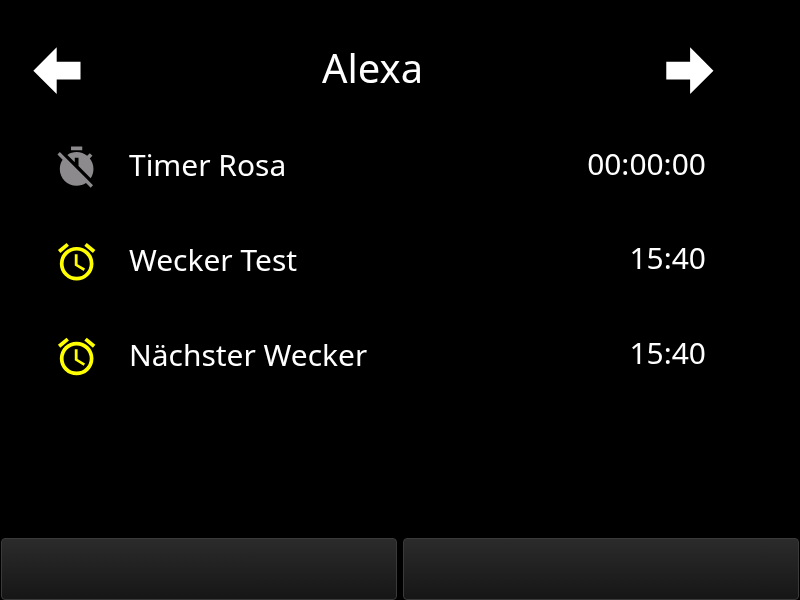
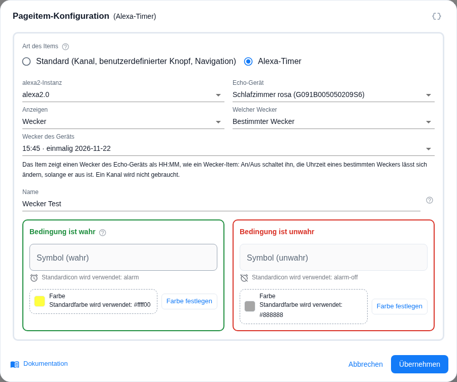
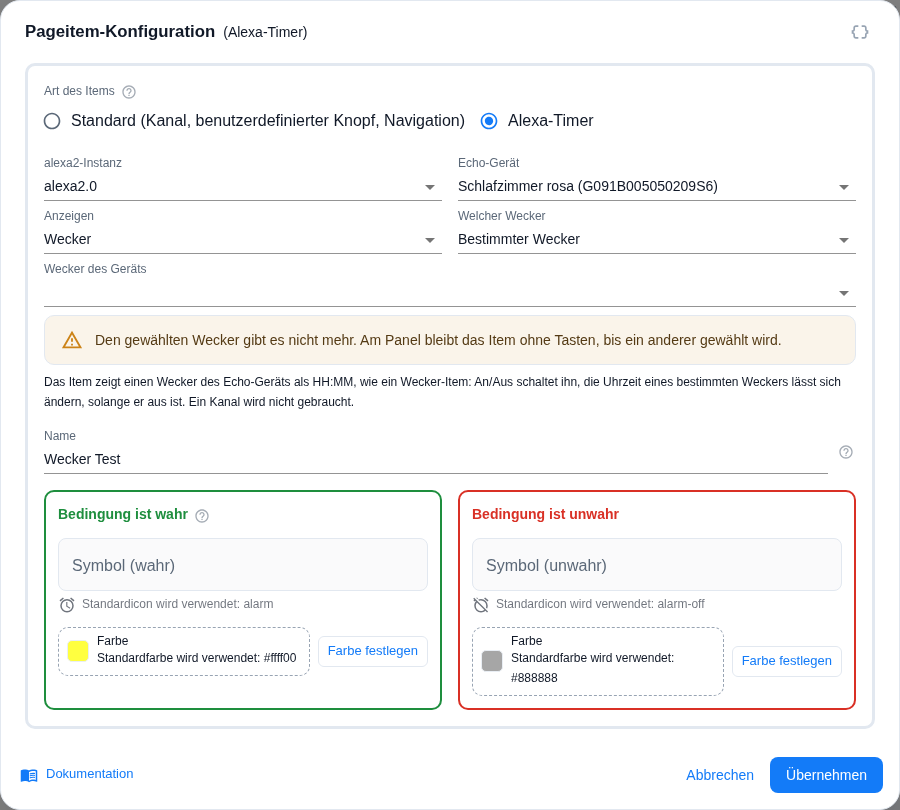

# Timer popup

This page explains timers on the panel: first in plain words what a timer is and which kind to take for what, then two step-by-step guides and an example. From [Reference](#reference) on follow the details – states, buttons, limits and finally the timers and alarms of an Echo device.

Contents:
- [What is a timer on the panel?](#what-is-a-timer-on-the-panel)
- [Which kind do I need?](#which-kind-do-i-need)
- [Quick start: egg timer (internal timer)](#quick-start-egg-timer-internal-timer)
- [Quick start: remaining time on the screensaver](#quick-start-remaining-time-on-the-screensaver)
  - [Example: script timer on the screensaver](#example-script-timer-on-the-screensaver)
- [Reference](#reference)
  - [1. Operating modes](#1-operating-modes)
  - [2. States](#2-states)
  - [3. Buttons](#3-buttons)
  - [4. Controlling the internal timer from outside](#4-controlling-the-internal-timer-from-outside)
  - [5. Use the timer of the screensaver](#5-use-the-timer-of-the-screensaver)
  - [6. Display and limits](#6-display-and-limits)
  - [7. Alexa timer (alexa2)](#7-alexa-timer-alexa2)
- [Pitfalls](#pitfalls)

## What is a timer on the panel?

A timer is an **entry on a page** that shows a remaining time – for example *Egg timer 00:04:30*. A tap on it opens the **timer popup**: two fields for minutes and seconds and up to three buttons such as **Start**, **Pause**, **Cancel** or **Finish**. With it you set the time, start and stop the timer.

When the time is up, the entry shows `00:00:00` until **Finish** is pressed. A script can react to that, for example play a sound.

In addition the **screensaver** can show the remaining time instead of the clock, in orange, and in red once it has run out. That is set in the screensaver, see [Timer instead of the clock](screensaver#timer-instead-of-the-clock).

Two words come up again and again on this page:

| Term | Meaning |
|---|---|
| **Channel** | An object in ioBroker that bundles states belonging together. Its **role** (`common.role`) tells the adapter what it is – for a timer `level.timer`. Usually you create an alias for it, see [alias table](ALIAS#leveltimer). |
| **Page item** | An entry on a page of the panel, created in the PageConfig tab through the [Pageitem Configuration](PageConfig-Dialoge#1-pageitem-configuration). |

## Which kind do I need?

All kinds look the same on the panel. They differ in **who counts the time** and in what you have to create in the admin:

| I want to … | take … | who counts | what I create in the admin | typical example |
|---|---|---|---|---|
| set a time on the panel and let it run down | **Internal** | the adapter | a channel with the role `level.timer` – it needs no states | egg timer in the kitchen |
| show the remaining time a script of my own or another adapter counts | **External** | the script | a channel `level.timer` with `ACTUAL` (remaining time in seconds), plus `STATUS` and `SET` so that there are buttons | remaining time of the washing machine; a script timer set by a voice control of your own |
| show a fixed wake-up time and switch it on and off | **Alarm clock** | nobody, it is a clock time | a channel `level.timer` with `ACTUAL` of the role `date`, plus `SET` and `STATUS` | alarm at 6:30 |
| show the same timer on a page as the screensaver | **From the screensaver** | like the screensaver | a channel `level.timer` and the checkbox **Use the timer of the screensaver** | the screensaver shows the remaining time, the page adds Start and Stop |

If in doubt: for a simple egg timer **Internal** is enough. The exact rules are under [Operating modes](#1-operating-modes).

The kinds can be combined. A typical example: a script of your own counts a timer, it is set through a voice control of your own, and the **screensaver** shows the remaining time – how that works is under [Example: script timer on the screensaver](#example-script-timer-on-the-screensaver).

Timers and alarms of an Echo device (alexa2 adapter) need no channel; they have a section of their own: [Alexa timer (alexa2)](#7-alexa-timer-alexa2).

## Quick start: egg timer (internal timer)

1. **Create a channel.** In the **Objects** tab of ioBroker below `0_userdata.0` (or below `alias.0`) create an object of the type **channel**, e.g. `0_userdata.0.EggTimer`, and enter the role `level.timer` in its properties. No states are needed below it. – *Result: an empty channel the adapter recognises as a timer.*

   

2. **Create a page item.** In the **PageConfig** tab open a page with page items (e.g. a cardEntities or cardGrid) and click on a free place. – *Result: the Pageitem Configuration is open.*
3. **Choose the channel.** **Kind of item** stays at **Standard**. In the field **ioBroker Channel** choose the channel `0_userdata.0.EggTimer`. – *Result: next to the title it says `(level.timer)`, below the field "ok (role=level.timer)".*

   That the channel has no states is not an error here: no state of `level.timer` is mandatory, so there is no warning sign at the field and the button at the bottom reads **Apply** (see [check marks](PageConfig-Dialoge#the-iobroker-channel-and-its-check-marks)).

   

4. **Enter a name** (optional), e.g. *Egg timer*. Without a name the adapter takes the name of the channel, as a last resort *Timer*. – *Result: that is the name of the entry in the list and in the popup.*
5. **Apply** (the adapter checks the item and takes it over), then **Save** in the tab. – *Result: the adapter restarts, the page shows the entry with `00:00:00`.*
6. **Try it on the panel:** tap the entry, set 5 minutes in the popup, **Start**. – *Result: the time runs down; at 0 `00:00:00` stays until **Finish** is pressed.*

If a script should learn about the end, create `STATE` in the channel as well (`boolean`, role `button`, writable): it becomes `true` when the time runs out and when **Finish** is pressed.

## Quick start: remaining time on the screensaver

The screensaver takes its timer from one source. Easiest is a timer page item (e.g. the egg timer from above); if a script of your own counts, take its states.

1. In the **Screensaver** tab open the screensaver of the panel and click on the **time** in the panel picture. – *Result: the dialog of the time is open.*
2. Tick **Show timer**. – *Result: the field **Source of the timer** appears.*
3. Choose the source:
   - **Page item with timer popup** and in the field **Page item** the egg timer. If it says *Some timers can only be selected after a page has been changed and saved.*, change the page of the egg timer once and save it.
   - or **Data points or slot patterns** and below it the **On/off state** and the **Data state** of the script (formats under [Source: two states](screensaver#source-two-states)).
   - The third source, **Alexa timer (alexa2)**, is described under [Alexa timer](#7-alexa-timer-alexa2).

   – *Result: the warning below the field disappears.*
4. **Apply**, then **Save**. – *Result: the adapter restarts.*
5. **Try it:** start a timer (on the panel or through the script). – *Result: instead of the clock the screensaver shows the remaining time in minutes, e.g. `2.5`; a tap on it switches back to the clock.*

All details of the display are under [Timer instead of the clock](screensaver#timer-instead-of-the-clock).

### Example: script timer on the screensaver

A script of your own counts a timer; it is set through a voice control of your own (the script evaluates the voice command). On the panel the screensaver should show the remaining time, and a page should offer Start and Cancel.

1. **States of the script:** the script keeps an on/off state (`true` while the timer runs) and a data state with the end time, e.g. as a timestamp in milliseconds. Which formats work is under [Source: two states](screensaver#source-two-states). – *Result: voice command and script set the timer, without the panel at all.*
2. **Screensaver:** in the quick start above choose the source **Data points or slot patterns** with these two states. – *Result: while the timer runs, the screensaver shows the remaining time instead of the clock.*
3. **Page (optional):** create a page item with a channel `level.timer` and tick **Use the timer of the screensaver**. – *Result: the item shows the same timer; **Start** writes data and on/off, **Cancel** sets on/off to false* (details in [section 5](#5-use-the-timer-of-the-screensaver)).

The script needs nothing special for this: it reads on/off and data, no matter whether the voice control or the panel wrote them. Whoever prefers to keep a channel `level.timer` with `ACTUAL` and `STATUS` instead of the two states (mode **External**, see [States](#2-states)) takes the source **Page item with timer popup** in the screensaver and chooses that item.

## Reference

The following sections describe every kind in detail. Whoever only wants an egg timer does not need them.

A page item with a channel of the role `level.timer` is a timer: in the list of a page it shows its name and its time, a tap on it opens the **timer popup** with the fields for minutes and seconds and up to three buttons. Depending on the channel the counting is done by the adapter, by a script of your own, by nobody (an alarm clock with a fixed time) – or the item shows the timer of the screensaver.

The item is created like any other through the [Pageitem Configuration](PageConfig-Dialoge#1-pageitem-configuration): pick a channel with the role `level.timer` as the **ioBroker Channel**. Which states the channel may have is listed in the [alias table](ALIAS#leveltimer). The name in the list and in the popup is the **Name** of the dialog, otherwise the name of the channel, and as a last resort *Timer*. The timers of an Echo device do without a channel, see [section 7](#7-alexa-timer-alexa2).

## 1. Operating modes

The operating mode says **who counts the time**. It is not set anywhere – the adapter reads it from the states of the channel:

| Mode | How the adapter recognises it | Who counts |
|---|---|---|
| **Internal** | no `ACTUAL` | the adapter |
| **External** | `ACTUAL` with the role `value.timer` or `level.timer`, or with the unit `s`, `sec` or `ms` | a script of your own |
| **Alarm clock** | `ACTUAL` with the role `date`, or with another role without a unit of time | nobody – a fixed clock time |
| **From the screensaver** | checkbox **Use the timer of the screensaver** in the item dialog | like the screensaver, see [section 5](#5-use-the-timer-of-the-screensaver) |

A channel with a `SET` only is an internal timer – unless `SET` carries the role `date`, then it is an alarm clock. An external timer or alarm clock with nothing writable and no `STATUS` is a plain time display: the popup shows the time but has no buttons.

An item of the kind **Alexa timer** has no channel; there the Echo device counts, see [section 7](#7-alexa-timer-alexa2).

## 2. States

A channel of the role `level.timer` can have up to four states – **none of them is mandatory**. A channel without any states is an internal timer. The names are suggestions: the adapter also finds the states by their role (table in [ALIAS](ALIAS#leveltimer)).

| State | Meaning |
|---|---|
| `ACTUAL` | The value that is shown. For an external timer the remaining time in seconds, with the unit `ms` in milliseconds. For an alarm clock a timestamp in milliseconds, shown as the clock time `HH:MM` in local time. |
| `SET` | The adapter writes a time set in the popup here, in the same unit as `ACTUAL`. Without `SET` it writes into `ACTUAL` if that one is writable. For an alarm clock `SET` holds the next point in time of that clock time as a timestamp in milliseconds. |
| `STATUS` | `0` = off, `1` = pause, `2` = running. Needed for an external timer and an alarm clock so that the buttons Start, Pause and On/Off exist – without it the script cannot know that it should count. |
| `STATE` | Becomes `true` when an internal timer runs out and when **Finish** is pressed – never with **Cancel** or **Clear**. |

Values written from outside only count when they are confirmed (`ack` = the value is a reported state, not a command) or the state lies below `0_userdata.0` or `alias.0`.

## 3. Buttons

Which buttons the popup shows and whether the time can be edited depends on the mode and the state (the buttons of the Alexa timer are in [section 7](#buttons-of-the-alexa-timer)):

| Mode and state | Buttons | Time editable |
|---|---|---|
| Internal, no time | **Start** | yes |
| Internal, time set, not started | **Start**, **Cancel** | yes |
| Internal, running | **Pause**, **Cancel**, **Finish** | no |
| Internal, paused | **Continue**, **Cancel** (after editing: **Start**) | yes |
| Internal, expired | **Finish**, display `00:00` | no |
| External, `STATUS` 0 | **Start**, **Clear** | if writable |
| External, `STATUS` 1 | **Continue**, **Clear** | if writable |
| External, `STATUS` 2, time left > 0 | **Pause**, **Cancel**, **Finish** | no |
| External, `STATUS` 2, time left 0 | **Finish**, display `00:00` | no |
| External without `STATUS` | **Clear**, if something is writable | if writable |
| Alarm clock, off | **On** (writes `STATUS` 2) | if writable |
| Alarm clock, on | **Off** (writes `STATUS` 1) | no |
| Alarm clock without `STATUS` | none | if writable |
| From the screensaver, no timer | **Start**, if a free slot is writable | yes, if a start is possible |
| From the screensaver, running or paused | **Cancel** | no |
| From the screensaver, expired | **Finish** | no |
| From the screensaver, not writable | none | no |

Closing the time fields starts nothing. For an external timer and an alarm clock the adapter writes the time to `SET` (or `ACTUAL`) at once; for an internal timer it remembers it and writes it to `SET` as well, if there is one; with *From the screensaver* it only remembers it. Counting begins with **Start** only.

**Cancel** and **Clear** set `STATUS` to 0 and, for an external timer, `SET` and `ACTUAL` to 0; `STATE` is left alone. **Finish** does the same and sets `STATE` to `true` in addition.

## 4. Controlling the internal timer from outside

Only needed if a script or another adapter should also set or start the timer of the panel. The internal timer runs inside the adapter, also while its page has never been opened. Through `SET` and `STATUS` it can be controlled from a script:

| Writing | Effect |
|---|---|
| `SET` > 0, timer standing or paused | sets the time, does not start |
| `SET` > 0, timer running | new remaining time, keeps running |
| `SET` = 0 | like **Cancel** |
| `STATUS` = 2 | Start or Continue; with the counter at 0 it takes the time from `SET` |
| `STATUS` = 1 | Pause, if it is running |
| `STATUS` = 0 | Cancel, without `STATE` |

The adapter mirrors every change of its state into `STATUS`. When the time is over, `STATUS` stays at 2 until **Finish** is pressed – like an external timer standing at `ACTUAL` 0 with `STATUS` 2. The remaining time of an internal timer cannot be read from outside. After a restart of the adapter an internal timer is gone; a `STATUS` left over from before is corrected then.

## 5. Use the timer of the screensaver

With this a page item shows exactly the timer the screensaver shows – handy to see, start or stop it on a page. Where the screensaver takes its timer from (states, another page item or an Echo device) is set in the screensaver, not here.

The checkbox **Use the timer of the screensaver** stands in the Pageitem Configuration for a channel of the role `level.timer` only. Below it says: *The item and its popup show the timer of the screensaver of this panel (time dialog). The states of this channel are not used for it.* Meant is the timer that is set up through the time in the [screensaver editor](screensaver#timer-instead-of-the-clock).

- List and popup show the same timer as the screensaver of this panel – also while it is tapped away there; with slot patterns the slot chosen there right now.
- The item does not read the states of the channel – it does not need them. Because no state of the role `level.timer` is mandatory, the field shows no error sign even for a channel without any states (see [check marks](PageConfig-Dialoge#the-iobroker-channel-and-its-check-marks)).
- The checkbox is locked when the screensaver of this panel uses exactly this item as the source of its timer: *Not possible: the screensaver of this panel uses this item as the source of its timer, that would be a circle.*

**Start** writes the data state of the screensaver timer first and then its on/off state. Which value goes into the data depends on the state: the remaining time with the unit `s`, `sec` or `ms` or the role `value.timer` or `level.timer`, an ISO date for a text state, otherwise the end as a timestamp in milliseconds. With slot patterns Start takes the lowest slot whose on/off is not true – without one no start is possible. **Cancel** and **Finish** set the on/off state of the shown slot to false. There is no pause here. If the source of the screensaver is a page item, the checkbox item starts and stops that page item.

If the screensaver of the panel has no complete timer, the log warns once per panel and the item stays without buttons.

## 6. Display and limits

What list and popup can show – the same for all kinds:

- In the list the time reads `HH:MM:SS`, for an alarm clock `HH:MM`. The popup shows minutes and seconds, at most `99:59`; for an alarm clock hour and minute.
- The two input fields of the panel go up to 59 each, so at most `59:59` can be entered.
- While a timer runs, the list is refreshed every 2 seconds, the open popup every second. That is on purpose – faster, the traffic to the panel piles up.
- The popup stays open while the timer runs, and the panel does not dim, because every refresh resets its sleep counter. That is intended.

### Value instead of icon

On the grid pages (cardGrid, cardGrid2, cardGrid3) as well as on the thermostat and the media page the [page item configuration](PageConfig-Dialoge#further-fields-depending-on-the-card-type) offers the option **Use Value Instead of Icon** – for the timer for every kind: internal timer, timer from states and Alexa timer (not for the Alexa alarm).

- **While a timer runs**, the **remaining time** replaces the icon – in the format of the screensaver timer: minutes with one decimal, always rounded up (`12.5`, `0.1`), from 1000 minutes on whole minutes (up to `9999`). It is drawn in font 1 like the clock, in the *on* colour of the item.
- **No timer, paused, expired or ringing:** the icon as without the option.
- The page is only sent again when the shown number changes (every 6 seconds, from 1000 minutes on every minute); a timer from states that counts outside redraws with every new value of `ACTUAL`. The open popup still counts every second.
- Off by default; *Entities* and *Schedule* do not have the option – there the line shows the remaining time anyway.
- The toolbar item **Timer** of the [media page](cardMedia#timer-alexa-only) always shows the remaining time like this.

## 7. Alexa timer (alexa2)

Instead of a channel, a timer item can show the timers of an **Echo device** – or one of its **alarms** (see [Alarms of an Echo device](#alarms-of-an-echo-device)). Both come from the **alexa2** adapter, which maps the Echo devices into ioBroker. No channel is needed. The screensaver knows the timers only, no alarms; its source **Alexa timer (alexa2)** is under [Source: Alexa timer (alexa2)](screensaver#source-alexa-timer-alexa2). On a media page with alexa2 there is also the toolbar item **Timer** for this, which follows the Echo the page currently controls, see [Media page – Timer (Alexa only)](cardMedia#timer-alexa-only).

### Quick start: Alexa timer as a page item

Requirement: the alexa2 adapter is running, and in its instance the option **Automatically query activity on device interaction** is switched on (why: see [Requirements](#requirements)).

1. In the **PageConfig** tab open a page with page items and click on a free place. – *Result: the Pageitem Configuration is open.*
2. At the top, at **Kind of item**, choose **Alexa timer**. – *Result: instead of the channel field there are **alexa2 instance** and **Echo device**.*
3. Choose the **alexa2 instance** and the **Echo device**. Only devices that can do timers are offered. – *Result: without a warning below, everything is ready.*
4. Enter a **Name** (optional), e.g. *Kitchen*. – *Result: that is the name of the entry; without a name *Timer*.*
5. **Apply** and **Save** in the tab. – *Result: the page shows the entry.*
6. **Try it:** say *"Alexa, set a timer for 3 minutes"* to the chosen Echo. – *Result: after about 10 seconds the entry shows the remaining time.* In the popup **Cancel** stops it; while no timer is active, **Start** starts a new one on the Echo.

### Requirements

| What | Why |
|---|---|
| a running **alexa2 instance** | It reads the timers from the Amazon account and takes the commands. |
| an Echo device that **can do timers** | The dialog only offers devices whose `Info.capabilities` contains `TIMERS_AND_ALARMS` – groups and plain speakers are missing. |
| in the alexa2 instance the option **Automatically query activity on device interaction** (`autoQueryActivityOnTrigger`) | Without it alexa2 does not ask what changed after a voice command: timers set by voice **never** show up in alexa2 and so never on the panel. If it is off, the dialog warns. |

### Creating it in the admin

At the top of the [Pageitem Configuration](PageConfig-Dialoge#1-pageitem-configuration) there is the **Kind of item**: **Standard (channel, custom button, navigation)** or **Alexa timer**. The choice exists on all pages with page items (cardGrid, cardGrid2, cardGrid3, cardEntities, cardSchedule, cardThermo2, cardMedia). With **Is a navigation** ticked, **Alexa timer** is locked – a navigation cannot be a timer.

With **Alexa timer** the dialog shows these fields:

| Field | Meaning |
|---|---|
| **alexa2 instance** | The alexa2 instance with the Echo device. All installed instances are offered. |
| **Echo device** | The device whose timers or alarms the item shows. Only devices whose `Info.capabilities` contains `TIMERS_AND_ALARMS` are offered, labelled with `Info.name` and the serial number. After changing instance or device a specific alarm has to be chosen again. |
| **Show** | **Timer** (default) or **Alarm**. What the alarm shows is under [Alarms of an Echo device](#alarms-of-an-echo-device). |
| **Which alarm** | With **Alarm** only: **Next active alarm** (default) or **A specific alarm**. |
| **Alarm of the device** | With **A specific alarm** only: one of the alarms of the Echo, labelled with time and repetition. |
| **Name** | Name in list and popup; empty = *Timer*. |
| **Condition is true** / **Condition is false** | Icon and colour while a timer is active or the alarm is switched on, and otherwise. Empty = defaults `timer` / `timer-off`, for an alarm `alarm` / `alarm-off`. |

**Apply** stays disabled until instance and device are chosen – with **A specific alarm** also the alarm.

Messages of the dialog:

| Message | Meaning |
|---|---|
| *In this alexa2 instance the option "Automatically query activity on device interaction" is off: timers set by voice never show up. Switch it on in the settings of the alexa2 instance.* | Switch the option on in the settings of the alexa2 instance. |
| *No alexa2 instance is installed.* | Install and set up alexa2. |
| *This instance has no Echo device with timers.* | Choose another instance, or alexa2 has not read the devices yet. |
| *The chosen device is no longer found in this instance or has no timers.* | Choose another device. |
| *This device has no alarms.* | With **A specific alarm**: the Echo has no alarm that could be chosen. |
| *The chosen alarm no longer exists. On the panel the item stays without buttons until another one is chosen.* | The alarm was deleted; choose another one. |

Switching between the two kinds in the open dialog keeps the fields of the other kind until the dialog closes; only the chosen kind is saved.

### What happens on the panel

| Situation | What you see |
|---|---|
| timer set by voice | After about 10 seconds the entry shows the remaining time – that is how long alexa2 takes to know the timer. |
| **Start** in the popup | The adapter sends the text *stelle einen Timer auf 5 Minuten* (whole minutes, for exactly one *1 Minute*) or *stelle einen Timer auf 90 Sekunden* to the Echo. The Echo speaks the confirmation. 5 seconds after the text the adapter has alexa2 query the activities again; so the timer appears on the panel about 6 seconds after **Start**. |
| **Cancel** (running) or **Finish** (ringing) | The timer disappears from the panel at once; at Amazon it is deleted in the background (confirmed within a fraction of a second) – also while it rings. alexa2 then reports the ringing as over about 2.5 seconds later. |
| time is up | `00:00:00`, only **Finish** in the popup, until the timer is stopped. |

- The adapter counts the remaining time itself from the end time of the timer; alexa2 does not count.
- **Start** exists only while no timer of the device is active.
- There is no **pause**.
- If the system language of ioBroker is not German, the text goes out in English (*set a timer for 5 minutes*). This form has not been tried on an Echo yet.
- The panel does not show the name of a timer (*"pasta timer"*).
- Closing the time fields starts nothing: the adapter only remembers the time, the timer is set with **Start** only.

### Buttons of the Alexa timer

| Kind and state | Buttons | Time editable |
|---|---|---|
| Alexa timer, no timer | **Start** | yes |
| Alexa timer, running | **Cancel** | no |
| Alexa timer, ringing | **Finish** | no |
| Alexa alarm (specific), off | **On** | yes |
| Alexa alarm (specific), on | **Off** | no |
| Alexa alarm (specific), single and past | none | no |
| Alexa alarm (next active), one is active | **Off** | no |
| Alexa alarm (next active), none active | none, display `00:00` | no |
| Alexa alarm, chosen alarm no longer exists | none, display `00:00` | no |

### Several timers

An Echo can have several timers at the same time. Shown is **a ringing one**, otherwise **the running one with the shortest remaining time**. **Cancel** and **Finish** affect exactly this shown timer; afterwards the entry shows the next one.

One Echo device can be the source of the [screensaver timer](screensaver#source-alexa-timer-alexa2) and of several items at the same time; all show the same state. If the timer is stopped through one of them, it disappears everywhere.

### Alarms of an Echo device

With **Show** **Alarm** the item shows an alarm of the Echo device like the [alarm clock mode](#1-operating-modes) of a channel: the alarm time as `HH:MM` in local time, the icon on while the alarm is switched on, and in the popup the buttons **On** and **Off**. The default icons are `alarm` and `alarm-off`.

Below follows the choice **Which alarm**:

| Choice | What the item shows | What you can do |
|---|---|---|
| **Next active alarm** (default) | the switched-on alarm that rings next | **Off** switches exactly this alarm off. Afterwards the item shows the next switched-on one – another press on **Off** would switch that one off as well. The time cannot be changed here. With none switched on: `00:00`, icon off, no buttons. |
| **A specific alarm** | always the same alarm, also while it is off | **On** and **Off**; while it is off, the time can be changed in the popup – that switches it on again at Amazon. |

The field **Alarm of the device** labels each alarm with time and repetition, e.g. *07:30 · MO,TU,WE,TH,FR* or *06:00 · once 2026-11-13*; an alarm with a name has it in front. If the chosen alarm no longer exists, the dialog warns, the item shows `00:00` without buttons on the panel, and the log warns once.

What the adapter writes:

| Action | state of alexa2 written |
|---|---|
| **On** / **Off** | `Alarm.<id>.enabled` = `true` / `false` |
| time changed in the popup (specific alarm only, only while off) | `Alarm.<id>.time` = `hh:mm:00` – the two fields of the popup are hour and minute. Amazon switches the alarm on again with it: alexa2 reports it back with `enabled` = `true`. |

- The display follows the states of alexa2: after **On**, **Off** or a new time it only changes once alexa2 reports the new state – after about 2.5 seconds.
- New alarms appear as soon as alexa2 creates their states – an alarm set by a text command about 3.5 seconds later, without the adapter having to ask. Deleted ones disappear at once, because alexa2 deletes their states with them. When the popup opens, the adapter checks in addition whether the alarms still exist.
- A **single alarm whose time has passed** cannot be changed any more according to alexa2. The item offers neither **On** nor a new time for it.
- The item does not show that an alarm is ringing right now, and it cannot stop it – like the alarm clock mode of a channel.

### Pitfalls of the Alexa timer

- **The timer does not show up:** Mostly the option **Automatically query activity on device interaction** is off in alexa2 – the dialog warns then. Otherwise another Echo is chosen than the one you spoke to. If the adapter does not find the device at all, it logs: *Alexa timer: … Timer.activeTimerList does not exist - is the device or the alexa2 instance correct?*
- **After a stop by voice `0.0` or `00:00:00` stays for a moment:** alexa2 did not report the stop then and only clears the timer itself about a minute later. Timers stopped on the panel are not affected – the adapter hides them at once.
- **The Echo speaks when the panel starts a timer:** That is how it is; the timer is set as if by voice.
- **An alarm cannot be switched on:** A single alarm whose time has passed gets no **On** – alexa2 cannot change it any more. Set a new alarm.
- **The specific alarm is gone:** It was deleted, e.g. by voice. Choose another one in the item dialog or take **Next active alarm**.
- **After On, Off or a new time the display does not change at once:** It waits for alexa2 to report, about 2.5 seconds.
- **A new time switches the alarm on again:** Changing the time of a switched-off alarm finds it switched on shortly after – Amazon activates it. To keep it off, press **Off** afterwards.

## Pitfalls

- **The item has no buttons:** Either nothing is writable and there is no `STATUS` (plain display), or the item uses the timer of the screensaver and that has no complete timer – the log says so once. A circle (the item is the source of the screensaver timer at the same time) leaves the item without buttons as well.
- **The script does not notice the start:** Without `STATUS` there are no Start, Pause and On/Off buttons for an external timer and an alarm clock. Create the state, writable, and read it with `ack`.
- **After a restart the internal timer does not go on.** It lives in the adapter only; whoever needs that counts in the script and hands `ACTUAL` and `STATUS` to the adapter.
- **The popup shows `99:59` although more time is left:** The two fields are limited to 99 minutes; the list shows the full time as `HH:MM:SS`.
- **`STATE` does not come:** Only the end of an internal timer and the button **Finish** set it. **Cancel** and **Clear** are meant not to report an end.
- **Alexa timer:** its own pitfalls see [section 7](#pitfalls-of-the-alexa-timer).
