# Screensaver – configuration in the admin

The screensaver is created in the admin: tab **Screensaver** in the instance settings. One entry describes one screensaver – its version, the panels that show it and the items on its places. The editor draws the panel the way the chosen version shows it; every place can be clicked and opens the matching settings.

Below the list of entries the link **Documentation** leads to this page. The messages that cover the screensaver are described under [Screensaver-Notify](Screensaver-Notify). A screensaver that is already set up is not taken over by the admin on its own – that only works through the [Migration](Migration) from a script.

Contents:
- [Creating a screensaver](#1-creating-a-screensaver)
- [The editor at a glance](#2-the-editor-at-a-glance)
- [Version and panels](#3-version-and-panels)
- [Items: the item dialog](#4-items-the-item-dialog)
- [Templates as items](#5-templates-as-items)
- [Raw data (JSON)](#6-raw-data-json)
- [More items than places: windows and paging](#7-more-items-than-places-windows-and-paging)
- [Indicators and buttons](#8-indicators-and-buttons)
- [Status icons](#9-status-icons)
- [Time and date](#10-time-and-date)
- [Weather](#11-weather)
- [Options: rotation, swipe, indicator buttons](#12-options-rotation-swipe-indicator-buttons)
- [Notifications](#13-notifications)
- [Saving – what the adapter does with it](#14-saving--what-the-adapter-does-with-it)
- [Pitfalls](#pitfalls)

## 1. Creating a screensaver

1. Open the instance settings → tab **Screensaver**.
2. On the left, type a name into the field **New screensaver** and click **+** (or press Enter). The name has to be unique – otherwise the field says *A screensaver with this name already exists* and the button stays disabled. The name only serves the list and the log.
3. The entry appears in the list, the editor opens on the right. A new entry starts as version **Standard** without a panel – the places appear as soon as a panel is chosen (see [Version and panels](#3-version-and-panels)).

Every row of the list names the version and the assigned panels below the name, with no panel *no panel*. The bin on a list entry appears on hover and deletes it with a confirmation. Below the list stand the **Panels without screensaver entry (they keep the screensaver of the script)**.

## 2. The editor at a glance

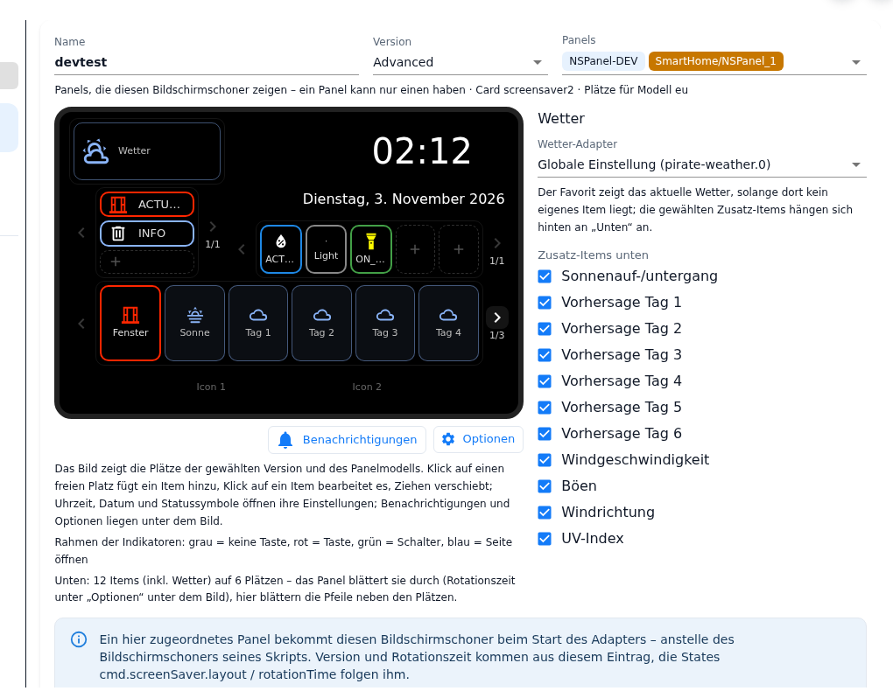

| Element | Meaning |
|---|---|
| **Name** | Name of the entry (can be renamed, has to stay unique). |
| **Version** | `Standard`, `Alternate`, `Advanced` or `Easyview` – the card (`screensaver`, `screensaver2`, `screensaver3`) follows from it. The line below names the card and the panel model the places are drawn for. |
| **Panels** | Multi select of the panels that show this screensaver. A panel can have only one. |
| **Panel picture** | The places of the chosen version and panel model: **Favorite**, **Left**, **Bottom**, **Indicators** or **Alternate**. Dashed with **+** = free (a click adds an item), occupied = a click edits it. |
| **Dragging** | An item can be dragged onto another place – also into another area. If an item lies there already, the two **swap** places. |
| **Label of an item** | The icon in its colour and a readable name below it (see below). The tooltip names the full name and how to operate the place. |
| **Bin on an item** | Appears on hover in the top right corner and deletes the item from the place. |
| **Eye on an item** | Small yellow eye icon: the item is only shown under a condition. The tooltip of the place names it in plain words – *Shown only while … is true* or *Shown only while: …*. |
| **`{ }` in front of the label** | The item is configured through [raw data](#6-raw-data-json). |
| **Paging arrows** | If a list area has more than one window, arrows with a counter stand to its left and right (above and below with narrow columns) – see [windows and paging](#7-more-items-than-places-windows-and-paging). |
| **Frame of the indicators** | grey = no key, red = button, green = switch, blue = open page. Grey also stands when the option **Indicators act as buttons** is off (see [Indicators](#8-indicators-and-buttons)). |
| **Time**, **Date** | A click opens the dialog for 12h/24h or the date format. |
| **Two status icons** | `mrIcon1` and `mrIcon2`; a click opens their dialog, grey = not used. Where they sit depends on the version: with Standard, Alternate and Easyview in the upper corners, with Advanced at the bottom next to the date. |
| **Button bar below the picture** | **Notifications** (with the number of messages switched on for this screensaver) and **Options** (rotation time, swipe gestures, indicator buttons). Up to 2.0.2 both buttons sat **in** the panel picture as a bell and a gear. |
| **Weather** (right column) | Weather adapter and its extra items, see [Weather](#11-weather). |

The label of an item in the panel picture follows an order of precedence – a regular expression is **never** shown as such:

1. the **headline** of the item (its `ScreensaverEntityText` for a raw data item),
2. the **name of the object** (`common.name`) as long as it is loaded, otherwise the last part of the id,
3. the **template name without the type** (`text.pirate-weather.favorit` → `pirate-weather favorit`),
4. the last part of the readable beginning of a search pattern (`/^pirate-weather\.0\.weather\.currently\./` → `currently`).

The tooltip shows the full text in the form *short name (template · state)*, for example `Window kitchen (window isOpen · alias.0.Window)`. If none of this is set, `?` stands there.

The note below the panel picture reminds that a panel assigned here gets this screensaver when the adapter starts – instead of the screensaver of its script.

## 3. Version and panels

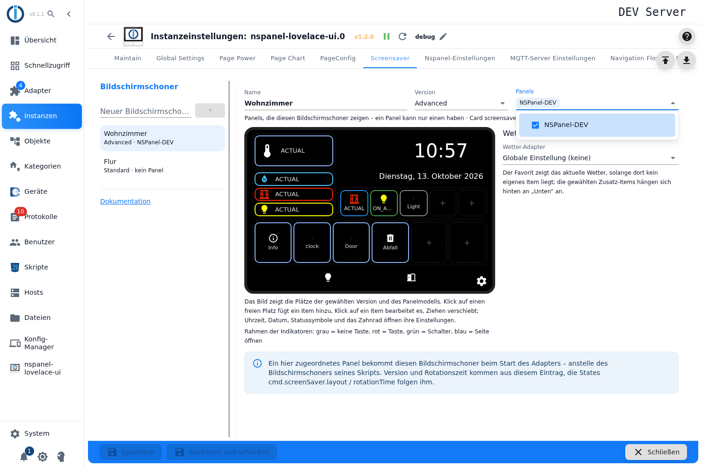

- **Panels**: The list shows all panels of the instance (tooltip with topic, IP and model). The **model of the first chosen panel** decides how many places the areas have – `eu` and `us-l` in landscape, `us-p` in portrait with a layout of its own. If the chosen panels have different models, the editor says which one it draws for. If a panel stands in two entries, the first one in the list wins; the editor and the log warn about it. Without a panel the editor says *No panel selected - this screensaver is not used*.
- **Changing the version**: Items that no longer have an area in the new version are kept and reported at the top – the button **Remove them** deletes them at once. Whoever switches back to the old version has them again.

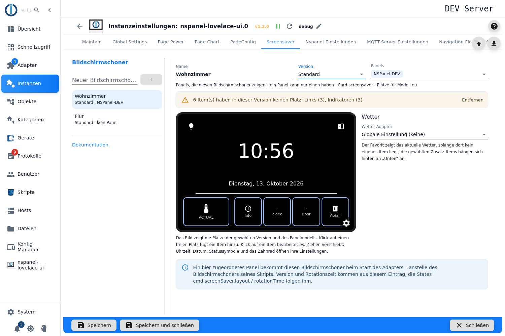

Places per version (model `eu`, differing values in brackets):

| Version | Favorite | Alternate | Left | Bottom | Indicators | Status icons |
|---|---|---|---|---|---|---|
| **Standard** | 1 | – | – | 4 | – | 2 |
| **Alternate** | 1 | 1 | – | 3 | – | 2 |
| **Advanced** | 1 | – | 3 | 6 | 5 | 2 |
| **Easyview** | – | – | – | 3 (`us-p`: 4) | – | 2 |

The number holds per window: **Left**, **Bottom** and **Indicators** take more items than they have places (see [windows and paging](#7-more-items-than-places-windows-and-paging)). **Favorite** and **Alternate** hold exactly one item.

## 4. Items: the item dialog

A click on a free place opens the item dialog, a click on an occupied item edits it. The title names the area and the place (*Item · Bottom · place 2 of 4*). The fields follow the place and the type of the state; on the right a preview draws the item the way the place shows it (as a sample value it calculates with 23.456 × factor).

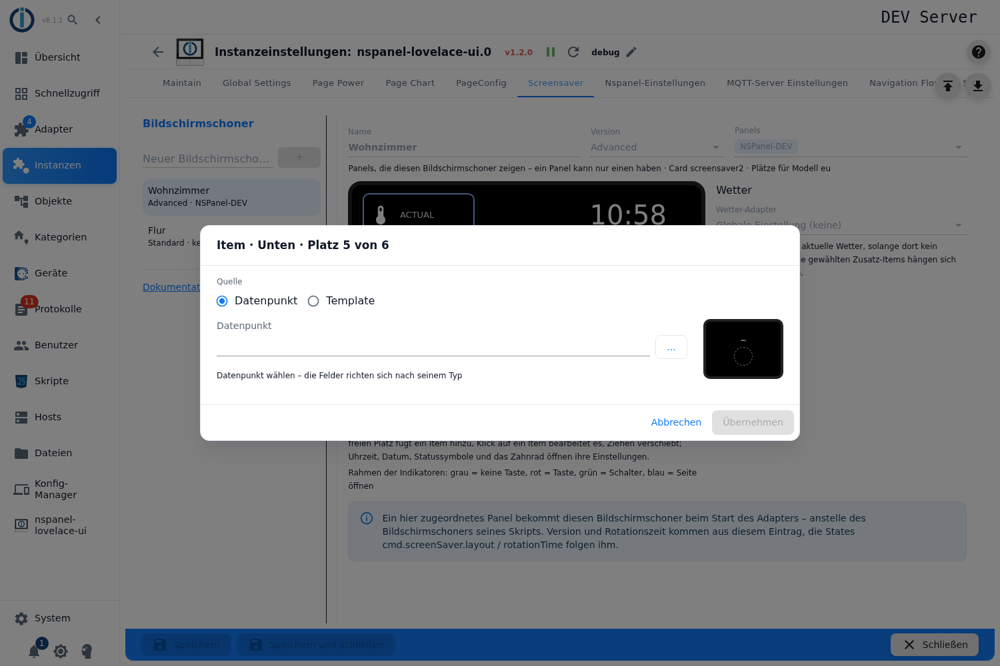

**Source**: *State* (one state with fields of its own) or *Template* (a page item template of the adapter, see [Templates](#5-templates-as-items)). At the top right of the title the button `{ }` for [raw data](#6-raw-data-json) sits in addition.

**State**: The id can be typed or picked from the object tree via **...**. It has to be a **state** (`type: state`) – a channel or device is refused with a hint, as is an id that does not exist. As soon as the state is known, the dialog shows *Name · type · unit* as well as the role and reveals the fields that fit the type:

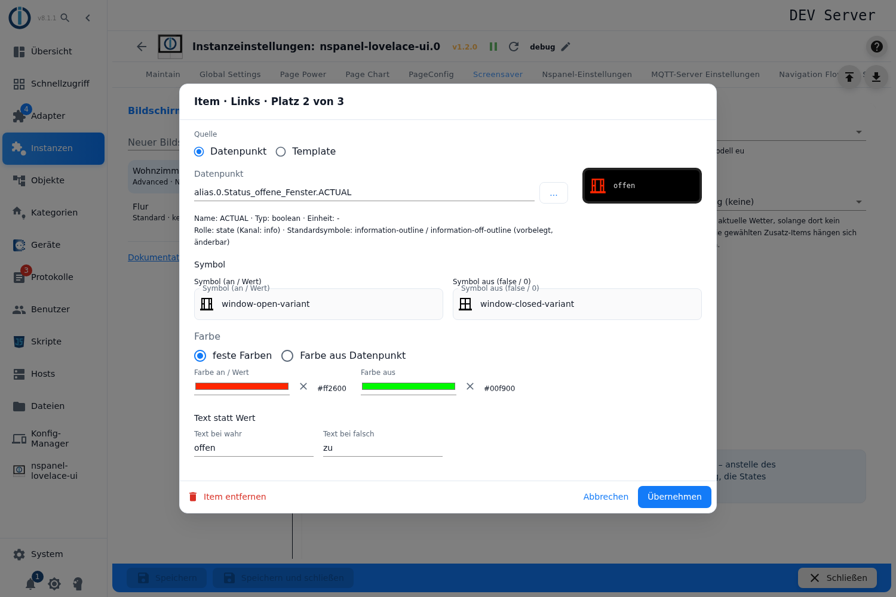

| Type of the state | Fields |
|---|---|
| **boolean** | **Icon (on / value)** and **Icon off (false / 0)**, **Color on / value** and **Color off**, **Text while true** / **Text while false** |
| **number** | Icon, additionally **Icon per value…**, fixed color or **color scale by value**, **Unit (empty = of the state)**, **Factor**, **Decimals** |
| date/time (role `date`/`time`) | Icon, color, **Date format** (seven presets to choose from, preset *Adapter default (short date)*; in **expert mode** additionally *Custom (JSON)* with a field for free `Intl.DateTimeFormatOptions`) |
| other (string …) | Icon, color |

Depending on the place, fields are added or dropped: **Bottom** has the **Headline (empty = name of the state)**, **Indicators** show the icon only and have the **Action on press** instead (see [Indicators](#8-indicators-and-buttons)); value and text fields are dropped there.

**Icon**: An item needs an icon – without an icon and without an icon list the panel cannot draw it, the dialog says *Without an icon the panel cannot draw the item - please choose an icon* and does not allow **Apply**. **Default icons are preset** from the role (and stay editable): the role of the channel above the state counts first (a `light` channel gives the bulb also for its `.ACTUAL`), otherwise the role of the state itself (`value.humidity`, `switch.light`, `sensor.door`, `value.temperature` …). The line "Role: …" names both. If the role knows no icons, the dialog says so.

**Color**: *fixed colors* (separate on/off for boolean, picker or hex value), for numbers alternatively *color scale by value* – **Edit scale…** opens the dialog with the scale, minimum/maximum, best value and mode (like the page items, see [PageConfig-Dialoge](PageConfig-Dialoge)):

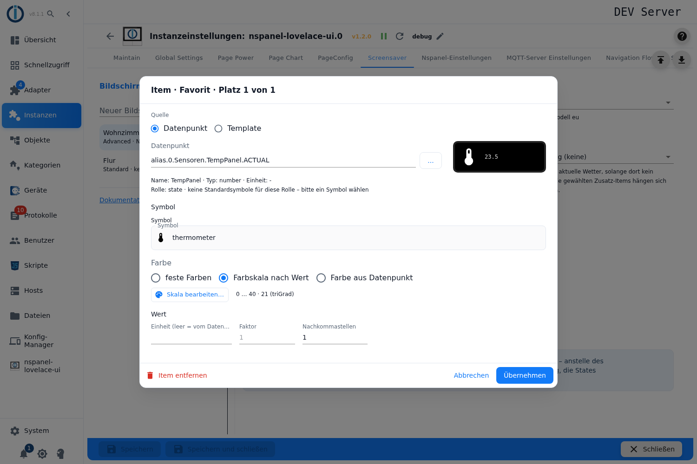

Third choice *color from a state*: a state whose value is the color – `#rrggbb`, `{"r":…,"g":…,"b":…}` (also as a JSON string) or a decimal number. On on/off states it applies to "on", "off" takes the default color. The state has to exist and be a state.

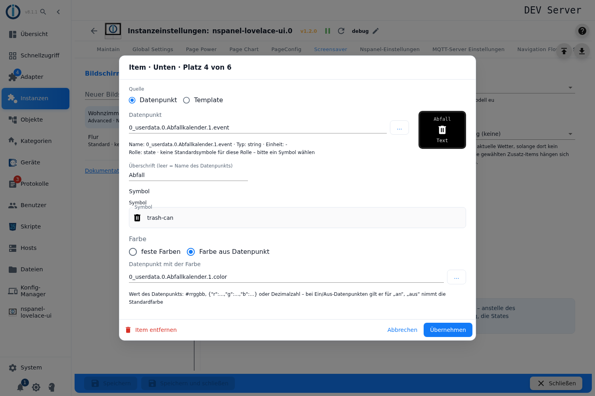

**Icon per value range** (numbers only): Instead of one fixed icon a list "up to value → icon" can be stored – the panel then changes the icon with the value. The button **Icon per value…** sits below the icon field as soon as the state is a number; expert mode is not needed for it. A stored list is shown next to it with its icons and the number of entries and can be deleted again with **Remove icon list** (bin).

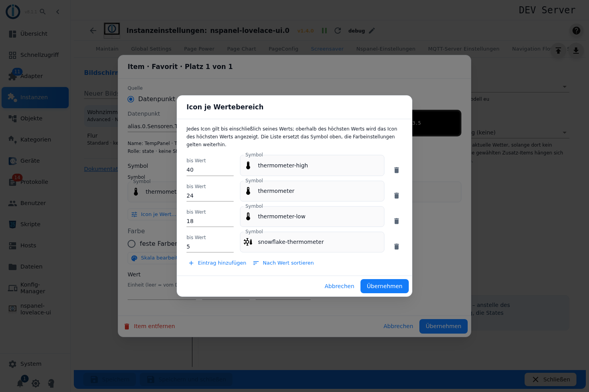

- Every row consists of **up to value** and an **icon**. An icon applies **up to and including** its value, above the highest value its icon stays. In the picture: up to 5 `snowflake-thermometer`, up to 18 `thermometer-low`, up to 24 `thermometer`, above that `thermometer-high` – so 23.5 °C shows the middle icon (see the preview).
- **Add entry** appends a row, the bin on the right removes it. **Sort by value** (from two rows on) orders the list for the overview only – the order does not matter, the adapter sorts it itself.
- **Apply** stays disabled while a started row is incomplete (*Every entry needs a numeric value and an icon*); rows without a value **and** without an icon are ignored. If a value appears twice, the dialog reports it – only one of those entries then takes effect, but it is not disabled because of it. An empty list removes the setting.
- The list **replaces the icon** of the field above and counts as the icon: an item with an icon list needs no icon of its own. Color or color scale, unit, factor and decimals keep working as before.

**Text instead of the value** (boolean): Instead of `true`/`false` the panel shows the **Text while true** or **Text while false**. Each field may also hold the **id of a state** – then its value is shown. An empty field keeps the raw value.

**Visibility**: This block stands below the other fields as soon as the state is known (with a template, as soon as the template and – if needed – the object are entered). It needs **no expert mode** either. It has two fields:

| Field | Effect |
|---|---|
| **State that hides the item while false** | While this state is `false`, the item does not appear on the panel. |
| **Condition over val (shown while true)** | JavaScript expression over `val`, the value of the item's state – so `val > 0` shows the item for positive values only. |

An item with a condition carries the eye icon in the panel picture and **takes no place on the panel** while the condition is not met – the other items move up.

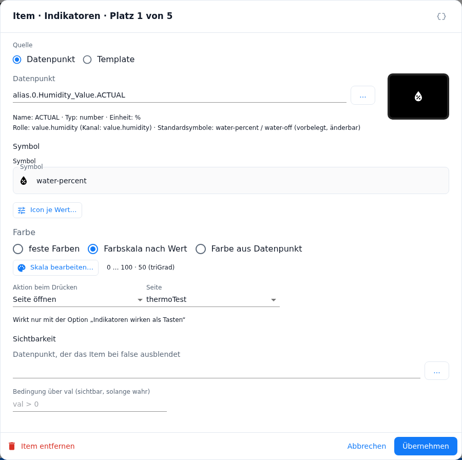

**Expert mode** (the icon at the bottom left of the admin bar) acts in the item dialog in one place only: with a date or time state the field **Date format** then additionally offers *Custom (JSON)* and below it a field for free `Intl.DateTimeFormatOptions`. All other fields are open without it.

**Remove item** at the bottom left deletes the item from the place.

## 5. Templates as items

With the source **Template** a place takes a page item template of the adapter (for example `text.clock`, `text.lock`, `script.light`, `shutter.basic`, the `pirate-weather.*` templates). The template brings icon, colors and texts itself – icon, color, text and value fields are dropped for that reason; the **visibility** settings hold for template items too.

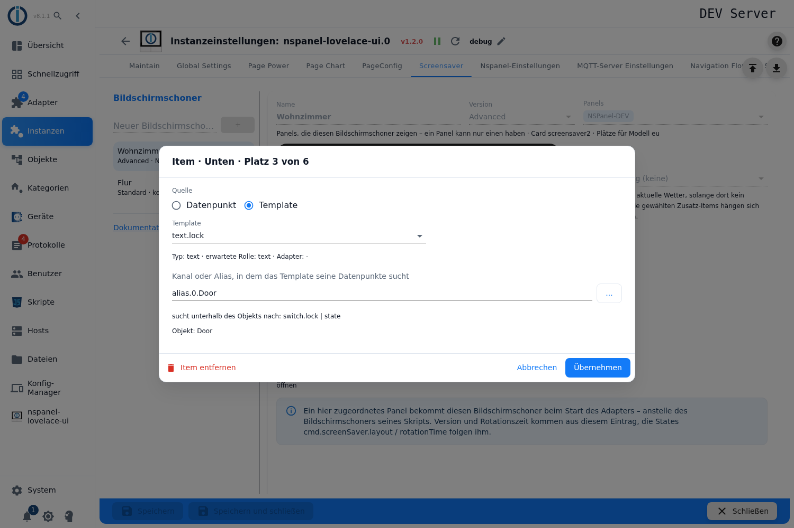

- The list of templates is delivered by the **running adapter** (grouped by prefix). If the instance is not running, the dialog says *The template list comes from the running adapter - it is not reachable right now*.
- Below the selection stand *Type · expects role · adapter*.
- Most templates search their states **below an object**: then a **Channel or alias the template searches its states in** is chosen (the object tree shows channels, devices and folders), and the dialog names what the template searches for below it (for example `.ACTUAL`, `switch.lock | state`). A single state in this spot is reported as a warning.
- Templates without an object (`text.clock`, `text.wlan`, `button.service.*` …) need none – then it says *This template needs no object - it brings its own data*.

## 6. Raw data (JSON)

For items the dialog does not put into fields, the item dialog takes the configuration **as JSON** – exactly as with the page items (see [PageConfig-Dialoge](PageConfig-Dialoge)). This is also where the items end up that the [Migration](Migration) took over from a script as raw data.

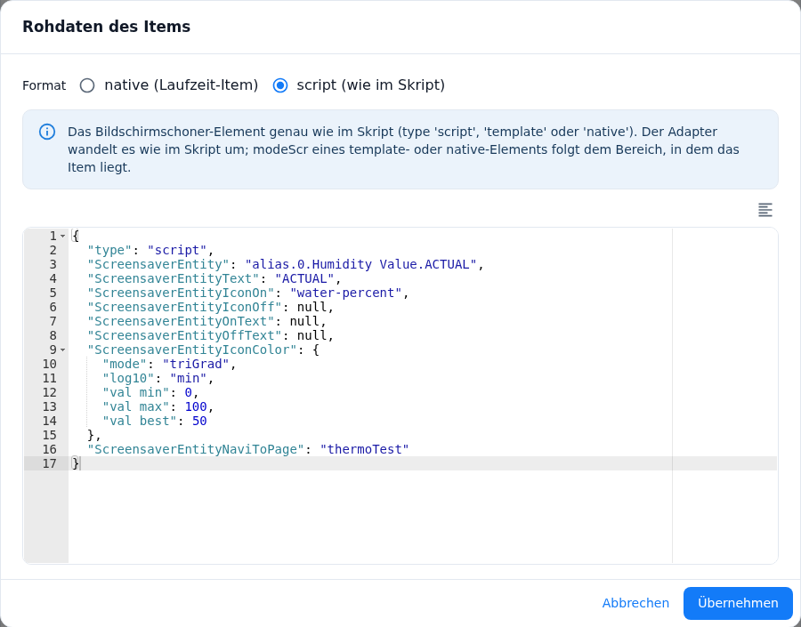

- **The button**: `{ }` at the top right in the title of the item dialog, tooltip *Enter the item as raw data (JSON)*. It is pale as long as the item is configured through the fields, and **orange** as soon as raw data is active.
- **The dialog** is called **Raw data of the item**. At the top the format choice, below it a help text for the chosen format, then a JSON editor with **Format JSON**. Invalid text is outlined in red and reported with *Invalid JSON: …* or *The configuration has to be a JSON object { ... }*; **Apply** then stays disabled.
- **Preset**: If the standard fields are filled in completely, the dialog opens the element the adapter would build from them, in the format **script**. Otherwise it starts empty (`{}`) in the format **native**.

| Format | What belongs in it |
|---|---|
| **native (runtime item)** | The runtime item of the screensaver, for example `{ template, dpInit, data }`. It is taken over unchanged. |
| **script (as in the script)** | The screensaver element with `type` `'script'`, `'template'` or `'native'`. The adapter converts it exactly as it converts an element of a script configuration. |

Example in the format **native** – a template with a search pattern:

```json
{
  "template": "text.pirate-weather.favorit",
  "dpInit": "/^pirate-weather\\.0\\.weather\\.currently\\./"
}
```

Example in the format **script** – a single state with fields of its own:

```json
{
  "type": "script",
  "ScreensaverEntity": "hm-rpc.0.ABC.1.TEMPERATURE",
  "ScreensaverEntityText": "Outside",
  "ScreensaverEntityIconOn": "thermometer",
  "ScreensaverEntityUnitText": "°C"
}
```

- **The area comes from the place**: `modeScr` is always set to the area the item lies in in the editor. A differing `modeScr` in the input is overwritten – otherwise the item would stand somewhere else on the panel than in the editor. With a `script` element of the type `'script'` the area follows from the list anyway.
- **The standard fields do not apply**: while raw data is active, the source switch and all fields disappear; in their place stands the note *Raw configuration active (format …)* with the button **Edit raw data**. A raw data item needs neither a state nor an icon – **Apply** is never disabled.
- **The way back**: **Remove raw data (back to standard)** in the dialog. After that the standard fields apply again; an item that was created as raw data from the start holds nothing there – not even a visibility condition – and has to be filled in anew.
- **In the panel picture**: the label starts with `{ }` (`{ } Outside`, just `{ }` without a recognisable name). The editor reads `enabled` / `ScreensaverEntityEnabled` and `visibleCondition` / `ScreensaverEntityVisibleCondition` from the raw data as well (up to ten levels deep) and sets the eye icon.

## 7. More items than places: windows and paging

The editor draws the list areas **Left**, **Bottom** and **Indicators** in **windows** of as many places as the version and the panel model allow. When the last window is full, it appends another one – so any number of items beyond the number of places can be created.

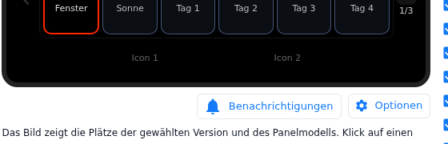

- **Paging in the editor**: From the second window on, arrows stand next to the places (above and below with narrow columns), tooltips *Previous places* and *Next places*. Next to them stands the counter `1/3`, whose tooltip writes it out: *Places 1-4 · page 1 of 3*.
- **Moving items between windows**: Drag an item over an arrow – the editor pages on while doing so (about one window per three quarters of a second) and the item can be dropped in the target window.
- **Note below the panel picture**: one line per area with more items than places, for example *Bottom: 7 items on 4 places - only visible items (condition met) take places, the panel pages through them. Here the arrows next to the places page.*
- **Paging on the panel**: The panel changes the window at the beat of the **rotation time** (see [Options](#12-options-rotation-swipe-indicator-buttons)).
- **Conditional items take no place**: An item whose visibility condition is not met drops out completely – the number of windows on the panel follows the visible items only.

Surplus items are therefore **not an error**. The warning *… item(s) have no place in this version* only concerns areas the chosen version **does not have at all** – indicators after switching from Advanced to Standard, for example.

## 8. Indicators and buttons

The indicators (version Advanced) show an icon only. For them the item dialog has the **Action on press**:

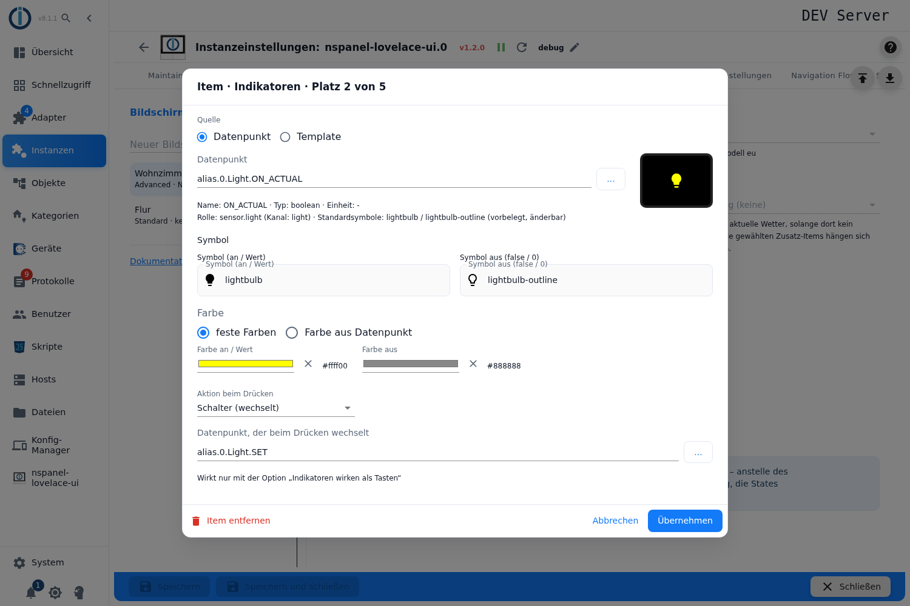

| Action | Effect |
|---|---|
| **none** | A tap leads to the main page. |
| **button (writes true)** | writes `true` into the chosen state. |
| **switch (toggles)** | toggles the chosen state between `true` and `false`. |
| **open a page** | opens the chosen page of the instance. |

Button and switch need a **writable** state; if it is not writable, the dialog says *… is not writable (common.write) - button and switch need a writable state* and does not allow applying. Below the field stands the note *Works only with the option "Indicators act as buttons"*. In the panel picture the frame shows the action: red = button, green = switch, blue = page, grey = none or the option is off.

**One state per indicator.** The adapter creates a state of its own for every indicator item: `panels.<panel>.buttons.indicator-1`, `-2`, `-3` … in the order in which the items stand in the area **Indicators**. The states are `boolean`, read-only and carry the role `button.press`. A tap on the indicator **always** writes `true` into its state – independently of the option. That makes them usable as triggers for own scripts, even without an action in the dialog.

The option **Indicators act as buttons** only decides what happens *afterwards*: switched on, the configured command runs (button, switch, page); switched off, the panel jumps to the main page.

## 9. Status icons

The two status icons (`mrIcon1`, `mrIcon2`) each follow one state: **Icon on** while `true`, otherwise **Icon off**, each with a **Color on** / **Color off** of its own. An optional second **State shown as value (optional)** next to it is shown with **Decimals** and **Unit**. Without a state the icon stays unused and is grey in the panel picture.

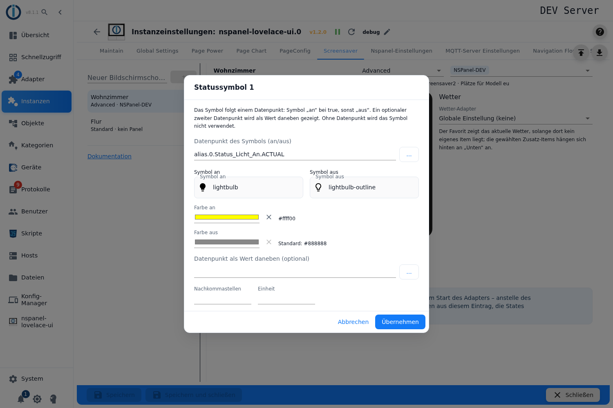

## 10. Time and date

Click on the time: **Adapter default**, **24 hours** or **12 hours**, with a preview.


Click on the date: format of **Weekday**, **Month** and **Year** (long, short, numeric, two digits …). *Global setting* takes the format from the instance settings; a value here holds for this screensaver only. The preview shows the result with today's date.

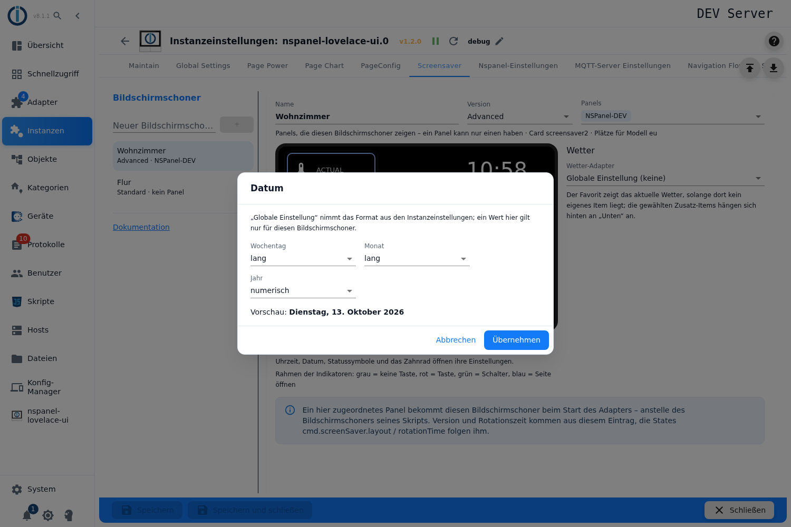

## 11. Weather

To the right of the panel picture stands the **Weather adapter** of this screensaver:

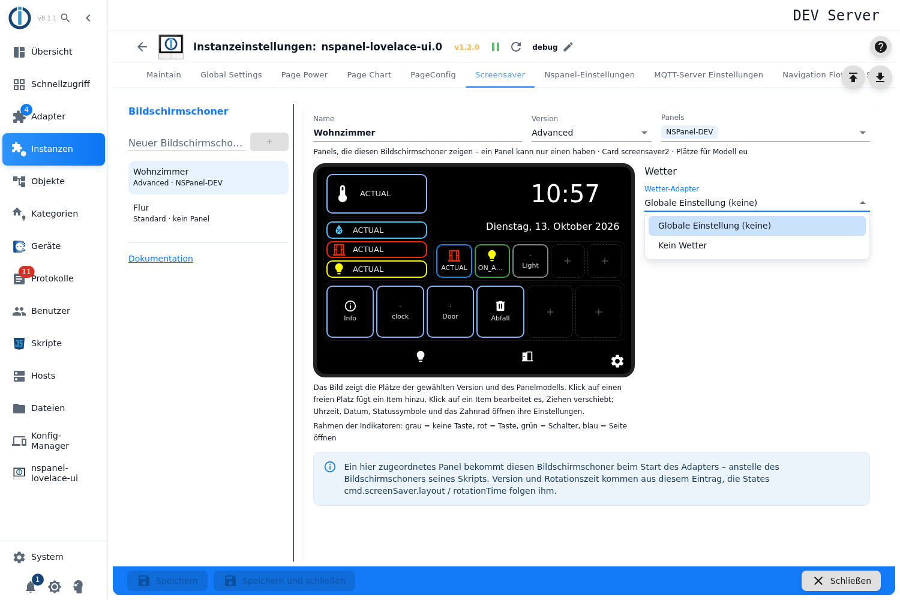

- **Global setting** – the weather instance from the instance settings (named in brackets), **No weather**, or one of the installed weather instances. Supported are `accuweather`, `openweathermap`, `pirate-weather` and `brightsky`; if none of them is installed, the editor says so.
- With a chosen adapter, tick boxes for its **Extra items at the bottom** appear (sunrise/sunset, forecast day …, wind speed, gusts, wind direction, UV index, solar radiation). They attach themselves **behind the last own item** in the area **Bottom**; if both no longer fit on the places, the panel pages through them (rotation time behind the button **Options**) and the editor shows a scroll bar with the number of items in this spot.
- The **Favorite** shows the current weather as long as no own item lies there – an own item replaces it.
- An instance that is entered but no longer installed is reported (*The instance "…" is not installed (anymore).*).

## 12. Options: rotation, swipe, indicator buttons

The button **Options** below the panel picture opens three settings (up to 2.0.2 it was the gear in the picture):

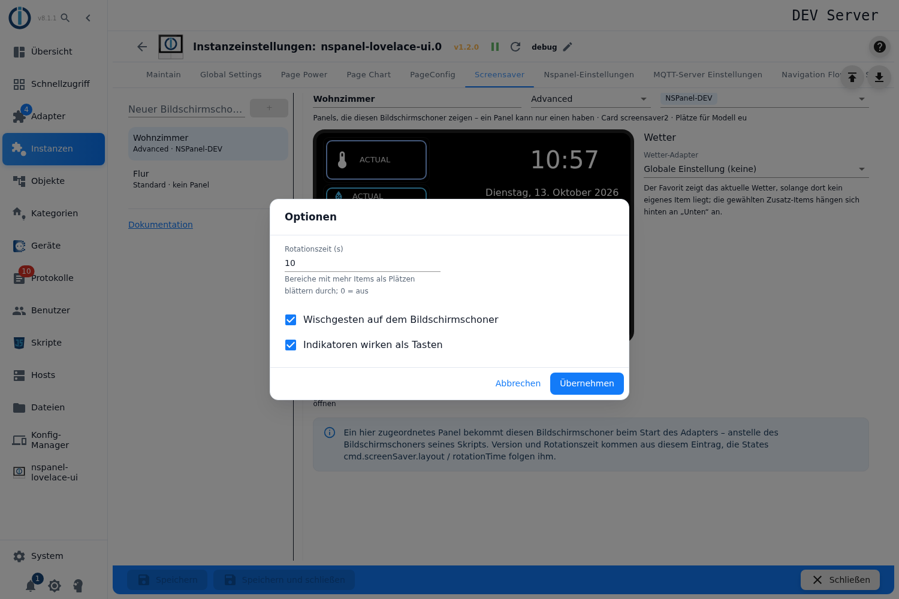

| Field | Effect |
|---|---|
| **Rotation time (s)** | The beat at which the panel pages on through the windows of an area with more items than places. `0` = off; values of 1 and 2 seconds are treated as 3 seconds by the adapter. |
| **Swipe gestures on the screensaver** | A gesture on the screensaver writes its number into `panels.<panel>.buttons.screensaverGesture`: `2` = leave (bExit), `3` = up, `4` = down, `5` = left, `6` = right. |
| **Indicators act as buttons** | The precondition for the action of an indicator being carried out (see [Indicators](#8-indicators-and-buttons)). |

The gesture number only arrives when the state `panels.<panel>.cmd.screenSaver.doubleClick` of the panel is on as well (default: on). If it is off, the adapter sets `buttons.screensaverGesture` to `0` (`inactive`) at the start and writes nothing into it afterwards.

## 13. Notifications

The button **Notifications** below the panel picture (up to 2.0.2 the bell in the picture) opens them: two lines that cover the screensaver while a state is "on". All screensavers share one common list; the tick box **Show on this screensaver** decides where a notification appears. The number on the button tells how many are switched on for this screensaver. The button only works while the instance is running.

> Everything else – content, conditions, priority, dismissing and the buzzer – is on a page of its own: [Screensaver-Notify](Screensaver-Notify).

## 14. Saving – what the adapter does with it

**Save** or **Save and close** at the bottom; the instance restarts. At the start the adapter looks for the first entry that holds the topic of each panel and builds the screensaver from it. The log then says, for example:

```
Screensaver 'Wohnzimmer' (advanced) from the admin configuration replaces the script screensaver of panel 'NSPanel-Wohnzimmer'
```

If the panel had no screensaver of its own before, the line ends with `is used by panel '…'`. If a panel stands in several entries, the log warns in addition (*… is listed in several screensavers (…) – '…' is used*).

- The screensaver of the script is replaced for this panel; panels without an entry keep it.
- Version, rotation time, swipe gestures and indicator buttons come from the entry; the states `panels.<panel>.cmd.screenSaver.layout` and `…rotationTime` follow it (they do not overwrite the entry).
- An item without an icon and without an icon list gets the default icons of its role, without a known role `help-circle-outline` – the dialog does not let it through without an icon in the first place, though.
- For every indicator item `panels.<panel>.buttons.indicator-<n>` is created.
- A [web panel](WebPanel) is a copy of its panel: the entry is found through the topic of the real panel and holds for both.
- The stored form lies in `native.screensaverConfig` of the instance (one object per entry). The **notifications** are kept separately from it in `native.screensaverNotify`; the entry only remembers the ids of those that are to appear on it.

## Pitfalls

- **The Screensaver tab is missing:** It only appears once the MQTT settings are complete (server or IP, port and credentials) **and at least one panel** stands in the panel table under [NSPanelsetting](NSPanelsetting). Central credentials only count as long as the adapter does **not** provide the MQTT server itself – in server mode the user name and the password have to stand in the fields.
- **Everything greyed out:** The instance is not running. The editor only works with a running instance, and the template list comes from the running adapter too.
- **No places in the panel picture:** No panel chosen yet.
- **Apply stays disabled:** state missing or not a state (channel chosen?), no icon and no icon list, no writable state for button/switch, no valid state for *color from a state*, a missing template or a missing object with a template – the dialog names the reason in a yellow line. A raw data item is not affected by this.
- **The icon does not change with the value:** An icon list exists for number states only, and every icon applies up to and including its value – above the highest value its icon stays. Duplicate values are reported by the dialog, only one of them takes effect.
- **Wrong icon preset:** The role of the channel above the state counts first – just change the icon.
- **The panel shows the script screensaver:** The panel stands in no entry, or it stands in a second entry further down (the first wins) – see the log.
- **The panel always shows the same items although more are created:** With **rotation time 0** the panel does not page – it stays on the first window. Set a rotation time for surplus items.
- **An item is missing on the panel but has a place in the editor:** If it carries the eye icon, its condition is not met – the tooltip of the place names it.
- **Items are reported after a version change:** They lie in areas the new version does not have (message at the top of the editor); switch the version back or **Remove them**. More items than places **in an existing** area does not trigger this message.
- **Easyview has no favorite:** For Easyview the editor only draws the area **Bottom**. A favorite item from another version is therefore reported as an item without a place on the change.
- **The indicator does not react to its action:** The state `panels.<panel>.buttons.indicator-<n>` arrives nevertheless – the panel only jumps to the main page instead of carrying out the command. Then the option **Indicators act as buttons** is missing.
- **`buttons.screensaverGesture` stays empty:** Either **Swipe gestures on the screensaver** is off or the state `cmd.screenSaver.doubleClick` of the panel is.
- **After "Remove raw data" the item is empty:** The standard fields come back, not the contents of the JSON – an item originally created as raw data has to be filled in anew afterwards. Save the JSON before removing it.
