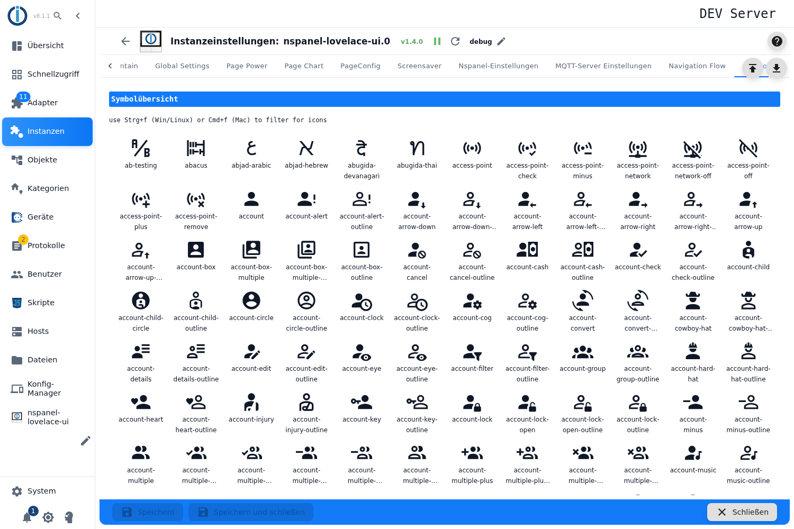

# Icon overview

A lookup aid: it lists every icon the adapter ships with, together with its name. That name is what you enter in the icon fields of the page and screensaver configuration.

## Searching and using a name

- **Show the search field:** `Ctrl + F` (Windows/Linux) or `Cmd + F` (Mac). The field filters the list by part of a name, case does not matter. The **X** in the field clears the filter.
- **Copy a name:** clicking an icon puts **its name** on the clipboard (not the image); a short message confirms it. From there it can be pasted into any icon field.
- The overview is read-only — clicking changes nothing in the configuration.

## Notes

- The collection is large (several thousand icons); the filter is the fastest way in. Typing `thermometer`, for instance, leaves the temperature variants.
- The icons take the text colour of the interface, so they are visible in dark mode too. Which colour an icon gets on the panel is set where the icon is used.
- While this tab is open, `Ctrl + F` is captured by the interface — the browser's own search is available again once you leave the tab.
