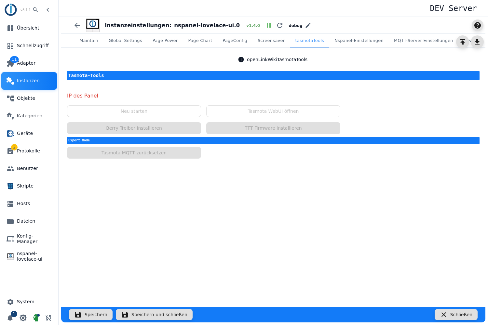

# Tasmota tools

A toolbox for when something goes wrong. It can restart a panel, open its web interface, reinstall the **Berry driver** or the **TFT firmware** individually and — in expert mode — reset Tasmota to factory settings.

> **The tab is only visible in expert mode.** Toggle it with the head icon at the bottom left of the admin sidebar; the setting applies to the current browser session only. It can be made permanent in the ioBroker system settings.

**Normal operation needs none of this.** When a panel is set up, the [NSPanel initialisation](Adapter-Installation) does all of it automatically; these tools exist for the case that one of those steps has to be repeated.

## The tools

First pick the device in the **IP of the panel** field — the list suggests the known panels, and a foreign IP can be typed in. Only then do the buttons become active.

| Button | Effect |
|---|---|
| **Restart** | Restarts Tasmota on the panel. Asks for confirmation first. |
| **Open Tasmota WebUI** | Opens the panel's web interface in a new tab. |
| **Install Berry driver** | Installs the Berry driver again. The panel downloads the file **itself from the internet** — without internet access it fails. |
| **Install TFT firmware** | Reinstalls the display firmware, matching the hardware model and the *beta TFT* setting. Takes a few minutes and restarts the panel. |
| **Reset Tasmota MQTT** (section *Expert Mode*) | ⚠️ **Factory reset of the Tasmota configuration.** The admin asks first. The Wi-Fi credentials survive; everything else — MQTT, topic, template — is gone and the panel has to be initialised again. This is exactly the command needed when a panel was attached to another host before. |

## When it does not work

- **Buttons stay grey:** no IP is selected, or the instance is not running.
- **Berry install without a success message:** the panel has no internet access, or the web interface is password protected and the password is missing in the [MQTT server settings](General).
- **The panel is silent after the factory reset:** that is expected — initialise it again through [NSPanel settings](NSPanelsetting).
