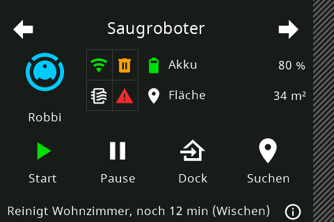
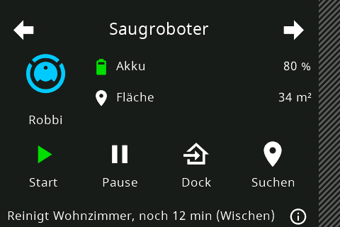
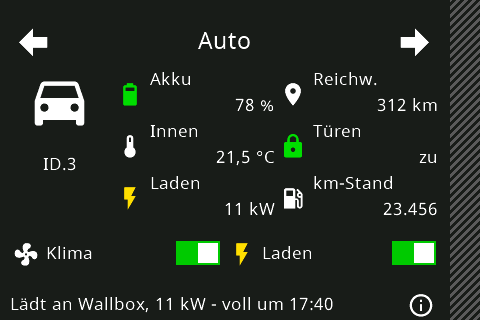

# Geräteseite in der HMI: cardDevice1, cardDevice2, cardDevice3 (EU)

Drei neue Seiten für **ein** Gerät (Saugroboter, Waschmaschine, Pkw …): großes Geräte-Icon, feste Anzahl Slots mit
festen Elementarten, Statuszeile unten, info-Icon unten rechts. Gebaut mit `HMI/tools/card_device.py`, Vorschau unter
`doc/Pictures/device-page/hmi-cardDevice{1,2,3}.png` (cardDevice1 mit Status-Icons, ohne: `hmi-cardDevice1-plain.png`).
Nur EU; us-l und us-p sind nicht angepasst.

## Bauen

```
PYTHONDONTWRITEBYTECODE=1 python3 HMI/tools/swipe_release_fix.py /mnt/projekte/nspanel-v6.2.0.entities5.HMI /tmp/swipe.HMI
PYTHONDONTWRITEBYTECODE=1 python3 HMI/tools/card_device.py /tmp/swipe.HMI nspanel-v6.2.0.device5.HMI --preview doc/Pictures/device-page
```

Teststände: `device1` (cardDevice1 mit N=6, ohne Status-Icons), `device2` (N=10, erstes Raster 42 px hoch),
`device3` (N=10, Raster auf die info-Zeilen ausgerichtet), `device4` (wie device3, zusätzlich senden main und info
auch bei Typ `text`), `device5` (Long-Press `buttonPress3` und Popups in main und allen Slots – aktuell; alle in
`/mnt/projekte/nspanel emu/`).

- Basis: `nspanel-v6.2.0.entities5.HMI` (= `HMI/nspanel-v6.2.0.HMI` + `entities2_five_rows.py`, geprüft: nur cardEntities,
  cardEntities2 und die pageType-Einträge unterscheiden sich). Dort fehlte `swipe_release_fix.py` (#934, keine HMI
  hatte ihn bisher). Er läuft deshalb vorher, die neuen Seiten erben ihn von cardGrid.
- Jede Seite ist eine frische Kopie von cardGrid: Kopfzeile, Pfeile samt Long-Press/Blinken, Swipe-Streifen,
  tmSerial (Empfang, Quittung/CRC, pageType-Umschalter), Sleep-Timer und renderCurrentPage bleiben unverändert.
  Entfernt sind die sechs Zellen (`bEntity1–6`, `tEntity1–6`); `tmLP` und `LPState` (Long-Press der Zellen) bleiben
  unverändert.
- Die Seiten werden **hinten** an die Seitenliste von main.HMI angehängt (Abschnitte 37/38/39.pa). Keine bestehende
  Seiten-ID verschiebt sich.
- Jede Seite mit tmSerial bekommt `if(tId.txt=="cardDevice<n>") page cardDevice<n>` hinter dem cardGrid3-Zweig
  (36 Seiten; pageTest hat keinen Umschalter, wie bisher).
- Idempotent: Läuft das Werkzeug auf seiner eigenen Ausgabe, baut es die drei Seiten in ihren Abschnitten neu und
  ändert sonst nichts (geprüft).

## Protokoll

```
pageType~cardDevice1          (bzw. cardDevice2 / cardDevice3)
entityUpd~<heading>~<prev: 6 Felder>~<next: 6 Felder>~<main>~<slot 1>~…~<slot N>~<info>
```

- Überschrift und Navigation (Felder 1–13) genau wie cardGrid.
- Jedes Element hat 6 Felder wie eine cardGrid-Zelle: `type~intName~icon~iconColor~displayName~optionalValue`.
- Element e (main = 0, Slot k = k, info = N+1) beginnt bei Feld **14 + 6·e**:

| Seite | N | main | Slots | info |
|---|---|---|---|---|
| cardDevice1 „Steuern“ | 10 | 14–19 | 20–79 | 80–85 |
| cardDevice2 „Fortschritt“ | 6 | 14–19 | 20–55 | 56–61 |
| cardDevice3 „Werte“ | 8 | 14–19 | 20–67 | 68–73 |

- Typ leer oder `delete` blendet ein Element komplett aus.
- Icons und Farben kommen nur vom Adapter. Ein Icon darf wie bei cardGrid auf `¬<Font-ID>` enden (setzt die Schrift).

### Art je Slot

| Seite | Slot 1 | Slot 2 | Slot 3 | Slot 4 | Slot 5 | Slot 6 | Slot 7 | Slot 8 | Slot 9 | Slot 10 |
|---|---|---|---|---|---|---|---|---|---|---|
| cardDevice1 | info | info | button | button | button | button | status | status | status | status |
| cardDevice2 | value | progress | info | info | info | button | – | – | – | – |
| cardDevice3 | info | info | info | info | info | info | switch | switch | – | – |

### Elementarten

| Art | Darstellung | Tippfläche |
|---|---|---|
| main | Icon Font 4 (Bold 80, Icon 66 px) in iconColor, Name (Feld 5) darunter. **Feld 6 → Statuszeile** | Icon und Name |
| info | Icon Font 1 in iconColor, Name Font 0, Wert (Feld 6) Font 0 rechtsbündig | Icon, Name und Wert |
| value | Feld 6 in Font 4, Name Font 0 darunter, kleines Icon Font 1 daneben (leeres Icon-Feld = kein Icon) | Rechteck um Icon, Wert und Name |
| progress | Name Font 0 darüber, Balken über die volle Breite; Feld 6 = ganze Zahl 0–100 (wird begrenzt), Füllung in iconColor, Rahmen in der Textfarbe | Name und Balken |
| button | Icon Font 3 in iconColor, Name Font 0 darunter | Icon und Name |
| switch | Icon Font 1, Name Font 0, Schalter `btOnOff` (Kopie von cardEntities, Bilder 1/2 bzw. 10/11 bei schwarzem Hintergrund); Zustand aus Feld 6 `0`/`1` | Icon und Name wie die anderen Plätze; der Schalter selbst sendet `OnOff` |
| status | nur Icon (Feld 3) Font 1 in iconColor, in einem 2×2-Block mit Raster (nur cardDevice1, siehe unten); der Name (Feld 5) wird nicht gezeigt, aber als Überschrift eines Popups gemerkt; Wert ungenutzt | die Zelle |
| info-Icon | Icon Font 1 in iconColor unten rechts; Name/Wert werden nicht genutzt | Icon; nur `buttonPress2`, kein Long-Press (das Element hat keinen Typ) |

- **Jeder Platz verhält sich wie eine cardGrid-Zelle** (main und alle Slot-Arten, Code der Zelle der Basis-HMI 6.2.0
  unverändert übernommen, siehe „Ereignisse beim Antippen“): kurzer Tipp `buttonPress2`, langer Druck `buttonPress3`
  bzw. Popup je Typ.
- Bei info, button und main leiten Name und Wert ihren Tipp an das Icon weiter (`click <Icon>,1/0`), die ganze
  Zeile/Kachel ist also bedienbar. value, progress und Icon+Name eines Schalters haben keinen Knopf; über ihnen liegt
  je ein unsichtbarer Hotspot `mSlot<k>` (Kopie eines Swipe-Streifens, kostet 7 Byte RAM). Die Status-Zellen tragen
  den Code selbst.
- **Regel:** Jedes Objekt, das beim Antippen den Press-Effekt zeigt, sendet beim Loslassen auch ein Ereignis. Die
  Umkehrung gilt nicht mehr: value, progress, status und Schalter-Icon/-Name senden, zeigen aber **keinen**
  Press-Effekt (Texte bzw. Hotspot, keine Knöpfe).
- **Statuszeile** `tStatus`: Feld 6 von main, immer (auch wenn main ausgeblendet ist), einzeilig, Font 0, normale
  Textfarbe. Leeres Feld = leere Zeile.
- **value-Schrift:** Font 4 (NotoSans Bold 80) enthält Ziffern, `:`, `%`, `°`, `,`, `.`, `-`, `/`, Leerzeichen,
  Buchstaben inkl. ä/ö/ü – aber **kein `€`**. Vorschub: Ziffer 33 px, `:` 17 px, `%` 53 px, `°` 25 px, Leerzeichen 15 px.

### Ereignisse beim Antippen

Der Code ist der der cardGrid-Zelle (`bEntity1` der Basis-HMI 6.2.0: `down`, `up`, Timer `tmLP` 500 ms, Merker
`LPState`), nur mit den Namen des jeweiligen Platzes. Ablauf:

1. **Berühren** (`down`): `tmLP` startet; Name, ID, Icon und Icon-Farbe gehen nach `pageIcons.tTmp1/2/3` und
   `tempIconColor`. Typ `shutter`, `shutter2`, `input_sel`, `timer`: das Popup öffnet **sofort**.
2. **Halten** (`tmLP`, nach 500 ms): Typ `light`, `light2`, `fan`, `number`: das Popup öffnet. Jeder andere Typ:
   `LPState=1` (Long-Press scharf).
3. **Loslassen** (`up`): `LPState` 0 → `event,buttonPress2,<intName>,button`, sonst
   `event,buttonPress3,<intName>,button`; `LPState` zurück auf 0. Der Long-Press wird also **beim Loslassen**
   gesendet, ohne sichtbare Rückmeldung während des Haltens (wie cardGrid).

Was der Adapter je Typ bekommt (gilt für **jede** Slot-Art und main):

| Typ | kurzer Tipp (< 500 ms) | langer Druck (≥ 500 ms) |
|---|---|---|
| `shutter`, `shutter2`, `input_sel`, `timer` | Popup sofort beim Berühren, **kein** `buttonPress2`/`3`; das Popup meldet `event,pageOpenDetail,<popup>,<intName>` | dasselbe (das Popup ist schon offen) |
| `light`, `light2`, `fan`, `number` | `event,buttonPress2,<intName>,button` | Popup nach 500 ms (popupLight, popupLight2, popupFan, popupSlider), kein `buttonPress3` |
| `text` | `event,buttonPress2,<intName>,button` | `event,buttonPress3,<intName>,button` |
| alle übrigen (`button`, `switch`, …) | `event,buttonPress2,<intName>,button` | `event,buttonPress3,<intName>,button` |

Je Slot-Art:

| Element | Objekte mit Tipp | Press-Effekt | kurz / lang | Besonderheit |
|---|---|---|---|---|
| main | `bMain`, `tMainName` → `bMain` | ja (Knopf, `bco2` 14823) | wie Tabelle oben | Typ `text` mit leerem intName sendet nichts |
| info | `bEntity<k>`, `tEntity<k>`/`tValue<k>` → `bEntity<k>` (cardDevice1 Slot 1–2 auch `bEntityS<k>`, `tEntityS<k>`, `tValueS<k>`) | ja | wie Tabelle oben | wie main |
| button | `bEntity<k>`, `tEntity<k>` → `bEntity<k>` | ja | wie Tabelle oben | sendet immer (auch `text` ohne intName), exakt der cardGrid-Code |
| value | Hotspot `mSlot1` (110/67, 226×110) über `tIcon1`, `tValue1`, `tEntity1` (cardDevice2) | nein | wie Tabelle oben | wie main; leeres Element sendet nichts |
| progress | Hotspot `mSlot2` (10/179, 429×42) über `tEntity2` und dem Balken (cardDevice2) | nein | wie Tabelle oben | wie value; das Popup bekommt kein Icon (leer), Farbe = Textfarbe des Namens |
| switch: Icon und Name | Hotspot `mSlot7`/`mSlot8` (10 bzw. 226/236, 161×34) über `tIcon<k>`, `tEntity<k>` (cardDevice3) | nein | wie Tabelle oben | wie value |
| switch: Schalter | `btOnOff<k>` | Bildwechsel | `event,buttonPress2,<intName>,OnOff,<0\|1>` beim Berühren, kein Long-Press (unverändert) | – |
| status | `tStat7–10` (cardDevice1), Code in der Zelle | nein | wie Tabelle oben | wie main; leere Zelle (Rahmen sichtbar) sendet nichts; Popup-Überschrift = Feld 5 (`vaName<k>`) |
| info-Icon | `bInfo` | ja | immer `event,buttonPress2,<intName>,button` | kein Long-Press, kein Popup (unverändert) |
| Statuszeile | `tStatus` | nein | – | kein Touch |

- Ausgeblendete Elemente (`vis 0`) nehmen keinen Tipp an. Hotspots und Status-Zellen bleiben dagegen berührbar, wenn
  ihr Element leer ist; ihr Code beginnt deshalb mit `if(type<k>.txt!="delete"&&type<k>.txt!="")`.
- Die Bedingung im Loslassen-Code (alle außer button) lautet `if(type<k>.txt!="text"||entn<k>.txt!="")`.
- **Popups und Rückkehr:** Die Popup-Seiten kennen die aufrufende Seite nicht. Sie lesen beim Laden nur
  `pageIcons.tTmp1` (Überschrift), `tTmp2` (ID → `entn`), `tTmp3` (Icon) und `tempIconColor` (popupSlider) und melden
  `event,pageOpenDetail,<popup>,<intName>`. Schließen (`b0` oder Sleep-Timeout) sendet
  `event,buttonPress2,<popup>,bExit`; zurück führt das `pageType~cardDevice<n>` des **Adapters** (der Zweig dafür steht
  im tmSerial jedes Popups). In der HMI ist für die Rückkehr nichts weiter zu setzen – derselbe Weg wie bei cardGrid.
- Wie bei cardGrid entscheidet `tmLP` anhand von `tTmp.txt` (Typ des berührten Platzes). Der tmSerial-Parser benutzt
  `tTmp` ebenfalls: kommt während des Haltens ein `entityUpd`, öffnet ein light/fan/number-Popup nicht, es gibt dann
  beim Loslassen `buttonPress3`. Verhalten der Vorlage, nicht geändert.

## Feldbreiten für den Adapter (Kürzen)

Font 0 ist 24 px hoch; die Breite eines Texts liefert `src/lib/const/text-width.ts` (Font 0).

| Seite | main-Name | Statuszeile | Slot-Name | Slot-Wert |
|---|---|---|---|---|
| cardDevice1 | 110 px | 390 px, 1 Zeile, links | info: 164 px, **mit Status-Icons 86 px**; button: 104 px | info: 110 px (rechtsbündig, in beiden Varianten) |
| cardDevice2 | 96 px | 390 px, 1 Zeile, mittig | value: 190 px; progress: 429 px; info: 104 px; button: 100 px | value: 190 px **Font 4**; info: 104 px |
| cardDevice3 | 100 px | 390 px, 1 Zeile, links | info: 125 px; switch: 125 px | info: 125 px |

Für zwei Statuszeilen (≥ 60 px Höhe) war in keinem Layout Platz: überall **eine** Zeile, 390 px.

## Geometrie

Kopfzeile wie cardGrid (`bPrev` 9/16 50×50, `tHeading` 65/26 320×30 Font 2, `bNext` 391/16 50×50). Inhalt
x 10–439 (die Swipe-Streifen liegen bei x < 9 und x ≥ 440), y 67–287; Statuszeile y 289–318, info-Icon
x 404–439 / y 288–319. Ausrichtung: links = xcen 0, mittig = 1, rechts = 2; alle Texte ycen 1, isbr 0.

### cardDevice1 „Steuern“ (Saugroboter, Rasenmäher)

Mit Status-Icons / ohne (alle vier Status-Slots leer – sieht aus wie vor den Status-Icons):




| Objekt | x | y | w | h | Font | Ausrichtung | txt_maxl |
|---|---|---|---|---|---|---|---|
| bMain | 10 | 68 | 110 | 86 | 4 | mittig | 10 |
| tMainName | 10 | 156 | 110 | 26 | 0 | mittig | 31 |
| bEntity1 (info, breit) | 126 | 76 | 36 | 34 | 1 | mittig | 10 |
| tEntity1 | 164 | 80 | 164 | 26 | 0 | links | 31 |
| tValue1 | 330 | 80 | 110 | 26 | 0 | rechts | 31 |
| bEntity2 (info, breit) | 126 | 120 | 36 | 34 | 1 | mittig | 10 |
| tEntity2 | 164 | 124 | 164 | 26 | 0 | links | 31 |
| tValue2 | 330 | 124 | 110 | 26 | 0 | rechts | 31 |
| bEntityS1 (info, schmal) | 204 | 76 | 36 | 34 | 1 | mittig | 10 |
| tEntityS1 | 242 | 80 | 86 | 26 | 0 | links | 31 |
| tValueS1 | 330 | 81 | 110 | 26 | 0 | rechts | 31 |
| bEntityS2 (info, schmal) | 204 | 120 | 36 | 34 | 1 | mittig | 10 |
| tEntityS2 | 242 | 124 | 86 | 26 | 0 | links | 31 |
| tValueS2 | 330 | 125 | 110 | 26 | 0 | rechts | 31 |
| tStat7 (status, oben links) | 124 | 71 | 38 | 45 | 1 | mittig | 10 |
| tStat8 (oben rechts) | 161 | 71 | 38 | 45 | 1 | mittig | 10 |
| tStat9 (unten links) | 124 | 115 | 38 | 45 | 1 | mittig | 10 |
| tStat10 (unten rechts) | 161 | 115 | 38 | 45 | 1 | mittig | 10 |
| bEntity3–6 (button) | 10 / 118 / 226 / 334 | 190 | 104 | 52 | 3 | mittig | 10 |
| tEntity3–6 | 10 / 118 / 226 / 334 | 244 | 104 | 26 | 0 | mittig | 31 |
| tStatus | 10 | 289 | 390 | 30 | 0 | links | 63 |
| bInfo | 404 | 288 | 36 | 32 | 1 | mittig | 10 |

**Status-Block (Slots 7–10):**

- Block x 124–198, y 71–159 (zwei Spalten à 38 px, zwei Zeilen à 45 px, Nachbarn 1 px überlappend → Raster 44 px),
  direkt rechts vom Haupt-Icon.
- **Maße aus der zi-Tabelle:** Die Font-1-Icons haben ihre Farbe in den Zeilen 6–28 der 32-px-Glyphe (Median über
  alle 7459 Icons; 6 px Luft oben, 3 px unten, sichtbar 23 px). Die Icons der info-Zeilen (Box y 76/120, h 34,
  vertikal zentriert) zeigen sich damit bei y 83–105 und 127–149, Zeilenabstand 44. Die Status-Zellen haben denselben
  Abstand (44) und liegen so, dass ihre Icons auf **genau denselben Zeilen** stehen (83–105 / 127–149): je Rasterreihe
  eine info-Zeile. Der Rahmen hat 12 px Abstand über und 10 px unter der Icon-Farbe (Ungleichheit durch die Glyphe).
- **2 × 3 verworfen:** drei Reihen mit Font 1 brauchen je ≥ 32 px Zelle (kleinere Box zeichnet die Nextion nicht) →
  Raster ≥ 97 px hoch (z. B. 71–167). Das passt zwar über die Knopfreihe (y 190), ist aber 30 px höher als der
  optische Bereich der beiden info-Zeilen (83–149, 67 px), keine Reihe stünde auf einer info-Zeile, und in 32 px
  bleiben 6 px Luft oben, 3 px unten – die Icons säßen am Rahmen. Deshalb **2 × 2, N = 10**.
- **Raster aus Objekt-Rahmen**, nicht gezeichnet: die vier Zellen sind Textfelder mit `style` 1 (Rahmen),
  `borderw` 1, `borderc` 14823 (das Grau der Tortenlinien auf cardPChart und der gedrückten Knöpfe). Vorlage dafür
  sind die Icons auf cardPower (`style` 1, Rahmen 2 px). Nachbarzellen überlappen um 1 px, ihre Rahmen liegen also
  aufeinander und ergeben Außenrahmen plus Kreuz. Die Nextion zeichnet die Rahmen mit dem Objekt, es muss nichts
  nachgezeichnet werden. Die Rahmenfarbe ist fest im Objekt (die Lade-Schleife setzt nur `bco`/`pco`).
- Auswertung im tmSerial **vor** den info-Zeilen: Typ, ID und Name jedes Status-Slots gehen nach `type<k>`,
  `entn<k>`, `vaName<k>` (für Tipp und Popup). Leerer oder `delete`-Slot → Zelle bleibt mit leerem Text (Rahmen
  bleibt stehen, das Icon ist unsichtbar, kein Tipp); belegter Slot → Icon/Farbe und Merker `vStatus` = 1. Danach: `vStatus` 0 →
  alle vier Zellen `vis 0`, sonst `vis 1`.
- Die info-Zeilen 1–2 gibt es zweimal: breit (`bEntity/tEntity/tValue1–2`) und schmal (`bEntityS/tEntityS/tValueS1–2`).
  Der Parser schreibt in den breiten Satz, kopiert Text, Icon-Schrift und Farbe in den schmalen und schaltet per `vis`
  den passenden Satz sichtbar. Position/Breite werden zur Laufzeit nie geändert (keine Seite des Projekts tut das).
  Beide Sätze haben den gleichen Tipp-Code (cardGrid-Zelle, auch `text` sendet) mit Typ/ID von Slot 1 bzw. 2.
- `tValueS1/2` liegen 1 px tiefer als `tValue1/2`, sonst wären die Rechtecke deckungsgleich und der Editor meldet
  „Component overlap“.

### cardDevice2 „Fortschritt“ (Waschmaschine, Trockner, Geschirrspüler)


| Objekt | x | y | w | h | Font | Ausrichtung | txt_maxl |
|---|---|---|---|---|---|---|---|
| bMain | 10 | 67 | 96 | 82 | 4 | mittig | 10 |
| tMainName | 10 | 151 | 96 | 26 | 0 | mittig | 31 |
| tIcon1 (value, Icon) | 110 | 90 | 34 | 36 | 1 | mittig | 10 |
| tValue1 (value) | 146 | 67 | 190 | 82 | 4 | links | 31 |
| tEntity1 | 146 | 151 | 190 | 26 | 0 | links | 31 |
| tEntity2 (progress, Name) | 10 | 179 | 429 | 26 | 0 | links | 31 |
| Balken slot 2 (gezeichnet) | 10 | 207 | 429 | 14 | – | Rahmen 1 px, Füllung innen 427 × 12 | – |
| bEntity3–5 (info) | 10 / 154 / 298 | 228 | 34 | 48 | 1 | mittig | 10 |
| tEntity3–5 | 46 / 190 / 334 | 226 | 104 | 25 | 0 | links | 31 |
| tValue3–5 | 46 / 190 / 334 | 252 | 104 | 25 | 0 | rechts | 31 |
| bEntity6 (button) | 340 | 67 | 100 | 50 | 3 | mittig | 10 |
| tEntity6 | 340 | 119 | 100 | 26 | 0 | mittig | 31 |
| tStatus | 10 | 289 | 390 | 30 | 0 | mittig | 63 |
| bInfo | 404 | 288 | 36 | 32 | 1 | mittig | 10 |

Die info-Slots 3–5 sind hier schmale Kacheln (Name oben, Wert rechtsbündig darunter): drei volle Zeilen à 32 px
passten unter Icon, Wert und Balken nicht mehr über die Statuszeile.

### cardDevice3 „Werte“ (Pkw, Sensorik)



| Objekt | x | y | w | h | Font | Ausrichtung | txt_maxl |
|---|---|---|---|---|---|---|---|
| bMain | 10 | 67 | 100 | 82 | 4 | mittig | 10 |
| tMainName | 10 | 151 | 100 | 26 | 0 | mittig | 31 |
| bEntity1–6 (info) | 114 / 277 (Spalte) | 69 / 121 / 173 (Zeile) | 34 | 48 | 1 | mittig | 10 |
| tEntity1–6 | 150 / 313 | 67 / 119 / 171 | 125 | 25 | 0 | links | 31 |
| tValue1–6 | 150 / 313 | 93 / 145 / 197 | 125 | 25 | 0 | rechts | 31 |
| tIcon7 / tIcon8 (switch) | 10 / 226 | 236 | 34 | 34 | 1 | mittig | 10 |
| tEntity7 / tEntity8 | 46 / 262 | 240 | 125 | 26 | 0 | links | 31 |
| btOnOff7 / btOnOff8 | 173 / 389 | 228 | 50 | 50 | Bild 1/2 | – | 3 |
| tStatus | 10 | 289 | 390 | 30 | 0 | links | 63 |
| bInfo | 404 | 288 | 36 | 32 | 1 | mittig | 10 |

Slot-Reihenfolge der info-Kacheln: zeilenweise, Slot 1 links oben, Slot 2 rechts oben, Slot 3 links Mitte …

## Puffer und RAM

- IDs (`entn*`, `entnMain`, `entnInfo`) 23 wie cardEntities2 (Adapter-IDs `<Seitenindex>?<n>`), Namen 31, Werte 31,
  Status 63, Icons 10, Typen 10, `tSend` 63 (längstes Ereignis `event,buttonPress2,` + ID + `,OnOff,1` = 50),
  `strCommand` 1019 (= Empfangspuffer des Displays; ein längeres `entityUpd` kommt ohnehin nicht an, die Nutzlast
  bleibt ≤ 1017 Byte).
- Schätzung wie `entities2_five_rows.py`: 9 + 7 je Objekt + Σ ceil((txt_maxl+1)/4)·4, global 436:

| Seite | Objekte | Seite | mit global | Grenze 3584 |
|---|---|---|---|---|
| cardDevice1 (N=10, mit zweitem Zeilensatz und Status-Block) | 80 | 3046 | 3482 | 102 frei |
| cardDevice2 | 60 | 2486 | 2922 | 662 frei |
| cardDevice3 | 73 | 2821 | 3257 | 327 frei |

Gegenüber `device4` kamen dazu: `LPState` (7, alle Seiten), je Hotspot 7 (cardDevice2 und 3 je zwei), auf cardDevice1
je Status-Slot `type<k>` (7 + 12), `entn<k>` (7 + 24) und `vaName<k>` (7 + 32) = 89, viermal 356 (Seite gesamt +363). Code kostet kein
RAM. cardDevice1 ist damit eng (das Werkzeug meldet Stände über 3400 und bricht über 3584 ab). Sparmöglichkeiten,
falls der Editor mehr anzeigt: `vaName7–10` weglassen (−156, Popups aus Status-Zellen dann ohne Überschrift) oder auf
`txt_maxl` 15 kürzen (−64); `tStatus` 63 → 47 (−16).

## Im Nextion-Editor prüfen

1. `nspanel-v6.2.0.device5.HMI` öffnen – keine Meldung „resource file damaged“ (Prüfsummen sind per `Hmi.check()`
   geprüft).
2. Kompilieren: keine Fehler in den Seiten cardDevice1–3 (Code ist nur Klartext, nicht kompiliert getestet).
   Besonders: `fill`/`draw` mit `defaultBcoColor`/`defaultFontColor`/`sys2` im tmSerial von cardDevice2,
   `click`-Weiterleitung der Texte, `btOnOff7/8` auf cardDevice3, `vStatus` und die Rahmen der Status-Zellen auf
   cardDevice1 (1 px breit, aneinanderliegend). Neu in `device5`: Touch-Code in den Textfeldern `tStat7–10`, die
   Hotspots `mSlot1/2` (cardDevice2) und `mSlot7/8` (cardDevice3) – meldet der Editor „Component overlap“ für einen
   Hotspot über Texten? –, die Zeilen `if(type7.txt!="delete"&&type7.txt!="")` und das darin verschachtelte
   `if(type7.txt!="text"||entn7.txt!="")`, `pageIcons.tTmp3.txt=""` in `mSlot2`.
3. RAM-Anzeige des Editors je Seite mit der Tabelle oben vergleichen (cardDevice1: nur 102 Byte Luft).
4. Am Panel: `pageType~cardDevice1` und ein `entityUpd` mit allen Elementen; Tipp auf info/button/main/Schalter/info-Icon,
   ausgeblendete Elemente (`delete`), Balken bei 0/50/100 und nach Rückkehr aus einem Popup (der Adapter schickt nach
   renderCurrentPage neu). cardDevice1: Wechsel mit/ohne Status-Icons in beiden Richtungen (Zeilen springen um,
   Raster erscheint/verschwindet), Tipp auf die schmalen Zeilen.
5. Ereignisse (Simulator, Ausgabe „Simulator Return“ bzw. am Panel im Adapter-Log): alle Elemente mit Typ `text` und
   einer ID belegen, dann auf jeder der drei Seiten **jeden Platz** antippen – Haupt-Icon und sein Name, jede
   info-Zeile/-Kachel auf Icon, Name und Wert (cardDevice1: breite **und** schmale Zeilen), Knöpfe, value (Icon, Wert,
   Name), progress (Name und Balken), jede Status-Zelle, Schalter-Icon und -Name, info-Icon.
   - kurz: genau ein `event,buttonPress2,<intName>,button`;
   - länger als 500 ms halten, dann loslassen: genau ein `event,buttonPress3,<intName>,button` (erst beim Loslassen,
     kein `buttonPress2` dazu); info-Icon: weiter `buttonPress2`;
   - Schalter selbst: nur `…,OnOff,<0|1>`, kein zusätzliches Ereignis vom Hotspot daneben.
   Gegenprobe: Typ `text` mit leerem intName sendet nichts (außer button); leere Status-Zelle neben einer belegten,
   leeres value/progress/switch-Element und die Statuszeile senden nichts.
6. Popups aus jedem Platz: Typ `input_sel` (sofort), `shutter`, `timer`; Typ `light`, `fan`, `number` (nach 500 ms
   Halten; kurzer Tipp → `buttonPress2`). Jeweils prüfen: `event,pageOpenDetail,<popup>,<intName>` mit der richtigen
   ID, Überschrift = Name des Platzes (Status-Zelle: Feld 5), Schließen → `event,buttonPress2,<popup>,bExit` und nach
   dem `pageType` des Adapters wieder die Geräteseite. progress: Popup ohne Icon.

## Bekannte Unsicherheiten / Abweichungen

- **Kein Nextion-Progress-Bar-Objekt:** Keine HMI-Datei des Projekts (alle Versionen, EU/us-l/us-p) enthält eine
  Fortschrittsanzeige, die sich als Vorlage kopieren ließe; ein Objekt ohne Vorlage zu erfinden riskiert eine defekte
  Projektdatei. Der Balken wird deshalb mit `draw`/`fill` gezeichnet (wie die Diagramme auf cardPChart/cardLChart).
  Er verschwindet bei einem Neuzeichnen der Seite, bis das nächste `entityUpd` kommt (nach `renderCurrentPage` schickt
  der Adapter ohnehin neu). Soll es ein echtes Objekt sein: im Editor eine Progress Bar auf eine Seite legen, dann kann
  das Werkzeug sie als Vorlage nehmen.
- Langes Halten: die Popups von light/light2/fan/number öffnen wie auf cardGrid nach 500 ms; alle anderen Typen
  senden beim Loslassen `buttonPress3`. Es gibt dabei keine sichtbare Rückmeldung, dass der Long-Press scharf ist.
- Ein Tipp auf Name/Wert läuft über `click <Knopf>,1/0`; dass dabei genau ein Ereignis entsteht (und nicht zwei), ist
  vom Aufbau her so, aber nicht im Simulator gesehen.
- Touch-Code in Textfeldern (`tStat7–10`) und Hotspots über Textfeldern gibt es in der Basis-HMI sonst nicht (die
  Swipe-Streifen liegen neben dem Inhalt). Ob ein Hotspot über einem Text, der neu gezeichnet wird, zuverlässig oben
  bleibt und ob der gezeichnete Balken unter `mSlot2` unberührt bleibt, ist nicht am Gerät gesehen.
- value, progress, status und Schalter-Icon/-Name zeigen beim Antippen keinen Press-Effekt.
- Die Statuszeile hat nur eine Zeile (für zwei war kein Platz).
- Status-Raster: ob die Nextion bei `style` 1 und `borderw` 1 genau 1 px zeichnet und die überlappenden Rahmen sauber
  aufeinanderliegen, ist nur aus der Vorlage cardPower (2 px) abgeleitet, nicht am Gerät gesehen. Beim Umschalten
  der Zeilensätze kann es kurz flackern (der breite Satz wird erst beschrieben, dann ausgeblendet).
- Kompilierung, RAM-Wert des Editors und Verhalten am Panel sind ungeprüft.
