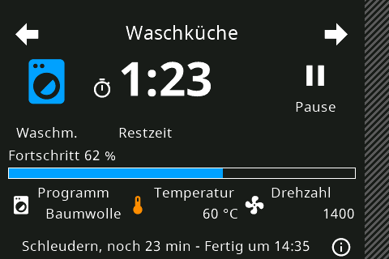
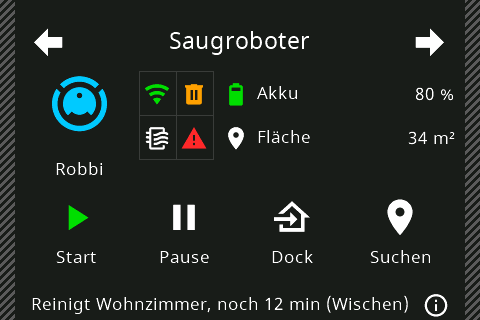
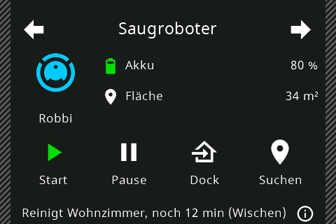
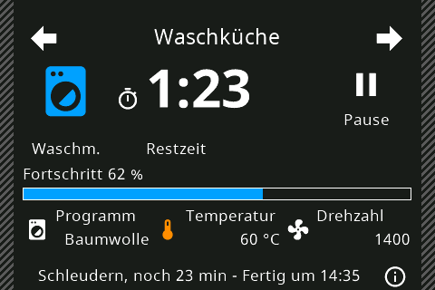
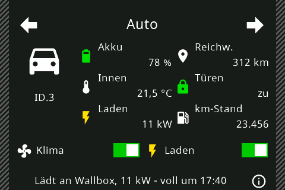
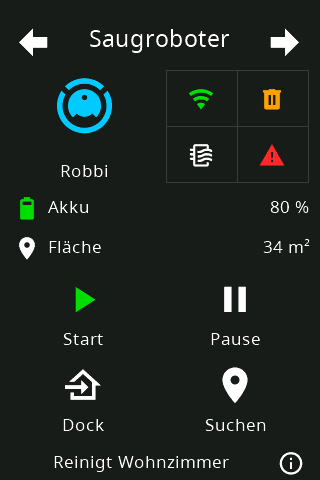
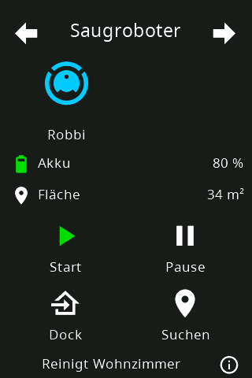
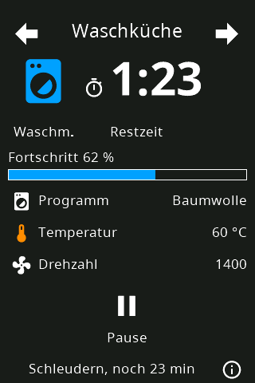
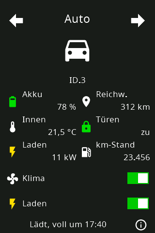

# Geräteseite in der HMI: cardDevice1, cardDevice2, cardDevice3 (EU, us-l, us-p)

Drei neue Seiten für **ein** Gerät (Saugroboter, Waschmaschine, Pkw …): großes Geräte-Icon, feste Anzahl Slots mit
festen Elementarten, Statuszeile unten, info-Icon unten rechts. Gebaut mit `HMI/tools/card_device.py`, Vorschau des
aktuellen Stands `device14` je Stufe unter `doc/Pictures/device-page/next/`; die älteren Vorschauen
`doc/Pictures/device-page/hmi-cardDevice{1,2,3}.png` (cardDevice1 mit 2×2-Status-Block, ohne:
`hmi-cardDevice1-plain.png`) zeigen `device12`.

> **Aktueller Stand ist `device15`** = `device14` mit `tRelease` 6.3.0 und dem shutter2-Zweig auf us-p cardSchedule
> (Abschnitt [„device15“](#device15-komplette-kette-trelease-630-us-p-cardschedule-shutter2)); die Geräteseiten sind
> dieselben wie in `device14` = `device13` mit Satz B/C 6 px weiter rechts (Abschnitt
> [„device14“](#device14-satz-bc-6-px-nach-rechts)); sonst gilt der Abschnitt
> [„device13“](#device13-typzahl-status-raster-devicons). Die Abschnitte ab
> [„Protokoll“](#protokoll) beschreiben `device12`; wo sie dem Abschnitt „device13“ widersprechen, sind sie
> **überholt** – vor allem: cardDevice1 hat in `entityUpd` 6 Slots (nicht 10), die Status-Icons kommen per `devIcons`
> in ein Raster bis 8×2 (nicht der 2×2-Block `tStat7–10`), cardDevice3 hat ein Raster bis 8×1, der schmale Satz
> `bEntityS/tEntityS/tValueS` und `vStatus` sind entfallen, Typen sind Zahlen, `entn` hat txt_maxl 7, `strCommand`
> 703 / 775 / 959.
Die Abschnitte bis „Empfang einer zu langen Nachricht“ beschreiben die EU-Seiten; Protokoll, Slots, Puffer und
Verhalten gelten für alle Modelle. Was bei us-l und us-p anders ist (Bauweg, Geometrie, RAM, Prüfliste), steht in
[„us-l und us-p“](#us-l-und-us-p). Die Geometrie aller drei Modelle als Daten:
[device-page-geometry.json](device-page-geometry.json).

## Bauen

```
PYTHONDONTWRITEBYTECODE=1 python3 HMI/tools/swipe_release_fix.py /mnt/projekte/nspanel-v6.2.0.entities5.HMI /tmp/swipe.HMI
PYTHONDONTWRITEBYTECODE=1 python3 HMI/tools/grid_long_press_feedback.py /tmp/swipe.HMI /tmp/feedback.HMI [<ref.tft>]
PYTHONDONTWRITEBYTECODE=1 python3 HMI/tools/schedule_shutter2_fix.py /tmp/feedback.HMI /tmp/schedule.HMI
PUPPETEER_PATH=$(npm root -g)/ PYTHONDONTWRITEBYTECODE=1 python3 HMI/tools/popup_notify3_font.py /tmp/schedule.HMI /tmp/font.HMI
PYTHONDONTWRITEBYTECODE=1 python3 HMI/tools/card_device.py /tmp/font.HMI nspanel-v6.2.0.device15.HMI --preview doc/Pictures/device-page/next --geometry doc/ideas/device-details/device-page-geometry.json
```

(Bis `device14` ohne `schedule_shutter2_fix.py` – auf EU ohne Wirkung, „nothing to do“ – und ohne
`popup_notify3_font.py`; die Schrift 9 mit 87 Icons kam ab `device11/12` über die Vorgängerdatei mit, siehe
[„device15“](#device15-komplette-kette-trelease-630-us-p-cardschedule-shutter2).)

`card_device.py` erkennt das Modell am Projekt (`pageStartup` sendet `event,startup,<Version>,<Modell>,…`) und nimmt
das passende Layout; der Aufruf ist für alle Modelle gleich. us-l und us-p: siehe [„us-l und us-p“](#us-l-und-us-p).
`--geometry <datei.json>` setzt den Schlüssel des Modells in der JSON-Datei (die anderen bleiben). Die EU-Ausgabe ist
mit der Modell-Weiche Byte für Byte dieselbe wie vorher (`cmp` gegen `device10`, auch die vier EU-Vorschaubilder).

Reihenfolge: `swipe_release_fix.py` → `grid_long_press_feedback.py` (Long-Press-Blinken auf cardGrid, cardGrid2,
cardGrid3) → `card_device.py` (baut die Geräteseiten und gibt ihnen dasselbe Blinken). `card_device.py` nimmt das
Blinken aus seiner cardGrid-Kopie heraus und setzt es für die Elemente der Geräteseite neu; die beiden letzten
Schritte liefern deshalb in beiden Reihenfolgen dieselbe Datei, und jeder Schritt ist auf seiner eigenen Ausgabe
wirkungslos (geprüft). Mit `<ref.tft>` (eine TFT, die aus einer Datei mit gleichen Grid-Seiten kompiliert ist)
nennt der zweite Schritt den echten RAM-Stand der Grid-Seiten.

`--fields` gibt zusätzlich die Rechnung der längsten Nachricht je Seite aus (siehe „Puffer und RAM“).

Teststände: `device1` (cardDevice1 mit N=6, ohne Status-Icons), `device2` (N=10, erstes Raster 42 px hoch),
`device3` (N=10, Raster auf die info-Zeilen ausgerichtet), `device4` (wie device3, zusätzlich senden main und info
auch bei Typ `text`), `device5` (Long-Press `buttonPress3` und Popups in main und allen Slots), `device6`
(`strCommand` je Seite bemessen, Empfang auf die Puffergröße begrenzt, Lauftext-Statuszeile auf cardDevice2 und 3),
`device7` (Lauftext auch auf cardDevice1, dafür Status-Icons ohne Popup-Überschrift und kürzere Icon-Puffer),
`device8` (Lauftext wieder entfernt, neue Kurz-Nachricht `devStatus` für die Statuszeile), `device9` (Statuszeile
auf allen drei Seiten mittig: `tStatus.xcen` 0 → 1 auf cardDevice1 und 3, sonst wie `device8`), `device10`
(Long-Press-Blinken auf cardGrid, cardGrid2, cardGrid3 und den drei Geräteseiten, sonst wie `device9`), `device12`
(Drück-Feedback der Status-Zellen `tStat7–10` und der Hotspots `mSlot1/2`, `mSlot7/8`, sonst wie `device11`, alle drei
Modelle), `device13` (Typ als Zahl, `entn` 7, Status-Raster bis 8×2 bzw. 8×1 per `devIcons`, `entityUpd` von cardDevice1
ohne Status-Slots (N = 6), Stufe in Feld 6 von info –
aktuell, alle drei Modelle, siehe [„device13“](#device13-typzahl-status-raster-devicons); alle in
`/mnt/projekte/nspanel emu/`). Die dortige `device5` hat Tim im Editor geöffnet, ein Lauftext-Objekt `g0` auf
cardDevice1 gelegt und gespeichert (siehe „Verworfen: Lauftext“).

- Basis: `nspanel-v6.2.0.entities5.HMI` (= `HMI/nspanel-v6.2.0.HMI` + `entities2_five_rows.py`, geprüft: nur cardEntities,
  cardEntities2 und die pageType-Einträge unterscheiden sich). Dort fehlte `swipe_release_fix.py` (#934, keine HMI
  hatte ihn bisher). Er läuft deshalb vorher, die neuen Seiten erben ihn von cardGrid.
- Jede Seite ist eine frische Kopie von cardGrid: Kopfzeile, Pfeile samt Long-Press/Blinken, Swipe-Streifen,
  tmSerial (Empfang, Quittung/CRC, pageType-Umschalter), Sleep-Timer und renderCurrentPage bleiben unverändert –
  bis auf die eine Zeile, die die Nachricht nach `strCommand` kopiert (siehe „Puffer und RAM“).
  Entfernt sind die sechs Zellen (`bEntity1–6`, `tEntity1–6`); `tmLP` und `LPState` (Long-Press der Zellen) bleiben,
  dazu kommt das Long-Press-Blinken (siehe „Rückmeldung beim Long-Press“).
- Die Seiten werden **hinten** an die Seitenliste von main.HMI angehängt (Abschnitte 37/38/39.pa). Keine bestehende
  Seiten-ID verschiebt sich.
- Jede Seite mit tmSerial bekommt `if(tId.txt=="cardDevice<n>") page cardDevice<n>` hinter dem cardGrid3-Zweig
  (36 Seiten; pageTest hat keinen Umschalter, wie bisher).
- Idempotent: Läuft das Werkzeug auf seiner eigenen Ausgabe, baut es die drei Seiten in ihren Abschnitten neu und
  ändert sonst nichts (geprüft).

## device15: komplette Kette, tRelease 6.3.0, us-p cardSchedule shutter2

Stand 2026-11-28. Neu gebaut aus den Ausgangsdateien mit der kompletten Kette (EU siehe [„Bauen“](#bauen), us-l/us-p
siehe [„us-l und us-p“ → „Bauen“](#bauen-1)) statt aus der Vorgängerdatei. Zwei Änderungen gegenüber `device14`:

- `pageStartup.tRelease` 6.2.0 → **6.3.0** (`card_device.py`, alle drei Modelle).
- **us-p cardSchedule:** Die Zeilen-Flächen `m0…m5` (`down`) hatten keinen Zweig für `type<r>=="shutter2"` – ein
  Tipp auf eine shutter2-Zeile tat nichts, EU und us-l öffnen dort `popupShutter2`. Neues Werkzeug
  `HMI/tools/schedule_shutter2_fix.py` setzt hinter den shutter-Zweig jeder Zeile dessen Kopie mit `"shutter2"` und
  `page popupShutter2` (Zeile für Zeile wie EU/us-l, Übergabe über die schon vorhandenen `pageIcons.tTmp1–3`). Alle
  anderen Zweige und die `up`-Ereignisse von `m0…m5` sind auf den drei Modellen gleich (Vergleich mit umbenanntem
  Zeilenindex); andere Seiten haben die Lücke nicht. Auf EU und us-l meldet das Werkzeug „nothing to do“. Code
  kostet keinen Seiten-RAM, keine neuen Objekte.

In die Kette kommt außerdem `popup_notify3_font.py` (Schrift 9 von popupNotify3 mit 87 Icons): Die Projekte in
`HMI/` haben noch die alte Schrift (56 Zeichen), `device11`–`device14` hatten die neue aus ihrer Vorgängerdatei. Die
gerenderte Schrift ist mit der von `device14` byteweise gleich (alle drei Modelle).

Skript-Vergleich aller lebenden Abschnitte `device14` → `device15`: EU und us-l nur `pageStartup.tRelease`; us-p
dazu `cardSchedule` (`m0…m5` `down`, je 58 → 63 Zeilen). `device-page-geometry.json` ist unverändert. Ein zweiter
Lauf von `schedule_shutter2_fix.py` auf `device15` meldet „nothing to do“. Dateien in `/home/tim/device-page-hmi/`
und `/mnt/projekte/nextion-vm/`; noch nicht kompiliert.

## device14: Satz B/C 6 px nach rechts

Stand 2026-11-28. Tims Wunsch: Das Icon der Info-Zeilen in Satz B (Stufe 1) und C (Stufe 2) von cardDevice1 stand
mit demselben Abstand hinter dem Raster wie die Raster-Icons untereinander und sah deshalb aus wie eine weitere
Spalte. Satz B und C liegen jetzt **6 px weiter rechts** (Icon 11 statt 5 px hinter der Rasterkante); die rechte Kante
bleibt, der Text wird 6 px schmaler:

| Modell | Satz B (Icon, Name, Wert) | Satz C (Icon, Wert) |
|---|---|---|
| EU | Icon 247, Name 285 w **43**, Wert = tValue 330 w 110 | Icon 321, Wert 359 w **81** (bis 440) |
| us-l (+15) | Icon 262, Name 300 w 43, Wert 345 w 110 | Icon 336, Wert 374 w 81 (bis 455) |

us-p (Satz C neben dem Haupt-Icon), Stufe 0 und 3, cardDevice2 und cardDevice3 sind unverändert. Puffer, Code,
Objektzahl und RAM-Schätzung bleiben (cardDevice1 3045 mit global), `check_area` meldet nichts.

```
for M in "" us-l- us-p-; do
  PYTHONDONTWRITEBYTECODE=1 python3 HMI/tools/card_device.py /home/tim/device-page-hmi/nspanel-${M}v6.2.0.device13.HMI \
    /home/tim/device-page-hmi/nspanel-${M}v6.2.0.device14.HMI --preview doc/Pictures/device-page/next \
    --geometry doc/ideas/device-details/device-page-geometry.json
done
```

- Eingabe sind die von Tim kompilierten `device13`-Dateien. Skript-Vergleich aller lebenden Abschnitte
  `device13` → `device14`: EU und us-l ändern nur `x`/`endx` von `bEntityB1/2`, `bEntityC1/2` und `x`/`w` von
  `tEntityB1/2`, `tValueC1/2` auf cardDevice1; us-p ist identisch. Ein zweiter Lauf auf `device14` liefert dieselben
  Abschnitte (idempotent). Kopien in `/mnt/projekte/nextion-vm/`.
- Adapter (`DEVICE_PAGE_FIELDS`: Name B 43, Wert C 81; web-l: Name B 233, Wert C 271), Web-Panel
  (`geometryHmi.ts`, web-l in `geometryWeb.ts`, das die x-Werte von eu übernimmt) und Admin-Vorschau sind angeglichen;
  web-p folgt us-p und bleibt.

## device13: Typzahl, Status-Raster, devIcons

Stand 2026-11-28. Umsetzung von [../hmi-type-number.md](../hmi-type-number.md) und
[status-grid-8x2.md](status-grid-8x2.md) mit Tims Entscheidungen vom 2026-11-28. Die Abschnitte weiter unten
beschreiben `device12`; was hier steht, geht ihnen für `device13` vor. Adapter, Admin und Web-Panel sind ebenfalls
umgesetzt (Konfiguration `statusStage` / `statusSlots`, siehe [README.md, „Geräteseite“](README.md#geräteseite)).

**Stand der Prüfung:** EU `device13` ist kompiliert (RAM in der Tabelle unten). Am Panel gemessen bzw. bestätigt:
`covx` liest führende Ziffern (leer oder ohne Ziffer → 0), `x`/`w`/`h` lassen sich zur Laufzeit nicht ändern
(Zuweisung liefert 0x1C bzw. 0x1A), die Rahmenkante bleibt nach `vis 0` der Nachbarspalte stehen. **Im Nextion-Simulator bestätigt (Tim, 2026-11-28,
Bilder `doc/Pictures/device-page/hmi/`):** alle Stufen von cardDevice1 (0, 2 … 16 Icons) und cardDevice3 (0–8 Icons)
sichtbar, Rahmen der Zellen, Info-Sätze A/B/C/keiner, ausgeblendete Kacheln 1 bzw. 1 und 2; Abgleich mit dem
Web-Panel in [BILDER.md](../../Pictures/device-page/BILDER.md#device13-stufen-gegen-die-echte-hmi-2026-11-28).
**us-l und us-p `device13` sind noch nicht kompiliert und nicht getestet** – offen.

```
for M in "" us-l- us-p-; do
  PYTHONDONTWRITEBYTECODE=1 python3 HMI/tools/card_device.py /home/tim/device-page-hmi/nspanel-${M}v6.2.0.device12.HMI \
    /home/tim/device-page-hmi/nspanel-${M}v6.2.0.device13.HMI --fields --preview doc/Pictures/device-page/next \
    --geometry doc/ideas/device-details/device-page-geometry.json
done
```

- Eingabe sind die `device12`-Dateien (das Werkzeug baut die drei Seiten aus cardGrid neu). Verglichen mit `device12`
  ändern sich in allen drei Modellen nur die Abschnitte cardDevice1, cardDevice2 und cardDevice3 (Skript-Vergleich
  aller lebenden Abschnitte). Ein zweiter Lauf auf `device13` liefert dieselben Abschnitte (idempotent).
- Geometrie: [device-page-geometry.json](device-page-geometry.json) (bis 2026-11-28 als `device-page-geometry.next.json`
  neben dem Stand `device12`; seitdem ersetzt sie ihn). Gegen sie vergleichen die Tests von Adapter und Web-Panel.
- Vorschau je Stufe: `doc/Pictures/device-page/next/hmi-[<modell>-]cardDevice1-stage0..3.png`,
  `…cardDevice3-stage0..2.png`, `…cardDevice2.png`.

### Protokoll device13

```
pageType~cardDevice1                    (bzw. cardDevice2 / cardDevice3)
entityUpd~<heading>~<prev>~<next>~<main>~<slot 1>~…~<slot N>~<info>      Feldpositionen wie device12
devStatus~<text>                        unverändert
devIcons~<typ>~<id>~<icon>~<farbe>~…    nur cardDevice1 (16 Zellen) und cardDevice3 (8 Zellen)
```

**Typ als Zahl** (alle drei Seiten, alle Elemente außer Navigation und info-Icon):

| Zahl | Typ im Adapter | Verhalten |
|---|---|---|
| 0 | leer, `delete` | Element ausgeblendet, Tipp tut nichts |
| 1 | `text`, `button`, `switch`, jeder andere Typ | nur senden; ohne intName (außer Knopf-Slot) kein Senden, kein Blinken |
| 2 / 3 / 4 / 5 | `shutter` / `shutter2` / `input_sel` / `timer` | Popup beim Berühren |
| 6 / 7 / 8 / 9 | `light` / `light2` / `fan` / `number` | Popup nach 500 ms |

- Der Parser liest den Typ jedes Elements mit `spstr` → `tTmp` und `covx tTmp.txt,type<k>.val,0,0` in die
  Zahlvariable `type<k>`/`typeMain`. Leer, `0` und jeder Text ohne führende Ziffer ergeben 0 (am Panel gemessen).
- `down` schreibt den Typ in die neue Zahlvariable `vLPType`, `tmLP` öffnet die Popups 6–9 daraus (vorher `tTmp`, das
  ein `entityUpd` während des Haltens überschrieb). Popups 2–5 vergleichen `type<k>.val`.
- Navigation (Felder 2 und 8) bleibt Text (`button`), Vergleich wie bisher. Das info-Icon wird ebenfalls per `covx`
  geprüft und bei 0 ausgeblendet.
- `entn*` (auch `entnMain`, `entnInfo`, `entnStat<i>`) txt_maxl **7**. `nent1/2` txt_maxl **11**: der Adapter schickt
  dort nur `bSubPrev`, `bSubNext`, `bUp`, `bHome` (`Navigation.buildNavigationString`, `Page.getNavigation`), höchstens
  8 Zeichen.

**Felder von entityUpd** (Element e beginnt bei 14 + 6e):

| Seite | N | main | Slots | info | Stufe |
|---|---|---|---|---|---|
| cardDevice1 | **6** (info, info, button × 4) | 14–19 | 20–55 | **56–61** | **Feld 61** (0–3) |
| cardDevice2 | 6 | 14–19 | 20–55 | 56–61 | – |
| cardDevice3 | 8 | 14–19 | 20–67 | 68–73 | **Feld 73** (0–2) |

Die Status-Slots 7–10 von cardDevice1 gibt es in `entityUpd` nicht mehr, die Status-Icons kommen nur noch per
`devIcons`. cardDevice2 hat keine Stufe und kein `devIcons`.

**Stufe** (Feld 6 von info, leer = 0, auf 0…max begrenzt, steht in `vStage`):

| Seite | Stufe | Raster-Spalten höchstens | Info-Zeilen / Kacheln |
|---|---|---|---|
| cardDevice1 | 0 | 0 | Satz A (breit, wie bisher) |
| | 1 | 3 | Satz B: Icon, Name schmal, Wert = `tValue1/2` von A |
| | 2 | 5 | Satz C: Icon, Wert 81 px (`device13` 87; us-p 106 px), kein Name |
| | 3 | 8 | keine (auch wenn entityUpd Info-Daten enthält) |
| cardDevice3 | 0 | 0 | alle Kacheln |
| | 1 | 4 | Kachel 1 aus (auch wenn entityUpd sie füllt) |
| | 2 | 8 | Kacheln 1 und 2 aus |

us-p cardDevice1 (Variante P2): Stufe 0 Satz A (volle Zeilen wie bisher), Stufe 1 **und** 2 Satz C rechts vom
Haupt-Icon, Stufe 3 keine Info-Zeilen. Einen Satz B gibt es auf us-p nicht.

Der Parser schreibt Icon, Name und Wert in Satz A und kopiert sie (Text, Schrift, Farbe) in den Satz der Stufe; er
blendet erst die anderen Sätze aus und dann den eigenen ein. Der heutige schmale Satz `bEntityS/tEntityS/tValueS` ist
entfallen.

**devIcons:** `devIcons~<typ 1>~<id 1>~<icon 1>~<farbe 1>~…`, Zelle i in den Feldern 1 + 4·(i−1) bis 4·i,
spaltenweise (Zelle 2c−1 oben, 2c unten; cardDevice3 eine Zeile). Typ per `covx`, leer = `0~~~` oder
`~~~`. Icon mit `¬<Font>` wie überall.

- Typ 0: Zelle leer (Text leer, Rahmen bleibt, kein Tipp). Sonst Icon, Schrift und Farbe.
- Spalten: bis zur höchsten belegten Zelle (cardDevice1 ⌈i/2⌉, cardDevice3 i), höchstens die Spalten der Stufe. Eine
  halb belegte letzte Spalte behält ihre leere Zelle mit Rahmen.
- Umgeschaltet werden nur Spalten, die sich ändern (`vCols`): erst die auszublendenden (von rechts), dann die
  einzublendenden. `entityUpd` blendet vor den Info-Sätzen bzw. Kacheln die Spalten jenseits der Stufe aus.
- Reihenfolge beim Öffnen: erst `entityUpd` (Stufe), dann `devIcons`. Kommt `devIcons` vor dem ersten `entityUpd`,
  gilt Stufe 0 und das Raster bleibt leer, bis das nächste `devIcons` kommt.
- Andere Seiten haben keinen Zweig und quittieren `devIcons` nur.

**Tippen und Long-Press:** jede Zelle und jedes Icon der Sätze B/C hat den Code der cardGrid-Zelle (Popup, Senden,
Drück-Feedback grau bei den Zellen, Long-Press-Blinken). Der Wert `tValue1/2` leitet in Stufe 1 an `bEntityB1/2` weiter,
sonst an `bEntity1/2`. Ein Popup aus einer Zelle hat keine Überschrift, eines aus Satz B/C den vollen Namen
(`tEntity1/2`).

| `vaLPCell` | cardDevice1 EU/us-l | cardDevice1 us-p | cardDevice3 |
|---|---|---|---|
| 1 | bMain | bMain | bMain |
| 2–7 | bEntity1–6 | bEntity1–6 | bEntity1–6 |
| 8–9 | Zellen 1–2 | Zellen 1–2 | mSlot7/8 |
| 10–17 | Zellen 3–10 | Zellen 3–10 | Zellen 1–8 |
| 18–23 | Zellen 11–16 | Zellen 11–16 | – |
| 24/25 | bEntityB1/2 | bEntityC1/2 | – |
| 26/27 | bEntityC1/2 | – | – |

### Geometrie device13

(Satz B/C in `device14` 6 px weiter rechts, siehe [„device14“](#device14-satz-bc-6-px-nach-rechts); die Tabelle zeigt die
`device14`-Werte.)

| Seite / Modell | Zellen (Abstand, w × h) | x Spalte 1 … 8 | y | Satz B | Satz C |
|---|---|---|---|---|---|
| cardDevice1 EU | 37, 38 × 45 | 124 … 383 (rechte Kante 421) | 71 / 115 | Icon 247, Name 285 w 43 (txt_maxl 15), Wert = tValue 330 w 110 | Icon 321, Wert 359 w 81 (txt_maxl 19) |
| cardDevice1 us-l | wie EU | 139 … 398 (436) | 71 / 115 | Icon 262, Name 300 w 43, Wert 345 | Icon 336, Wert 374 w 81 |
| cardDevice1 us-p (P2) | 37, 38 × 41 | 10 … 269 (307) | 188 / 228 | – | Icon 166 (y 76/120), Wert 204 w 106 (y 80/124) |
| cardDevice3 EU | 37, 38 × 52 | 114 … 373 (411) | 67 | – | – |
| cardDevice3 us-l | wie EU | 129 … 388 (426) | 67 | – | – |
| cardDevice3 us-p | 36, 37 × 51 | 10 … 262 (299) | 182 | – | – |

Satz B/C: Icon 36 × 34 (Font 1, y 76/120), Texte h 26 (y 80/124), Wert rechtsbündig. Zellen: Text mit Rahmen
(`style` 1, `borderw` 1, `borderc` 14823), Font 1, mittig, txt_maxl 7. us-p: das Raster endet bei y 268 über den
Knöpfen (ab 272); Satz C liegt neben dem Haupt-Icon (x 10–159) innerhalb von y 76–153. `check_area` prüft
sichtbaren Bereich, Tippflächen und Überschneidungen je Stufe: keine Meldungen.

### Puffer, strCommand, RAM device13

| Seite | `entityUpd` Größtfall voll / neuer Adapter | `devIcons` voll / neuer Adapter | `strCommand` device12 → device13 |
|---|---|---|---|
| cardDevice1 | 770 / **639** | 536 / **392** | 943 → **703** |
| cardDevice2 | 857 / **701** | – | 875 → **775** |
| cardDevice3 | 1072 / **869** | 272 / **200** | 1019 → **959** |

- „Neuer Adapter“ (`--fields`): Typ 1 Byte, ID 7, Navigation `button`/`bSubPrev`, ein Icon 4 Byte (devIcons 7 mit
  `¬<Font>`), Farbe 5, Namen und Werte bis zum Puffer, Stufe 1 Byte. `strCommand` = das Größere aus `entityUpd`
  und `devIcons` + 10 %, 4k−1. Die Begrenzung beim Empfang (`clamp_receive`) bleibt.

RAM (Schätzung des Werkzeugs mit global 436; „Prognose“ = gemessener device10-Wert + Änderung der Schätzung;
„gemessen“ = Editor beim Kompilieren von `device13`):

| Seite | Modell | Schätzung device12 → device13 | Prognose (Editor) | frei (Prognose) | gemessen |
|---|---|---|---|---|---|
| cardDevice1 | EU | 3201 → 3045 | 3176 | 408 | **3216 (368 frei)** |
| cardDevice1 | us-l | 3201 → 3045 | 3152 | 432 | offen |
| cardDevice1 | us-p | 3015 → 2969 | 3030 | 554 | offen |
| cardDevice2 | EU | 2785 → 2456 | 2495 | 1089 | **2492 (1092 frei)** |
| cardDevice2 | us-l / us-p | 2785 → 2456 | 2471 | 1113 | offen |
| cardDevice3 | EU | 3264 → 3229 | 3317 | 267 | **3328 (256 frei)** |
| cardDevice3 | us-l / us-p | 3264 → 3229 | 3293 | 291 | offen |

Die Messung liegt bei cardDevice1 40 Byte über der Prognose, bei cardDevice3 11 Byte darüber.

Alle Schätzungen liegen mehr als 150 Byte unter 3584 (größte: cardDevice3 3229). Neu je Seite: Zahlvariablen
`vLPType` (alle), `vStage`, `vCols` (cardDevice1/3); Typvariablen als Zahl statt Text.

**Code:** Die Rücksetzkette des Long-Press-Blinkens steht in jedem `up` und in `tc0` und hat auf cardDevice1 jetzt
27 Einträge (vorher 13), der Zweig `devIcons` 16 Zellen. Das kostet kein RAM, macht aber den Code der Seite gut
doppelt so lang (Prüfliste).

### device13 im Editor und am Panel prüfen

Stand 2026-11-28: EU kompiliert, RAM gemessen (Punkt 2), `covx` gemessen (Punkt 3, Teil „leeres Element und `0`
ausgeblendet“), Rahmenkanten nach dem Ausblenden von Spalten bestätigt (Punkt 5). Im Simulator bestätigt (Bilder
`doc/Pictures/device-page/hmi/`): Punkt 5 bis auf die halbe letzte Spalte (nur gerade Anzahlen aufgenommen) und
Punkt 6 (Stufen, Rahmen, Kacheln). Alles andere ist offen; us-l und us-p sind noch nicht kompiliert.

1. Alle drei Dateien öffnen (keine Meldung „resource file damaged“), kompilieren: 0 Fehler, keine „Component
   overlap“. Neu im Code: `covx tTmp.txt,type<k>.val,0,0`, `type<k>.val`, `if(type1.val==0||vStage.val>=3)`, `if(sys2<8&&vCols.val>=8)`, `click` in `if/else` (tValue1/2),
   `if(vStage.val>=1&&vStage.val<=2)` (us-p). Der Code der Seiten ist deutlich länger: übersetzt der Editor ihn?
2. RAM je Seite und Modell melden (Tabelle oben). ✅ EU gemessen; us-l und us-p offen.
3. Typzahl: `entityUpd` mit Zahlen 0–9 in main und Slots: 0 blendet aus, 2–5 Popup sofort, 6–9 nach 500 ms, 1 sendet
   (ohne ID nicht, Knopf-Slot doch); leeres Element und `0` ausgeblendet.
4. Long-Press während eines `entityUpd`: das Popup eines Typs 6–9 öffnet trotzdem (`vLPType`).
5. Stufen cardDevice1: Feld 61 = 0/1/2/3, je mit `devIcons` mit 0, 1, 5, 9, 16 belegten Zellen: Spaltenzahl
   (⌈n/2⌉, höchstens 3/5/8), halbe letzte Spalte mit Rahmen, Info-Sätze A/B/C/keiner, Rahmenkanten nach dem Ausblenden
   von Spalten, keine Reste der anderen Sätze. Abschneiden: Name in Satz B (49 px, `device14` 43 px, 15 Byte), Wert in Satz C (87 px,
   `device14` 81 px, 19 Byte; welche Seite fehlt beim rechtsbündigen Wert?). ✅ EU im Simulator (2026-11-28, `hmi/cardDevice1-icons-NN.png`
   mit 0, 2 … 16 Icons): Spaltenzahl, Rahmen, Sätze A/B/C/keiner, keine Reste; Name in Satz B an der Feldgrenze
   abgeschnitten („Batter“). Offen: halbe letzte Spalte, Abschneiden des Werts in Satz C.
6. Stufen cardDevice3: Feld 73 = 0/1/2 mit 3 bzw. 7 Icons; Kachel 1/2 bleibt aus, auch wenn `entityUpd` sie füllt;
   Rahmen gegen bMain und Kachel 3; Icon in h 52/51 mittig. ✅ EU im Simulator (2026-11-28,
   `hmi/cardDevice3-icons-N.png` mit 0–8 Icons).
7. Tippen, Drück-Feedback, Long-Press-Blinken und Popups für alle Zellen (vaLPCell-Tabelle), die Icons und Texte der
   Sätze B/C und den Wert `tValue1/2` in Stufe 0 und 1 (blinkt das sichtbare Icon?). Popup aus Satz B/C mit vollem
   Namen.
8. Zwei Nachrichten direkt nacheinander (`entityUpd`, `devIcons` mit 392 Byte): beide quittiert. `devIcons` auf
   cardDevice2 oder einer anderen Seite: nur Quittung.
9. Kürzen beim Kopieren: `tEntityB1.txt=tEntity1.txt` (31 → 15 Byte) und `tValueC1.txt=tValue1.txt` (31 → 19):
   schneidet die Nextion ab, ohne Fehler?
10. us-p cardDevice1: Raster 8 × 2 unter dem Haupt-Icon, Satz C rechts daneben (Stufe 1/2), Stufe 0 volle Zeilen.

## Protokoll

> **Stand `device12`.** Für `device13` gilt der Abschnitt [„Protokoll device13“](#protokoll-device13): cardDevice1 hat
> N = 6, info liegt bei 56–61, die Status-Icons kommen per `devIcons`.

```
pageType~cardDevice1          (bzw. cardDevice2 / cardDevice3)
entityUpd~<heading>~<prev: 6 Felder>~<next: 6 Felder>~<main>~<slot 1>~…~<slot N>~<info>
devStatus~<text>              (nur die Statuszeile, siehe „Kurz-Nachricht devStatus“)
```

- Überschrift und Navigation (Felder 1–13) genau wie cardGrid.
- Jedes Element hat 6 Felder wie eine cardGrid-Zelle: `type~intName~icon~iconColor~displayName~optionalValue`.
- Element e (main = 0, Slot k = k, info = N+1) beginnt bei Feld **14 + 6·e**:

| Seite | N | main | Slots | info |
|---|---|---|---|---|
| cardDevice1 „Steuern“ | 10 | 14–19 | 20–79 | 80–85 |
| cardDevice2 „Fortschritt“ | 6 | 14–19 | 20–55 | 56–61 |
| cardDevice3 „Werte“ | 8 | 14–19 | 20–67 | 68–73 |

- Typ leer oder `delete` blendet ein Element komplett aus.
- Icons und Farben kommen nur vom Adapter. Ein Icon darf wie bei cardGrid auf `¬<Font-ID>` enden (setzt die Schrift).

### Art je Slot

*(Stand `device12`. Seit `device13` hat cardDevice1 nur die Slots 1–6; die Status-Icons sind keine Slots mehr, sondern
16 Zellen per `devIcons`, cardDevice3 hat dazu 8 Zellen.)*

| Seite | Slot 1 | Slot 2 | Slot 3 | Slot 4 | Slot 5 | Slot 6 | Slot 7 | Slot 8 | Slot 9 | Slot 10 |
|---|---|---|---|---|---|---|---|---|---|---|
| cardDevice1 | info | info | button | button | button | button | status | status | status | status |
| cardDevice2 | value | progress | info | info | info | button | – | – | – | – |
| cardDevice3 | info | info | info | info | info | info | switch | switch | – | – |

### Elementarten

| Art | Darstellung | Tippfläche |
|---|---|---|
| main | Icon Font 4 (Bold 80, Icon 66 px) in iconColor, Name (Feld 5) darunter. **Feld 6 → Statuszeile** | Icon und Name |
| info | Icon Font 1 in iconColor, Name Font 0, Wert (Feld 6) Font 0 rechtsbündig | Icon, Name und Wert |
| value | Feld 6 in Font 4, Name Font 0 darunter, kleines Icon Font 1 daneben (leeres Icon-Feld = kein Icon) | Rechteck um Icon, Wert und Name |
| progress | Name Font 0 darüber, Balken über die volle Breite; Feld 6 = ganze Zahl 0–100 (wird begrenzt), Füllung in iconColor, Rahmen in der Textfarbe | Name und Balken |
| button | Icon Font 3 in iconColor, Name Font 0 darunter | Icon und Name |
| switch | Icon Font 1, Name Font 0, Schalter `btOnOff` (Kopie von cardEntities, Bilder 1/2 bzw. 10/11 bei schwarzem Hintergrund); Zustand aus Feld 6 `0`/`1` | Icon und Name wie die anderen Plätze; der Schalter selbst sendet `OnOff` |
| status | nur Icon (Feld 3) Font 1 in iconColor, in einem 2×2-Block mit Raster (nur cardDevice1, siehe unten; **`device13`:** Zelle eines Rasters bis 8×2 bzw. 8×1 per `devIcons`, nur Typ, ID, Icon, Farbe); Name (Feld 5) und Wert werden nicht gelesen | die Zelle |
| info-Icon | Icon Font 1 in iconColor unten rechts; Name/Wert werden nicht genutzt | Icon; nur `buttonPress2`, kein Long-Press (das Element hat keinen Typ) |

- **Jeder Platz verhält sich wie eine cardGrid-Zelle** (main und alle Slot-Arten, Code der Zelle der Basis-HMI 6.2.0
  unverändert übernommen, siehe „Ereignisse beim Antippen“): kurzer Tipp `buttonPress2`, langer Druck `buttonPress3`
  bzw. Popup je Typ.
- Bei info, button und main leiten Name und Wert ihren Tipp an das Icon weiter (`click <Icon>,1/0`), die ganze
  Zeile/Kachel ist also bedienbar. value, progress und Icon+Name eines Schalters haben keinen Knopf; über ihnen liegt
  je ein unsichtbarer Hotspot `mSlot<k>` (Kopie eines Swipe-Streifens, kostet 7 Byte RAM). Die Status-Zellen tragen
  den Code selbst.
- **Regel:** Jedes Objekt, das beim Antippen den Press-Effekt zeigt, sendet beim Loslassen auch ein Ereignis. Die
  Umkehrung gilt nicht mehr: value, progress, status und Schalter-Icon/-Name senden, zeigen aber **keinen**
  Press-Effekt (Texte bzw. Hotspot, keine Knöpfe).
- **Statuszeile** `tStatus`: Feld 6 von main, immer (auch wenn main ausgeblendet ist), einzeilig, Font 0, normale
  Textfarbe, auf allen drei Seiten horizontal zentriert. Leeres Feld = leere Zeile. Höchstens **63 Byte**. Zwischen zwei `entityUpd` ersetzt `devStatus~<text>`
  nur diesen Text.
- **value-Schrift:** Font 4 (NotoSans Bold 80) enthält Ziffern, `:`, `%`, `°`, `,`, `.`, `-`, `/`, Leerzeichen,
  Buchstaben inkl. ä/ö/ü – aber **kein `€`**. Vorschub: Ziffer 33 px, `:` 17 px, `%` 53 px, `°` 25 px, Leerzeichen 15 px.

### Kurz-Nachricht devStatus

```
devStatus~<text>
```

- **Zweck:** Ein Statustext, der nicht in die Zeile passt, wird vom **Adapter** in höchstens drei Abschnitte geteilt
  (jeder ≤ 390 px in Font 0 und ≤ 63 Byte, Trennung an Wortgrenzen). Das `entityUpd` trägt den gerade gezeigten
  Abschnitt in Feld 6 von main; alle 3 Sekunden schickt der Adapter den nächsten mit `devStatus`, endlos im Kreis.
  Die kurze Nachricht geht schnell: kein ganzes `entityUpd`, kein Neuzeichnen der Elemente.
- **HMI:** eigener Zweig im tmSerial der drei Seiten, hinter dem `entityUpd`-Block und vor `pageType`:

  ```
  if(tInstruction.txt=="devStatus")
  {
    spstr strCommand.txt,tStatus.txt,"~",1
  }
  ```

  Er setzt nur `tStatus.txt`. Leerer Text leert die Zeile. Ausrichtung und Farbe sind die des Objekts (auf allen
  drei Seiten mittig). Länger als 63 Byte schneidet die Nextion beim Zuweisen ab (der Adapter schickt nie mehr).
- **Quittung:** unverändert der gemeinsame Weg hinter allen Zweigen – `udelete payloadLength+1`, dann
  `event,ack,<recvCrc>`. Der neue Zweig fasst `u[]`, `payloadLength`, `recvCrc` und `bufferPos` nicht an.
- **Name:** `statusUpdate` ist beim Screensaver vergeben; `devStatus` kommt sonst in keiner Seite vor. Andere Seiten
  kennen die Nachricht nicht und quittieren sie nur (kein Zweig greift).
- Konstante im Werkzeug: `STATUS_COMMAND`; im Adapter `DEVICE_PAGE_STATUS_COMMAND`.

### Verworfen: Lauftext

`device6`/`device7` hatten über der Statuszeile ein Nextion-Objekt „Scrolling text“ (`gStatus`, Typ 55), das der
Adapter mit dem Kennzeichen `¬1` am Statusfeld einschaltete. Im Simulator zeigte sich (Tim, 2026-11-23): das Objekt
beginnt **leer**, der Text läuft von rechts herein, ganz hinaus, und beginnt wieder rechts – die Zeile ist also
wiederholt leer –, und es ruckelt. Einen Startversatz hat das Objekt nicht. Deshalb ist es wieder entfernt; der
Wechsel der Abschnitte ersetzt es. Die Vorlage des Objekts (`g0` in Tims `device5`: ein Textobjekt ohne `pw`, mit
`dir`, `dis`, `tim`, `en` hinter `ycen` und `vvs0–3` hinter `spay`) steht in der Git-Historie von
`card_device.py` (`make_scroll`).

### Ereignisse beim Antippen

Der Code ist der der cardGrid-Zelle (`bEntity1` der Basis-HMI 6.2.0: `down`, `up`, Timer `tmLP` 500 ms, Merker
`LPState`), nur mit den Namen des jeweiligen Platzes. Ablauf:

1. **Berühren** (`down`): `tmLP` startet; Name, ID, Icon und Icon-Farbe gehen nach `pageIcons.tTmp1/2/3` und
   `tempIconColor`. Typ `shutter`, `shutter2`, `input_sel`, `timer`: das Popup öffnet **sofort**. Das berührte
   Element wird grau (14823, das `bco2` gedrückter Knöpfe): ein Knopf von selbst, eine Status-Zelle bzw. das
   Namensfeld unter einem Hotspot per Code (seit `device12`, siehe „Drück-Feedback ohne Knopf“).
2. **Halten** (`tmLP`, nach 500 ms): Typ `light`, `light2`, `fan`, `number`: das Popup öffnet. Jeder andere Typ:
   `LPState=1` (Long-Press scharf), und der Hintergrund des gehaltenen Elements **blinkt grün/grau** im
   200-ms-Takt (seit `device10`, siehe „Rückmeldung beim Long-Press“).
3. **Loslassen** (`up`): das Blinken bzw. das Grau endet, die Farben sind wieder die normalen. `LPState` 0 →
   `event,buttonPress2,<intName>,button`, sonst `event,buttonPress3,<intName>,button`; `LPState` zurück auf 0. Der
   Long-Press wird also **beim Loslassen** gesendet (wie cardGrid).

Was der Adapter je Typ bekommt (gilt für **jede** Slot-Art und main):

| Typ | kurzer Tipp (< 500 ms) | langer Druck (≥ 500 ms) |
|---|---|---|
| `shutter`, `shutter2`, `input_sel`, `timer` | Popup sofort beim Berühren, **kein** `buttonPress2`/`3`; das Popup meldet `event,pageOpenDetail,<popup>,<intName>` | dasselbe (das Popup ist schon offen) |
| `light`, `light2`, `fan`, `number` | `event,buttonPress2,<intName>,button` | Popup nach 500 ms (popupLight, popupLight2, popupFan, popupSlider), kein `buttonPress3` |
| `text` | `event,buttonPress2,<intName>,button` | `event,buttonPress3,<intName>,button` |
| alle übrigen (`button`, `switch`, …) | `event,buttonPress2,<intName>,button` | `event,buttonPress3,<intName>,button` |

Je Slot-Art:

| Element | Objekte mit Tipp | Press-Effekt | kurz / lang | Besonderheit |
|---|---|---|---|---|
| main | `bMain`, `tMainName` → `bMain` | ja (Knopf, `bco2` 14823) | wie Tabelle oben | Typ `text` mit leerem intName sendet nichts |
| info | `bEntity<k>`, `tEntity<k>`/`tValue<k>` → `bEntity<k>` (cardDevice1 Slot 1–2 auch `bEntityS<k>`, `tEntityS<k>`, `tValueS<k>`) | ja | wie Tabelle oben | wie main |
| button | `bEntity<k>`, `tEntity<k>` → `bEntity<k>` | ja | wie Tabelle oben | sendet immer (auch `text` ohne intName), exakt der cardGrid-Code |
| value | Hotspot `mSlot1` (110/67, 226×110) über `tIcon1`, `tValue1`, `tEntity1` (cardDevice2) | ja (per Code: `tEntity1.bco` 14823) | wie Tabelle oben | wie main; leeres Element sendet nichts |
| progress | Hotspot `mSlot2` (10/179, 429×42) über `tEntity2` und dem Balken (cardDevice2) | ja (per Code: `tEntity2.bco`) | wie Tabelle oben | wie value; das Popup bekommt kein Icon (leer), Farbe = Textfarbe des Namens |
| switch: Icon und Name | Hotspot `mSlot7`/`mSlot8` (10 bzw. 226/236, 161×34) über `tIcon<k>`, `tEntity<k>` (cardDevice3) | ja (per Code: `tEntity<k>.bco`) | wie Tabelle oben | wie value |
| switch: Schalter | `btOnOff<k>` | Bildwechsel | `event,buttonPress2,<intName>,OnOff,<0\|1>` beim Berühren, kein Long-Press (unverändert) | – |
| status | `tStat7–10` (cardDevice1; `device13`: die 16 bzw. 8 Zellen des Rasters), Code in der Zelle | ja (per Code: `bco` der Zelle 14823, Rahmen bleibt) | wie Tabelle oben | wie main; leere Zelle (Rahmen sichtbar) sendet nichts; ein Popup aus der Zelle hat **keine Überschrift** (`pageIcons.tTmp1` leer) |
| info-Icon | `bInfo` | ja | immer `event,buttonPress2,<intName>,button` | kein Long-Press, kein Popup (unverändert) |
| Statuszeile | `tStatus` | nein | – | kein Touch |

- **Drück-Feedback ohne Knopf** (seit `device12`, `add_press_feedback` in `card_device.py`): Knöpfe zeigen ihr
  `bco2` (14823) selbst; Status-Zellen und Hotspots sind Textfelder bzw. haben keinen Hintergrund und bekommen
  dasselbe Grau per Code – auf allen drei Modellen dieselben Elemente: cardDevice1 `tStat7–10` (die Zelle selbst),
  cardDevice2 `mSlot1` → `tEntity1`, `mSlot2` → `tEntity2`, cardDevice3 `mSlot7` → `tEntity7`, `mSlot8` → `tEntity8`
  (das Namensfeld, dasselbe Objekt, das beim Long-Press blinkt; Icon, Wert und Balken bleiben). `down` setzt
  innerhalb von `if(type<k>.txt!="delete"&&type<k>.txt!="")` – also nur bei belegtem Element – `bco=14823`; `up`
  setzt direkt hinter `tmLP.en=0` immer `bco=defaultBcoColor` zurück, `tc0` `up` (bekommt jedes Loslassen, auch eins,
  das das Element nicht erreicht) ebenso, dort nur bei `if(<obj>.bco!=defaultBcoColor)` (kein Neuzeichnen bei jedem
  Tipp). `defaultBcoColor` ist der Wert der Lade-Schleife (`b[sys0].bco=defaultBcoColor` für alle Knöpfe und Texte)
  und des Long-Press-Restores; das Blinken beginnt vom Grau aus (erste Phase Grün). Popup-Typen verlassen die Seite,
  die Lade-Schleife stellt beim Zurückkommen her. Kein neues Objekt, kein RAM; Zeilen zwischen
  `// >> press feedback (card_device.py)` und `// << press feedback`.
- Ausgeblendete Elemente (`vis 0`) nehmen keinen Tipp an. Hotspots und Status-Zellen bleiben dagegen berührbar, wenn
  ihr Element leer ist; ihr Code beginnt deshalb mit `if(type<k>.txt!="delete"&&type<k>.txt!="")`.
- Die Bedingung im Loslassen-Code (alle außer button) lautet `if(type<k>.txt!="text"||entn<k>.txt!="")`.
- **Popups und Rückkehr:** Die Popup-Seiten kennen die aufrufende Seite nicht. Sie lesen beim Laden nur
  `pageIcons.tTmp1` (Überschrift), `tTmp2` (ID → `entn`), `tTmp3` (Icon) und `tempIconColor` (popupSlider) und melden
  `event,pageOpenDetail,<popup>,<intName>`. Schließen (`b0` oder Sleep-Timeout) sendet
  `event,buttonPress2,<popup>,bExit`; zurück führt das `pageType~cardDevice<n>` des **Adapters** (der Zweig dafür steht
  im tmSerial jedes Popups). In der HMI ist für die Rückkehr nichts weiter zu setzen – derselbe Weg wie bei cardGrid.
- Wie bei cardGrid entscheidet `tmLP` anhand von `tTmp.txt` (Typ des berührten Platzes). Der tmSerial-Parser benutzt
  `tTmp` ebenfalls: kommt während des Haltens ein `entityUpd`, öffnet ein light/fan/number-Popup nicht, es gibt dann
  beim Loslassen `buttonPress3`. Verhalten der Vorlage, nicht geändert.

### Rückmeldung beim Long-Press

Werkzeug `HMI/tools/grid_long_press_feedback.py` (cardGrid, cardGrid2, cardGrid3; `card_device.py` ruft dessen
`remove()`/`add()` für die Geräteseiten auf). Vorgabe (Tim, 2026-11-23): Wo ein gehaltener Druck einen Long-Press
auslöst, zeigt die HMI, sobald er erkannt ist – auf den Grid-Seiten blinkt der Hintergrund des angetippten Icons.

- **Welche Zelle:** neue Zahlvariable `vaLPCell` je Seite (Kopie von `LPState`, letztes Objekt). Jedes Objekt, das
  `tmLP` startet, schreibt in `down` direkt hinter `tmLP.en=1` seine Nummer hinein (`vaLPCell.val=<k>`, 1 … n in
  Objektreihenfolge). `tmLP` und der Restore suchen die Zelle über eine Kette `if(vaLPCell.val==<k>)` mit
  Objektnamen – keine Objekt-IDs, ein Umsortieren im Editor schadet nicht, und ein Tipp, der per `click <Knopf>,1`
  vom Namen/Wert kommt, wird gleich behandelt.
- **Was blinkt:**

  | Element | Objekt, das blinkt | Attribut |
  |---|---|---|
  | Grid-Zelle, main, info, button (Knopf, auch die schmalen `bEntityS1/2`) | der Icon-Knopf selbst | `bco` **und** `bco2` |
  | status (cardDevice1) | die Zelle `tStat7–10` (Textfeld, Rahmen bleibt; kurzer Druck: Grau, siehe „Drück-Feedback ohne Knopf“) | `bco` |
  | value, progress (cardDevice2), Icon+Name eines Schalters (cardDevice3) – Hotspot `mSlot<k>` | das Namensfeld `tEntity<k>` unter dem Hotspot (kurzer Druck: Grau) | `bco` |

  Das Namensfeld gibt es bei allen drei Hotspot-Arten, es ist breit (190, 429 bzw. 125 px) und liegt bei progress
  **über** dem gezeichneten Balken (y 179–204, Balken ab 207): der Balken wird nicht übermalt und muss nicht neu
  gezeichnet werden. Ein Knopf bekommt beide Attribute, weil nicht belegt ist, mit welchem der beiden die Nextion
  einen **gehaltenen** Knopf neu zeichnet (die Pfeile schreiben aus demselben Grund `pco` und `pco2`).
- **Farben und Takt:** Grün 2016 (das Grün des Uhr- und Pfeil-Blinkens) ↔ Grau 14823 (`bco2`, der normale
  Press-Hintergrund), zuerst Grün, 200 ms je Phase. Kein Gelb: das Icon eines gedrückten Knopfs ist weiß (`pco2`),
  auf Gelb wäre es kaum zu sehen. `tmLP` läuft weiter und wird auf 200 ms umgestellt – kein neuer Timer.
- **Code** (cardGrid3 mit vier Zellen, je Zelle ein Zweig):

  ```
  // bEntity2 down, hinter tmLP.en=1
  vaLPCell.val=2
  // tmLP, hinter LPState.val=1 (die Popup-Typen haben die Seite vorher verlassen)
  if(vaLPCell.val>0)
  {
    tmLP.tim=200
  }
  if(vaLPCell.val==2)
  {
    if(bEntity2.bco==2016)
    {
      bEntity2.bco=14823
    }else
    {
      bEntity2.bco=2016
    }
    bEntity2.bco2=bEntity2.bco
  }
  // Restore: in jedem up hinter tmLP.en=0 (vor dem Senden) und am Ende von tc0 up; dort steht als erste Zeile
  // im if zusätzlich tmLP.en=0 - also nur, wenn schon geblinkt wird (tmLP.tim ist dann 200)
  if(tmLP.tim!=500)
  {
    tmLP.tim=500
    if(vaLPCell.val==2)
    {
      bEntity2.bco=defaultBcoColor
      bEntity2.bco2=14823
    }
  }
  ```

  Die erzeugten Zeilen stehen zwischen `// >> long press feedback (grid_long_press_feedback.py)` und
  `// << long press feedback`; daran erkennt das Werkzeug sie wieder (idempotent).
- **Kein Blinken:** Popup-Typen (das Popup öffnet beim Berühren bzw. nach 500 ms); auf den Geräteseiten Typ `text`
  ohne intName (sendet nichts – `down` setzt dafür `vaLPCell.val=0`; button sendet immer und blinkt immer); leere
  Elemente (der Code läuft nicht); `bInfo` und der Schalter `btOnOff<k>` (kein Long-Press).
- **Nie hängen bleiben:**
  - Loslassen: `up` des Elements stoppt den Timer (`tmLP.en=0`, erste Zeile, immer) und stellt zurück. Zusätzlich
    stellt `tc0` `up` (bekommt jedes Loslassen) zurück – aber nur **innerhalb** von `if(tmLP.tim!=500){…}`: dort
    stehen `tmLP.en=0`, `tmLP.tim=500` und die Farben. `tc0` stoppt den Timer also nur, wenn das Blinken schon
    läuft; vor Ablauf der 500 ms fasst `tc0` `tmLP` nicht an (so in allen drei Modellen und in der kompilierten
    EU-`device10`). Das Zurückstellen ist wiederholbar, die Reihenfolge der beiden Ereignisse ist egal.
  - **Offener Fall (theoretisch, nicht beobachtet):** Erreicht ein Loslassen **vor** Ablauf der 500 ms nur `tc0`
    und nicht das Element (Finger vom Element gezogen), läuft `tmLP` weiter: nach 500 ms setzt er `LPState=1` und
    die Zelle beginnt zu blinken, obwohl kein Finger mehr aufliegt – bis zum nächsten Loslassen irgendwo auf der
    Seite (dessen `tc0` `up` stellt zurück) oder einem Seitenwechsel. Dass `LPState` in diesem Fall stehen bleibt,
    war schon vor dem Blinken so (siehe „Bekannte Unsicherheiten“); neu ist nur, dass man es sieht. Prüfpunkt für
    Tim, siehe Schritt 9. Der Code bleibt, wie er kompiliert und auf EU getestet ist.
  - Seitenwechsel (Popup, `pageType` des Adapters nach `sleepReached` oder Navigation): die Seite wird neu
    geladen; `bco2`, `tmLP.tim` und die Variablen sind lokal und haben wieder ihre Entwurfswerte, `bco` setzt die
    Lade-Schleife.
  - `entityUpd` während des Haltens: schreibt kein `bco`/`bco2` (das Werkzeug prüft, dass nur die Lade-Schleife
    Hintergründe schreibt und jedes blinkende Objekt in ihr liegt – daher ist `defaultBcoColor` der richtige
    Rückgabewert). Das Blinken läuft weiter, das Loslassen stellt zurück.
- **RAM:** eine Zahlvariable je Seite, in der Seitentabelle kompilierter TFTs 8 Byte (Schätzformel: 7).

**Alle Long-Press-Stellen der EU-HMI** (jede Stelle, an der ein gehaltener Druck `buttonPress3` sendet):

| Stelle | Seiten | Rückmeldung |
|---|---|---|
| Screensaver-Indikatoren | screensaver2, screensaver5 | hat sie schon: Uhrzeit blinkt gelb/grün (`indicator_long_press_release.py`) |
| Pfeile `bPrev`/`bNext` | alle Kartenseiten mit `tmLPNav` (cardEntities, cardEntities2, cardSchedule, cardGrid, cardGrid2, cardGrid3, cardMedia, cardThermo, cardThermo2, cardAlarm, cardQR, cardPower, cardChart, cardLChart, cardPChart, cardDevice1–3) | hat sie schon: Überschrift und Pfeile blinken gelb/grün (`nav_long_press_blink.py`) |
| Zellen `bEntity<k>` | cardGrid, cardGrid2, cardGrid3 | neu: Zellhintergrund blinkt |
| main, Slots | cardDevice1–3 | neu: siehe Tabelle oben |
| Zeilen `m0…` (linke Fläche) | cardEntities, cardEntities2 | bewusst ohne: eigener Tipp-Bereich, sendet sofort beim Berühren, keine Haltezeit |
| Zellen `bEntity<k>`, `bPopup` mit `tmLP` | cardMedia, cardThermo2 | bewusst ohne: der Timer öffnet nur Popups, `up` sendet immer `buttonPress2` – es gibt dort keinen Long-Press |

Andere Seiten senden kein `buttonPress3`.

## Feldbreiten für den Adapter (Kürzen)

Font 0 ist 24 px hoch; die Breite eines Texts liefert `src/lib/const/text-width.ts` (Font 0).

| Seite | main-Name | Statuszeile | Slot-Name | Slot-Wert |
|---|---|---|---|---|
| cardDevice1 | 110 px | 390 px, 1 Zeile, links | info: 164 px, mit Status-Icons 86 px (`device12`; **`device14`:** Satz B 43 px / 15 Byte, Satz C kein Name); button: 104 px | info: 110 px (rechtsbündig; `device14` Satz C 81 px / 19 Byte) |
| cardDevice2 | 96 px | 390 px, 1 Zeile, mittig | value: 190 px; progress: 429 px; info: 104 px; button: 100 px | value: 190 px **Font 4**; info: 104 px |
| cardDevice3 | 100 px | 390 px, 1 Zeile, links | info: 125 px; switch: 125 px | info: 125 px |

Für zwei Statuszeilen (≥ 60 px Höhe) war in keinem Layout Platz: überall **eine** Zeile, 390 px.

Statuszeile für den Adapter in Zahlen: jeder Abschnitt ≤ 390 px **und** ≤ 63 Byte, auf allen drei Seiten.

## Geometrie

Kopfzeile wie cardGrid (`bPrev` 9/16 50×50, `tHeading` 65/26 320×30 Font 2, `bNext` 391/16 50×50). Inhalt
x 10–439 (die Swipe-Streifen liegen bei x < 9 und x ≥ 440), y 67–287; Statuszeile y 289–318, info-Icon
x 404–439 / y 288–319. Ausrichtung: links = xcen 0, mittig = 1, rechts = 2; alle Texte ycen 1, isbr 0.

### cardDevice1 „Steuern“ (Saugroboter, Rasenmäher)

> **Stand `device12` – überholt.** Seit `device13` gibt es statt des 2×2-Blocks `tStat7–10` und des schmalen Satzes
> `bEntityS/tEntityS/tValueS` ein Raster bis 8×2 und die Sätze B und C, siehe [„Geometrie device13“](#geometrie-device13).
> Die Herleitung unten (Maße aus der zi-Tabelle, Raster aus Objekt-Rahmen) gilt für das neue Raster sinngemäß weiter.

Mit Status-Icons / ohne (alle vier Status-Slots leer – sieht aus wie vor den Status-Icons):


| Objekt | x | y | w | h | Font | Ausrichtung | txt_maxl |
|---|---|---|---|---|---|---|---|
| bMain | 10 | 68 | 110 | 86 | 4 | mittig | 7 |
| tMainName | 10 | 156 | 110 | 26 | 0 | mittig | 31 |
| bEntity1 (info, breit) | 126 | 76 | 36 | 34 | 1 | mittig | 7 |
| tEntity1 | 164 | 80 | 164 | 26 | 0 | links | 31 |
| tValue1 | 330 | 80 | 110 | 26 | 0 | rechts | 31 |
| bEntity2 (info, breit) | 126 | 120 | 36 | 34 | 1 | mittig | 7 |
| tEntity2 | 164 | 124 | 164 | 26 | 0 | links | 31 |
| tValue2 | 330 | 124 | 110 | 26 | 0 | rechts | 31 |
| bEntityS1 (info, schmal) | 204 | 76 | 36 | 34 | 1 | mittig | 7 |
| tEntityS1 | 242 | 80 | 86 | 26 | 0 | links | 31 |
| tValueS1 | 330 | 81 | 110 | 26 | 0 | rechts | 31 |
| bEntityS2 (info, schmal) | 204 | 120 | 36 | 34 | 1 | mittig | 7 |
| tEntityS2 | 242 | 124 | 86 | 26 | 0 | links | 31 |
| tValueS2 | 330 | 125 | 110 | 26 | 0 | rechts | 31 |
| tStat7 (status, oben links) | 124 | 71 | 38 | 45 | 1 | mittig | 7 |
| tStat8 (oben rechts) | 161 | 71 | 38 | 45 | 1 | mittig | 7 |
| tStat9 (unten links) | 124 | 115 | 38 | 45 | 1 | mittig | 7 |
| tStat10 (unten rechts) | 161 | 115 | 38 | 45 | 1 | mittig | 7 |
| bEntity3–6 (button) | 10 / 118 / 226 / 334 | 190 | 104 | 52 | 3 | mittig | 7 |
| tEntity3–6 | 10 / 118 / 226 / 334 | 244 | 104 | 26 | 0 | mittig | 31 |
| tStatus | 10 | 289 | 390 | 30 | 0 | mittig | 63 |
| bInfo | 404 | 288 | 36 | 32 | 1 | mittig | 7 |

**Status-Block (Slots 7–10):**

- Block x 124–198, y 71–159 (zwei Spalten à 38 px, zwei Zeilen à 45 px, Nachbarn 1 px überlappend → Raster 44 px),
  direkt rechts vom Haupt-Icon.
- **Maße aus der zi-Tabelle:** Die Font-1-Icons haben ihre Farbe in den Zeilen 6–28 der 32-px-Glyphe (Median über
  alle 7459 Icons; 6 px Luft oben, 3 px unten, sichtbar 23 px). Die Icons der info-Zeilen (Box y 76/120, h 34,
  vertikal zentriert) zeigen sich damit bei y 83–105 und 127–149, Zeilenabstand 44. Die Status-Zellen haben denselben
  Abstand (44) und liegen so, dass ihre Icons auf **genau denselben Zeilen** stehen (83–105 / 127–149): je Rasterreihe
  eine info-Zeile. Der Rahmen hat 12 px Abstand über und 10 px unter der Icon-Farbe (Ungleichheit durch die Glyphe).
- **2 × 3 verworfen:** drei Reihen mit Font 1 brauchen je ≥ 32 px Zelle (kleinere Box zeichnet die Nextion nicht) →
  Raster ≥ 97 px hoch (z. B. 71–167). Das passt zwar über die Knopfreihe (y 190), ist aber 30 px höher als der
  optische Bereich der beiden info-Zeilen (83–149, 67 px), keine Reihe stünde auf einer info-Zeile, und in 32 px
  bleiben 6 px Luft oben, 3 px unten – die Icons säßen am Rahmen. Deshalb **2 × 2, N = 10**.
- **Raster aus Objekt-Rahmen**, nicht gezeichnet: die vier Zellen sind Textfelder mit `style` 1 (Rahmen),
  `borderw` 1, `borderc` 14823 (das Grau der Tortenlinien auf cardPChart und der gedrückten Knöpfe). Vorlage dafür
  sind die Icons auf cardPower (`style` 1, Rahmen 2 px). Nachbarzellen überlappen um 1 px, ihre Rahmen liegen also
  aufeinander und ergeben Außenrahmen plus Kreuz. Die Nextion zeichnet die Rahmen mit dem Objekt, es muss nichts
  nachgezeichnet werden. Die Rahmenfarbe ist fest im Objekt (die Lade-Schleife setzt nur `bco`/`pco`).
- Auswertung im tmSerial **vor** den info-Zeilen: Typ und ID jedes Status-Slots gehen nach `type<k>` und
  `entn<k>` (für Tipp und Popup). Leerer oder `delete`-Slot → Zelle bleibt mit leerem Text (Rahmen
  bleibt stehen, das Icon ist unsichtbar, kein Tipp); belegter Slot → Icon/Farbe und Merker `vStatus` = 1. Danach: `vStatus` 0 →
  alle vier Zellen `vis 0`, sonst `vis 1`.
- Die info-Zeilen 1–2 gibt es zweimal: breit (`bEntity/tEntity/tValue1–2`) und schmal (`bEntityS/tEntityS/tValueS1–2`).
  Der Parser schreibt in den breiten Satz, kopiert Text, Icon-Schrift und Farbe in den schmalen und schaltet per `vis`
  den passenden Satz sichtbar. Position/Breite werden zur Laufzeit nie geändert (keine Seite des Projekts tut das; am
  Panel gemessen: es geht auch nicht, eine Zuweisung an `x`/`w`/`h` liefert 0x1C bzw. 0x1A).
  Beide Sätze haben den gleichen Tipp-Code (cardGrid-Zelle, auch `text` sendet) mit Typ/ID von Slot 1 bzw. 2.
- `tValueS1/2` liegen 1 px tiefer als `tValue1/2`, sonst wären die Rechtecke deckungsgleich und der Editor meldet
  „Component overlap“.

### cardDevice2 „Fortschritt“ (Waschmaschine, Trockner, Geschirrspüler)



| Objekt | x | y | w | h | Font | Ausrichtung | txt_maxl |
|---|---|---|---|---|---|---|---|
| bMain | 10 | 67 | 96 | 82 | 4 | mittig | 10 |
| tMainName | 10 | 151 | 96 | 26 | 0 | mittig | 31 |
| tIcon1 (value, Icon) | 110 | 90 | 34 | 36 | 1 | mittig | 10 |
| tValue1 (value) | 146 | 67 | 190 | 82 | 4 | links | 31 |
| tEntity1 | 146 | 151 | 190 | 26 | 0 | links | 31 |
| tEntity2 (progress, Name) | 10 | 179 | 429 | 26 | 0 | links | 31 |
| Balken slot 2 (gezeichnet) | 10 | 207 | 429 | 14 | – | Rahmen 1 px, Füllung innen 427 × 12 | – |
| bEntity3–5 (info) | 10 / 154 / 298 | 228 | 34 | 48 | 1 | mittig | 10 |
| tEntity3–5 | 46 / 190 / 334 | 226 | 104 | 25 | 0 | links | 31 |
| tValue3–5 | 46 / 190 / 334 | 252 | 104 | 25 | 0 | rechts | 31 |
| bEntity6 (button) | 340 | 67 | 100 | 50 | 3 | mittig | 10 |
| tEntity6 | 340 | 119 | 100 | 26 | 0 | mittig | 31 |
| tStatus | 10 | 289 | 390 | 30 | 0 | mittig | 63 |
| bInfo | 404 | 288 | 36 | 32 | 1 | mittig | 10 |

Die info-Slots 3–5 sind hier schmale Kacheln (Name oben, Wert rechtsbündig darunter): drei volle Zeilen à 32 px
passten unter Icon, Wert und Balken nicht mehr über die Statuszeile.

### cardDevice3 „Werte“ (Pkw, Sensorik)


| Objekt | x | y | w | h | Font | Ausrichtung | txt_maxl |
|---|---|---|---|---|---|---|---|
| bMain | 10 | 67 | 100 | 82 | 4 | mittig | 10 |
| tMainName | 10 | 151 | 100 | 26 | 0 | mittig | 31 |
| bEntity1–6 (info) | 114 / 277 (Spalte) | 69 / 121 / 173 (Zeile) | 34 | 48 | 1 | mittig | 10 |
| tEntity1–6 | 150 / 313 | 67 / 119 / 171 | 125 | 25 | 0 | links | 31 |
| tValue1–6 | 150 / 313 | 93 / 145 / 197 | 125 | 25 | 0 | rechts | 31 |
| tIcon7 / tIcon8 (switch) | 10 / 226 | 236 | 34 | 34 | 1 | mittig | 10 |
| tEntity7 / tEntity8 | 46 / 262 | 240 | 125 | 26 | 0 | links | 31 |
| btOnOff7 / btOnOff8 | 173 / 389 | 228 | 50 | 50 | Bild 1/2 | – | 3 |
| tStatus | 10 | 289 | 390 | 30 | 0 | mittig | 63 |
| bInfo | 404 | 288 | 36 | 32 | 1 | mittig | 10 |

Slot-Reihenfolge der info-Kacheln: zeilenweise, Slot 1 links oben, Slot 2 rechts oben, Slot 3 links Mitte …

## Puffer und RAM

> **Stand `device12`.** Für `device13` gelten [„Puffer, strCommand, RAM device13“](#puffer-strcommand-ram-device13)
> (`entn` 7, Typen als Zahl, `strCommand` 703 / 775 / 959, RAM EU gemessen).

- IDs (`entn*`, `entnMain`, `entnInfo`) 23 wie cardEntities2 (Adapter-IDs `<Seitenindex>?<n>`), Namen 31, Werte 31,
  Status 63, Icons 10 (cardDevice1: 7), Typen 10, `tSend` 63 (längstes Ereignis
  `event,buttonPress2,` + ID + `,OnOff,1` = 50).
- `strCommand` wird **je Seite** aus ihren Slots berechnet (siehe unten), höchstens 1019 (das Display nimmt
  höchstens 1017 Byte Nutzlast an).
- Schätzung wie `entities2_five_rows.py`: 9 + 7 je Objekt + Σ ceil((txt_maxl+1)/4)·4, global 436. Gemessen ist das
  nicht (dazu braucht es eine kompilierte TFT oder die Editor-Anzeige).

| Seite | Objekte | `strCommand` | Seite | mit global | frei bis 3584 | frei in `device7` (mit Lauftext) |
|---|---|---|---|---|---|---|
| cardDevice1 (N=10, zweiter Zeilensatz, Status-Block) | 77 | 943 | 2765 | 3201 | **383** | 171 |
| cardDevice2 | 61 | 875 | 2349 | 2785 | **799** | 591 |
| cardDevice3 | 74 | 1019 | 2828 | 3264 | **320** | 180 |

Das ist die Schätzung für `device10` (mit `vaLPCell`, +7 je Seite gegenüber `device9`). **Gemessen** sind `device9`
und `device10`: die Seitentabellen von `/mnt/projekte/nspanel-v6.2.0.device9.tft` und `…device10.tft` (Tims
Kompilate, gelesen mit `nav_long_press_blink.tft_ram`; die Summen stimmen mit der Editor-Ausgabe überein, der
Editor weist davon 428 Byte als global aus, nicht 436) – die Schätzung liegt bei `device10` 131
(cardDevice1), 39 (cardDevice2) und 88 (cardDevice3) Byte darunter:

| Seite | `device9` gemessen (global + Seite) | frei | `device10` gemessen | frei |
|---|---|---|---|---|
| cardGrid | 2720 | 864 | 2728 | 856 |
| cardGrid2 | 3064 | 520 | 3072 | 512 |
| cardGrid3 | 2588 | 996 | 2596 | 988 |
| cardDevice1 | 3324 | 260 | 3332 | **252** |
| cardDevice2 | 2816 | 768 | 2824 | 760 |
| cardDevice3 | 3348 | 236 | 3352 | **232** |

Die EU-Datei `device10` ist damit im Editor kompiliert (die TFT liegt vor); der Code der Seiten ist auf us-l und us-p
derselbe.

Der Zweig für `devStatus` ist nur Code und kostet kein RAM. Gegenüber `device7` fehlt je Seite `gStatus` (−147
geschätzt); auf cardDevice1 und 2 ist außerdem `strCommand` wieder kleiner (1015 → 943 bzw. 943 → 875, je −72 bzw.
−68), weil das Statusfeld wieder höchstens 63 Byte hat.

Von `device7` geblieben sind auf cardDevice1 (damals nötig, damit der Lauftext passte; jetzt Reserve):

- `vaName7–10` entfernt (4 × 39 = −156): der Name der Status-Icons wird nicht gelesen, ein Popup aus einer
  Status-Zelle hat keine Überschrift (`pageIcons.tTmp1.txt=""`). Der Adapter schickt den Namen ohnehin leer. Mit
  390 Byte frei ließe sich die Überschrift wieder einbauen (+156, `strCommand` dann 1019: +76).
- die 14 Icon-Puffer (`bMain`, `bEntity1–6`, `bEntityS1–2`, `tStat7–10`, `bInfo`) von 10 auf 7 gekürzt (je −4 = −56):
  ein Icon ist ein Zeichen (höchstens 4 Byte UTF-8) plus Schrift-Zusatz `¬<Ziffer>` (2 + 1). Die Pfeile `bPrev`/
  `bNext` und die Icon-Puffer von cardDevice2/3 bleiben bei 10.

### Größe von `strCommand`

Vorgabe: Der Puffer muss eine nicht kaputte Nachricht gut fassen; was der Adapter darüber hinaus anhängt, fällt weg.
Längste Nachricht der Seite ist `entityUpd~<heading>~<prev>~<next>~<main>~<slot 1…N>~<info>`; `time`, `date`,
`timeout`, `dimmode` und `pageType` (die übrigen Nachrichten, die der Parser der Seite annimmt) sind weit kürzer.
Das CRC-Präfix `^XXXX^` des Adapters wertet der Berry-Treiber aus, es kommt nicht am Display an.

Zwei Rechnungen in Byte, je Element die sechs Felder `Typ+ID+Icon+Farbe+Name+Wert` (`card_device.py --fields`):

- **(a) alle Puffer voll:** jedes Feld so lang wie der Puffer, in dem es landet (Typ 10, ID 23, Icon 10, Farbe 5,
  Name 31, Wert 31 bzw. `tTmp` 10 bei progress/switch, Status 63, Überschrift 40); Felder, die die Seite nicht liest,
  mit dem, was der Adapter schickt.
- **(b) wie der Adapter baut:** ID höchstens 12 (`<Seitenindex>?<n>`), ein Icon 4, Farbe 5, längster Typ der Art (`input_sel`
  9 bei info, `button`/`switch` 6, `text` 4), Name und Wert bis zum Puffer, Wert eines Knopfs/Schalters 1 (`0`/`1`),
  progress 3 (`100`), Status-Icons ohne Name und Wert (der Adapter schickt beide Felder leer), Pfeile und info-Icon
  ohne Name und Wert.

| Teil | (a) | (b) |
|---|---|---|
| `entityUpd` | 9 | 9 |
| Überschrift | 40 | 40 |
| Pfeil (je, zweimal) | 10+23+10+5+0+0 = 48 | 6+12+4+5+0+0 = 27 |
| main | 10+23+10+5+31+63 = 142 | 6+12+4+5+31+63 = 121 |
| info | 10+23+10+5+31+31 = 110 | 9+12+4+5+31+31 = 92 |
| value | 10+23+10+5+31+31 = 110 | 4+12+4+5+31+31 = 87 |
| progress | 10+23+4+5+31+10 = 83 | 4+12+4+5+31+3 = 59 |
| button | 10+23+10+5+31+1 = 80 | 6+12+4+5+31+1 = 59 |
| switch | 10+23+10+5+31+10 = 89 | 6+12+4+5+31+1 = 59 |
| status | 10+23+10+5+31+0 = 79 | 4+12+4+5+0+0 = 25 |
| info-Icon | 10+23+10+5+0+0 = 48 | 6+12+4+5+0+0 = 27 |

| Seite | Felder / Trenner `~` | (a) Summe + Trenner | (b) Summe + Trenner | (b) + 10 % | `txt_maxl` (4k−1, ≤ 1019) |
|---|---|---|---|---|---|
| cardDevice1 (2 info, 4 button, 4 status; Icons 7, Status-Icons ohne Namen) | 86 / 85 | 1031 + 85 = **1116** | 771 + 85 = **856** | 942 | **943** |
| cardDevice2 (value, progress, 3 info, button) | 62 / 61 | 938 + 61 = **999** | 732 + 61 = **793** | 873 | **875** |
| cardDevice3 (6 info, 2 switch) | 74 / 73 | 1173 + 73 = **1246** | 921 + 73 = **994** | 1094 | **1019** |

- `devStatus~` + 63 Byte = 73 Byte, weit unter jedem Puffer.
- (a) liegt auf cardDevice1 und 3 über den 1017 Byte, die das Display überhaupt annimmt – der Adapter verwirft
  solche Nachrichten ohnehin (`MAX_PANEL_PAYLOAD_BYTES`). Maßgeblich ist (b).
- Der Adapter kürzt Namen und Werte nicht auf 31 Byte (die HMI schneidet beim Einlesen ab). Schickt er längere,
  wächst die Nachricht über (b) hinaus; reicht der Puffer nicht, fehlen die **letzten** Elemente (zuerst das
  info-Icon). Wer das ausschließen will, kürzt im Adapter Namen und Werte der Geräteseite auf 31 Byte.
- Würden die Status-Icons einen Namen bekommen (Popup-Überschrift, je 31 Byte), wäre (b) auf cardDevice1 980 und
  der Puffer bliebe 1019.

### Empfang einer zu langen Nachricht

Der Empfang (tmSerial, von cardGrid) hängt an keiner Stelle an der Größe von `strCommand`: Rahmenlänge, CRC-Prüfung
(`crcputu 0,payloadLength-1` über den seriellen Puffer `u[]`), `udelete payloadLength+1` und die Quittung
`event,ack,<recvCrc>` arbeiten nur mit `u[]` und `payloadLength`; die festen Zahlen 1023 dort sind die Größe des
seriellen Puffers. `strCommand` wird an genau einer Stelle beschrieben: `ucopy strCommand.txt,4,payloadLength-5,0`.
Was die Nextion tut, wenn dabei mehr Byte kommen als `txt_maxl`, ist nicht belegt. Auf Seiten mit kleinerem Puffer
als 1017 begrenzt das Werkzeug deshalb die Kopie (`clamp_receive`):

```
sys0=payloadLength-5
if(sys0>875)
{
  sys0=875
}
ucopy strCommand.txt,4,sys0,0
```

`sys0` ist an der Stelle frei (die Rahmenende-Prüfung davor ist ausgewertet, alles dahinter setzt es vor dem Lesen;
das Werkzeug prüft das). Folge einer zu langen Nachricht: sie wird vollständig aus `u[]` gelöscht und mit ihrer
echten CRC quittiert, der Adapter wartet also nicht; der Parser sieht nur die ersten `txt_maxl` Byte, die Felder
dahinter sind leer (Element ausgeblendet). Ein Mehrbyte-Zeichen an der Schnittstelle kann halb sein.
cardDevice3 (1019) behält die Zeile von cardGrid.

Gegenüber `device4` kamen dazu: `LPState` (7, alle Seiten), je Hotspot 7 (cardDevice2 und 3 je zwei), auf cardDevice1
je Status-Slot `type<k>` (7 + 12) und `entn<k>` (7 + 24) = 50, viermal 200. Code kostet kein
RAM. cardDevice1 bleibt die engste Seite (das Werkzeug meldet Stände über 3400 und bricht über 3584 ab).
Sparmöglichkeiten, falls der Editor mehr anzeigt: Icon-Puffer auch auf cardDevice2/3 auf 7 (je −4), `tStatus`
63 → 47 (−16; der Adapter müsste die Abschnitte dann auf 47 Byte begrenzen).

## us-l und us-p

Teststände (am 2026-11-24 von Tim im Editor kompiliert, 0 Fehler, 0 Warnungen; Kopien in
`/mnt/projekte/nspanel emu/`): `/home/tim/device-page-hmi/nspanel-us-l-v6.2.0.device10.HMI` und
`/home/tim/device-page-hmi/nspanel-us-p-v6.2.0.device10.HMI`, gebaut aus den unveränderten 6.2.0-Projekten in
`HMI/us-l/` und `HMI/us-p/`.

### Was gegenüber 6.2.0 dazukommt

Vergleich der Live-Seiten von EU `device10` mit `HMI/nspanel-v6.2.0.HMI`, Objekt für Objekt (Attribute und Code je
Ereignis). `device10` entsteht Byte für Byte aus `nspanel-v6.2.0.entities5.HMI` und den drei Werkzeugen (nachgebaut,
`cmp` gleich); `entities5` unterscheidet sich von 6.2.0 nur in cardEntities, cardEntities2 und den pageType-Einträgen.
Handänderungen aus dem Editor, die kein Werkzeug abdeckt, gibt es außer der Seite cardEntities2 nicht.

| Abweichung EU `device10` ↔ EU 6.2.0 | Werkzeug | us-l / us-p |
|---|---|---|
| Swipe-Streifen `mSwipeNext/Up/Prev`: `up` = `click bNext/bPrev,0` (EU 45 Streifen auf 15 Seiten) | `swipe_release_fix.py` | übertragen: 42 Streifen auf 14 Seiten je Modell, dazu die 9 der drei neuen Seiten |
| cardGrid, cardGrid2, cardGrid3: Long-Press-Blinken (`vaLPCell`, Blöcke in `tmLP`, `tc0` `up`, `down`/`up` jeder Zelle) | `grid_long_press_feedback.py` | übertragen, Werkzeug unverändert (us-p cardGrid2 hat 9 Zellen) |
| cardEntities `m0…m3` `down`: else-if-Kette, letzter Zweig „jeder andere Typ“ sendet `event,buttonPress3,<entn>,button` | Teil 2 von `entities2_five_rows.py` | übertragen mit `entities_left_tap.py` (läuft ohne cardEntities2): us-l `m0…m3`, us-p `m0…m5` |
| neue Seiten cardDevice1–3, Einträge in main.HMI, pageType-Zweige `cardDevice1–3` in allen Seiten mit tmSerial (EU 36) | `card_device.py` | übertragen: Abschnitte 35/36/37.pa, Seiten-IDs 35–37, Zweige in 34 Seiten |
| Seite cardEntities2 (im Editor als Kopie von cardEntities angelegt, dann `entities2_five_rows.py` Teil 1), ihr Eintrag in main.HMI, pageType-Zweig `cardEntities2` in allen 36 Seiten mit Umschalter | Editor + `entities2_five_rows.py` | **nicht übertragen** – Entscheidung von Tim: cardEntities2 wird nicht weiterverfolgt, die EU-Seite bleibt liegen |

Dazu kommt **nur auf us-p** eine Korrektur, die kein Gegenstück auf EU hat (`grid_cell_id_fix.py`): auf cardGrid3
baut `bEntity4` `up` seine beiden Ereignisse mit der ID der Nachbarzelle
(`tSend.txt="event,buttonPress2,"+entn3.txt+",button"`, ebenso `buttonPress3`); `down` nimmt richtig
`type4/entn4/tEntity4`. Ein Popup öffnet also für Zelle 4, ein Tipp oder Long-Press wird für Zelle 3 gemeldet. Der
Fehler steht seit us-p 5.1.1 in der Datei (5.1.0 hat noch `entn4`) und fällt mit dem Blinken auf: Zelle 4 blinkt, das Ereignis trägt die ID von
Zelle 3. Jetzt `entn4`. Maschinell geprüft auf allen drei Modellen (6.2.0 und die gebauten Dateien): auf cardGrid,
cardGrid2 und cardGrid3 ist jede Zelle `bEntity<k>` Zeile für Zeile die Zelle 1 mit umbenannten Namen – einzige
Ausnahme war diese Zelle; auf den Geräteseiten benutzt jedes nummerierte Objekt (Knopf, Text, Hotspot, Status-Zelle,
Schalter, auch die schmalen Zeilen) in allen Ereignissen nur `type/entn/tEntity/…` seiner eigenen Nummer, und der
Parser liest jede Zelle aus ihren eigenen Feldern.

Schon in 6.2.0 verschieden und **nicht angefasst**: die Zeilen-Flächen `m<n>` von cardEntities setzen auf EU
zusätzlich `tempIconColor=tIcon<r>.pco`, auf us-l/us-p nicht (deren popupSlider liest die Variable nicht).
Nebenbei behoben: auf us-p prüfte der alte Text-Zweig der Zeilen 5 und 6 `type4` statt des eigenen Typs; der neue
letzte Zweig nimmt den Typ der Zeile.

### Bauen

```
M=us-l   # bzw. us-p
PYTHONDONTWRITEBYTECODE=1 python3 HMI/tools/swipe_release_fix.py HMI/$M/nspanel-$M-v6.2.0.HMI /tmp/$M-1.HMI
PYTHONDONTWRITEBYTECODE=1 python3 HMI/tools/grid_cell_id_fix.py /tmp/$M-1.HMI /tmp/$M-2.HMI
PYTHONDONTWRITEBYTECODE=1 python3 HMI/tools/grid_long_press_feedback.py /tmp/$M-2.HMI /tmp/$M-3.HMI
PYTHONDONTWRITEBYTECODE=1 python3 HMI/tools/entities_left_tap.py /tmp/$M-3.HMI /tmp/$M-4.HMI
PYTHONDONTWRITEBYTECODE=1 python3 HMI/tools/schedule_shutter2_fix.py /tmp/$M-4.HMI /tmp/$M-5.HMI
PUPPETEER_PATH=$(npm root -g)/ PYTHONDONTWRITEBYTECODE=1 python3 HMI/tools/popup_notify3_font.py /tmp/$M-5.HMI /tmp/$M-6.HMI
PYTHONDONTWRITEBYTECODE=1 python3 HMI/tools/card_device.py /tmp/$M-6.HMI nspanel-$M-v6.2.0.device15.HMI --preview doc/Pictures/device-page/next --geometry doc/ideas/device-details/device-page-geometry.json
```

- `schedule_shutter2_fix.py` ergänzt auf us-p den shutter2-Zweig von cardSchedule, auf us-l (und EU) „nothing to
  do“; `popup_notify3_font.py` bringt die Schrift 9 mit 87 Icons (seit `device15` in der Kette, siehe
  [„device15“](#device15-komplette-kette-trelease-630-us-p-cardschedule-shutter2)).
- Fünf Schritte statt drei (ohne die beiden seit `device15`). `grid_cell_id_fix.py` behebt die falsche ID von us-p cardGrid3 Zelle 4; auf us-l (und
  EU) meldet es „nothing to do“ und ändert nichts – der Schritt steht in beiden Ketten, damit sie gleich sind. Es
  ignoriert die Blöcke des Long-Press-Blinkens, läuft also vor oder nach `grid_long_press_feedback.py`.
- Die EU-Basis `entities5` hat den Links-Tipp schon, bei us-l/us-p bringt ihn `entities_left_tap.py` (auf EU 6.2.0
  liefert es für cardEntities denselben Code wie `entities5`, geprüft).
- Jeder Schritt prüft die Prüfsummen (`Hmi.check()`) und den Round-Trip jeder geänderten Seite; jeder ist auf seiner
  eigenen Ausgabe wirkungslos (für `card_device.py`, `entities_left_tap.py` und `grid_cell_id_fix.py` geprüft).
- `card_device.py` bricht ab, wenn eine Box oder ein Hotspot der neuen Seite den sichtbaren Bereich verlässt oder
  eine Tippfläche schneidet, die die Seite von cardGrid behält: die Pfeile `bPrev`/`bNext`, die Swipe-Streifen und
  die versteckte Fläche `mSpecial` in der Kopfzeile.
- Vorschaubilder heißen mit Modell: `hmi-us-l-cardDevice1.png`, `hmi-us-p-cardDevice1.png` usw.; die EU-Namen
  bleiben. Die Vorschau zeichnet mit den Schriften des jeweiligen Projekts.

### Gleich auf allen Modellen

*(Stand `device10`/`device12`; seit `device13`: cardDevice1 N = 6, `strCommand` 703 / 775 / 959, IDs 7, Typen als Zahl.)*

Protokoll und Feldreihenfolge, Anzahl und Art der Slots (cardDevice1 N=10, cardDevice2 N=6, cardDevice3 N=8),
`devStatus`, Textpuffer (Name/Wert 31 Byte, Statuszeile 63 Byte, IDs 23, Icons 10 bzw. 7 auf cardDevice1),
`strCommand` (943 / 875 / 1019) samt Begrenzung beim Empfang, Schriften je Rolle (Font-IDs 0, 1, 3, 4 gibt es auf
allen Modellen; die Icon-Schriften sind dieselben Dateien), Tippflächen, Long-Press, Popups, Blinken, tmSerial und
Quittung. Der Code der Seiten ist bis auf die Koordinaten des gezeichneten Balkens (cardDevice2) derselbe wie auf EU;
us-p cardDevice1 hat keinen zweiten (schmalen) Zeilensatz. **Abweichungen von den festen Werten des Adapters: keine.**

Verschieden ist nur die Geometrie – und damit die Breiten, mit denen der Adapter Namen, Werte und Statuszeile misst.

### us-l: EU-Layout, 15 px nach rechts

Sichtbar ist auf us-l x 15–464 (EU 0–449). Die Verschiebung wird am Projekt gemessen, nicht angenommen: die Kopfzeile
von cardGrid liegt auf us-l genau 15 px rechts der EU-Kopfzeile (`bPrev` 24 statt 9, `tHeading` 80 statt 65, `bNext`
406 statt 391); cardEntities liegt mit jedem Objekt ebenfalls 15 px weiter rechts. (Die Zellen von cardGrid us-l
liegen 16 px weiter rechts – maßgeblich ist der sichtbare Bereich, also 15.) `card_device.py` bricht ab, wenn die
drei Kopf-Objekte nicht dieselbe Verschiebung zeigen oder sie nicht zum sichtbaren Bereich passt.

Alle Objekte der EU-Tabellen oben gelten mit x + 15 (Inhalt x 25–454, Statuszeile x 25–414, info-Icon x 419–454),
y, Breiten, Höhen, Schriften unverändert. Der Balken von cardDevice2 wird bei x 25 gezeichnet. Die Swipe-Streifen
von us-l liegen bei x 0–8 und 471–479, also außerhalb.






### us-p: eigene Anordnung (320 × 480)

Kopfzeile wie cardGrid us-p (`bPrev` 9/16 50×50, `tHeading` 60/24 200×30 Font 2, `bNext` 261/16 50×50). Inhalt
x 10–309 (300 px, die Swipe-Streifen liegen bei x 0–8 und 311–319), y 67–443; unten die Statuszeile y 447–476 mit
**262 px** (EU/us-l 390) und rechts daneben das info-Icon x 274–309. Alle Texte ycen 1, isbr 0, einzeilig.

Schriften: dieselben Rollen wie EU. Font 1, 3, 4 (Icons, großer Wert) sind dieselben Dateien wie auf EU. Font 0
(Namen, Werte, Statuszeile) ist auf us-p eine andere Variante: 2201 statt 2248 Zeichen, teils andere Breiten, kein
`€`; `°`, `²`, Umlaute sind vorhanden. Der Adapter muss auf us-p mit den us-p-Breiten messen (`font_widths.py` liefert
sie je Modell).

#### cardDevice1 „Steuern“

> **Stand `device12` – überholt.** Seit `device13` (Variante P2) liegt das Raster bis 8×2 unter dem Haupt-Icon an der
> Stelle der Info-Zeilen, die Info-Zeilen stehen in den Stufen 1 und 2 als Satz C rechts neben dem Haupt-Icon, siehe
> [„Geometrie device13“](#geometrie-device13). us-p `device13` ist noch nicht kompiliert.




| Objekt | x | y | w | h | Font | Ausrichtung | txt_maxl |
|---|---|---|---|---|---|---|---|
| bMain | 10 | 70 | 150 | 86 | 4 | mittig | 7 |
| tMainName | 10 | 158 | 150 | 26 | 0 | mittig | 31 |
| tStat7 / tStat8 (status, oben) | 166 / 237 | 70 | 72 | 57 | 1 | mittig | 7 |
| tStat9 / tStat10 (unten) | 166 / 237 | 126 | 72 | 57 | 1 | mittig | 7 |
| bEntity1 / bEntity2 (info) | 10 | 190 / 230 | 36 | 34 | 1 | mittig | 7 |
| tEntity1 / tEntity2 | 48 | 194 / 234 | 156 | 26 | 0 | links | 31 |
| tValue1 / tValue2 | 206 | 194 / 234 | 104 | 26 | 0 | rechts | 31 |
| bEntity3–6 (button, 2 × 2) | 10 / 162 | 272 / 358 | 148 | 52 | 3 | mittig | 7 |
| tEntity3–6 | 10 / 162 | 326 / 412 | 148 | 26 | 0 | mittig | 31 |
| tStatus | 10 | 447 | 262 | 30 | 0 | mittig | 63 |
| bInfo | 274 | 446 | 36 | 32 | 1 | mittig | 7 |

- Haupt-Icon oben links mit dem Namen darunter, rechts daneben der Status-Block: 2 × 2 Zellen à 72 × 57 px
  (Nachbarn 1 px überlappend, Block x 166–308, y 70–182 – so hoch wie Icon und Name zusammen). Raster wie auf EU
  aus den Rahmen der Zellen (`style` 1, `borderw` 1, `borderc` 14823).
- Die zwei info-Zeilen gehen über die volle Breite und hängen **nicht** vom Status-Block ab: es gibt nur einen
  Zeilensatz (kein `bEntityS/tEntityS/tValueS`, 6 Objekte weniger als EU). Sind alle vier Status-Slots leer, ist der
  Block ausgeblendet und der Platz rechts vom Haupt-Icon bleibt frei.
- Knöpfe als 2 × 2: Slot 3 oben links, 4 oben rechts, 5 unten links, 6 unten rechts.

#### cardDevice2 „Fortschritt“



| Objekt | x | y | w | h | Font | Ausrichtung | txt_maxl |
|---|---|---|---|---|---|---|---|
| bMain | 10 | 68 | 90 | 82 | 4 | mittig | 10 |
| tMainName | 10 | 152 | 90 | 26 | 0 | mittig | 31 |
| tIcon1 (value, Icon) | 102 | 91 | 34 | 36 | 1 | mittig | 10 |
| tValue1 (value) | 138 | 68 | 172 | 82 | 4 | links | 31 |
| tEntity1 | 138 | 152 | 172 | 26 | 0 | links | 31 |
| mSlot1 (Hotspot value) | 102 | 68 | 208 | 110 | – | – | – |
| tEntity2 (progress, Name) | 10 | 184 | 300 | 26 | 0 | links | 31 |
| Balken slot 2 (gezeichnet) | 10 | 212 | 300 | 14 | – | Rahmen 1 px, Füllung innen 298 × 12 | – |
| mSlot2 (Hotspot progress) | 10 | 184 | 300 | 42 | – | – | – |
| bEntity3–5 (info, Zeilen) | 10 | 234 / 274 / 314 | 36 | 34 | 1 | mittig | 10 |
| tEntity3–5 | 48 | 238 / 278 / 318 | 156 | 26 | 0 | links | 31 |
| tValue3–5 | 206 | 238 / 278 / 318 | 104 | 26 | 0 | rechts | 31 |
| bEntity6 (button) | 10 | 356 | 300 | 52 | 3 | mittig | 10 |
| tEntity6 | 10 | 410 | 300 | 26 | 0 | mittig | 31 |
| tStatus | 10 | 447 | 262 | 30 | 0 | mittig | 63 |
| bInfo | 274 | 446 | 36 | 32 | 1 | mittig | 10 |

- Der große Wert hat 172 px (EU 190): „12:34“ braucht 149 px, „100%“ 152 px, „100 %“ 167 px.
- Die drei Infos sind hier volle Zeilen (Name links, Wert rechts) statt der schmalen Kacheln der EU-Seite; der Knopf
  liegt darunter über die volle Breite (auf EU oben rechts).

#### cardDevice3 „Werte“



| Objekt | x | y | w | h | Font | Ausrichtung | txt_maxl |
|---|---|---|---|---|---|---|---|
| bMain | 85 | 68 | 150 | 82 | 4 | mittig | 10 |
| tMainName | 10 | 152 | 300 | 26 | 0 | mittig | 31 |
| bEntity1–6 (info) | 10 / 162 (Spalte) | 184 / 236 / 288 (Zeile) | 34 | 48 | 1 | mittig | 10 |
| tEntity1–6 | 46 / 198 | 182 / 234 / 286 | 112 | 25 | 0 | links | 31 |
| tValue1–6 | 46 / 198 | 208 / 260 / 312 | 112 | 25 | 0 | rechts | 31 |
| tIcon7 / tIcon8 (switch) | 10 | 350 / 402 | 34 | 34 | 1 | mittig | 10 |
| tEntity7 / tEntity8 | 46 | 354 / 406 | 212 | 26 | 0 | links | 31 |
| btOnOff7 / btOnOff8 | 260 | 342 / 394 | 50 | 50 | Bild 1/2 | – | 3 |
| mSlot7 / mSlot8 (Hotspot Icon + Name) | 10 | 350 / 402 | 248 | 34 | – | – | – |
| tStatus | 10 | 447 | 262 | 30 | 0 | mittig | 63 |
| bInfo | 274 | 446 | 36 | 32 | 1 | mittig | 10 |

- Haupt-Icon oben in der Mitte, sein Name darunter über die volle Breite. Kacheln zeilenweise wie auf EU (Slot 1
  links oben, Slot 2 rechts oben …), die zwei Schalter als Zeilen untereinander.
- Haupt-Icon und Name beginnen bei y 68 / 152 wie auf cardDevice2, nicht bei 67 / 151: die versteckte Fläche
  `mSpecial` liegt auf us-p bei x 174–256, **y 1–67** (EU und us-l y 0–66) und hätte sich in der Zeile y 67 mit
  `bMain` (x 85–234) überschnitten. Jetzt grenzen sie aneinander (67 / 68), ohne gemeinsames Pixel.
- Die engste Seite in der Höhe. Freie Pixelzeilen zwischen den Blöcken: `bMain` (bis 149) – 2 – `tMainName`
  (152–177) – 4 – Kacheln (182–336) – 5 – Schalter 7 (342–391) – 2 – Schalter 8 (394–443) – **2** – info-Icon
  `bInfo` (ab 446, x 274–309, liegt unter dem Schalter x 260–309) bzw. **3** – Statuszeile (ab 447).

### Feldbreiten für den Adapter je Modell

us-l wie EU (Tabelle „Feldbreiten für den Adapter“ oben). us-p, gemessen mit den us-p-Tabellen von Font 0:

| Seite | main-Name | Statuszeile | Slot-Name | Slot-Wert |
|---|---|---|---|---|
| cardDevice1 | 150 px | **262 px**, 1 Zeile, mittig | info: 156 px (mit und ohne Status-Icons); button: 148 px | info: 104 px |
| cardDevice2 | 90 px | **262 px**, 1 Zeile, mittig | value: 172 px; progress: 300 px; info: 156 px; button: 300 px | value: 172 px **Font 4**; info: 104 px |
| cardDevice3 | 300 px | **262 px**, 1 Zeile, mittig | info: 112 px; switch: 212 px | info: 112 px |

Statuszeile in Zahlen: EU 390 px, us-l 390 px, us-p 262 px – auf allen drei Seiten des Modells gleich, überall
≤ 63 Byte je Abschnitt. Die Werte stehen als `statusWidth` je Seite in `device-page-geometry.json`.

### Geometrie als Daten

`doc/ideas/device-details/device-page-geometry.json`, erzeugt mit `card_device.py --geometry` aus den **gebauten**
Seiten (die Boxen sind die Attribute der Objekte, nur der Balken kommt aus dem Layout, weil er gezeichnet wird):

```
{ "eu" | "us-l" | "us-p": {
    "stage": {w, h}, "visible": {x, w}, "layout": "landscape" | "portrait", "shiftX": 0 | 15,
    "pages": { "cardDevice1" | "cardDevice2" | "cardDevice3": {
        "slotCount", "statusWidth", "strCommand",
        "header": {"prev", "heading", "next"},
        "main": {"icon", "name"},
        "slots": [ {"slot", "kind", "icon"?, "name"?, "value"?, "bar"?, "toggle"?, "touch"?, "cell"?, "narrow"?} ],
        "status", "info" } } } }
```

Jede Box: `object` (Name in der HMI), `x`, `y`, `w`, `h`, bei Texten und Knöpfen `font`, `align`
(`left`/`center`/`right`) und `maxBytes` (`txt_maxl`). `cell` = Status-Zelle (mit `border`), `bar` = gezeichneter
Balken, `toggle` = Schalter `btOnOff`, `touch` = Hotspot `mSlot<k>`, `narrow` = der zweite Satz `icon`/`name`/`value`
einer info-Zeile, der statt des breiten gezeigt wird, solange der Status-Block sichtbar ist (nur EU und us-l,
cardDevice1 Slot 1–2). Das Web-Panel baut seine Layouts aus dieser Datei.

### RAM je Seite und Modell

*(Messung `device10`. `device13` EU: cardDevice1 3216, cardDevice2 2492, cardDevice3 3328 – siehe „Puffer, strCommand,
RAM device13“; us-l/us-p `device13` offen.)*

**Gemessen** am 2026-11-24: Ausgabe des Nextion-Editors beim Kompilieren der drei `device10`-Projekte (alle
„Compile Successful! 0 Errors, 0 Warnings“). Global belegt EU 428 Byte, us-l und us-p je 404; die Werte unten sind
Seite + global, Limit 3584.

| Seite | EU | us-l | us-p |
|---|---|---|---|
| cardGrid | 2728 (856 frei) | 2704 (880 frei) | 2704 (880 frei) |
| cardGrid2 | 3072 (512 frei) | 3048 (536 frei) | 3220 (364 frei) |
| cardGrid3 | 2596 (988 frei) | 2572 (1012 frei) | 2572 (1012 frei) |
| cardDevice1 | 3332 (**252 frei**) | 3308 (**276 frei**) | 3076 (508 frei) |
| cardDevice2 | 2824 (760 frei) | 2800 (784 frei) | 2800 (784 frei) |
| cardDevice3 | 3352 (**232 frei**) | 3328 (**256 frei**) | 3328 (**256 frei**) |
| cardEntities | 3000 (584 frei) | 2976 (608 frei) | 3548 (**36 frei**) |

Die Seitenanteile von us-l sind auf allen sieben Seiten die der EU-Datei (gleiche Objekte und Puffer), der Unterschied
von 24 Byte kommt nur aus dem globalen Anteil. us-p weicht ab bei cardGrid2 (9 Zellen), cardDevice1 (kein schmaler
Zeilensatz) und cardEntities (sechs Zeilensätze).

Engste Seiten je Datei (alle Seiten, nicht nur die geänderten):

| Modell | Seiten | engste Seiten (frei bis 3584) |
|---|---|---|
| EU | 40 | popupThermo 4, popupInSel 84, popupTimer 84, cardSchedule 132, cardThermo2 148 |
| us-l | 38 | popupThermo 28, popupInSel 60, popupTimer 108, cardThermo2 172, cardDevice3 256 |
| us-p | 38 | popupThermo 28, **cardEntities 36**, popupInSel 60, popupTimer 108, cardThermo2 172 |

**us-p cardEntities hat nur 36 Byte Luft.** Der Wert stammt aus den sechs Zeilensätzen und war schon vor dieser
Arbeit so (der Links-Tipp ist nur Code), ist aber erst jetzt festgehalten. Eine weitere Variable (8 Byte) passt noch,
ein neues Textobjekt oder ein größerer Puffer auf dieser Seite nicht mehr ohne Ausgleich.

Die Schätzformel des Werkzeugs (9 + 7 je Objekt + Textpuffer) liegt bei den Grid- und Geräteseiten nahe an der
Messung, bei cardEntities aber weit darunter (us-p geschätzt 3212, gemessen 3548; EU 2768 zu 3000) – Schieberegler,
Zahlenfelder und Schalter kosten deutlich mehr als 7 Byte. `card_device.py` bricht über 3584 ab und meldet Stände
über 3400. Die anderen 14 Seiten mit Swipe-Streifen und die Seiten mit neuem pageType-Zweig ändern nur Code (kein
RAM).

### us-l und us-p: im Nextion-Editor prüfen

Für jedes der beiden Projekte:

1. Datei öffnen – keine Meldung „resource file damaged“. Seitenliste: 38 Seiten, cardDevice1, cardDevice2,
   cardDevice3 stehen **hinten** (IDs 35, 36, 37), alle bisherigen Seiten an ihrer alten Stelle.
2. Kompilieren – keine Fehler, keine Warnung „Component overlap“ (**erledigt 2026-11-24:** beide Projekte
   kompilieren mit 0 Fehlern und 0 Warnungen, 38 Seiten). Der Code der drei Seiten ist der der EU-Datei, die
   kompiliert ist; neu gegenüber EU sind nur:
   - die Koordinaten in `fill`/`draw` des Balkens im tmSerial von cardDevice2 (us-l `25,207,…`, us-p `10,212,300,14`,
     Füllung `sys0*298/100`);
   - us-p cardDevice1 ohne `bEntityS/tEntityS/tValueS1–2` (im tmSerial fehlt der Block „wide and narrow set“);
   - cardEntities `m0…m3` (us-p `m0…m5`): die Kette `}else if(type<r>.txt=="…")` mit dem letzten Zweig
     `}else if(type<r>.txt!="delete"&&type<r>.txt!="")`.
3. ~~RAM-Werte melden~~ – erledigt 2026-11-24, siehe Tabelle „gemessen“ oben (us-p cardEntities: 36 Byte frei).
4. Ansehen (Editor-Vorschau oder Simulator, `pageType~cardDevice<n>` und ein `entityUpd` mit allen Elementen):
   - us-l: jedes Element sitzt 15 px weiter rechts als auf EU; links von x 15 und rechts von x 464 liegt nichts
     (auch das info-Icon nicht), der Balken von cardDevice2 beginnt bei x 25 unter dem Namen.
   - us-p: Anordnung wie in den Bildern oben. cardDevice1: Status-Raster rechts neben dem Haupt-Icon, 2 × 2 Knöpfe;
     cardDevice2: Wert in Font 4 neben dem Icon, Balken über die volle Breite, Knopf unten; cardDevice3: Kacheln
     2 × 3, Schalter als Zeilen; unten ist es eng – zwischen dem zweiten Schalter (bis y 443) und dem info-Icon
     (ab y 446) liegen 2 freie Pixelzeilen, bis zur Statuszeile (ab y 447) 3. Lassen sich Schalter 8 und info-Icon
     getrennt treffen? Statuszeile mittig, info-Icon rechts daneben.
     **Im Emulator geprüft 2026-11-24 (Tim, us-p-TFT):** Schalter 8 (`OnOff` 0 und 1) und info-Icon lösen getrennt
     aus.
   - us-p cardDevice3: das Haupt-Icon beginnt bei y 68 direkt unter der versteckten Fläche `mSpecial` (bis y 67) –
     ein Tipp auf den oberen Rand des Icons löst das Icon aus, nicht `mSpecial`.
   - us-p: Texte in Font 0 (andere Schrift als EU) – passen Namen und Werte in ihre Felder, ist der Punkt `.` zu
     sehen (in dieser Schrift ein Zeichen ohne Kantenglättung)?
5. Am Panel bzw. im Simulator dieselben Schritte wie für EU (Schritte 4–9 unten): Ereignisse je Platz, Popups,
   überlange Nachricht, `devStatus`, Long-Press-Blinken – auf us-p auch die 2 × 2-Knöpfe und die großen
   Status-Zellen; auf us-p cardDevice1 gibt es keine schmalen Zeilen.
6. Kleine Anpassungen:
   - Swipe: Tipp auf den Rand links/rechts/oben einer Kartenseite sendet beim Loslassen `buttonPress2` des Pfeils.
   - cardGrid, cardGrid2 (us-p: alle 9 Zellen), cardGrid3: Long-Press-Blinken wie EU Schritt 9.
   - **us-p cardGrid3, Zelle 4** (unten rechts): kurzer Tipp sendet `event,buttonPress2,<ID von Zelle 4>,button`,
     langer Druck `event,buttonPress3,<ID von Zelle 4>,button` – bisher trugen beide die ID von Zelle 3. Gegenprobe
     Zelle 3: ihre eigene ID. Mit vier verschieden belegten Zellen testen.
     **Im Emulator geprüft 2026-11-24 (Tim, us-p-TFT):** kurzer Tipp auf Zelle 4 sendet `buttonPress2` mit der ID
     von Zelle 4, der lange Druck öffnet bei Typ `number` das Popup mit der ID von Zelle 4 (`pageOpenDetail`).
     Nicht ausgelöst wurde dabei die Zeile mit `buttonPress3`: sie wird nur bei Typen ohne Popup gesendet (z. B.
     `text`, `button`), Zelle 4 war eine `number`.
   - cardEntities: Tipp links auf eine Zeile mit Typ `switch`, `button` oder `text` sendet genau ein
     `event,buttonPress3,<entn>,button`; `light`, `shutter`, `number` … öffnen weiter ihr Popup; leere Zeile nichts.
     Auf us-p auch Zeile 5.

Adapter (Feldbreiten) und Web-Panel (Boxen) haben eigene Tabellen je Modell; ihre Tests vergleichen sie mit
`device-page-geometry.json`. Ändert sich eine Box in der HMI, müssen sie nachziehen (Web-Panel:
`src-web/src/cards/cardDevice/geometryHmi.ts`).

## Im Nextion-Editor prüfen

Die Schritte gelten für die EU-Datei; für us-l und us-p zusätzlich die Liste in
[„us-l und us-p: im Nextion-Editor prüfen“](#us-l-und-us-p-im-nextion-editor-prüfen).

1. `nspanel-v6.2.0.device10.HMI` öffnen – keine Meldung „resource file damaged“ (Prüfsummen sind per `Hmi.check()`
   geprüft).
2. Kompilieren: keine Fehler in den Seiten cardDevice1–3 (Code ist nur Klartext, nicht kompiliert getestet).
   Besonders: `fill`/`draw` mit `defaultBcoColor`/`defaultFontColor`/`sys2` im tmSerial von cardDevice2,
   `click`-Weiterleitung der Texte, `btOnOff7/8` auf cardDevice3, `vStatus` und die Rahmen der Status-Zellen auf
   cardDevice1 (1 px breit, aneinanderliegend). Neu in `device5`: Touch-Code in den Textfeldern `tStat7–10`, die
   Hotspots `mSlot1/2` (cardDevice2) und `mSlot7/8` (cardDevice3) – meldet der Editor „Component overlap“ für einen
   Hotspot über Texten? –, die Zeilen `if(type7.txt!="delete"&&type7.txt!="")` und das darin verschachtelte
   `if(type7.txt!="text"||entn7.txt!="")`, `pageIcons.tTmp3.txt=""` in `mSlot2`.
   Neu seit `device6`/`device7`: die fünf Zeilen vor `ucopy strCommand.txt,4,sys0,0` im tmSerial von cardDevice1
   und 2; `pageIcons.tTmp1.txt=""` in `tStat7–10`. Neu in `device8`: der Zweig `if(tInstruction.txt=="devStatus")`
   im tmSerial aller drei Seiten (zwischen dem `entityUpd`-Block und `pageType`); kein `gStatus` mehr, kein
   „Component overlap“ an der Statuszeile. Neu in `device9`: `tStatus` auf cardDevice1 und 3 mit `xcen` 1 (mittig).
   Neu in `device10`: `vaLPCell` (letztes Objekt) auf cardGrid, cardGrid2, cardGrid3 und cardDevice1–3; die Blöcke
   zwischen `// >> long press feedback` und `// << long press feedback` in `tmLP`, `tc0` `up` und in `down`/`up`
   jedes Elements – darin `if(tmLP.tim!=500)`, `bEntity1.bco2=bEntity1.bco` und `tEntity<k>.bco=…` (Textfelder).
3. RAM-Anzeige des Editors je Seite mit der Tabelle „gemessen“ oben vergleichen (`device10`: cardDevice1 252 Byte
   frei, cardDevice3 232, cardGrid2 512).
4. Am Panel: `pageType~cardDevice1` und ein `entityUpd` mit allen Elementen; Tipp auf info/button/main/Schalter/info-Icon,
   ausgeblendete Elemente (`delete`), Balken bei 0/50/100 und nach Rückkehr aus einem Popup (der Adapter schickt nach
   renderCurrentPage neu). cardDevice1: Wechsel mit/ohne Status-Icons in beiden Richtungen (Zeilen springen um,
   Raster erscheint/verschwindet), Tipp auf die schmalen Zeilen.
5. Ereignisse (Simulator, Ausgabe „Simulator Return“ bzw. am Panel im Adapter-Log): alle Elemente mit Typ `text` und
   einer ID belegen, dann auf jeder der drei Seiten **jeden Platz** antippen – Haupt-Icon und sein Name, jede
   info-Zeile/-Kachel auf Icon, Name und Wert (cardDevice1: breite **und** schmale Zeilen), Knöpfe, value (Icon, Wert,
   Name), progress (Name und Balken), jede Status-Zelle, Schalter-Icon und -Name, info-Icon.
   - kurz: genau ein `event,buttonPress2,<intName>,button`;
   - länger als 500 ms halten, dann loslassen: genau ein `event,buttonPress3,<intName>,button` (erst beim Loslassen,
     kein `buttonPress2` dazu); info-Icon: weiter `buttonPress2`;
   - Schalter selbst: nur `…,OnOff,<0|1>`, kein zusätzliches Ereignis vom Hotspot daneben.
   Gegenprobe: Typ `text` mit leerem intName sendet nichts (außer button); leere Status-Zelle neben einer belegten,
   leeres value/progress/switch-Element und die Statuszeile senden nichts.
6. Popups aus jedem Platz: Typ `input_sel` (sofort), `shutter`, `timer`; Typ `light`, `fan`, `number` (nach 500 ms
   Halten; kurzer Tipp → `buttonPress2`). Jeweils prüfen: `event,pageOpenDetail,<popup>,<intName>` mit der richtigen
   ID, Überschrift = Name des Platzes (Status-Zelle: keine Überschrift), Schließen → `event,buttonPress2,<popup>,bExit` und nach
   dem `pageType` des Adapters wieder die Geräteseite. progress: Popup ohne Icon.
7. Überlange Nachricht (Panel oder Simulator, am einfachsten auf cardDevice2, Puffer 875): ein `entityUpd` mit
   etwa 950–1000 Byte schicken, z. B. die Überschrift oder die Namen mit Füllzeichen verlängern (über
   `CustomSend` direkt, der Adapter baut so etwas nicht). Erwartet: genau eine Quittung `event,ack,<crc>` mit der
   CRC der ganzen Nachricht; die Seite zeigt die vorderen Elemente, die hinteren (zuletzt das info-Icon) sind
   ausgeblendet; kein Müll in anderen Feldern. Direkt danach ein normales `entityUpd` und `time~…`: beide werden
   verarbeitet und quittiert (kein hängender Empfang, keine verschobene Folgenachricht). Gegenprobe auf
   cardDevice1 (Puffer 943) mit 1017 Byte.
8. Statuszeile und `devStatus` (alle drei Seiten; im Simulator von Hand, am Panel schickt der Adapter es selbst):
   - `entityUpd` mit kurzem Feld 19: der Text steht (cardDevice2 mittig, sonst links).
   - `devStatus~zweiter Abschnitt`: **nur** die Statuszeile wechselt – Icons, Namen, Werte, Balken (cardDevice2),
     Status-Raster (cardDevice1) und Schalter bleiben, nichts flackert, der gezeichnete Balken bleibt stehen.
     Genau eine Quittung `event,ack,<crc>`.
   - `devStatus~` (leer): die Zeile ist leer. Danach `devStatus~Text`: er steht wieder.
   - Ein Text mit 63 Byte und einer mit 80 Byte: der zweite ist bei 63 Byte abgeschnitten, kein Müll daneben.
   - `devStatus` im Wechsel alle 3 s über eine Minute, dazwischen `entityUpd` und `time~…`: alles wird verarbeitet
     und quittiert, die Uhr im Kopf läuft weiter, kein hängender Empfang.
   - Während ein Platz gehalten wird (Long-Press, 500 ms) ein `devStatus`: der Long-Press funktioniert weiter (der
     Zweig benutzt `tTmp` nicht – anders als ein `entityUpd`).
   - `devStatus~x` auf einer anderen Seite (z. B. cardGrid, Screensaver): keine Wirkung, nur die Quittung.
   - Popup öffnen und zurück: die Statuszeile zeigt, was das nächste `entityUpd` bringt.
   - Mit dem Adapter (Geräteseite mit langem Statustext): Abschnitt 1 beim Öffnen, Wechsel alle 3 s, im Kreis;
     ändert sich ein Slot-Wert, springt die Zeile nicht auf Abschnitt 1 zurück; ändert sich der Statustext, beginnt
     er bei Abschnitt 1.
   - cardDevice1: Icons mit Schrift-Zusatz (`<Icon>¬3`) in main, info, Knopf, Status-Zelle und info-Icon – die
     Icon-Puffer haben dort nur 7 Byte.

9. Long-Press-Blinken (Simulator oder Panel; Elemente mit Typ `text` und einer ID bzw. `button`/`switch` belegen):
   - **cardGrid, cardGrid2, cardGrid3:** eine Zelle halten – nach 0,5 s blinkt ihr Icon-Hintergrund grün/grau
     (200 ms je Phase), die Namenszeile darunter nicht. Loslassen: Hintergrund sofort normal, genau ein
     `event,buttonPress3,<intName>,button`. Kurzer Tipp: nur der graue Press-Hintergrund, `buttonPress2`.
     Jede Zelle einzeln (es blinkt die gehaltene, keine andere).
   - Sichtbarkeit: Wechselt der gehaltene Knopf wirklich sichtbar die Farbe? Ist das Icon in beiden Phasen zu sehen?
     Bleibt nach dem Loslassen kein grüner Rest (auch bei hellem Thema bzw. schwarzem Hintergrund)?
   - Finger halten und **von der Zelle herunterziehen**, dann loslassen: das Blinken endet, die Zelle ist normal;
     der nächste kurze Tipp auf eine andere Zelle sendet `buttonPress2`.
   - Dasselbe **schneller als 0,5 s**: Zelle berühren, sofort herunterziehen und neben der Zelle loslassen, dann
     nichts mehr berühren. Bleibt alles ruhig – oder beginnt die Zelle nach 0,5 s zu blinken und blinkt bis zur
     nächsten Berührung? (`tc0` `up` stoppt `tmLP` nur, wenn schon geblinkt wird; kommt das Loslassen nicht bei der
     Zelle an, läuft der Timer weiter. Siehe „Nie hängen bleiben“.)
   - Während des Blinkens ein `entityUpd` (anderer Wert, anderes Icon; einmal auch die gehaltene Zelle per `delete`
     ausblenden): Blinken läuft weiter bzw. die ausgeblendete Zelle erscheint nicht wieder; nach dem Loslassen
     nichts Grünes.
   - Blinken bis zum Sleep-Timeout halten bzw. `pageType~screensaver` schicken und zurück: Seite normal.
   - Typ `light`/`fan`/`number`: Popup nach 0,5 s, kein Blinken; `shutter`/`input_sel`/`timer`: Popup sofort.
     Nach der Rückkehr aus dem Popup eine andere Zelle halten: sie blinkt, nicht die vorherige.
   - Pfeil lange halten: Überschrift/Pfeile blinken gelb/grün wie bisher, keine Zelle blinkt.
   - **cardDevice1–3:** main, info (Icon, Name und Wert antippen – es blinkt der Icon-Knopf), button, auf
     cardDevice1 die schmalen Zeilen und jede Status-Zelle (Rahmen bleibt, Nachbarrahmen unbeschädigt); cardDevice2
     value und progress (es blinkt das Namensfeld; der Balken bleibt stehen); cardDevice3 Icon/Name eines Schalters
     (Namensfeld blinkt, der Schalter daneben nicht). Jeweils Loslassen → normal und `buttonPress3`.
   - Gegenprobe: Typ `text` **ohne** intName (nicht button) blinkt nicht und sendet nichts; `bInfo` blinkt nicht.
   - **Drück-Feedback (`device12`):** kurzer Tipp auf eine belegte Status-Zelle (cardDevice1), auf value/progress
     (cardDevice2) und Icon/Name eines Schalters (cardDevice3): grau, solange der Finger liegt (Zelle bzw.
     Namensfeld), Loslassen → normal, `buttonPress2`. Leere Zelle/leeres Element: bleibt normal. Halten → Blinken,
     Loslassen → normal. Berühren und herunterziehen → nach dem Loslassen normal. Popup-Typ antippen und zurück →
     normal. Helles Thema bzw. schwarzer Hintergrund: kein grauer Rest.

## Bekannte Unsicherheiten / Abweichungen

- **Long-Press-Blinken (`device10`):** nur Klartext, nicht kompiliert, nicht im Simulator gesehen. Offen ist vor
  allem, ob die Nextion einen **gehaltenen** Knopf beim Schreiben von `bco`/`bco2` sichtbar neu zeichnet (deshalb
  beide Attribute; Vorbild sind `pco`/`pco2` der Pfeile), ob das Schreiben von `bco` eines per `vis …,0`
  ausgeblendeten Objekts es wieder zeichnet (nur wenn ein `entityUpd` die gehaltene Zelle ausblendet), und ob ein
  Textfeld unter einem Hotspot nach dem Neuzeichnen den Hotspot weiter durchlässt (Loslassen muss beim Hotspot
  ankommen; `tc0` fängt es sonst ab). `if(tmLP.tim!=500)` liest ein Timer-Attribut in einer Bedingung – in der
  Basis-HMI wird `tim` sonst nur geschrieben.
- main blinkt und sendet `buttonPress3`; der Adapter hat für main derzeit keine Long-Press-Aktion.
- Kommt das Loslassen nicht beim Element an (nur `tc0`), bleibt `LPState` wie schon bisher auf 1 stehen: der
  nächste kurze Tipp wird dann als lang gemeldet. Verhalten der Vorlage, nicht geändert.

- **`devStatus`:** der Zweig ist nur Klartext, nicht kompiliert und nicht im Simulator gesehen. Abgeleitet, nicht
  beobachtet ist auch, dass eine Zuweisung an `tStatus.txt` nur dieses Objekt neu zeichnet (so verhalten sich die
  Textobjekte der anderen Seiten, z. B. die Uhr im Screensaver).
- Was der Editor an `device5` beim Speichern verändert hat (Vergleich von Tims Datei mit der gebauten): nur der
  Abschnitt von cardDevice1 – das neue Objekt `g0` am Ende, im Seitenkopf Länge und Objektzahl. Alle anderen 285
  Abschnitte, auch cardDevice2 und 3, sind Byte für Byte gleich; die Datei ist kleiner (21,7 statt 34,3 MB), weil
  der Editor die gelöschten alten Abschnittsstände nicht mitschreibt. Der Editor hat die gebauten Seiten also
  geöffnet und unverändert zurückgeschrieben (kompiliert ist damit noch nichts).

- Verhalten bei überlanger Nachricht ist nur aus dem Code abgeleitet (Kopie auf `txt_maxl` begrenzt, Rest des
  Empfangs unabhängig vom Puffer), nicht am Display oder im Simulator gesehen.

- **Kein Nextion-Progress-Bar-Objekt:** Keine HMI-Datei des Projekts (alle Versionen, EU/us-l/us-p) enthält eine
  Fortschrittsanzeige, die sich als Vorlage kopieren ließe; ein Objekt ohne Vorlage zu erfinden riskiert eine defekte
  Projektdatei. Der Balken wird deshalb mit `draw`/`fill` gezeichnet (wie die Diagramme auf cardPChart/cardLChart).
  Er verschwindet bei einem Neuzeichnen der Seite, bis das nächste `entityUpd` kommt (nach `renderCurrentPage` schickt
  der Adapter ohnehin neu). Soll es ein echtes Objekt sein: im Editor eine Progress Bar auf eine Seite legen, dann kann
  das Werkzeug sie als Vorlage nehmen.
- Langes Halten: die Popups von light/light2/fan/number öffnen wie auf cardGrid nach 500 ms; alle anderen Typen
  senden beim Loslassen `buttonPress3`; solange blinkt der Hintergrund des Elements (seit `device10`).
- Ein Tipp auf Name/Wert läuft über `click <Knopf>,1/0`; dass dabei genau ein Ereignis entsteht (und nicht zwei), ist
  vom Aufbau her so, aber nicht im Simulator gesehen.
- Touch-Code in Textfeldern (`tStat7–10`) und Hotspots über Textfeldern gibt es in der Basis-HMI sonst nicht (die
  Swipe-Streifen liegen neben dem Inhalt). Ob ein Hotspot über einem Text, der neu gezeichnet wird, zuverlässig oben
  bleibt und ob der gezeichnete Balken unter `mSlot2` unberührt bleibt, ist nicht am Gerät gesehen.
- value, progress, status und Schalter-Icon/-Name zeigen beim Antippen keinen Press-Effekt (nur das Blinken nach
  0,5 s).
- Die Statuszeile hat nur eine Zeile (für zwei war kein Platz).
- Status-Raster: ob die Nextion bei `style` 1 und `borderw` 1 genau 1 px zeichnet und die überlappenden Rahmen sauber
  aufeinanderliegen, ist nur aus der Vorlage cardPower (2 px) abgeleitet, nicht am Gerät gesehen. *(Am Panel bestätigt
  mit `device13`: die gemeinsame Rahmenkante bleibt stehen, wenn die Nachbarspalte per `vis 0` ausgeblendet wird.)* Beim Umschalten
  der Zeilensätze kann es kurz flackern (der breite Satz wird erst beschrieben, dann ausgeblendet).
- EU `device10` ist kompiliert: `/mnt/projekte/nspanel-v6.2.0.device10.tft` (2026-11-23 22:25) hat eine Seitentabelle
  mit 40 Seiten, deren Werte zu `device10` passen (siehe „Puffer und RAM“). Die Hinweise „nicht kompiliert“ weiter oben
  stammen von vor diesem Kompilat. Das Verhalten am Panel ist ungeprüft.
- **us-l und us-p:** seit 2026-11-24 kompiliert (0 Fehler, 0 Warnungen, RAM siehe „RAM je Seite und Modell“); am
  Panel oder im Simulator ist noch nichts gesehen. Außerdem geprüft sind Prüfsummen, Round-Trip, dass der Code der Seiten dem der kompilierten EU-Datei entspricht (bis auf die
  Balken-Koordinaten und den fehlenden schmalen Zeilensatz auf us-p), dass jede Box im sichtbaren Bereich und neben
  den Swipe-Streifen liegt, sich keine Boxen verschiedener Elemente überschneiden und keine zwei Objekte
  deckungsgleich sind. Die Vorschaubilder sind aus den Objekten und den Schriften des Projekts gezeichnet, nicht vom
  Display. Die us-p-Anordnung ist ein Vorschlag nach Tims Skizze (cardDevice1) bzw. nach den Vorgaben
  (cardDevice2/3) – ob Abstände und Größen am Gerät gefallen, ist offen.
- us-p: Ein Popup aus einer Status-Zelle, das Blinken der großen Zellen (72 × 57) und der breite Knopf von
  cardDevice2 (300 px Press-Fläche) sind am Gerät nicht gesehen.
