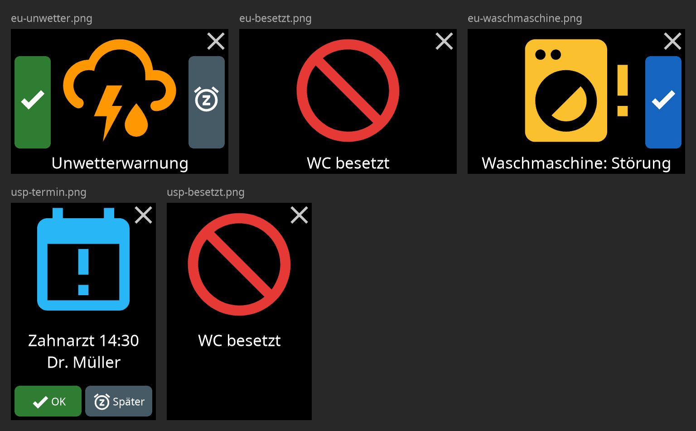
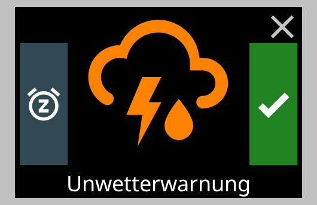
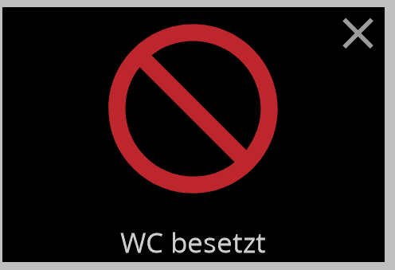
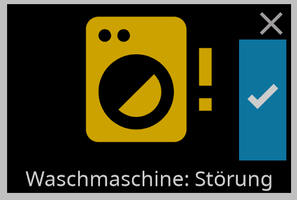
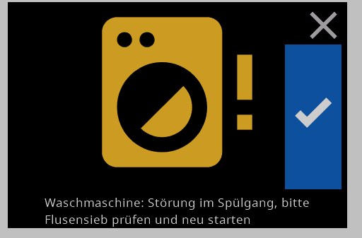

# Benachrichtigungsseite mit großem Icon

Stand: 2026-11-18. Testseite `popupNotify3` in HMI 6.2.0 (Generator `HMI/tools/popup_notify3.py`), im Emulator geprüft. Neue HMI-Seite für Benachrichtigungen, die man aus der Entfernung erkennt: ein großes Icon, darunter
eine Zeile Text, Schließen-Kreuz und bis zu zwei Buttons. Beispiele: WC besetzt, Unwetterwarnung, gestörtes Hausgerät,
anstehender Termin, Internet weg.

## Beschlossen

**Layout**
- Das Icon ist so groß, wie es passt. Es gibt **eine** Icon-Font für alle Modelle (EU, us-l, us-p), Glyphenhöhe
  **255 px** (Font 9, nur die Icons der Liste) – 272 px wären möglich, aber Höhe und Glyphenbreite sind im zi-Format
  je ein Byte. ≈ 167 KB Flash.
- Schließen-Kreuz oben rechts (MDI `close` aus der vorhandenen Bold-80-Font, hellgrau).
- Unten **eine Zeile Text**. Mehr Zeilen nur dort, wo dadurch das Icon nicht kleiner wird (us-p).
- **Die Schrift der Textzeile ist einstellbar** (Font per Nachricht), Standard 48 px. Textfeld EU y 272–319 (48 px),
  oben ausgerichtet: Font 3 (48 px) und Font 2 (32 px) **einzeilig**, nur Font 0 (24 px) **zweizeilig**. Damit
  überlappt der Text weder Icon noch Buttons.
- **Umbruch macht der Adapter:** Die Nextion bricht mit `isbr` zeichenweise mitten im Wort um (Emulator). Der
  Adapter rechnet die Breite exakt aus den Font-Tabellen (Vorschub left+width+right je Zeichen, kein Kerning),
  bricht an Leerzeichen um, trennt Zeilen mit **CR LF** (nur CR reicht nicht) und kürzt auf die erlaubte Zeilenzahl.
- **EU / us-l (480×320):** bis zu 2 Buttons als senkrechte Spalten links und rechts (80 px breit, y 60–264, die rechte
  beginnt unter dem Kreuz). Auf den Buttons ein MDI-Icon in 80 px aus der vorhandenen Bold-80-Font. Die Textzeile
  läuft unter den Spalten über die ganze sichtbare Breite (434 px, bei 48 px etwa 20–23 Zeichen).
- **Sichtbarer Bereich:** Der Rahmen des Panels verdeckt rechts etwa 30 px. Sichtbar ist bei EU x 0–449, bei us-l
  derselbe Bereich 15 px weiter rechts (x 15–464) – so liegen auch alle anderen Seiten (Screensaver-Texte 0–449,
  Karten mit bPrev/bNext 9–440, Popup-Kreuz bis 446; us-l jeweils +15). Geometrie EU (us-l: x +15):

  | Objekt | x | y |
  |---|---|---|
  | Spalte links `b1` | 8–87 | 60–264 |
  | Spalte rechts `b2` | 362–441 | 60–264 |
  | Kreuz `b0` (66×80) | 381–446 (endet wie das Kreuz von `popupNotify`) | 0–79 |
  | Icon `tIcon` (255×255) | 97–351 (mittig im sichtbaren Bereich) | 0–254 |
  | Text `tText` (434×48) | 8–441 | 272–319 |

  us-p (320×480) hat keinen solchen Versatz (die Seiten nutzen die volle Breite symmetrisch) und bleibt unverändert.
  Das Web-Panel hat keinen Rahmen und nutzt weiter die volle Fläche.
- **us-p (320×480):** Buttons unten nebeneinander, je Icon (48 px) + kurzer Text (32 px). Darüber der Text: mit Buttons
  2 Zeilen, ohne Buttons bis zu 4 (bei 48 px etwa 16 Zeichen pro Zeile).
- Ohne Buttons bleibt das Icon gleich groß, die Seitenspalten bleiben leer.

**Farben**
- Icon-Farbe und Button-Farbe sind per Nachricht setzbar.
- Einfarbige Icons (eine Font-Glyphe hat eine Farbe). Mehrfarbig ginge über übereinandergezeichnete Ebenen, ist aber
  nicht geplant.

**Icons**
- Stil **MDI** (Material Design Icons) wie im übrigen Panel. Google Material Symbols wurden verglichen und verworfen:
  feiner, aber ohne die Warn-Varianten (`-alert`) und ohne Kloschüssel.
- „Besetzt“ = Parkverbotsschild `cancel` (Ring mit Strich oben links → unten rechts), z. B. rot.
- Startumfang 55, um 32 erweitert auf 87 (neue Icons hinten angehängt). Maßgebliche Liste (einzige Quelle für
  Adapter, Admin-Icon-Tab und Generator): `templates/popup-notify3-icons.json`; die Aufzählung hier ist nur die
  Übersicht:
  - Allgemein: `alert`, `information-outline`, `doorbell`, `package-variant-closed`, `mailbox-up`, `phone-ring`,
    `shield-alert`, `alarm-light`, `window-open-variant`, `window-open-hinged-variant` (eigenes EU-Fenster),
    `window-shutter-alert`, `door-open`, `garage-open`, `ev-station`, `power-socket-de`, `battery-alert-variant-outline`
  - Termine: `calendar`, `calendar-alert`, `calendar-clock`, `bell-ring`, `trash-can`
  - Offline: `wifi-off`, `web-off`, `cloud-off-outline`, `lan-disconnect`
  - Besetzt: `cancel`, `toilet`, `door-closed-lock`
  - Wetter/Unwetter: `weather-rainy`, `weather-lightning`, `weather-lightning-rainy`, `weather-hail`, `weather-pouring`,
    `weather-snowy-heavy`, `weather-windy`, `weather-tornado`, `home-alert`, `subway-alert-variant`, `home-flood`,
    `snowflake-alert`, `sun-thermometer`, `weather-fog`
  - Hausgeräte fertig: `washing-machine`, `tumble-dryer`, `dishwasher`
  - Hausgeräte gestört: `washing-machine-alert`, `tumble-dryer-alert`, `dishwasher-alert`, `fridge-alert`,
    `water-boiler-alert`, `robot-vacuum-alert`, `radiator-off`
  - Gefahr: `water-alert`, `smoke-detector-alert`, `fire-alert`
  - Erweiterung (32), erst mit der TFT 6.3.0 (zusammen mit der Geräteseite); auf älterer TFT bleibt das
    Symbol leer:
    `garage-variant`, `garage-open-variant`, `chevron-triple-up`, `chevron-triple-down`,
    `chevron-triple-left`, `chevron-triple-right`, `school`, `gate-open`, `door-sliding-open`, `lock-open-alert`,
    `car-door`, `garage-alert-variant`, `gate-alert`, `key-alert`, `molecule-co2`, `thermometer-alert`, `heat-wave`,
    `fan-alert`, `flash-alert`, `car-battery`, `battery-charging-high`, `motion-sensor`, `cctv`, `lightbulb-alert`,
    `leak`, `water-pump-off`, `pill`, `pill-multiple`, `medication`, `bus-school`, `stove`, `pot-steam`
- Button-Icons (aus den vorhandenen Fonts, kein zusätzlicher Flash): OK `check-bold`, Bestätigen `check-circle-outline`,
  Später `alarm-snooze`, Öffnen `door-open` / `lock-open-variant-outline`, Ablehnen `close-thick`.

**Speicher**
- Icon-Font bei 255 px: gemessen ≈ 3,3 KB pro Icon (zum Vergleich 32 px 136 B, 48 px 250 B, 80 px 461 B),
  87 Icons ≈ 282 KB Flash (55 waren ≈ 181 KB). Fonts kosten keinen Seiten-RAM.

## Seite und Protokoll (HMI 6.2.0, Test)

- Seite `popupNotify3` (Kopie von `popupNotify`), Öffnen mit `pageType~popupNotify3`.
- Inhalt: `entityUpdateDetail~<id>~<icon>~<iconFarbe>~<text>~<textFarbe>~~<btnLinksIcon>~<btnLinksFarbe>~<btnRechtsIcon>~<btnRechtsFarbe>~<timeout>`
  (Farben 565-dezimal, leeres Button-Icon = Button aus, leerer Font = 3, Text ≤ 199 Byte, Nachricht ≤ 511 Byte).
- Ereignisse wie `popupNotify`: links `buttonPress2,<id>,notifyAction,button1`, rechts `…,button3` (`button2` ist bei
  `popupNotify` der mittlere und bleibt frei), Kreuz/Timeout `buttonPress2,popupNotify3,bExit`. Nach einem Button
  stellt die Seite den alten Screensaver-Timeout wieder her und schließt sich danach selbst, falls der Adapter nichts tut.
- Kreuz `b0` ist 80 px hoch (Nextion zeichnet keinen Text in zu niedrigen Boxen) und ragt 20 px in die rechte Spalte
  (EU x 381–441, y 60–79); das Icon berührt es nicht.
- Buttons eckig (keine passende Rundungs-Font).

## Offen

- Fix `sleepValue`: Die Seite setzt den globalen Zähler beim Laden nicht zurück (Altfehler, `popupNotify` genauso).
  Lädt sie sich über sich selbst neu oder war sie länger als der Screensaver-Timeout offen, kommt ~1 s später `bExit`
  und eine gerade folgende Nachricht geht verloren. Vorschlag: im `load` `sleepValue=0` und alten Timeout merken.
- Adapter, Admin, Web-Panel: Anbindung von `popupNotify3` (u. a. `panel.ts` bExit nur für `popupNotify`).
- us-p ohne Buttons: Icon und Text senkrecht mittig setzen (im Mockup bleibt unten Fläche leer).
- us-p: Die Icon-Fläche reicht in die Ecke des Kreuzes – Icons, die bis rechts oben zeichnen, könnten es berühren.
- Button-Beschriftung als Text auf EU/us-l (statt Icon): Buchstaben senkrecht gestapelt (`\r\n` zwischen den
  Buchstaben, Adapter-seitig), passt in 32 px für ~7 Buchstaben – nur falls Icons nicht reichen.
- Herd mit Warnung gibt es in MDI nicht (`stove-alert` fehlt) – eigenes Icon oder weglassen.
- Erst EU als Testseite, us-l/us-p nach Abnahme. Adapter, Admin und Web-Panel danach.

## Bilder

Emulator (HMI 6.2.0, `popupNotify3`), unter `doc/Pictures/pageNotify/`:

| Unwetter | Besetzt | Waschmaschine | 24 px zweizeilig |
|---|---|---|---|
|  |  |  |  |

Entwürfe (Mockups) aus der Planung:

| Datei | Inhalt |
|---|---|
| `eu-unwetter.png` | EU, 2 Buttons (OK grün, Später grau), Icon orange |
| `eu-besetzt.png` | EU, ohne Buttons, `cancel` rot |
| `eu-waschmaschine.png` | EU, 1 Button rechts, langer Text in einer Zeile |
| `usp-termin.png` | us-p, Buttons unten, 2 Textzeilen |
| `usp-besetzt.png` | us-p, ohne Buttons |

Die Bilder sind mit den echten Fonts der HMI 6.1.0 (Text, Kreuz, Button-Icons) und 3-Bit-Alpha wie auf dem Panel
gerendert; das große Icon per Canvas auf 8 Alphastufen.
