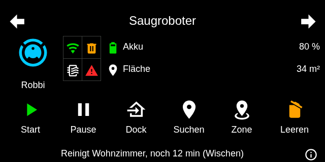
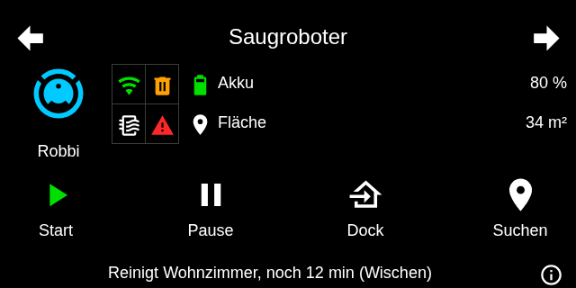
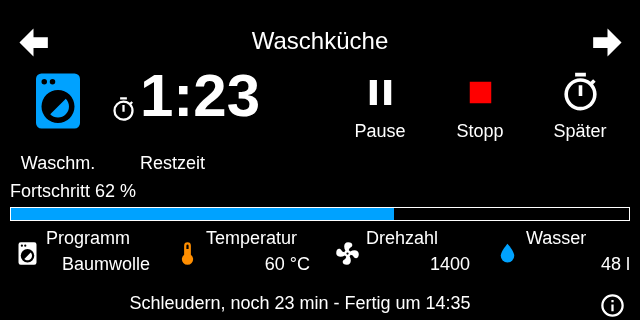
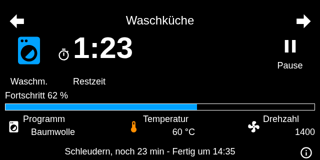
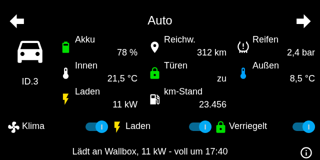
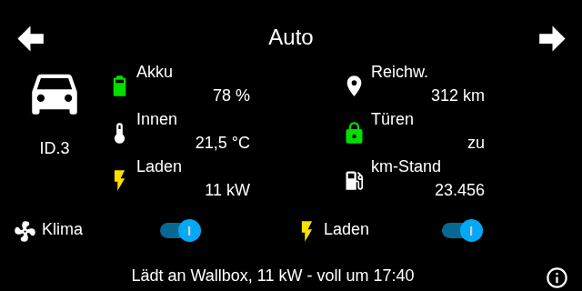

# Web-Panel: Smartphone-Modelle `web-p` und `web-l`

Stand: 2026-11-07. Verbindliche Spezifikation für alle Beteiligten (Adapter, Web-Frontend, Admin).
Entscheidungen sind mit Tim abgestimmt; Abweichungen nur nach Rücksprache.

## Ziel

Eigenständige Web-Panels (`kind: 'web'`) sollen auf Smartphones und Tablets bildschirmfüllend laufen.
Dafür gibt es zwei neue Panel-Modelle mit einer festen logischen Bühne im Verhältnis 2:1, die der
Browser wie bisher auf den Viewport skaliert (schmale Ränder bei 16:9 bis 20:9).

| Modell | Bühne | Vorlage | Inhaltsbreite (`contentWidth`, Bühne − 33) |
| --- | --- | --- | --- |
| `web-p` | 320 × 640 (hochkant) | us-p (320 × 480) | 287 |
| `web-l` | 640 × 320 (quer) | eu (480 × 320) | 607 |

## Regeln

- `NSpanelModel` wird `'eu' | 'us-p' | 'us-l' | 'web-p' | 'web-l'` (Adapter `types.ts` und `NSPanel.d.ts`,
  Admin `adminShareConfig.ts`, Web `protocol/types.ts`). Hilfsfunktionen statt Stringvergleichen:
  `isPortrait(model)` (`us-p`, `web-p`), `isWebModel(model)`, Bühnengröße nur über `stageSize(model)`.
- Die Web-Modelle gibt es **nur für eigenständige Web-Panels**. Der Hardware-Dialog im Admin bietet sie
  nicht an; ein Hardware-Panel mit Web-Modell meldet der Adapter als Konfigurationsfehler (Log, Panel
  wird nicht angelegt). Klone echter Panels behalten das Hardware-Modell.
- **Kein Wechsel der Ausrichtung zur Laufzeit.** Die Ausrichtung ist Teil des Modells und wird beim
  Anlegen des Web-Panels gewählt. Dreht der Nutzer das Gerät, skaliert die Bühne mit Rändern.
- TFT-Version für `hello`: Web-Modelle haben keine TFT, `tftVersion` liefert den bisherigen Fallback.
- Alle `=== 'us-p'`-Abfragen, die Elementzahlen oder Layouts wählen, werden zu Tabellen pro Modell
  (Adapter `pageMenu.ts`, `pageGrid.ts`; Admin `PageMenuEditor.tsx`; Web `gridLayout`, `EntityList`,
  `bottomCount`).
- Kein Web-Manifest, keine PWA (fest installierte Geräte nutzen Fully Kiosk).
- Mitzunehmende Inkonsistenzen: der Web-Parser für `tiles` nimmt fest 5 bottom / 7 indicator, der
  Adapter erlaubt bei us-p 4 / 8 (Parser folgt dem Modell). `cardThermo2` hat `maxItems` 8 in
  `pageThermo2.ts` und 9 in `pageMenu.ts` (9 ist richtig, der Web-Parser zeigt 9 Slots).

## Menü-Karten: Elemente pro Modell

| Karte | eu / us-l | us-p | web-l | web-p |
| --- | --- | --- | --- | --- |
| cardEntities | 4 | 5 | 4 | 8 |
| cardSchedule | 6 | 6 | 6 | 11 |
| cardGrid | 3×2 = 6 | 2×3 = 6 | 4×2 = 8 | 2×5 = 10 |
| cardGrid2 | 4×2 = 8 | 3×3 = 9 | 5×2 = 10 | 3×5 = 15 |
| cardGrid3 | 2×2 = 4 | 2×2 = 4 | 3×2 = 6 | 2×4 = 8 |
| cardMedia Optionen | 5 | 5 | 6 | 8 (2 Reihen à 4) |
| cardThermo2 Slots | 9 | 9 | 9 | 9 |

Geometrie-Vorgaben Web (Bühnenpixel, TitleBar 62 hoch, Inhalt ab y 62/72):

- cardEntities web-p: 8 Zeilen à 71 px ab y 72, kompakte Zeilen wie us-p. web-l: 4 Zeilen à 57 px wie eu,
  Namensbreite wächst mit der Inhaltsbreite.
- cardSchedule web-p: 11 Zeilen à 49 px ab y 79. web-l: wie eu.
- Grids: Spaltenbreite `floor(contentWidth / Spalten)`, Zeilenhöhe `floor((Höhe − 62 − 18) / Zeilen)`
  (web-p) bzw. 119 (quer). cardGrid3 behält Schrift 24 und Wertbreite 140.
- cardMedia web-l: Optionsleiste 6 × 106 px. web-p: eigenes Hochkant-Layout (Logo, Name, Artist,
  Steuerleiste, Lautstärke untereinander), Optionen 2 Reihen × 4 à 80 px unten.
- cardThermo2: web-l wie eu mit Ring in der Mitte (x 305) und den 4+4+1 Slots; web-p nach dem
  us-p-HMI (Slots in Reihen oben und unten, Ring dazwischen), 9 Slots.
- Feste Karten (cardThermo, cardPower, cardAlarm, cardChart, cardLChart, cardPChart, cardQR, cardTrash,
  pageStartup) bleiben in ihrer eu- bzw. us-p-Geometrie und werden auf der Bühne zentriert
  (web-l: horizontal, web-p: vertikal).

## Geräteseiten (cardDevice1–3)

Stand: 2026-11-24. Die Geräteseiten ([device-page-hmi.md](../ideas/device-details/device-page-hmi.md)) haben im
Web-Panel eine **Geometrie je Modell** (`src-web/src/cards/cardDevice/`). Sie stehen nicht in `CENTERED_ON_WEB`,
die Karte sieht also immer das echte Modell.

| Modell | Geometrie | Quelle |
| --- | --- | --- |
| eu | Tabelle der eu-HMI, unverändert | `geometryHmi.ts` `EU_GEOMETRY` |
| us-l | eu-Tabelle **15 px nach rechts** (sichtbarer Bereich x 15–464) | `geometryHmi.ts` `US_L_GEOMETRY` |
| web-l | eigenes Layout auf 640 px mit Zusatz-Elementen | `geometryWeb.ts` `webLandscapeGeometry` |
| us-p, web-p | **vorläufiger Rückfall** (Phase 2 ersetzt ihn): eu-Seite ohne Zusatz-Elemente, auf die Bühnenbreite verkleinert (320 / 450) | `layout.ts` `FALLBACK` |

- **Neues Modell:** Tabelle (Hardware, aus `doc/ideas/device-details/device-page-geometry.json`) bzw. Layout-Funktion
  (Web) anlegen und in `GEOMETRY` in `layout.ts` eintragen – sonst nichts. Eine Box darf `font` und `align`
  mitbringen, wenn das Modell von der Vorgabe der Elementart abweicht.
- **us-l:** Die Verschiebung ist aus der HMI abgelesen (`HMI/us-l/nspanel-us-l-v6.2.0.HMI` gegen
  `HMI/nspanel-v6.2.0.HMI`): Überschrift, Pfeile und alle Objekte von cardEntities und cardThermo2 +15 px, die
  Zellen von cardGrid +16, von cardGrid2 +14; y, Breite und Höhe gleich. Wie bei cardThermo2 verschiebt die Karte
  nur ihren Inhalt, die Kopfzeile (`TitleBar`) zeichnet das Web-Panel auf us-l bei allen Karten wie eu.

### Zusatz-Elemente der Web-Modelle

Der Adapter hängt sie bei `web-l` und `web-p` **hinter das info-Icon**; eu, us-l und us-p (auch als Web-Klon)
bekommen und zeigen nur den Standardteil.

```
entityUpd~<heading>~<prev 6>~<next 6>~<main 6>~<slot 1..N je 6>~<info 6>~<extra 1..E je 6>
```

| Seite | N | Zusatz-Slots (E) | damit |
| --- | --- | --- | --- |
| cardDevice1 | 10 | button, button | 6 Knöpfe |
| cardDevice2 | 6 | info, button, button | 4 Infos, 3 Knöpfe |
| cardDevice3 | 8 | info, info, switch | 8 Infos, 3 Schalter |

Ein Zusatz-Element verhält sich wie ein Standard-Slot seiner Art (Tipp, Long-Press, Popup). Fehlende oder leere
Zusatz-Elemente hinterlassen keine Lücke: jede Reihe wird für die Elemente gesetzt, die sie tragen muss – bis zum
letzten belegten Zusatz-Slot ihrer Art. Der Parser liest die Zusatz-Slots nur bei einem Web-Modell
(`ParseContext.model`).

### Layout web-l (Bühne 640 × 320)

Kopfzeile wie die anderen web-l-Karten, Inhalt x 10–629 (kein HMI-Rand), y, Schriften und Elementarten wie eu.
**Kein Textfeld ist schmaler als auf eu** (der Adapter kürzt Namen und Werte auf die eu-Breiten); die Breite geht in
mehr Elemente, nicht in längere Texte. Statuszeile auf allen drei Seiten **x 10, y 289, 580 × 30, mittig**
(eu 390 px), info-Icon x 594, y 288, 36 × 32.

| Seite | Aufbau | x-Positionen |
| --- | --- | --- |
| cardDevice1 | main und Status-Block (2×2) wie eu. Info-Zeilen 1–2: Icon x 126 (mit Status-Icons 204), Name bis x 518 (354 bzw. 276 px), Wert x 520, 110 px rechtsbündig. Darunter **eine Reihe mit 4–6 Knöpfen** (104 × 52, Name 104 × 26, y 190 / 244) | 4: 10 / 182 / 354 / 526 · 5: 10 / 139 / 268 / 397 / 526 · 6: 8 / 112 / 216 / 320 / 424 / 528 |
| cardDevice2 | main und großer Wert wie eu (bei 3 Knöpfen Icon x 106, Wert und Name x 140 statt 110 / 146). **1–3 Knöpfe oben rechts** (100 × 50, Name 100 × 26), rechtsbündig, Slot 6 zuerst. Balken und sein Name 620 px. Darunter **eine Reihe mit 3–4 Info-Kacheln** (140 px wie eu) | Knöpfe 1: 530 · 2: 430 / 530 · 3: 330 / 430 / 530 · Infos 3: 10 / 250 / 490 · 4: 10 / 170 / 330 / 490 |
| cardDevice3 | main wie eu. Info-Kacheln (161 px wie eu) in den Zeilen y 69 / 121 / 173: Slots 1–6 zeilenweise in zwei Spalten wie eu, die **Zusatz-Infos in einer dritten Spalte** (oben, Mitte). Darunter **eine Reihe mit 2–3 Schaltern** (y 228–277) | Infos 2 Spalten: 114 / 372 · 3 Spalten: 114 / 292 / 469 · Schalter 2: 10 / 320 (213 px wie eu) · 3: 10 / 217 / 424 (206 px: Name x + 34, Schalter x + 161, 45 px) |

Voll belegt und ohne Zusatz-Elemente (Beispiele `src-web/scripts/examples/web-l-cardDevice*.txt`):








## Screensaver: Plätze pro Modell

`ScreenSaverConst` (`definition.ts`) und die Kopie `screensaverSlotLimits` (`adminShareConfig.ts`,
Test hält sie gleich). Nicht genannte Plätze (favorit, alternate, mricon, time, date, notify) bleiben
wie eu.

| Modus | eu: bottom / indicator / left | web-l | web-p |
| --- | --- | --- | --- |
| standard | 4 / 0 / 0 | 6 / 0 / 0 | 8 / 0 / 0 |
| alternate | 3 (+ alternate) / 0 / 0 | 5 / 0 / 0 | 7 / 0 / 0 |
| advanced | 6 / 5 / 3 | 8 / 8 / 3 | 8 / 12 / 4 |
| easyview | 3 (us-p 4) / 0 / 0 | 4 / 0 / 0 | 8 / 0 / 0 |
| tiles | 5 (us-p 4) / 7 (us-p 8) / 0 | 7 / 11 / 0 | 8 / 8 / 0 |

Layout-Vorgaben Web:

- web-l: eu-Layout, zusätzliche Breite geht in die Spalten (standard/alternate: 82 px ab x 137;
  advanced: bottom 75 px ab x 16, Indikatoren 56 px ab x 178; easyview `floor(594 / 4)`; tiles 7 Spalten
  à 90 ab x 5, Indikatoren Zeile 0 mit 7 Zellen, Zeile 1 je 2 Zellen links und rechts der Uhr).
- web-p: hochkant, bottom immer **zwei Reihen à 4** Spalten à 80 px (Aufbau Name/Icon/Wert wie bisher).
  Bei standard, alternate, advanced und easyview Uhr und Datum oben, favorit bzw. alternate darunter;
  Indikatoren bei advanced: 1–4 als 2×2-Block rechts neben der left-Spalte (unter Uhr und Datum),
  5–12 als zwei Reihen à 4 darunter; zwischen Indikatoren und bottom-Reihen eine dünne Trennlinie wie
  bei standard. left-Spalte 4 Zeilen. Bei tiles liegt die Uhr zwischen den
  Indikator- und den bottom-Reihen (anders als us-p, wo sie zwischen den beiden Indikatorreihen liegt).
  tiles: 4 Spalten à 80, Reihen von oben: Indikatoren (128), Indikatoren (128), Uhr + Datum (110),
  bottom (107), bottom (107), Statusbalken (5) wie `HMI/tools/screensaver5_usp.py`.
- Notify im Screensaver: web-p mehr Textzeilen (Bereich unter der Uhr), web-l wie eu.
- Keine neuen Indikatorreihen in Modi, die keine haben.

## Popups

| Popup | eu | web-l | web-p |
| --- | --- | --- | --- |
| popupNotify Zeilen je textSize 0…5 | 7/5/5/4/2/1 | 7/5/5/4/2/1, Text 560 px breit | 20/15/15/10/6/3, Text 272 px breit |
| popupInSel Einträge pro Seite | 3×4 = 12 | 4×4 = 16 | 2×8 = 16 |
| popupThermo Modi pro Zeile | 3 | 4 | 4 (zwei Zeilen pro Eintrag) |
| popupFan Modi pro Seite | 3×2 = 6 | 4×2 = 8 | 2×4 = 8 |
| popupSlider, popupTimer, popupLight, popupShutter, popupShutter2 | fest | eu-Layout, Slider auf 480 verlängert | Hochkant-Layout, gleiche Elemente (gilt auch für us-p) |

- Die Zeilenzahl von popupNotify legt der Adapter fest (`pagePopup.ts`, Fenster je `textSize`); sie wird
  eine Tabelle pro Modell. Der Browser bricht um, es gibt keine Zeichenzahl pro Zeile.
- Seitengrößen von popupInSel, popupThermo und popupFan bestimmt nur das Web (der Adapter sendet die
  ganze Liste, maximal 48 Einträge).

## Admin

- Web-Panel-Dialog (`PagePanelOverview.tsx`): Modellauswahl bekommt `web-p` und `web-l` mit den Texten
  „Smartphone hochkant“ / „Smartphone quer“ (i18n, 11 Sprachen). Hardware-Dialog unverändert.
- Screensaver-Editor: WYSIWYG-Layouts (`LAYOUTS`) für `web-l` (Aspekt 2 / 1) und `web-p` (Aspekt 1 / 2)
  pro Modus, Plätze laut Tabelle; `layoutOf` wählt nach Modell.
- Menü-Karten-Editor: `Grid2ModelStatus` wird zu einer Slot-Anzahl pro Modell für alle Menü-Karten.
  Neben der Karte ein Hinweissymbol mit Tooltip, das die Elementzahl je zugewiesenem Modell nennt und
  bei gemischten Modellen warnt. Keine WYSIWYG-Vorschau.

## Prüfung

- Adapter: Unit-Tests für die Tabellen (maxItems je Karte und Modell, ScreenSaverConst = slotLimits,
  Notify-Zeilen), `npm run lint`, `npm run check`, `npm test`.
- Web: Tests der Parser und Layout-Funktionen, Screenshots per `src-web/scripts/screenshot.mjs` mit
  `?model=web-p` bzw. `web-l` für jede Karte, jeden Screensaver-Modus und jedes Popup.
- Admin: Puppeteer-Durchlauf (siehe Memory „Admin per Puppeteer prüfen“).
