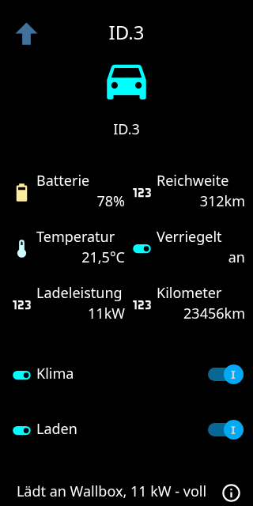

# Web-Panel: Smartphone-Modelle `web-p` und `web-l`

Stand: 2026-11-07. Verbindliche Spezifikation für alle Beteiligten (Adapter, Web-Frontend, Admin).
Entscheidungen sind mit Tim abgestimmt; Abweichungen nur nach Rücksprache.

## Ziel

Eigenständige Web-Panels (`kind: 'web'`) sollen auf Smartphones und Tablets bildschirmfüllend laufen.
Dafür gibt es zwei neue Panel-Modelle mit einer festen logischen Bühne im Verhältnis 2:1, die der
Browser wie bisher auf den Viewport skaliert (schmale Ränder bei 16:9 bis 20:9).

| Modell | Bühne | Vorlage | Inhaltsbreite (`contentWidth`, Bühne − 33) |
| --- | --- | --- | --- |
| `web-p` | 320 × 640 (hochkant) | us-p (320 × 480) | 287 |
| `web-l` | 640 × 320 (quer) | eu (480 × 320) | 607 |

## Regeln

- `NSpanelModel` wird `'eu' | 'us-p' | 'us-l' | 'web-p' | 'web-l'` (Adapter `types.ts` und `NSPanel.d.ts`,
  Admin `adminShareConfig.ts`, Web `protocol/types.ts`). Hilfsfunktionen statt Stringvergleichen:
  `isPortrait(model)` (`us-p`, `web-p`), `isWebModel(model)`, Bühnengröße nur über `stageSize(model)`.
- Die Web-Modelle gibt es **nur für eigenständige Web-Panels**. Der Hardware-Dialog im Admin bietet sie
  nicht an; ein Hardware-Panel mit Web-Modell meldet der Adapter als Konfigurationsfehler (Log, Panel
  wird nicht angelegt). Klone echter Panels behalten das Hardware-Modell.
- **Kein Wechsel der Ausrichtung zur Laufzeit.** Die Ausrichtung ist Teil des Modells und wird beim
  Anlegen des Web-Panels gewählt. Dreht der Nutzer das Gerät, skaliert die Bühne mit Rändern.
- TFT-Version für `hello`: Web-Modelle haben keine TFT, `tftVersion` liefert den bisherigen Fallback.
- Alle `=== 'us-p'`-Abfragen, die Elementzahlen oder Layouts wählen, werden zu Tabellen pro Modell
  (Adapter `pageMenu.ts`, `pageGrid.ts`; Admin `PageMenuEditor.tsx`; Web `gridLayout`, `EntityList`,
  `bottomCount`).
- Kein Web-Manifest, keine PWA (fest installierte Geräte nutzen Fully Kiosk).
- Mitzunehmende Inkonsistenzen: der Web-Parser für `tiles` nimmt fest 5 bottom / 7 indicator, der
  Adapter erlaubt bei us-p 4 / 8 (Parser folgt dem Modell). `cardThermo2` hat `maxItems` 8 in
  `pageThermo2.ts` und 9 in `pageMenu.ts` (9 ist richtig, der Web-Parser zeigt 9 Slots).

## Menü-Karten: Elemente pro Modell

| Karte | eu / us-l | us-p | web-l | web-p |
| --- | --- | --- | --- | --- |
| cardEntities | 4 | 5 | 4 | 8 |
| cardSchedule | 6 | 6 | 6 | 11 |
| cardGrid | 3×2 = 6 | 2×3 = 6 | 4×2 = 8 | 2×5 = 10 |
| cardGrid2 | 4×2 = 8 | 3×3 = 9 | 5×2 = 10 | 3×5 = 15 |
| cardGrid3 | 2×2 = 4 | 2×2 = 4 | 3×2 = 6 | 2×4 = 8 |
| cardMedia Optionen | 5 | 5 | 6 | 8 (2 Reihen à 4) |
| cardThermo2 Slots | 9 | 9 | 9 | 9 |

Geometrie-Vorgaben Web (Bühnenpixel, TitleBar 62 hoch, Inhalt ab y 62/72):

- cardEntities web-p: 8 Zeilen à 71 px ab y 72, kompakte Zeilen wie us-p. web-l: 4 Zeilen à 57 px wie eu,
  Namensbreite wächst mit der Inhaltsbreite.
- cardSchedule web-p: 11 Zeilen à 49 px ab y 79. web-l: wie eu.
- Grids: Spaltenbreite `floor(contentWidth / Spalten)`, Zeilenhöhe `floor((Höhe − 62 − 18) / Zeilen)`
  (web-p) bzw. 119 (quer). cardGrid3 behält Schrift 24 und Wertbreite 140.
- cardMedia web-l: Optionsleiste 6 × 106 px. web-p: eigenes Hochkant-Layout (Logo, Name, Artist,
  Steuerleiste, Lautstärke untereinander), Optionen 2 Reihen × 4 à 80 px unten.
- cardThermo2: web-l wie eu mit Ring in der Mitte (x 305) und den 4+4+1 Slots; web-p nach dem
  us-p-HMI (Slots in Reihen oben und unten, Ring dazwischen), 9 Slots.
- Feste Karten (cardThermo, cardPower, cardAlarm, cardChart, cardLChart, cardPChart, cardQR, cardTrash,
  pageStartup) bleiben in ihrer eu- bzw. us-p-Geometrie und werden auf der Bühne zentriert
  (web-l: horizontal, web-p: vertikal).

## Geräteseiten (cardDevice1–3)

Stand: 2026-11-28 (Status-Icons in Stufen, TFT `device13`). Die Geräteseiten ([device-page-hmi.md](../ideas/device-details/device-page-hmi.md)) haben im
Web-Panel eine **Geometrie je Modell** (`src-web/src/cards/cardDevice/`). Sie stehen nicht in `CENTERED_ON_WEB`,
die Karte sieht also immer das echte Modell.

| Modell | Geometrie | Quelle |
| --- | --- | --- |
| eu | Tabelle der eu-HMI, unverändert | `geometryHmi.ts` `EU_GEOMETRY` |
| us-l | eu-Tabelle **15 px nach rechts** (sichtbarer Bereich x 15–464) | `geometryHmi.ts` `US_L_GEOMETRY` |
| us-p | Tabelle der us-p-HMI (320 × 480, Inhalt x 10–309, Statuszeile 262 px) | `geometryHmi.ts` `US_P_GEOMETRY` |
| web-l | eigenes Layout auf 640 px mit Zusatz-Elementen | `geometryWeb.ts` `webLandscapeGeometry` |
| web-p | eigenes Layout auf 320 × 640 nach dem Vorbild us-p mit Zusatz-Elementen | `geometryWeb.ts` `webPortraitGeometry` |

- **Web = HMI:** `geometry.test.ts` liest `doc/ideas/device-details/device-page-geometry.json` (Werkzeug der HMI) und
  vergleicht für eu, us-l und us-p jede Box (x/y/w/h), jede Schrift und Ausrichtung sowie die Tippflächen mit den
  Hotspots der HMI. Ändert sich eine HMI-Seite, schlägt der Test fehl, bis die Tabelle nachgezogen ist.
- **Tippfläche von main:** genau die zwei Boxen Icon und Name (`bMain`, `tMainName` der HMI), auf allen Modellen –
  nicht das Rechteck um beide. Wo das Icon schmaler ist als der Name (us-p und web-p cardDevice3, web-p cardDevice1
  in den Stufen 0 und 3: Icon 150 px mittig, Name 300 px), löst die Fläche neben dem Icon nichts aus; ebenso die 2 px
  zwischen Icon und Name. Der Press-Effekt gilt weiter für Icon und Name zusammen.
- **Neues Modell:** Tabelle (Hardware) bzw. Layout-Funktion (Web) anlegen und in `GEOMETRY` in `layout.ts`
  eintragen – sonst nichts. Schrift und Ausrichtung je Elementart stehen in `BOX_STYLES` (`geometry.ts`); eine Box
  darf `font` und `align` mitbringen, wenn ein Modell davon abweicht (bisher keins).
- **Status-Icons (TFT device13):** cardDevice1 und cardDevice3 haben ein Raster (8 × 2 bzw. 8 × 1 Zellen, 1 px
  Rahmen Grau 14823, Nachbarn überlappen 1 px), gefüllt per `devIcons~…`; die Stufe steht in Feld 6 von info. Sichtbar
  sind die Spalten bis zur höchsten belegten Zelle, höchstens die der Stufe (`vCols` der HMI: ein `entityUpd` blendet
  nur Spalten jenseits seiner Stufe aus). cardDevice1 zeigt die Info-Zeilen in Satz A/B/C bzw. keine, cardDevice3
  blendet Kachel 1 bzw. 1 und 2 aus. Satz B kürzt den Namen auf 15 Byte, Satz C den Wert auf 19 Byte (die HMI kopiert
  in kleinere Puffer). Die Typen kommen als Zahl (0 leer, 1 nur senden, 2–9 Popup-Typen), `parse.ts` führt sie auf
  die Namen zurück; ein Typname versteht das Web-Panel weiter.
- **us-p:** cardDevice1 in Variante P2 – das Raster unter dem Haupt-Icon an der Stelle der Info-Zeilen, die
  Info-Zeilen in den Stufen 1 und 2 als Satz C rechts neben dem Haupt-Icon (wie in der HMI, kein Satz B).
- **us-l:** Die Verschiebung ist aus der HMI abgelesen (`HMI/us-l/nspanel-us-l-v6.2.0.HMI` gegen
  `HMI/nspanel-v6.2.0.HMI`): Überschrift, Pfeile und alle Objekte von cardEntities und cardThermo2 +15 px, die
  Zellen von cardGrid +16, von cardGrid2 +14; y, Breite und Höhe gleich. Wie bei cardThermo2 verschiebt die Karte
  nur ihren Inhalt, die Kopfzeile (`TitleBar`) zeichnet das Web-Panel auf us-l bei allen Karten wie eu.

### Zusatz-Elemente der Web-Modelle

Der Adapter hängt sie bei `web-l` und `web-p` **hinter das info-Icon**; eu, us-l und us-p (auch als Web-Klon)
bekommen und zeigen nur den Standardteil.

```
entityUpd~<heading>~<prev 6>~<next 6>~<main 6>~<slot 1..N je 6>~<info 6>~<extra 1..E je 6>
```

| Seite | N | Zusatz-Slots (E) | damit |
| --- | --- | --- | --- |
| cardDevice1 | 6 | button, button | 6 Knöpfe |
| cardDevice2 | 6 | info, button, button | 4 Infos, 3 Knöpfe |
| cardDevice3 | 8 | info, info, switch | 8 Infos, 3 Schalter |

Ein Zusatz-Element verhält sich wie ein Standard-Slot seiner Art (Tipp, Long-Press, Popup). **Fehlende oder leere
Zusatz-Elemente hinterlassen keine Lücke, egal an welcher Stelle:** Jede Reihe wird nur für die **belegten**
Zusatz-Elemente ihrer Art gesetzt, in ihrer Reihenfolge und lückenlos hinter den Standard-Slots (`filledExtras` in
`geometryWeb.ts`). Ist z. B. nur der zweite Zusatz-Knopf belegt, steht er am Platz des ersten, und die Seite sieht
aus wie mit nur dem ersten. Das Element selbst bleibt dabei dasselbe: Tipp, Long-Press und Schalter senden den
`intName` genau dieses Slots. Leere **Standard**-Slots bleiben dagegen wie in der HMI eine Lücke. Der Parser liest
die Zusatz-Slots nur bei einem Web-Modell (`ParseContext.model`).

### Layout web-l (Bühne 640 × 320)

Kopfzeile wie die anderen web-l-Karten, Inhalt x 10–629 (kein HMI-Rand), y, Schriften und Elementarten wie eu.
**Kein Textfeld ist schmaler als auf eu** – einzige Ausnahme: die Namen von Knöpfen, die ohne Zwischenraum
nebeneinander stehen, sind 4 px schmaler (siehe unten); die Breite geht in mehr Elemente, nicht in längere Texte (Namen und
Werte haben wie auf der HMI höchstens 31 Byte und werden an der Feldgrenze abgeschnitten). Statuszeile auf allen drei Seiten **x 10, y 289, 580 × 30, mittig**
(eu 390 px), info-Icon x 594, y 288, 36 × 32.

| Seite | Aufbau | x-Positionen |
| --- | --- | --- |
| cardDevice1 | main und Raster der Status-Icons wie eu. Info-Zeilen 1–2 je Stufe: Satz A Icon x 126, Name x 164 bis 518 (354 px), Wert x 520, 110 px rechtsbündig; Satz B Icon x 241, Name x 279 bis 518 (239 px, 15 Byte), Wert x 520; Satz C Icon x 315, Wert x 353 bis 630 (277 px, 19 Byte, rechtsbündig), kein Name; Stufe 3 keine. Darunter **eine Reihe mit 4–6 Knöpfen** (104 × 52, Name 104 × 26, y 190 / 244; bei 6 Knöpfen Name x + 2, 100 × 26) | 4: 10 / 182 / 354 / 526 · 5: 10 / 139 / 268 / 397 / 526 · 6: 8 / 112 / 216 / 320 / 424 / 528 |
| cardDevice2 | main und großer Wert wie eu (bei 3 Knöpfen Icon x 106, Wert und Name x 140 statt 110 / 146). **1–3 Knöpfe oben rechts** (100 × 50, Name 100 × 26; ab 2 Knöpfen Name x + 2, 96 × 26), rechtsbündig, Slot 6 zuerst, die belegten Zusatz-Knöpfe direkt dahinter. Balken und sein Name 620 px. Darunter **eine Reihe mit 3–4 Info-Kacheln** (140 px wie eu) | Knöpfe 1: 530 · 2: 430 / 530 · 3: 330 / 430 / 530 · Infos 3: 10 / 250 / 490 · 4: 10 / 170 / 330 / 490 |
| cardDevice3 | main wie eu. Info-Kacheln (161 px wie eu) in den Zeilen y 69 / 121 / 173: Slots 1–6 zeilenweise in zwei Spalten wie eu, die **Zusatz-Infos in einer dritten Spalte** (von oben: die erste belegte in Zeile 1, die zweite in Zeile 2). Darunter **eine Reihe mit 2–3 Schaltern** (y 228–277) | Infos 2 Spalten: 114 / 372 · 3 Spalten: 114 / 292 / 469 · Schalter 2: 10 / 320 (213 px wie eu) · 3: 10 / 217 / 424 (206 px: Name x + 34, Schalter x + 161, 45 px) |

**Knopf-Namen in dichten Reihen:** Stehen die Knöpfe einer Reihe ohne Zwischenraum nebeneinander (cardDevice1 mit
6 Knöpfen, cardDevice2 ab 2 Knöpfen), ist das Namensfeld 4 px schmaler und mittig unter dem Icon (x + 2) – zwischen
zwei Namen bleiben so 4 px wie zwischen den Knöpfen von eu (104 px im Raster 108). Icon und Tippfläche behalten die
volle Breite. In den verteilten Reihen (cardDevice1 mit 4 oder 5 Knöpfen) bleibt der Name 104 px.

Voll belegt und ohne Zusatz-Elemente. Die Bilder zeigen die Referenzbelegung der Nutzer-Doku
(`src-web/scripts/examples/ref-cardDevice*-extras.txt` bzw. `ref-cardDevice*.txt`, siehe
[BILDER.md](../Pictures/device-page/BILDER.md)); die Beispiele `web-l-cardDevice*.txt` mit anderen Daten nutzen
die Tests:


### Layout web-p (Bühne 320 × 640)

Kopfzeile wie die anderen web-p-Karten, Inhalt x 10–309 und alle Elemente (Größe, Schrift, Aufbau einer Zeile) wie
auf us-p. Statuszeile auf allen drei Seiten **x 10, y 607, 262 × 30, mittig** (wie us-p, dort y 447), info-Icon
x 274, y 606, 36 × 32.

Die 160 px mehr Höhe tragen die Zusatz-Elemente als weitere Zeilen. **Die Zeilen teilen sich die Höhe** (`stack` in
`geometryWeb.ts`): die Zeilen behalten ihre Höhe, die freie Höhe zwischen der ersten Zeile und der Statuszeile geht
in die Abstände – zwischen zwei Gruppen (main, Infos, Knöpfe / Schalter, Statuszeile) doppelt so viel wie zwischen
zwei Zeilen einer Gruppe. Ohne Zusatz-Elemente hat die Seite weniger Zeilen und größere Abstände, aber kein Loch
über der Statuszeile.

| Seite | Aufbau | y der Zeilen (voll belegt · ohne Zusatz-Elemente) |
| --- | --- | --- |
| cardDevice1 | Stufe 0: **main in der Mitte** (Icon x 85, Name 300 px), darunter 2 Info-Zeilen (34 px, Satz A). Stufen 1 und 2: main links (150 × 86 + Name) wie us-p, die Info-Zeilen als Satz C rechts daneben (Icon x 166, Wert x 204, 106 px); Stufe 3: main in der Mitte, keine Info-Zeilen. Ab Stufe 1 statt der Info-Zeilen das Raster (8 × 2 Zellen 38 × 41, x 10 + 37·c, Block 81 px hoch). Darunter **2–3 Reihen mit je zwei Knöpfen** (148 × 52, Name 148 × 26, x 10 / 162); die dritte Reihe trägt die belegten Zusatz-Knöpfe (ein einzelner steht links) | main 70 · Stufe 0: Infos 210 / 256 · Knöpfe 316 / 409 / 501 — ohne: Infos 233 / 291 · Knöpfe 374 / 478 · ab Stufe 1: Raster 210 · Knöpfe 316 / 409 / 502 — ohne: Raster 236 · Knöpfe 369 / 475 |
| cardDevice2 | main, großer Wert und Balken wie us-p. **3–4 Info-Zeilen** (die vierte ist die Zusatz-Info). Darunter **eine Reihe mit 1–3 Knöpfen**, die sich die Breite teilen: 1 Knopf 300 px wie us-p, 2 je 148 px (x 10 / 162), 3 je 100 px (x 10 / 110 / 210, die Breite dieses Knopfs auf eu; sie stehen ohne Zwischenraum, ihr Name hat deshalb x + 2, 96 × 26); Slot 6 zuerst, die belegten Zusatz-Knöpfe dahinter | main 68 · Balken 209 · Infos 282 / 332 / 381 / 431 · Knöpfe 496 — ohne: Balken 219 · Infos 302 / 357 / 411 · Knopf 486 |
| cardDevice3 | main wie us-p (Icon mittig, Name 300 px). **3–4 Reihen mit je zwei Info-Kacheln** (148 px, x 10 / 162, 51 px hoch); die vierte Reihe trägt die belegten Zusatz-Infos (eine einzelne steht links). Darunter **2–3 Schalterzeilen** (50 px, Name 212 px, Schalter x 260) | main 67 · Infos 191 / 249 / 307 / 365 · Schalter 429 / 486 / 543 — ohne: Infos 216 / 287 / 358 · Schalter 448 / 518 |

Abweichung von „kein Feld schmaler als auf us-p“: nur die Knöpfe von cardDevice2. Auf us-p hat der eine Knopf die
ganze Breite (300 px); drei Knöpfe in voller Breite wären drei Zeilen à 80 px und passen nicht mehr über die
Statuszeile. In einer Reihe haben sie zu dritt 100 px – so breit wie derselbe Knopf auf eu; ihr Namensfeld hat 96 px,
damit zwischen zwei Namen 4 px bleiben.

Voll belegt und ohne Zusatz-Elemente. Die Bilder zeigen die Referenzbelegung der Nutzer-Doku
(`src-web/scripts/examples/ref-portrait-cardDevice*-extras.txt` bzw. `ref-portrait-cardDevice*.txt`); die Beispiele
`web-p-cardDevice*.txt` mit anderen Daten nutzen die Tests, die us-p-Seiten mit den Daten der HMI-Vorschau stehen
in `us-p-cardDevice*.txt`:




### Feldbreiten für den Adapter

`src/lib/types/deviceDetails.ts`, `DEVICE_PAGE_FIELDS_BY_MODEL` (`devicePageFields(layout, model)`). Der Adapter
misst nur die Statuszeile (web-l mit den eu-Font-Tabellen, web-p mit den us-p-Tabellen); die übrigen Breiten sind
für Admin und Doku. Bei Reihen mit wechselnder Elementzahl steht der schmalste Fall (web-l Layout 1: Knopf 104,
zu sechst 100; web-l Layout 2: Knopf 100, ab zwei 96; web-p Layout 2: Knopf 300, zu zweit 148, zu dritt 96). Ein Test
des Web-Panels (`adapterTables.test.ts`) hält die Tabelle des Adapters und das Layout gleich.

| Modell | Statuszeile | Layout 1 | Layout 2 | Layout 3 |
| --- | --- | --- | --- | --- |
| eu, us-l | 390 | main 110 · Info 164 / 110 (Stufe 1: 49 / 110, Stufe 2: – / 87) · Knopf 104 | main 96 · Wert 190 / 190 (Font 4) · Balken 429 · Info 104 / 104 · Knopf 100 | main 100 · Info 125 / 125 · Schalter 125 |
| us-p | 262 | main 150 · Info 156 / 104 (Stufe 1 und 2: – / 106) · Knopf 148 | main 90 · Wert 172 / 172 (Font 4) · Balken 300 · Info 156 / 104 · Knopf 300 | main 300 · Info 112 / 112 · Schalter 212 |
| web-l | 580 | main 110 · Info 354 / 110 (Stufe 1: 239 / 110, Stufe 2: – / 277) · Knopf 100 | main 96 · Wert 190 / 190 (Font 4) · Balken 620 · Info 104 / 104 · Knopf 96 | main 100 · Info 125 / 125 · Schalter 125 |
| web-p | 262 | main 150 · Info 156 / 104 (Stufe 1 und 2: – / 106) · Knopf 148 | main 90 · Wert 172 / 172 (Font 4) · Balken 300 · Info 156 / 104 · Knopf 96 | main 300 · Info 112 / 112 · Schalter 212 |

(Info, Wert: Name / Wert in px.)

## Screensaver: Plätze pro Modell

`ScreenSaverConst` (`definition.ts`) und die Kopie `screensaverSlotLimits` (`adminShareConfig.ts`,
Test hält sie gleich). Nicht genannte Plätze (favorit, alternate, mricon, time, date, notify) bleiben
wie eu.

| Modus | eu: bottom / indicator / left | web-l | web-p |
| --- | --- | --- | --- |
| standard | 4 / 0 / 0 | 6 / 0 / 0 | 8 / 0 / 0 |
| alternate | 3 (+ alternate) / 0 / 0 | 5 / 0 / 0 | 7 / 0 / 0 |
| advanced | 6 / 5 / 3 | 8 / 8 / 3 | 8 / 12 / 4 |
| easyview | 3 (us-p 4) / 0 / 0 | 4 / 0 / 0 | 8 / 0 / 0 |
| tiles | 5 (us-p 4) / 7 (us-p 8) / 0 | 7 / 11 / 0 | 8 / 8 / 0 |

Layout-Vorgaben Web:

- web-l: eu-Layout, zusätzliche Breite geht in die Spalten (standard/alternate: 82 px ab x 137;
  advanced: bottom 75 px ab x 16, Indikatoren 56 px ab x 178; easyview `floor(594 / 4)`; tiles 7 Spalten
  à 90 ab x 5, Indikatoren Zeile 0 mit 7 Zellen, Zeile 1 je 2 Zellen links und rechts der Uhr).
- web-p: hochkant, bottom immer **zwei Reihen à 4** Spalten à 80 px (Aufbau Name/Icon/Wert wie bisher).
  Bei standard, alternate, advanced und easyview Uhr und Datum oben, favorit bzw. alternate darunter;
  Indikatoren bei advanced: 1–4 als 2×2-Block rechts neben der left-Spalte (unter Uhr und Datum),
  5–12 als zwei Reihen à 4 darunter; zwischen Indikatoren und bottom-Reihen eine dünne Trennlinie wie
  bei standard. left-Spalte 4 Zeilen. Bei tiles liegt die Uhr zwischen den
  Indikator- und den bottom-Reihen (anders als us-p, wo sie zwischen den beiden Indikatorreihen liegt).
  tiles: 4 Spalten à 80, Reihen von oben: Indikatoren (128), Indikatoren (128), Uhr + Datum (110),
  bottom (107), bottom (107), Statusbalken (5) wie `HMI/tools/screensaver5_usp.py`.
- Notify im Screensaver: web-p mehr Textzeilen (Bereich unter der Uhr), web-l wie eu.
- Keine neuen Indikatorreihen in Modi, die keine haben.

## Popups

| Popup | eu | web-l | web-p |
| --- | --- | --- | --- |
| popupNotify Zeilen je textSize 0…5 | 7/5/5/4/2/1 | 7/5/5/4/2/1, Text 560 px breit | 20/15/15/10/6/3, Text 272 px breit |
| popupInSel Einträge pro Seite | 3×4 = 12 | 4×4 = 16 | 2×8 = 16 |
| popupThermo Modi pro Zeile | 3 | 4 | 4 (zwei Zeilen pro Eintrag) |
| popupFan Modi pro Seite | 3×2 = 6 | 4×2 = 8 | 2×4 = 8 |
| popupSlider, popupTimer, popupLight, popupShutter, popupShutter2 | fest | eu-Layout, Slider auf 480 verlängert | Hochkant-Layout, gleiche Elemente (gilt auch für us-p) |

- Die Zeilenzahl von popupNotify legt der Adapter fest (`pagePopup.ts`, Fenster je `textSize`); sie wird
  eine Tabelle pro Modell. Der Browser bricht um, es gibt keine Zeichenzahl pro Zeile.
- Seitengrößen von popupInSel, popupThermo und popupFan bestimmt nur das Web (der Adapter sendet die
  ganze Liste, maximal 48 Einträge).

## Admin

- Web-Panel-Dialog (`PagePanelOverview.tsx`): Modellauswahl bekommt `web-p` und `web-l` mit den Texten
  „Smartphone hochkant“ / „Smartphone quer“ (i18n, 11 Sprachen). Hardware-Dialog unverändert.
- Screensaver-Editor: WYSIWYG-Layouts (`LAYOUTS`) für `web-l` (Aspekt 2 / 1) und `web-p` (Aspekt 1 / 2)
  pro Modus, Plätze laut Tabelle; `layoutOf` wählt nach Modell.
- Menü-Karten-Editor: `Grid2ModelStatus` wird zu einer Slot-Anzahl pro Modell für alle Menü-Karten.
  Neben der Karte ein Hinweissymbol mit Tooltip, das die Elementzahl je zugewiesenem Modell nennt und
  bei gemischten Modellen warnt. Keine WYSIWYG-Vorschau.

## Prüfung

- Adapter: Unit-Tests für die Tabellen (maxItems je Karte und Modell, ScreenSaverConst = slotLimits,
  Notify-Zeilen), `npm run lint`, `npm run check`, `npm test`.
- Web: Tests der Parser und Layout-Funktionen, Screenshots per `src-web/scripts/screenshot.mjs` mit
  `?model=web-p` bzw. `web-l` für jede Karte, jeden Screensaver-Modus und jedes Popup.
- Admin: Puppeteer-Durchlauf (siehe Memory „Admin per Puppeteer prüfen“).
